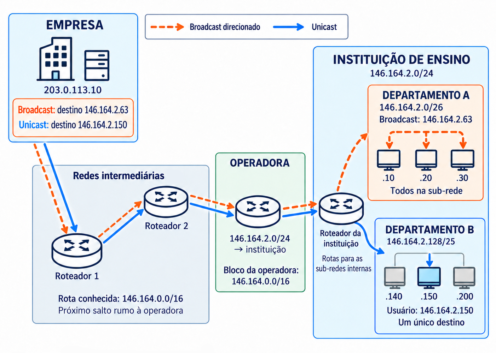

# 04. Camada de Rede

## Função da Camada de Rede:

Enquanto a camada de enlace realiza a comunicação local entre dispositivos (adjacentes), a camada de rede permite que a informação trafegue da origem até o destino através de redes interligadas e dispositivos intermediários. 

Esse processo envolve duas funções principais:

- **Roteamento:** Define os caminhos até os destinos, conforme os critérios utilizados pela rede. É a parte que organiza as informações sobre as rotas disponíveis.
- **Encaminhamento (Comutação):** É a ação prática: o equipamento recebe um pacote, consulta as informações de encaminhamento e o repassa pela saída correspondente ao próximo salto.

> No modelo Internet, o **IP** oferece esse serviço sem garantir a entrega ou a ordem de chegada dos pacotes.

## Comutação:

Permite que dispositivos se comuniquem através de equipamentos intermediários, sem exigir uma conexão direta entre as extremidades.

<br>
*Fonte: MAIA, Luiz Paulo. Arquitetura de Redes de Computadores, 2ª ed., 2013, p. 261.*

<br>
*Fonte: MAIA, Luiz Paulo. Arquitetura de Redes de Computadores, 2ª ed., 2013, p. 262.*

Nos diagramas de camadas, os roteadores executam apenas até a Camada de Rede porque esse é o nível necessário ao encaminhamento IP básico. É como um centro de distribuição dos correios: basta consultar o endereço no envelope, sem interpretar o conteúdo da carta. 

> O equipamento pode executar outras funções de camadas superiores, mas elas não são necessárias para esse encaminhamento.

### Comutação por Circuito:

Estabelece um caminho entre a origem e o destino antes da transmissão. Esse **circuito** mantém recursos reservados para a comunicação até seu encerramento. O processo ocorre em três etapas:

1. **Alocação do circuito:** Estabelece-se o caminho e reservam-se os recursos necessários.
2. **Troca de dados:** A informação é transmitida pelo circuito estabelecido.
3. **Liberação do circuito:** A conexão é encerrada e os recursos ficam disponíveis para outras comunicações.

> Funciona como uma ligação telefônica tradicional: primeiro disca-se e estabelece-se a chamada; depois ocorre a conversa; ao desligar, o circuito é liberado. Durante a ligação, a capacidade reservada permanece ocupada mesmo nos momentos de silêncio.

<br>
*Fonte: MAIA, Luiz Paulo. Arquitetura de Redes de Computadores, 2ª ed., 2013, p. 263.*

- **Caminho predefinido:** Os dados seguem pelo circuito estabelecido, simplificando seu encaminhamento durante a transmissão.
- **Reserva de recursos:** O circuito fica dedicada àquela comunicação. O mesmo enlace físico pode atender vários circuitos por multiplexação, cada um com sua parcela reservada.
- **Ociosidade:** Se houver pouco tráfego ou períodos de silêncio, a reserva permanece sem ser aproveitada por outras comunicações (gerando filas de esperar se não houver recursos disponíveis).
- **Dependência do circuito:** Uma falha no caminho pode interromper a comunicação e exigir seu restabelecimento. Isso não significa que todos os dados já recebidos sejam perdidos; a forma de retomar a transferência depende dos mecanismos utilizados.

### Comutação por Pacotes:

Organiza os dados em pequenos blocos chamados **pacotes**, encaminhados pelos equipamentos intermediários até o destino. Uma mensagem maior pode ser dividida em vários pacotes, e os enlaces são compartilhados por diferentes comunicações.

<br>
*Fonte: MAIA, Luiz Paulo. Arquitetura de Redes de Computadores, 2ª ed., 2013, p. 265.*

- **Compartilhamento:** Pacotes de vários dispositivos utilizam a mesma infraestrutura, aproveitando os intervalos em que outras comunicações não estão transmitindo.
- **Uso sob demanda:** Funciona sem reserva de capacidade. Os recursos de transmissão são utilizados conforme há pacotes para enviar (menor ociosidade em relação aos circuitos dedicados).
- **Recuperação por partes:** A divisão permite a implementação de mecanismos de recuperação que retransmitam partes perdidas, sem necessariamente reenviar toda a mensagem.
- **Processamento por pacote:** Cada equipamento precisa interpretar informações de controle para encaminhar os pacotes. O compartilhamento melhora o aproveitamento da rede, mas acrescenta trabalho em relação ao circuito já estabelecido.

## Implementações da Comutação por Pacotes:

### Datagrama (Serviço Não Orientado a Conexão):

**Cada pacote é tratado de forma independente**, sem estabelecer previamente uma conexão na camada de rede. O equipamento consulta o endereço de destino e suas informações de encaminhamento para decidir o próximo salto. É o modelo utilizado pelo IP na Internet.

- **Caminhos independentes:** Pacotes de uma mesma comunicação podem seguir rotas diferentes, mas não precisam mudar de caminho a cada envio (pode haver um reaproveitamento de rota para evitar o recálculo do zero).
- **Adaptação a falhas:** Havendo caminhos alternativos e atualização das rotas, novos pacotes podem contornar um equipamento ou enlace defeituoso. A recuperação não é necessariamente imediata.
- **Entrega e ordem:** No serviço oferecido pelo IP, pacotes podem se perder ou chegar fora de ordem. Retransmissão e reorganização dependem de outros mecanismos, como os oferecidos pelo TCP, já apresentado na camada de transporte.

### Circuito Virtual (Serviço Orientado a Conexão):

Estabelece um caminho lógico antes do envio dos dados. Os pacotes seguem esse caminho, e os equipamentos intermediários utilizam um **identificador do circuito** para consultar o encaminhamento correspondente.  Esse modelo é aplicado em Redes ATM (*Asynchronous Transfer Mode*), por exemplo.

- **Caminho estabelecido:** A escolha do percurso é feita previamente. Ainda existe processamento por pacote, mas o encaminhamento utiliza as associações do circuito, em vez de tratar cada destino de forma independente.
- **Compartilhamento:** Continua sendo comutação por pacotes: diferentes circuitos virtuais podem compartilhar os mesmos enlaces físicos (não reserva capacidade exclusiva - menos desperdício).
- **Entrega e ordem:** Ajuda na ordenação, mas um circuito virtual não garante, por si só, que todos os pacotes sejam entregues e em sequência. Essas garantias dependem do serviço implementado.
- **Dependência do caminho:** Uma falha pode interromper os circuitos que passam pelo trecho afetado e exigir o estabelecimento de novos caminhos. Isso não implica necessariamente reiniciar toda a transferência de dados.

## Endereçamento:

Permite identificar as interfaces de rede e orientar o encaminhamento até o destino. No modelo Internet, utiliza-se um identificador lógico chamado **endereço IP** (*Internet Protocol*). Um dispositivo com várias interfaces pode ter endereços distintos associados a elas.

O cabeçalho do pacote IP contém os **endereços de origem e destino**. O destino orienta o encaminhamento do pacote pela rede; a origem informa de onde ele partiu e pode ser utilizada pelo destinatário para enviar uma resposta.

Nem todo endereço é globalmente único: endereços privados podem ser reutilizados em redes diferentes. A identificação precisa ser válida no contexto em que o endereço é utilizado.

- **IPv4:** Possui **32 *bits***, permitindo $2^{32}$ combinações. Sua representação decimal utiliza quatro blocos de 8 *bits*, separados por pontos, com valores entre 0 e 255 (como `192.168.0.1`).
- **IPv6:** Possui **128 *bits***, permitindo $2^{128}$ combinações. A ampliação do espaço de endereçamento combate diretamente a limitação de endereços do IPv4. 

> Um IPv6 normalmente aparece na sua forma resumida, como `fe80::70db:aa5b:82c0:622c`. Os dois pontos juntos indicam o ocultamento de uma cadeia de zeros. Então, o endereço completo é na verdade `fe80:0000:0000:0000:70db:aa5b:82c0:622c`.

### Endereço Físico (MAC) e Endereço Lógico (IP):

- **MAC:** É utilizado no enlace para identificar interfaces na comunicação local. A interface normalmente possui um endereço atribuído pelo fabricante, mas o endereço efetivamente utilizado pode ser alterado por configuração ou aleatorização do sistema.
- **IP:** É utilizado no endereçamento lógico e no encaminhamento entre redes. Sua configuração deve corresponder à rede de conexão, podendo ser feita manualmente ou por mecanismos automáticos.

> Ao levar um notebook de casa para uma cafeteria, a configuração IP é adequada à nova rede. O MAC pode permanecer igual, mas também pode mudar por mecanismos de privacidade. O valor numérico do IP não precisa ser diferente, pois as duas redes podem utilizar a mesma faixa privada.

## Endereçamento Hierárquico:

Se fosse necessário manter uma rota individual para cada interface da Internet, as tabelas seriam muito maiores e mais difíceis de atualizar. O endereçamento hierárquico permite agrupar destinos, dividindo o endereço em duas partes:

- **Identificador de Rede (*NetID*):** Identifica a rede à qual a interface pertence.
- **Identificador de *Host* (*HostID*):** Distingue a interface dentro dessa rede.

> É semelhante a um endereço postal: a informação sobre uma cidade permite encaminhar correspondências para muitos endereços sem conhecer cada casa individualmente. Na rede, um prefixo pode representar vários destinos em uma única entrada de encaminhamento.

### Máscara e Prefixo de Rede:

O endereço IPv4 identifica a interface, mas, sozinho, não informa onde termina a parte de rede e começa a parte de *host*. Essa divisão é indicada pela **máscara de rede**, formada por *bits* 1 consecutivos para a rede, seguidos de *bits* 0 para o *host*.

Por exemplo, a máscara `255.255.255.0` corresponde a 24 *bits* 1 e 8 *bits* 0. No endereço `146.164.2.70`, ela indica que `146.164.2` identifica a rede e o último bloco identifica o *host* dentro dela.

A mesma divisão pode ser escrita como **comprimento do prefixo**: `146.164.2.70/24`. O número após a barra informa quantos *bits* pertencem à rede. Em IPv4, ele pode variar de 0 a 32.

- **Na máquina:** O endereço IP e a máscara são configurados na interface, manualmente ou por mecanismos como DHCP. Essa configuração permite identificar a rede diretamente conectada.
- **No roteador:** Além da configuração de suas interfaces, existem rotas com prefixos e indicações de encaminhamento. Cada rota pode representar um bloco de tamanho diferente.

> A máscara não é enviada junto do endereço no cabeçalho de cada pacote IPv4. O pacote contém o IP de destino; os equipamentos utilizam as configurações e rotas que conhecem para decidir como encaminhá-lo.

Para obter o endereço da rede, aplica-se **AND *bit* a *bit*** entre o IP e a máscara:

- ***Bit* 1 na máscara:** Preserva o *bit* correspondente do IP.
- ***Bit* 0 na máscara:** Zera o *bit* correspondente do IP.

Assim, `146.164.2.70 AND 255.255.255.0 = 146.164.2.0`. A operação identifica a rede correspondente àquela máscara; a decisão de encaminhamento utiliza esse resultado junto das informações disponíveis na tabela de rotas.

### Endereços de Rede, de *Host* e de *Broadcast*:

Definida a divisão entre rede e *host*, os valores da parte de *host* determinam a função de cada endereço. Nas sub-redes IPv4 convencionais com *broadcast*:

- **Todos os *bits* de *host* em zero:** Identificam a própria rede.
- **Todos os *bits* de *host* em um:** Formam o endereço de *broadcast*, utilizado para destinar uma transmissão a todas as interfaces daquela sub-rede.
- **Valores intermediários:** Podem ser atribuídos às interfaces, respeitando outras reservas aplicáveis.

Na rede `146.164.2.0/24`, o endereço da rede é `146.164.2.0`, o de *broadcast* é `146.164.2.255` e o intervalo utilizável vai de `146.164.2.1` a `146.164.2.254`.

Os finais `.0` e `.255` resultam dessa divisão específica. **A máscara determina a parte de host**, que pode ocupar mais ou menos que os últimos oito *bits*.

> Em enlaces ponto a ponto com prefixo `/31`, os dois endereços são utilizados pelas extremidades. A reserva de rede e *broadcast* descrita acima se aplica às sub-redes convencionais com *broadcast*.

### Sub-redes:

O **subendereçamento** divide um bloco em blocos menores. Para isso, amplia-se o prefixo usando parte dos *bits* antes destinados aos *hosts*. Esses *bits* passam a distinguir as sub-redes, reduzindo a quantidade de endereços dentro de cada uma.

Por exemplo, o bloco `146.164.2.0/24` possui oito *bits* para *hosts*. Ao utilizar dois deles para subdivisão, formam-se $2^2 = 4$ sub-redes `/26`, cada uma com seis *bits* para *hosts*.

Cada sub-rede terá $2^6 = 64$ endereços. Descontando rede e *broadcast*, restam **62 endereços para interfaces**:

| Sub-rede | Intervalo Utilizável | Broadcast |
| --- | --- | --- |
| `146.164.2.0/26` | `146.164.2.1` - `146.164.2.62` | `146.164.2.63` |
| `146.164.2.64/26` | `146.164.2.65` - `146.164.2.126` | `146.164.2.127` |
| `146.164.2.128/26` | `146.164.2.129` - `146.164.2.190` | `146.164.2.191` |
| `146.164.2.192/26` | `146.164.2.193` - `146.164.2.254` | `146.164.2.255` |

A máscara `/26` corresponde a `255.255.255.192`. Aplicando-a ao endereço `146.164.2.70`, obtém-se a sub-rede `146.164.2.64`. No último bloco, a operação é:

```
IP:       01000110  (70)
Máscara:  11000000  (192)
AND:      01000000  (64)
```

Os dois primeiros *bits* desse bloco distinguem as quatro sub-redes; os seis restantes identificam os *hosts*. Quanto maior o prefixo, menor será o bloco de endereços.

A divisão permite organizar setores e distribuir melhor os endereços. Quando as sub-redes correspondem a segmentos de enlace separados, como VLANs diferentes, também há separação dos seus domínios de *broadcast*.

> Subendereçamento não depende do modelo por classes: ele foi utilizado nesse modelo e continua sendo utilizado com CIDR. É uma divisão do bloco disponível. Apenas configurar faixas IP diferentes no mesmo enlace não separa os domínios de *broadcast*.

### Encaminhamento Dentro e Fora da Rede:

A divisão em sub-redes tem uma consequência prática: a máquina precisa distinguir os destinos acessíveis diretamente daqueles que exigem um roteador.

Considere uma máquina configurada como `146.164.2.70/26`, pertencente à sub-rede `146.164.2.64/26`. Na configuração comum:

- **Destino `146.164.2.100`:** Está na mesma sub-rede. A máquina pode enviar pelo enlace local, sem passar por um roteador.
- **Destino `146.164.2.130`:** Está em outra sub-rede, `146.164.2.128/26`. A máquina encaminha o pacote ao seu *gateway*, que deve estar acessível na rede local.

Essa distinção pode ser obtida aplicando a máscara ao IP da própria máquina e ao destino: resultados iguais indicam a mesma sub-rede. Para destinos externos, a tabela de rotas indica o próximo salto; na ausência de uma rota mais específica, pode ser utilizado o *gateway* padrão.

O roteador recebe o pacote e consulta sua própria tabela. Cada entrada associa um **prefixo de destino** a uma saída ou próximo salto. Se várias entradas corresponderem ao destino, utiliza-se a de **prefixo mais longo**, pois ela representa o grupo mais específico.

> Uma rota `/26` é mais específica que uma `/24` que a contém. A escolha depende das rotas presentes na tabela, não de uma máscara enviada pela máquina de origem.

Cada roteador conhece os caminhos necessários à sua função. Um equipamento externo pode conhecer apenas uma rota para a instituição, enquanto os equipamentos internos conhecem suas divisões. Não é necessário haver um “subprovedor” para cada sub-rede: os próprios roteadores da instituição podem fazer esse encaminhamento, e um único equipamento pode atender várias sub-redes.

## Endereçamento por Classes (*Classful*):

Nesse modelo, os primeiros *bits* do endereço determinavam a divisão básica entre rede e *host*. As classes A, B e C ofereciam três tamanhos de rede; D e E tinham outras finalidades.

| Classe | Bits Iniciais | Faixa de Endereços              | Divisão ou Finalidade                                                                            |
| ------ | ------------- | ------------------------------- | ------------------------------------------------------------------------------------------------ |
| **A**  | `0`           | `0.0.0.0` a `127.255.255.255`   | 8 *bits* para rede e 24 para *host*.                                                             |
| **B**  | `10`          | `128.0.0.0` a `191.255.255.255` | 16 *bits* para rede e 16 para *host*.                                                            |
| **C**  | `110`         | `192.0.0.0` a `223.255.255.255` | 24 *bits* para rede e 8 para *host*.                                                             |
| **D**  | `1110`        | `224.0.0.0` a `239.255.255.255` | Endereçamento de grupos (*multicast*).                                                           |
| **E**  | `1111`        | `240.0.0.0` a `255.255.255.255` | Faixa historicamente reservada para usos futuros e experimentais, com endereços de uso especial. |

> Os *bits* iniciais das classes A, B e C já estão incluídos nos tamanhos da parte de rede. As faixas também contêm endereços especiais que não podem ser atribuídos normalmente às interfaces.

O endereço `146.164.2.70`, por exemplo, pertence à antiga classe B. Sua rede básica seria `146.164.0.0`, com máscara `255.255.0.0` (`/16`). A instituição poderia subdividir esse bloco usando máscaras mais longas, como `/24` e `/26`.

No esquema histórico, as redes externas podiam encaminhar para a rede classe B como um todo, enquanto a instituição utilizava as máscaras de sub-rede para distribuir o tráfego internamente. Portanto, **as máscaras permitiam subdividir a rede recebida, mas não eliminavam a rigidez dos tamanhos atribuídos pelas classes**.

Uma organização com cerca de 500 interfaces ilustra o problema: uma classe C, com 254 endereços utilizáveis, seria insuficiente; uma classe B, com 65.534, reservaria muito mais endereços que o necessário. Dividir a classe B em departamentos organizaria o espaço, mas não reduziria o bloco originalmente reservado à organização.

Outra possibilidade seria receber vários blocos classe C. Isso reduziria a sobra, mas aumentaria a quantidade de redes que precisavam ser representadas nas tabelas de roteamento. O modelo enfrentava, assim, **desperdício de endereços e crescimento das tabelas**.

## Endereçamento Sem Classes (CIDR):

O **CIDR** (*Classless Inter-Domain Routing*) permite distribuir e anunciar blocos com comprimentos de prefixo explícitos, sem limitar a divisão aos tamanhos das classes A, B e C. A identificação da rede passa a depender do prefixo informado, em vez de ser deduzida da classe do endereço.

Uma rede convencional `/23`, por exemplo, possui nove *bits* para *hosts*: são $2^9 = 512$ endereços, dos quais 510 são utilizáveis. Esse tamanho pode atender ao exemplo das 500 interfaces sem reservar uma classe B inteira.

O CIDR também permite **agregar rotas**: blocos contíguos e corretamente alinhados podem ser representados por um prefixo que abrange todos eles, quando o encaminhamento permitir. Assim, uma rota externa pode representar várias redes internas.

- **Distribuição mais flexível:** Os blocos podem ser dimensionados mais próximos da necessidade, embora continuem seguindo potências de dois.
- **Prefixos explícitos:** As informações de roteamento identificam o bloco e seu comprimento de prefixo, permitindo trabalhar com tamanhos diferentes.
- **Agregação:** Reduz a necessidade de divulgar cada divisão interna separadamente.

> O CIDR não criou as máscaras nem o subendereçamento. Ele retirou a obrigatoriedade das classes na alocação e no roteamento entre redes, permitindo aplicar a organização por prefixos de forma mais flexível.

### VLSM e Subdivisões Sucessivas:

O **VLSM** (*Variable Length Subnet Masking*) permite utilizar máscaras de comprimentos diferentes nas subdivisões de um bloco. Assim, setores com necessidades distintas podem receber quantidades diferentes de endereços.

No exemplo de `146.164.2.0/24`, em vez de criar quatro sub-redes iguais, seria possível manter `146.164.2.0/26` e `146.164.2.64/26`, com 62 endereços utilizáveis cada, e destinar a metade restante a `146.164.2.128/25`, com 126.

“Comprimento variável” significa que as sub-redes podem ter tamanhos diferentes. A máscara continua definida para cada configuração; ela não muda automaticamente a cada pacote.

Também é possível subdividir um bloco que já resultou de outra divisão. Uma instituição pode organizar `146.164.0.0/16` em setores `/24` e subdividir um desses setores em redes `/26`. A máscara identifica o prefixo completo até o nível utilizado; ela não registra separadamente os nomes ou as funções administrativas de cada divisão.

Para um pacote destinado à máquina `146.164.2.70/26`, uma organização possível seria:

| Equipamento                      | Rota Conhecida no Exemplo | Encaminhamento                                |
| -------------------------------- | ------------------------- | --------------------------------------------- |
| Roteador externo                 | `146.164.0.0/16`          | Em direção à instituição.                     |
| Roteador da instituição          | `146.164.2.0/24`          | Em direção ao setor.                          |
| Roteador que atende a subdivisão | `146.164.2.64/26`         | Para a rede local que contém a máquina `.70`. |

O endereço de destino do pacote continua sendo `146.164.2.70`. O que varia é o nível de detalhe das rotas utilizadas para alcançá-lo. Essa organização não exige três equipamentos distintos: um roteador pode conhecer vários desses blocos.

As divisões internas podem permanecer representadas externamente por um prefixo agregado, desde que ele encaminhe corretamente o tráfego. Essa visibilidade depende das rotas divulgadas; uma sub-rede não fica automaticamente escondida por ser uma subdivisão.

> O VLSM organiza a distribuição de tamanhos dentro de um bloco; o CIDR permite tratar blocos e rotas sem depender das classes, inclusive entre organizações. Ambos utilizam prefixos para representar conjuntos de endereços.

<br>
*Fonte: Elaborado pelo autor com auxílio do ChatGPT, 2026.*

## Endereçamento Estático e Dinâmico:

- **Estático:** O endereço permanece configurado na interface até ser alterado, normalmente por configuração manual. Exige controle dos endereços utilizados: atribuir o mesmo IP a duas interfaces que precisam ser distintas na mesma rede pode causar um conflito.
- **Dinâmico:** No IPv4, normalmente utiliza **DHCP** (*Dynamic *Host* Configuration Protocol*). O cliente solicita uma configuração e recebe um endereço por um período de concessão, que pode ser renovado. O endereço pode mudar em outra conexão, mas isso não é obrigatório.

O endereçamento dinâmico facilita a administração e a mobilidade: ao conectar-se a outra rede, o dispositivo pode receber uma configuração compatível com ela, sem intervenção manual. Endereços cuja concessão termina podem ser reutilizados pelo servidor.

> Servidores, impressoras, câmeras e roteadores podem precisar de um endereço estável para facilitar seu acesso. Além da configuração estática, quando aplicável, uma **reserva no DHCP** permite entregar sempre o mesmo endereço a um cliente identificado.

> Ao executar `ip a` no terminal Linux (no Windows, `ipconfig /all`), é possível consultar os endereços IPv4 e IPv6 e suas informações de máscara ou prefixo. No Linux, `ip -4 route` e `ip -6 route` mostram as rotas IPv4 e IPv6: quais redes são alcançadas por cada interface e próximo salto. A entrada `default` é utilizada quando não existe uma rota mais específica para o destino.
