# 04. Camada de Rede

## Função da Camada de Rede:

Enquanto a camada de enlace realiza a comunicação local entre dispositivos adjacentes, a camada de rede permite que a informação trafegue da origem até o destino através de redes interligadas e dispositivos intermediários. Esse processo envolve duas funções principais:

- **Roteamento:** Define os caminhos até os destinos e organiza as informações sobre as rotas disponíveis, conforme os critérios utilizados pela rede.
- **Encaminhamento (Comutação):** É a ação prática: o equipamento recebe um pacote, consulta as informações de encaminhamento e o repassa pela saída correspondente ao **próximo salto**, o próximo equipamento que o receberá no trajeto.

> No modelo Internet, o **IP** (*Internet Protocol*) oferece esse serviço sem garantir a entrega ou a ordem de chegada dos pacotes.

## Comutação:

Permite que dispositivos se comuniquem através de equipamentos intermediários, sem exigir uma conexão direta entre as extremidades.

<br>
*Fonte: MAIA, Luiz Paulo. Arquitetura de Redes de Computadores, 2ª ed., 2013, p. 261.*

<br>
*Fonte: MAIA, Luiz Paulo. Arquitetura de Redes de Computadores, 2ª ed., 2013, p. 262.*

Nos diagramas de camadas, os roteadores executam apenas até a Camada de Rede porque esse é o nível necessário ao encaminhamento IP básico. É como um centro de distribuição dos correios: basta consultar o endereço no envelope, sem interpretar o conteúdo da carta.

> O equipamento pode executar outras funções de camadas superiores, mas elas não são necessárias para esse encaminhamento.

### Comutação por Circuito:

Estabelece um caminho entre a origem e o destino antes da transmissão. Esse **circuito** mantém recursos reservados para a comunicação até seu encerramento. O processo ocorre em três etapas:

1. **Alocação do circuito:** Estabelece-se o caminho e reservam-se os recursos necessários.
2. **Troca de dados:** A informação é transmitida pelo circuito estabelecido.
3. **Liberação do circuito:** A conexão é encerrada e os recursos ficam disponíveis para outras comunicações.

> Funciona como uma ligação telefônica tradicional: primeiro disca-se e estabelece-se a chamada; depois ocorre a conversa; ao desligar, o circuito é liberado.

<br>
*Fonte: MAIA, Luiz Paulo. Arquitetura de Redes de Computadores, 2ª ed., 2013, p. 263.*

- **Caminho predefinido:** Os dados seguem pelo circuito estabelecido, simplificando seu encaminhamento durante a transmissão.
- **Reserva e ociosidade:** A capacidade reservada fica indisponível para outras comunicações mesmo nos períodos de silêncio. Um enlace físico pode atender vários circuitos por multiplexação, cada um com sua parcela reservada.
- **Dependência do circuito:** Uma falha no caminho pode interromper a comunicação e exigir seu restabelecimento, sem necessariamente perder os dados já recebidos.

### Comutação por Pacotes:

Organiza os dados em pequenos blocos chamados **pacotes**, encaminhados pelos equipamentos intermediários até o destino. Uma mensagem maior pode ser dividida em vários pacotes, e os enlaces são compartilhados por diferentes comunicações.

<br>
*Fonte: MAIA, Luiz Paulo. Arquitetura de Redes de Computadores, 2ª ed., 2013, p. 265.*

- **Compartilhamento sob demanda:** Pacotes de várias comunicações utilizam a infraestrutura conforme há dados para enviar, aproveitando os intervalos de ociosidade. Esse funcionamento não exige reserva fixa de capacidade, embora determinados serviços possam reservar recursos.
- **Recuperação por partes:** A divisão permite implementar mecanismos que retransmitam partes perdidas, sem necessariamente reenviar toda a mensagem. A divisão em pacotes, sozinha, não realiza essa recuperação.
- **Processamento por pacote:** Cada equipamento interpreta informações de controle para decidir o encaminhamento. O compartilhamento melhora o aproveitamento da rede, mas também pode provocar espera quando vários pacotes disputam uma saída.

## Implementações da Comutação por Pacotes:

### Datagrama (Serviço Não Orientado a Conexão):

**Cada pacote é tratado de forma independente**, sem estabelecer previamente uma conexão na camada de rede. O equipamento consulta o endereço de destino e suas informações de encaminhamento para decidir o próximo salto. É o modelo utilizado pelo IP na Internet.

- **Caminhos independentes:** Pacotes da mesma comunicação podem seguir rotas diferentes, sem exigir mudança de caminho a cada envio. O encaminhamento consulta informações já disponíveis, em vez de calcular uma rota completa por pacote.
- **Adaptação a falhas:** Havendo caminhos alternativos e atualização das rotas, novos pacotes podem contornar um equipamento ou enlace defeituoso. A recuperação não é necessariamente imediata.
- **Entrega e ordem:** No serviço IP, pacotes podem se perder ou chegar fora de ordem. Retransmissão e reorganização dependem de outros mecanismos, como os oferecidos pelo TCP, apresentado no modelo de camadas.

### Circuito Virtual (Serviço Orientado a Conexão):

Estabelece um caminho lógico antes do envio dos dados. Os pacotes seguem esse caminho, e os equipamentos intermediários utilizam um **identificador do circuito** para consultar o encaminhamento correspondente. Esse modelo é aplicado em redes ATM (*Asynchronous Transfer Mode*), por exemplo.

- **Caminho estabelecido:** O percurso é escolhido previamente. Ainda existe processamento por pacote, mas o encaminhamento utiliza as associações do circuito.
- **Compartilhamento:** Diferentes circuitos virtuais podem compartilhar os enlaces físicos. A existência de reserva de capacidade depende do serviço, não apenas de ser um circuito virtual.
- **Entrega e ordem:** O caminho comum favorece a manutenção da ordem, mas as garantias de entrega e ordenação dependem do serviço implementado.
- **Dependência do caminho:** Uma falha pode interromper os circuitos afetados e exigir novos caminhos, sem necessariamente reiniciar toda a transferência.

## Endereçamento:

Permite identificar as interfaces de rede e orientar o encaminhamento até o destino. No modelo Internet, utiliza-se um identificador lógico chamado **endereço IP**. Um dispositivo com várias interfaces pode ter endereços distintos associados a elas.

O cabeçalho IP contém os **endereços de origem e destino**. O destino orienta o encaminhamento; a origem identifica de onde o pacote partiu e permite endereçar uma resposta. A identificação vale dentro do seu contexto: endereços privados, por exemplo, podem ser reutilizados em redes independentes.

- **IPv4:** Possui **32 *bits***, permitindo `2^32` combinações. Sua representação decimal utiliza quatro blocos de 8 *bits*, separados por pontos, com valores entre 0 e 255 (como `192.168.0.1`).
- **IPv6:** Possui **128 *bits***, permitindo `2^128` combinações. A ampliação do espaço de endereçamento combate diretamente a limitação de endereços do IPv4. Sua representação utiliza oito grupos hexadecimais, separados por dois-pontos.

> Um IPv6 pode aparecer resumido, como `fe80::70db:aa5b:82c0:622c`. O `::` substitui grupos zerados: o endereço completo é `fe80:0000:0000:0000:70db:aa5b:82c0:622c`. Essa substituição pode aparecer uma única vez no endereço.

Os cálculos de máscaras, sub-redes e faixas de endereços apresentados a seguir se concentram no **IPv4**. Mecanismos específicos dessa versão, como ARP e endereçamento de *broadcast*, não devem ser estendidos automaticamente ao IPv6.

### Endereço Físico (MAC) e Endereço Lógico (IP):

- **MAC:** Identifica interfaces na comunicação pelo enlace local. Como visto na camada de enlace, o endereço utilizado pode ser alterado por configuração ou aleatorização do sistema.
- **IP:** Identifica interfaces no contexto lógico da rede e orienta o encaminhamento entre redes. Sua configuração deve corresponder à rede de conexão, podendo ser manual ou automática.

> Ao levar um notebook de casa para uma cafeteria, a configuração IP é adequada à nova rede. O MAC permanece igual (ou pode mudar por mecanismos de privacidade). O valor numérico do IP também pode coincidir, pois as duas redes podem utilizar a mesma faixa privada.

### Endereçamento Estático e Dinâmico:

- **Estático:** O endereço permanece configurado na interface até ser alterado, normalmente por configuração manual. Exige controle dos endereços utilizados: atribuir o mesmo IP a interfaces que precisam ser distintas na mesma rede pode causar um conflito.
- **Dinâmico:** No IPv4, normalmente utiliza **DHCP** (*Dynamic Host Configuration Protocol*). O cliente solicita uma configuração e recebe um endereço por um período de concessão, que pode ser renovado. O endereço pode mudar em outra conexão, mas isso não é obrigatório.

O endereçamento dinâmico facilita a administração e a mobilidade, permitindo receber uma configuração compatível ao mudar de rede. Endereços com concessões encerradas podem ser reutilizados pelo servidor.

> Servidores, impressoras, câmeras e roteadores podem precisar de um endereço estável para facilitar seu acesso. Além da configuração estática, uma **reserva no DHCP** permite entregar o mesmo endereço a um cliente identificado.

> Ao executar `ip a` no terminal Linux (no Windows, `ipconfig /all`), é possível consultar os endereços IPv4 e IPv6 e suas informações de máscara ou prefixo, explicadas a seguir.

## Endereçamento Hierárquico:

Se fosse necessário manter uma rota individual para cada interface da Internet, as tabelas seriam muito maiores e mais difíceis de atualizar. O endereçamento hierárquico permite agrupar destinos, dividindo o endereço em duas partes:

- **Identificador de Rede (*NetID*):** Identifica a rede à qual a interface pertence.
- **Identificador de Host (*HostID*):** Distingue a interface dentro dessa rede.

> É semelhante a um endereço postal: a informação sobre uma cidade permite encaminhar correspondências para muitos endereços sem conhecer cada casa individualmente. Na rede, um prefixo pode representar vários destinos em uma única entrada de encaminhamento.

### Máscara e Prefixo de Rede:

O endereço IPv4 identifica a interface, mas, sozinho, não informa onde termina a parte de rede e começa a parte de *host*. Essa divisão é indicada pela **máscara de rede**, formada por *bits* 1 consecutivos para a rede, seguidos de *bits* 0 para o *host*.

Por exemplo, a máscara `255.255.255.0` corresponde a 24 *bits* 1 e 8 *bits* 0. No endereço `146.164.2.70`, ela indica que `146.164.2` identifica a rede e o último bloco identifica o *host* dentro dela.

A mesma divisão pode ser escrita como **comprimento do prefixo**: `146.164.2.70/24`. O número após a barra informa quantos *bits* pertencem à rede. Em IPv4, ele pode variar de 0 a 32.

- **Na máquina:** O endereço IP e a máscara são configurados na interface, manualmente ou por mecanismos como DHCP. Essa configuração permite identificar a rede diretamente conectada.
- **No roteador:** Além da configuração de suas interfaces, existem rotas com prefixos e indicações de encaminhamento. Cada rota pode representar um bloco de tamanho diferente.

> A máscara não é enviada junto do endereço no cabeçalho de cada pacote IPv4. O pacote contém o IP de destino; os equipamentos utilizam as configurações e rotas que conhecem para decidir como encaminhá-lo.

Para obter o endereço da rede, aplica-se **AND *bit* a *bit*** entre o IP e a máscara:

- **Bit 1 na máscara:** Preserva o *bit* correspondente do IP.
- **Bit 0 na máscara:** Zera o *bit* correspondente do IP.

Assim, `146.164.2.70 AND 255.255.255.0 = 146.164.2.0`, identificando a rede correspondente àquela máscara.

### Endereços de Rede, de Host e de *Broadcast*:

Definida a divisão entre rede e *host*, os valores da parte de *host* determinam a função de cada endereço. Nas sub-redes IPv4 convencionais com *broadcast*:

- **Todos os *bits* de *host* em zero:** Identificam a própria rede.
- **Todos os *bits* de *host* em um:** Formam o endereço de *broadcast*, utilizado para destinar uma transmissão a todas as interfaces daquela sub-rede.
- **Valores intermediários:** Podem ser atribuídos às interfaces, respeitando outras reservas aplicáveis.

Na rede `146.164.2.0/24`, o endereço da rede é `146.164.2.0`, o de *broadcast* é `146.164.2.255` e o intervalo utilizável vai de `146.164.2.1` a `146.164.2.254`.

Os finais `.0` e `.255` resultam dessa divisão específica. **A máscara determina a parte de *host***, que pode ocupar mais ou menos que os últimos oito *bits*.

> Em enlaces ponto a ponto com prefixo `/31`, os dois endereços são utilizados pelas extremidades. A reserva de rede e *broadcast* descrita acima se aplica às sub-redes convencionais com *broadcast*.

### Sub-redes:

O **subendereçamento** divide um bloco em blocos menores. Para isso, amplia-se o prefixo usando parte dos *bits* antes destinados aos *hosts*. Esses *bits* passam a distinguir as sub-redes, reduzindo a quantidade de endereços dentro de cada uma.

Por exemplo, o bloco `146.164.2.0/24` possui oito *bits* para *hosts*. Ao utilizar dois deles para subdivisão, formam-se `2^2 = 4` sub-redes `/26`, cada uma com seis *bits* para *hosts*.

Cada sub-rede terá `2^6 = 64` endereços. Descontando rede e *broadcast*, restam **62 endereços para interfaces**:

| Sub-rede | Intervalo Utilizável | *Broadcast* |
| --- | --- | --- |
| `146.164.2.0/26` | `146.164.2.1` - `146.164.2.62` | `146.164.2.63` |
| `146.164.2.64/26` | `146.164.2.65` - `146.164.2.126` | `146.164.2.127` |
| `146.164.2.128/26` | `146.164.2.129` - `146.164.2.190` | `146.164.2.191` |
| `146.164.2.192/26` | `146.164.2.193` - `146.164.2.254` | `146.164.2.255` |

A máscara `/26` corresponde a `255.255.255.192`. Aplicando-a ao endereço `146.164.2.70`, obtém-se a sub-rede `146.164.2.64`. No último bloco, a operação é:

```text
IP:       01000110  (70)
Máscara:  11000000  (192)
AND:      01000000  (64)
```

Os dois primeiros *bits* desse bloco distinguem as quatro sub-redes; os seis restantes identificam os *hosts*. Quanto maior o prefixo, menor será o bloco de endereços.

A divisão permite organizar setores e distribuir melhor os endereços. Quando as sub-redes correspondem a segmentos de enlace separados, como VLANs diferentes, também há separação dos seus domínios de *broadcast*.

> Apenas configurar faixas IP diferentes no mesmo enlace não separa os domínios de *broadcast*. Essa separação depende também da organização da camada de enlace, apresentada no apêndice de redes locais.

## Endereçamento por Classes (*Classful*):

Nesse modelo histórico, os primeiros *bits* do endereço determinavam a divisão básica entre rede e *host*. As classes A, B e C ofereciam três tamanhos de rede; D e E tinham outras finalidades.

| Classe | Bits Iniciais | Faixa de Endereços | Divisão ou Finalidade |
| --- | --- | --- | --- |
| **A** | `0` | `0.0.0.0` a `127.255.255.255` | 8 *bits* para rede e 24 para *host*. |
| **B** | `10` | `128.0.0.0` a `191.255.255.255` | 16 *bits* para rede e 16 para *host*. |
| **C** | `110` | `192.0.0.0` a `223.255.255.255` | 24 *bits* para rede e 8 para *host*. |
| **D** | `1110` | `224.0.0.0` a `239.255.255.255` | Endereçamento de grupos (*multicast*). |
| **E** | `1111` | `240.0.0.0` a `255.255.255.255` | Faixa historicamente reservada para usos futuros e experimentais, com endereços de uso especial. |

> Os *bits* iniciais das classes A, B e C já estão incluídos nos tamanhos da parte de rede. As faixas também contêm endereços especiais que não podem ser atribuídos normalmente às interfaces.

O endereço `146.164.2.70`, por exemplo, pertence à antiga classe B. Sua rede básica seria `146.164.0.0`, com máscara `255.255.0.0` (`/16`). A instituição poderia subdividir esse bloco usando máscaras mais longas, como `/24` e `/26`.

No esquema histórico, as redes externas podiam encaminhar para a rede classe B como um todo, enquanto a instituição utilizava as máscaras de sub-rede para distribuir o tráfego internamente. As máscaras permitiam subdividir a rede recebida, mas **não eliminavam a rigidez dos tamanhos atribuídos pelas classes**.

Uma organização com cerca de 500 interfaces ilustra o problema: uma classe C, com 254 endereços utilizáveis, seria insuficiente; uma classe B, com 65.534, reservaria muito mais endereços que o necessário. Subdividir a classe B organizaria o espaço, mas não reduziria o bloco originalmente reservado à organização.

Outra possibilidade seria receber vários blocos classe C. Isso reduziria a sobra, mas aumentaria a quantidade de redes representadas nas tabelas de roteamento. O modelo enfrentava, assim, **desperdício de endereços e crescimento das tabelas**.

## Endereçamento Sem Classes (CIDR):

O **CIDR** (*Classless Inter-Domain Routing*) permite distribuir e anunciar blocos com comprimentos de prefixo explícitos, sem limitar a divisão aos tamanhos das classes A, B e C. A identificação da rede depende do prefixo informado, em vez de ser deduzida da classe do endereço.

Uma rede convencional `/23`, por exemplo, possui nove *bits* para *hosts*: são `2^9 = 512` endereços, dos quais 510 são utilizáveis. Esse tamanho pode atender ao exemplo das 500 interfaces sem reservar uma classe B inteira.

> O CIDR não criou as máscaras nem o subendereçamento. Ele retirou a obrigatoriedade das classes na alocação e no roteamento entre redes. Subdividir blocos continua sendo possível nesse modelo.

### VLSM e Subdivisões Sucessivas:

O **VLSM** (*Variable Length Subnet Masking*) permite utilizar máscaras de comprimentos diferentes nas subdivisões de um bloco. Assim, setores com necessidades distintas podem receber quantidades diferentes de endereços.

No exemplo de `146.164.2.0/24`, em vez de criar quatro sub-redes iguais, seria possível manter `146.164.2.0/26` e `146.164.2.64/26`, com 62 endereços utilizáveis cada, e destinar a metade restante a `146.164.2.128/25`, com 126.

Também é possível subdividir um bloco que já resultou de outra divisão: uma instituição pode organizar `146.164.0.0/16` em setores `/24` e subdividir um desses setores em redes `/26`. A máscara identifica o prefixo completo utilizado, sem registrar separadamente as funções administrativas de cada divisão.

> “Comprimento variável” significa que as sub-redes podem ter tamanhos diferentes; a máscara não muda automaticamente a cada pacote. O **VLSM** organiza os tamanhos dentro de um bloco; o **CIDR** permite distribuir e anunciar blocos sem depender das classes, inclusive agregando rotas.

### Agregação de Rotas:

Blocos contíguos e corretamente alinhados podem ser representados por um prefixo que abrange todos eles, quando o encaminhamento permitir. Assim, uma rota externa pode representar várias redes internas, reduzindo a necessidade de divulgar cada divisão separadamente.

Para um pacote destinado à máquina `146.164.2.70/26`, uma organização possível seria:

| Equipamento | Rota Conhecida no Exemplo | Encaminhamento |
| --- | --- | --- |
| Roteador externo | `146.164.0.0/16` | Em direção à instituição. |
| Roteador da instituição | `146.164.2.0/24` | Em direção ao setor. |
| Roteador que atende a subdivisão | `146.164.2.64/26` | Para a rede local que contém a máquina `.70`. |

O destino continua sendo `146.164.2.70`; varia o detalhamento das rotas utilizadas. Um mesmo roteador pode conhecer vários desses blocos. A representação externa depende das rotas divulgadas, não apenas de existir uma subdivisão.

<br>
*Fonte: Elaborado pelo autor com auxílio do ChatGPT, 2026.*

## Mapeamento de Endereços:

O IP identifica o destino na camada de rede, mas a entrega em um enlace *Ethernet* utiliza um quadro com endereços MAC. O **mapeamento de endereços** associa o IP de um dispositivo acessível no enlace local ao seu MAC, permitindo realizar essa entrega.

### Mapeamento Estático:

Mantém associações entre IP e MAC configuradas manualmente, apenas para as entradas necessárias. Permite controlar associações específicas, mas exige acompanhar mudanças de endereços ou equipamentos. O trabalho cresce com a quantidade de entradas, e uma associação desatualizada pode impedir a entrega correta.

### Mapeamento Dinâmico - ARP:

O **ARP** (*Address Resolution Protocol*) descobre essas associações sob demanda no IPv4 em enlaces como *Ethernet*. Antes de perguntar, o dispositivo consulta sua tabela de vizinhos; se já houver uma associação válida, pode utilizá-la.

Quando precisa resolver um endereço, envia uma solicitação ARP em *broadcast*, perguntando “Qual MAC corresponde ao IP X?”. É como um grito para os dispositivos daquele enlace. Na situação comum, o dispositivo com aquele IP responde diretamente ao solicitante, informando seu MAC. A solicitação fica restrita ao enlace local.

> As associações aprendidas ficam temporariamente em uma tabela de vizinhos (*cache*), evitando repetir a pergunta a cada pacote. No Linux, `ip neigh` permite consultá-la; no Windows, `arp -a` mostra as entradas ARP. O IPv6 utiliza outro mecanismo de descoberta de vizinhos, não o ARP.

## Encaminhamento de Pacotes:

O **encaminhamento** determina por onde enviar o pacote. A máquina consulta suas rotas para escolher a **interface de rede**, conexão física ou lógica pela qual envia e recebe dados, e o próximo salto. Em um enlace *Ethernet*, utiliza então o mapeamento de endereços para obter o MAC desse próximo salto.

### Dentro e Fora da Sub-rede:

Considere uma máquina configurada como `146.164.2.70/26`, pertencente à sub-rede `146.164.2.64/26`. Na configuração comum:

- **Destino `146.164.2.100`:** Está na mesma sub-rede. A máquina resolve o MAC do próprio destino e envia pelo enlace local, sem passar por um roteador.
- **Destino `146.164.2.130`:** Está em outra sub-rede, `146.164.2.128/26`. A máquina resolve o MAC do roteador escolhido como próximo salto e entrega o pacote a ele, não procura o MAC do destino remoto.

Essa distinção pode ser obtida aplicando a máscara ao IP da própria máquina e ao destino: resultados iguais indicam a mesma sub-rede. A decisão efetiva considera as rotas configuradas, inclusive rotas mais específicas quando existirem.

Cada roteador consulta sua própria tabela para determinar a saída seguinte, até que o pacote alcance a rede do destino e possa ser entregue localmente. A organização e a origem dessas rotas serão detalhadas em **Roteamento**.

O **quadro** é endereçado ao próximo salto local, enquanto o **pacote IP** identifica o destino final. Em um encaminhamento comum, sem tradução de endereços, o IP de destino é preservado, mas o quadro é substituído conforme o pacote passa de um enlace para outro.

## NAT:

A passagem de pacotes entre redes também pode envolver a tradução de endereços IP. Um uso comum é permitir o acesso à Internet por dispositivos com endereços privados, reduzindo a necessidade de endereços públicos.

O IPv4 possui aproximadamente 4,3 bilhões de combinações (`2^32`), das quais nem todas estão disponíveis para atribuição comum. O crescimento das redes e a quantidade de dispositivos conectados pressionaram esse espaço limitado.

> **A reserva de faixas privadas e o NAT são mecanismos distintos**, utilizados em conjunto nesse cenário.

### Endereços Públicos e Privados:

- **Públicos:** São globalmente únicos no contexto de sua atribuição e utilizáveis no roteamento da Internet. O acesso ao dispositivo ainda depende das rotas e das regras de filtragem.
- **Privados:** Destinam-se ao uso interno e não são encaminhados como destinos globais pela Internet pública. Podem ser reutilizados em redes independentes, mas precisam ser coordenados entre redes interligadas para evitar conflitos.

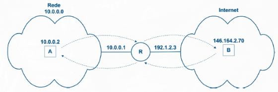<br>
*Fonte: MAIA, Luiz Paulo. Arquitetura de Redes de Computadores, 2ª ed., 2013, p. 288.*

As faixas privadas do IPv4 são:

| Bloco | Intervalo de Endereços |
| --- | --- |
| `10.0.0.0/8` | `10.0.0.0` a `10.255.255.255` |
| `172.16.0.0/12` | `172.16.0.0` a `172.31.255.255` |
| `192.168.0.0/16` | `192.168.0.0` a `192.168.255.255` |

> Os prefixos indicam o tamanho desses blocos, que podem ser subdivididos; eles não equivalem a uma única rede das antigas classes A, B e C.

### Tradução de Endereços e Portas:

O **NAT** (*Network Address Translation*) altera endereços IP na passagem entre redes. No caso comum de acesso à Internet, o equipamento substitui o endereço privado de origem por um endereço público e mantém as associações necessárias para traduzir o tráfego de retorno.

Quando vários dispositivos compartilham um mesmo IPv4 público utilizando também as portas TCP ou UDP, o mecanismo é chamado **NAPT** (*Network Address Port Translation*), também conhecido como **PAT** (*Port Address Translation*).

As **portas**, apresentadas no modelo de camadas, distinguem comunicações entre aplicações. O tradutor associa endereços, portas e protocolo, podendo trocar a porta de origem para diferenciar comunicações. Na resposta, essa associação recupera o endereço e a porta internos; a porta não identifica permanentemente um aparelho.

> O NAT básico traduz endereços; o NAPT/PAT também utiliza portas. No uso cotidiano, “NAT” frequentemente designa esse segundo funcionamento. A tradução não substitui um *firewall*: traduzir endereços e decidir quais comunicações são permitidas são funções diferentes.

## Roteamento:

O **roteamento** organiza e atualiza as rotas; o **encaminhamento** consulta essas informações para enviar cada pacote ao próximo salto.

### Funções e Tipos de Roteadores:

O roteador interliga redes e encaminha pacotes entre elas. Pode ser implementado em equipamentos de dois tipos:

- **Especializados:** Projetados para redes, podem acelerar o encaminhamento com chips dedicados; o cálculo das rotas pode continuar em *software*.
- **De uso geral:** Computadores configurados como roteadores, por exemplo, com Linux. Suas interfaces podem ser físicas ou lógicas.

> Roteadores separam domínios de *broadcast* de enlace. Também podem oferecer NAT, DHCP e *firewall*, mas esses serviços são opcionais. O desempenho depende dos recursos e das funções executadas.

### Tabela de Rotas e Prefixo Mais Longo:

Cada entrada da **tabela de rotas** associa um prefixo de destino à interface de saída e, quando necessário, ao próximo roteador. Entre entradas compatíveis, utiliza-se a de **prefixo mais longo**, por ser a mais específica.

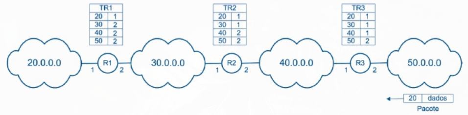<br>
*Fonte: MAIA, Luiz Paulo. Arquitetura de Redes de Computadores, 2ª ed., 2013, p. 291.*

Para `146.164.2.70`, a rota `146.164.2.64/26` tem precedência sobre `146.164.2.0/24`, pois representa um grupo menor de endereços que contém o destino.

> A seleção utiliza os prefixos da tabela, não uma máscara enviada pela máquina de origem.

### Rota Padrão e Gateway Padrão:

A **rota padrão** (*default route*) atende aos destinos sem rota mais específica. No IPv4, `0.0.0.0/0` corresponde a qualquer endereço, com a menor especificidade possível. O ***gateway* padrão** é o próximo roteador indicado por essa rota, quando necessário.

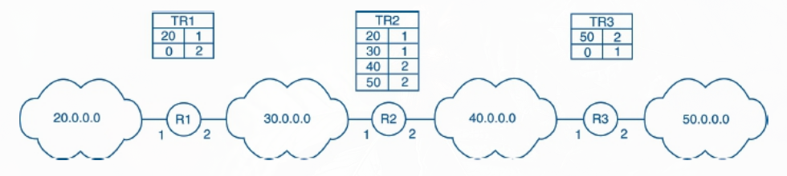<br>
*Fonte: MAIA, Luiz Paulo. Arquitetura de Redes de Computadores, 2ª ed., 2013, p. 292.*

Na figura, os números identificam redes; tabelas IPv4 reais utilizam prefixos. Nem todo roteador possui rota padrão: **sem rota aplicável, o pacote é descartado**.

> No Linux, `ip -4 route` e `ip -6 route` mostram as rotas IPv4 e IPv6. `default` identifica a rota padrão; `via`, o próximo roteador; e `dev`, a interface de saída.

### Origem e Atualização das Rotas:

As rotas podem ter três origens:

- **Redes diretamente conectadas:** Identificadas pela configuração das interfaces e alcançadas pelo próprio enlace.
- **Rotas estáticas:** Configuradas pelo administrador, incluindo uma rota padrão quando necessária.
- **Rotas dinâmicas:** Aprendidas e atualizadas por protocolos de roteamento.

Essas origens podem coexistir. As atualizações dinâmicas podem ser periódicas ou provocadas por mudanças na rede.

> Endereçamento estático/dinâmico trata da configuração dos endereços; roteamento estático/dinâmico, da origem e atualização das rotas.

### Algoritmos, Protocolos e Métricas:

O **protocolo** estabelece a troca de informações; o **algoritmo** avalia os caminhos e permite selecionar as rotas. As **métricas** medem características usadas nessa comparação:

- **Número de saltos (*Hop Count*):** Quantidade de saltos até o destino. Menos saltos não significa necessariamente menor atraso.
- **Taxa de transmissão e carga:** Capacidade do enlace e sua utilização, respectivamente; um enlace rápido também pode estar congestionado.
- **Atraso (latência):** Tempo associado à passagem dos dados pelo enlace ou caminho.
- **Taxa de erro:** Ocorrência de erros na transmissão.
- **Disponibilidade:** Continuidade de funcionamento, considerando as interrupções.
- **Custo:** Valor configurado ou calculado a partir de uma ou mais características; não precisa representar dinheiro.

O melhor caminho depende das métricas e políticas adotadas. Cada algoritmo utiliza critérios específicos, sem necessariamente medir todas as condições do tráfego.

### Características Desejáveis dos Algoritmos:

Um algoritmo deve equilibrar a qualidade das rotas e o trabalho para mantê-las:

- **Seleção de caminhos:** Escolher rotas adequadas às métricas e políticas.
- **Convergência:** Estabilizar as informações rapidamente após mudanças.
- **Robustez:** Lidar com falhas e informações desatualizadas sem instabilidade persistente.
- **Escalabilidade:** Continuar viável com o crescimento da rede.
- **Consumo de recursos:** Limitar processamento, memória e tráfego de controle.

### Classificações dos Algoritmos:

Os critérios podem ser combinados: um cálculo distribuído, por exemplo, pode utilizar um mapa global da topologia.

| Critério | Alternativas |
| --- | --- |
| **Atualização** | **Estático ou dinâmico**, conforme a origem e a atualização das rotas apresentadas anteriormente. |
| **Estrutura** | **Plano:** organização sem uma divisão hierárquica do domínio de roteamento. **Hierárquico:** organização em domínios ou áreas, limitando o detalhamento necessário em cada parte. |
| **Informação disponível** | **Local ou parcial:** utiliza informações recebidas dos vizinhos, sem precisar conhecer toda a topologia. **Global:** utiliza um mapa da topologia do domínio considerado. |
| **Local do cálculo** | **Centralizado:** uma entidade concentra o cálculo das rotas. **Distribuído:** os roteadores participam desse cálculo e trocam informações entre si. |

> A centralização também permite atualizar rotas; não exige uma rede imutável.

Quanto à entrega, distinguem-se *unicast* (um destinatário), *broadcast* (todos em um âmbito definido) e *multicast* (um grupo).

### Roteamento por Vetor de Distância:

Cada roteador divulga aos vizinhos os destinos conhecidos e seus custos. O **vetor de distância** dispensa um mapa completo: calcula o custo de uma rota somando o custo até o vizinho ao valor anunciado por ele.

> É como consultar vizinhos sobre destinos e distâncias, sem receber a descrição de todo o percurso.

1. **Conhecimento inicial:** Identifica redes diretamente conectadas e rotas configuradas.
2. **Troca:** Envia e recebe anúncios dos vizinhos, conforme o protocolo.
3. **Cálculo:** Soma o custo até o vizinho ao custo anunciado; com custo unitário, acrescenta `1`.
4. **Atualização:** Inclui destinos e adota alternativas melhores. Anúncios do vizinho usado pela rota atual também podem indicar pioras ou perda de acesso.

Nos exemplos, **Caminho** indica o enlace de saída e **Custo**, o custo total até o destino. Cada enlace tem custo `1`.

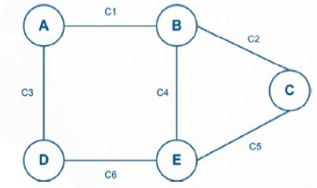<br>
*Fonte: MAIA, Luiz Paulo. Arquitetura de Redes de Computadores, 2ª ed., 2013, p. 301.*

**T0 - Inicialização:** Cada roteador conhece apenas a si mesmo, com custo zero.

| Roteador | Destino | Caminho | Custo |
|---|---|---|---|
| **A** | A | - | 0 |
| **B** | B | - | 0 |
| **C** | C | - | 0 |
| **D** | D | - | 0 |
| **E** | E | - | 0 |

**T1 - Identificação dos Vizinhos:** São incluídos os vizinhos diretamente conectados, com custo 1.

| Roteador | Destino | Caminho | Custo |
|---|---|---|---|
| **A** | A | - | 0 |
| | B | C1 | 1 |
| | D | C3 | 1 |
| **B** | B | - | 0 |
| | A | C1 | 1 |
| | C | C2 | 1 |
| | E | C4 | 1 |
| **C** | C | - | 0 |
| | B | C2 | 1 |
| | E | C5 | 1 |
| **D** | D | - | 0 |
| | A | C3 | 1 |
| | E | C6 | 1 |
| **E** | E | - | 0 |
| | B | C4 | 1 |
| | C | C5 | 1 |
| | D | C6 | 1 |

**T2 - Primeira Troca de Vetores:** Os anúncios dos vizinhos permitem descobrir destinos indiretos.

| Roteador | Destino | Caminho | Custo |
|---|---|---|---|
| **A** | A | - | 0 |
| | B | C1 | 1 |
| | D | C3 | 1 |
| | C | C1 | 2 |
| | E | C1 | 2 |
| **B** | B | - | 0 |
| | A | C1 | 1 |
| | C | C2 | 1 |
| | E | C4 | 1 |
| | D | C1 | 2 |
| **C** | C | - | 0 |
| | B | C2 | 1 |
| | E | C5 | 1 |
| | A | C2 | 2 |
| | D | C5 | 2 |
| **D** | D | - | 0 |
| | A | C3 | 1 |
| | E | C6 | 1 |
| | B | C3 | 2 |
| | C | C6 | 2 |
| **E** | E | - | 0 |
| | B | C4 | 1 |
| | C | C5 | 1 |
| | D | C6 | 1 |
| | A | C4 | 2 |

**T3 - Convergência:** Os menores custos foram encontrados; novas trocas não alteram as tabelas.

> A pode alcançar E por C1 (A - B - E) ou C3 (A - D - E), ambos com custo 2. A escolha depende do desempate adotado.

Ao detectar uma falha, diretamente ou por ausência de atualizações, o roteador **invalida as rotas afetadas** e pode anunciá-las com custo **infinito** (inalcançável). Os vizinhos atualizam suas rotas e procuram alternativas, quando disponíveis.

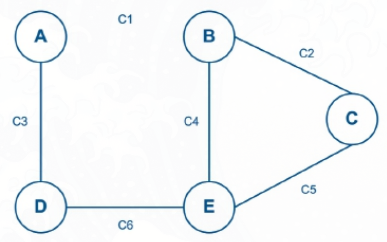<br>
*Fonte: MAIA, Luiz Paulo. Arquitetura de Redes de Computadores, 2ª ed., 2013, p. 305.*

**T0 - Detecção da Falha:** Apenas A e B detectam a falha em C1 e invalidam as rotas dependentes desse enlace.

| Roteador | Destino | Caminho | Custo |
|---|---|---|---|
| **A** | A | - | 0 |
| | B | C1 | $\infty$ |
| | D | C3 | 1 |
| | C | C1 | $\infty$ |
| | E | C1 | $\infty$ |
| **B** | B | - | 0 |
| | A | C1 | $\infty$ |
| | C | C2 | 1 |
| | E | C4 | 1 |
| | D | C1 | $\infty$ |
| **C** | C | - | 0 |
| | B | C2 | 1 |
| | E | C5 | 1 |
| | A | C2 | 2 |
| | D | C5 | 2 |
| **D** | D | - | 0 |
| | A | C3 | 1 |
| | E | C6 | 1 |
| | B | C3 | 2 |
| | C | C6 | 2 |
| **E** | E | - | 0 |
| | B | C4 | 1 |
| | C | C5 | 1 |
| | D | C6 | 1 |
| | A | C4 | 2 |

**T1 - Propagação da Falha:** A informação chega aos demais roteadores, que invalidam as rotas afetadas.

| Roteador | Destino | Caminho | Custo |
|---|---|---|---|
| **A** | A | - | 0 |
| | B | C1 | $\infty$ |
| | D | C3 | 1 |
| | C | C1 | $\infty$ |
| | E | C1 | $\infty$ |
| **B** | B | - | 0 |
| | A | C1 | $\infty$ |
| | C | C2 | 1 |
| | E | C4 | 1 |
| | D | C1 | $\infty$ |
| **C** | C | - | 0 |
| | B | C2 | 1 |
| | E | C5 | 1 |
| | A | C2 | $\infty$ |
| | D | C5 | 2 |
| **D** | D | - | 0 |
| | A | C3 | 1 |
| | E | C6 | 1 |
| | B | C3 | $\infty$ |
| | C | C6 | 2 |
| **E** | E | - | 0 |
| | B | C4 | 1 |
| | C | C5 | 1 |
| | D | C6 | 1 |
| | A | C4 | $\infty$ |

**T2 - Descoberta de Caminhos Alternativos:** Novas trocas revelam alternativas, mas ainda restam destinos considerados inalcançáveis.

| Roteador | Destino | Caminho | Custo |
|---|---|---|---|
| **A** | A | - | 0 |
| | B | C1 | $\infty$ |
| | D | C3 | 1 |
| | C | C3 | 3 |
| | E | C3 | 2 |
| **B** | B | - | 0 |
| | A | C1 | $\infty$ |
| | C | C2 | 1 |
| | E | C4 | 1 |
| | D | C4 | 2 |
| **C** | C | - | 0 |
| | B | C2 | 1 |
| | E | C5 | 1 |
| | A | C2 | $\infty$ |
| | D | C5 | 2 |
| **D** | D | - | 0 |
| | A | C3 | 1 |
| | E | C6 | 1 |
| | B | C6 | 2 |
| | C | C6 | 2 |
| **E** | E | - | 0 |
| | B | C4 | 1 |
| | C | C5 | 1 |
| | D | C6 | 1 |
| | A | C6 | 2 |

**T3 - Convergência:** Todos os roteadores encontram os menores custos disponíveis sem utilizar C1.

| Roteador | Destino | Caminho | Custo |
|---|---|---|---|
| **A** | A | - | 0 |
| | B | C3 | 3 |
| | D | C3 | 1 |
| | C | C3 | 3 |
| | E | C3 | 2 |
| **B** | B | - | 0 |
| | A | C4 | 3 |
| | C | C2 | 1 |
| | E | C4 | 1 |
| | D | C4 | 2 |
| **C** | C | - | 0 |
| | B | C2 | 1 |
| | E | C5 | 1 |
| | A | C5 | 3 |
| | D | C5 | 2 |
| **D** | D | - | 0 |
| | A | C3 | 1 |
| | E | C6 | 1 |
| | B | C6 | 2 |
| | C | C6 | 2 |
| **E** | E | - | 0 |
| | B | C4 | 1 |
| | C | C5 | 1 |
| | D | C6 | 1 |
| | A | C6 | 2 |

> As etapas são didáticas. Na prática, as atualizações são assíncronas, e sua sequência depende dos anúncios recebidos e dos mecanismos de prevenção de ciclos.

O cálculo é simples, mas informações antigas podem causar convergência lenta e *loops* temporários.

### Roteamento por Estado do Enlace:

No **estado do enlace**, cada roteador conhece a topologia do domínio considerado, enquanto o vetor de distância trabalha com destinos e custos anunciados pelos vizinhos. O funcionamento envolve:

1. **Conhecimento local:** Identifica vizinhos e custos dos enlaces.
2. **Divulgação:** Propaga anúncios pelo domínio; identificadores e números de sequência permitem reconhecer repetições e informações antigas.
3. **Construção do mapa:** Reúne os anúncios em uma base local, sincronizada com as dos participantes da mesma área.
4. **Cálculo:** Determina os caminhos de menor custo a partir de si mesmo, por exemplo, com **Dijkstra**, e registra os próximos saltos.

> O mapa é comum, mas cada roteador mantém sua cópia e calcula suas rotas. Não existe uma tabela central consultada por todos.

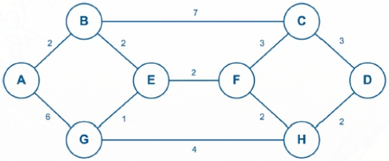<br>
*Fonte: MAIA, Luiz Paulo. Arquitetura de Redes de Computadores, 2ª ed., 2013, p. 308.*

**T0 - Identificação dos Enlaces:** Cada roteador registra seus vizinhos e os custos dos enlaces.

| Roteador | Vizinho | Custo |
|---|---|---|
| **A** | B | 2 |
| | G | 6 |
| **B** | A | 2 |
| | C | 7 |
| | E | 2 |
| **C** | B | 7 |
| | D | 3 |
| | F | 3 |
| **D** | C | 3 |
| | H | 2 |
| **E** | B | 2 |
| | F | 2 |
| | G | 1 |
| **F** | C | 3 |
| | E | 2 |
| | H | 2 |
| **G** | A | 6 |
| | E | 1 |
| | H | 4 |
| **H** | D | 2 |
| | F | 2 |
| | G | 4 |

**T1 - Topologia Compartilhada:** Os anúncios permitem que cada roteador monte sua própria cópia da topologia apresentada.

| De | Para | Custo |
|---|---|---|
| A | B | 2 |
| A | G | 6 |
| B | A | 2 |
| B | C | 7 |
| B | E | 2 |
| C | B | 7 |
| C | D | 3 |
| C | F | 3 |
| D | C | 3 |
| D | H | 2 |
| E | B | 2 |
| E | F | 2 |
| E | G | 1 |
| F | C | 3 |
| F | E | 2 |
| F | H | 2 |
| G | A | 6 |
| G | E | 1 |
| G | H | 4 |
| H | D | 2 |
| H | F | 2 |
| H | G | 4 |

A **árvore de caminhos mínimos** tem o próprio roteador na raiz. É uma seleção lógica: os enlaces fora dela permanecem disponíveis para outros caminhos. Para A, o resultado é:

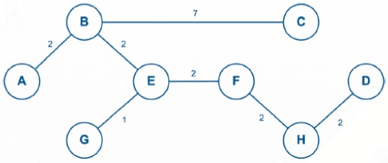<br>
*Fonte: MAIA, Luiz Paulo. Arquitetura de Redes de Computadores, 2ª ed., 2013, p. 310.*

Mudanças são divulgadas e provocam o recálculo das rotas afetadas, sem exigir sempre uma reconstrução completa. Manter o mapa e calcular caminhos consome memória e processamento; durante a convergência, ainda podem ocorrer *loops* temporários.

### Roteamento Hierárquico e Sistemas Autônomos:

O **roteamento hierárquico** limita o detalhamento das informações ao organizar a rede em domínios. Um **Sistema Autônomo (AS)** reúne redes e roteadores sob uma administração com política de roteamento definida.

- **Roteamento interno:** Estabelece caminhos dentro do AS, com detalhamento conforme o protocolo e suas áreas.
- **Roteamento externo:** Troca informações de alcance entre AS, considerando políticas de interconexão.
- **Roteadores de borda:** Interligam o AS a outros. Rotas externas ou uma rota padrão orientam o tráfego até a saída.

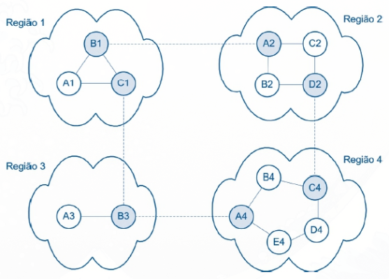<br>
*Fonte: MAIA, Luiz Paulo. Arquitetura de Redes de Computadores, 2ª ed., 2013, p. 317.*

**Tabela de A1:**

| Destino | Caminho | Custo |
|---|---|---|
| A1 | - | 0 |
| B1 | B1 | 1 |
| C1 | C1 | 1 |
| R2 | B1 | 2 |
| R3 | C1 | 2 |
| R4 | C1 | 3 |

> Um AS não equivale a qualquer sub-rede nem a uma única rota. Pode ter divisões internas, e seus roteadores podem conhecer rotas externas.

## *Broadcast*:

Envia a mesma informação a todos os participantes de um âmbito definido, evitando transmissões individuais para cada destinatário (economia massiva de banda, já que os pacotes não são copiados e enviados como mensagens separadas).

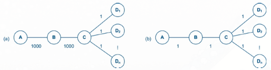<br>
*Fonte: MAIA, Luiz Paulo. Arquitetura de Redes de Computadores, 2ª ed., 2013, p. 318.*

> A difusão em uma sub-rede IPv4 e a distribuição por uma topologia de roteadores têm funcionamentos distintos.
### *Broadcast* Limitado e Direcionado:

- **Limitado (`255.255.255.255`):** Alcança a rede local, por difusão no enlace. Os roteadores não o encaminham para outras redes.
- **Direcionado:** Utiliza o endereço de *broadcast* da sub-rede, como `192.168.10.255` para `192.168.10.0/24` (*bits* de *host* em um). Se permitido, pode chegar de outra rede e ser difundido no enlace final.

> O *broadcast* direcionado recebido de outra rede é bloqueado por padrão nos roteadores, devido ao risco de abuso. Os modelos de distribuição seguintes não representam um serviço automático de *broadcast* pela Internet.

### Inundação (*Flooding*):

Cada roteador replica a mensagem pelas saídas participantes, exceto pela interface de chegada.

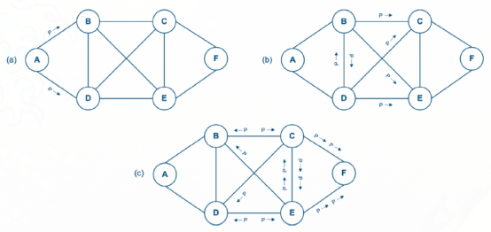<br>
*Fonte: MAIA, Luiz Paulo. Arquitetura de Redes de Computadores, 2ª ed., 2013, p. 318.*

Esse método alcança os nós conectados, mas permite cópias repetidas e *loops* por outros caminhos. Dois mecanismos complementares limitam essa circulação:

- **Identificação e *cache*:** Registra mensagens recentes e descarta duplicatas, identificadas, por exemplo, pela origem e pelo número de sequência.
- **Limite de saltos:** Impede circulação indefinida. No IPv4, os roteadores reduzem o **TTL** (*Time to Live*) e descartam o pacote quando ele se esgota.

Ainda há gasto de banda com cópias descartadas adiante.

> O identificador de duplicatas depende do protocolo; não é necessariamente o campo de identificação do cabeçalho IPv4.

### Árvore de Cobertura (*Spanning Tree*):

Seleciona ligações que conectam todos os participantes **sem ciclos**, com um único caminho entre cada par de nós. A mensagem se divide nas bifurcações. Os enlaces excluídos continuam fisicamente disponíveis para outras comunicações.

- **Vantagem:** Reduz cópias redundantes.
- **Limitações:** Pode concentrar tráfego e produzir caminhos menos eficientes para alguns emissores. Uma falha na árvore pode exigir ajustes e interromper parte da distribuição, sem necessariamente recalcular tudo.

> Aqui, a árvore orienta a distribuição de pacotes. O STP, apresentado no apêndice de redes locais, aplica a ideia de ausência de ciclos ao encaminhamento por *switches*.

## *Multicast*:

Envia a mesma informação a um **grupo de destinatários**, replicando os pacotes onde os caminhos se separam. As árvores de distribuição podem ser específicas por origem ou compartilhadas entre emissores. Elas alcançam os receptores interessados e podem atravessar roteadores sem membros locais do grupo.

### Endereçamento de Grupo e IGMP:

No IPv4, utiliza `224.0.0.0/4` (`224.0.0.0` a `239.255.255.255`), a antiga classe D. O endereço identifica o **grupo**; cada interface conserva seu endereço individual.

> É como uma frequência de rádio: o emissor transmite para um grupo, como `224.1.1.1`, e os receptores interessados “sintonizam” a transmissão.

O **IGMP** (*Internet Group Management Protocol*) informa aos roteadores locais o interesse dos dispositivos nos grupos. O roteamento *multicast* organiza os caminhos entre essas redes.

- **Grupos permanentes:** Têm endereço atribuído permanentemente, mesmo sem membros ou transmissão ativa.
- **Grupos temporários:** Duram enquanto houver participantes. O IGMP informa a participação, mas não distribui endereços globalmente.

> Comum em IPTV e redes administradas, o *multicast* exige suporte e políticas compatíveis entre redes; o endereço de grupo não garante alcance pela Internet.

### Roteamento por Caminho Reverso (RPM):

O **RPM** (*Reverse Path Multicasting*) utiliza das tabelas de roteamento para identificar a origem da mensagem e descobrir se ela é repetida (para então poda-la), ou não (para reencaminhá-la). Sabendo a origem e o destino da mensagem, o roteador analisa a tabela de roteamento para saber se faz sentido a interface pela qual ela chegou:

- **Caminho ótimo:** Isso indica que a mensagem não podia ter chegado antes (*shortest path*), ou seja, a mensagem não é repetida. Dessa maneira, é realizado o encaminhamento adiante por todas as suas interfaces (menos a de entrada da informação).
- **Caminho não ótimo:** Como a informação veio de uma interface diferente da ótima (veio de um caminho paralelo ou é um possível *loop*) a mensagem já chegou àquele roteador antes. Como se trata de uma mensagem repetida, ela não é reencaminhada (é podada).

Ao final do processo, é possível obter criar a **árvore de cobertura de menor custo**, evitando *loops* na transmissão e garantindo o melhor caminho para alcançar os membros do *multicast* a partir do transmissor.

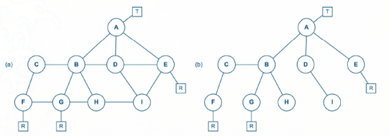<br>
*Fonte: MAIA, Luiz Paulo. Arquitetura de Redes de Computadores, 2ª ed., 2013, p. 322.*

Uma grande crítica desse modelo é que ele envia a informação para todos os roteadores (já que o único filtro é não ser uma informação repetida), causando desperdício de banda e podendo ocasionar na sobrecarga da rede.

> O teste segue as rotas conhecidas, sem garantir o menor percurso físico.

### Árvores Compartilhadas Baseadas em Núcleo (CBT):

No **CBT** (*Core Based Trees*), roteadores com receptores interessados solicitam associação em direção a um **núcleo** (arbitrário - não precisa ser o núcleo físico nem mesmo ser um integrante do *multicast*, mas sua escolha impacta na performance da rede), formando uma árvore única compartilhada pelo grupo. Os dados entram nessa árvore e seguem pelos ramos até os receptores. Sua estrutura é atualizada conforme os participantes entram ou saem.

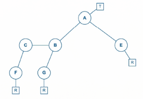<br>
*Fonte: MAIA, Luiz Paulo. Arquitetura de Redes de Computadores, 2ª ed., 2013, p. 322.*

- **Vantagem:** Evita a inundação inicial do domínio e compartilha a estrutura de distribuição entre emissores.
- **Limitações:** Pode produzir caminhos mais longos; a disponibilidade do núcleo e a concentração de tráfego precisam ser consideradas.

> Outros protocolos usam um ponto de encontro (*Rendezvous Point*, RP). A chegada dos dados à árvore e uma eventual mudança para caminhos por origem dependem do protocolo.

## Fontes:

- MAIA, Luiz Paulo. *Arquitetura de Redes de Computadores*. 2. ed. Rio de Janeiro: LTC, 2013.
- BRADEN, R. (ed.). *Requirements for Internet Hosts — Communication Layers*. RFC 1122. [S. l.]: RFC Editor, 1989. Disponível em: https://www.rfc-editor.org/rfc/rfc1122.html. Acesso em: 21 out. 2026.
- PLUMMER, D. C. *An Ethernet Address Resolution Protocol*. RFC 826. [S. l.]: RFC Editor, 1982. Disponível em: https://www.rfc-editor.org/rfc/rfc826.html. Acesso em: 21 out. 2026.
- REKHTER, Y. et al. *Address Allocation for Private Internets*. RFC 1918. [S. l.]: RFC Editor, 1996. Disponível em: https://www.rfc-editor.org/rfc/rfc1918.html. Acesso em: 21 out. 2026.
- SRISURESH, P.; EGEVANG, K. *Traditional IP Network Address Translator (Traditional NAT)*. RFC 3022. [S. l.]: RFC Editor, 2001. Disponível em: https://www.rfc-editor.org/rfc/rfc3022.html. Acesso em: 21 out. 2026.
- MALKIN, G. *RIP Version 2*. RFC 2453. [S. l.]: RFC Editor, 1998. Disponível em: https://datatracker.ietf.org/doc/rfc2453/. Acesso em: 21 out. 2026.
- HAWKINSON, J.; BATES, T. *Guidelines for Creation, Selection, and Registration of an Autonomous System (AS)*. RFC 1930. [S. l.]: RFC Editor, 1996. Disponível em: https://www.rfc-editor.org/rfc/rfc1930.html. Acesso em: 21 out. 2026.
- SENIE, D. *Changing the Default for Directed Broadcasts in Routers*. RFC 2644. [S. l.]: RFC Editor, 1999. Disponível em: https://www.rfc-editor.org/rfc/rfc2644.html. Acesso em: 21 out. 2026.
- DEERING, S. *Host Extensions for IP Multicasting*. RFC 1112. [S. l.]: RFC Editor, 1989. Disponível em: https://www.rfc-editor.org/rfc/rfc1112.html. Acesso em: 21 out. 2026.
- CISCO. *IP Multicast Technology Overview*. In: *IP Multicast Configuration Guide, Cisco IOS XE 17.x*. [S. l.]: Cisco, [s. d.]. Disponível em: https://www.cisco.com/c/en/us/td/docs/routers/ios/config/17-x/ip-multicast/b-ip-multicast/m_imc_tech_oview-0.html. Acesso em: 21 out. 2026.
