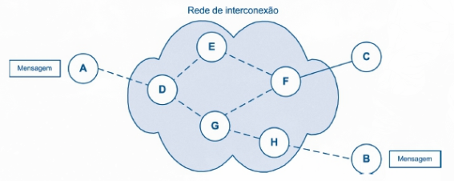
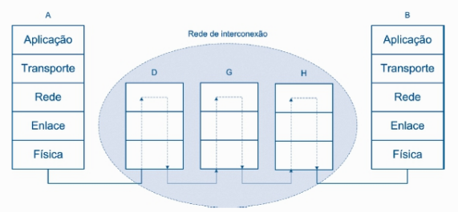
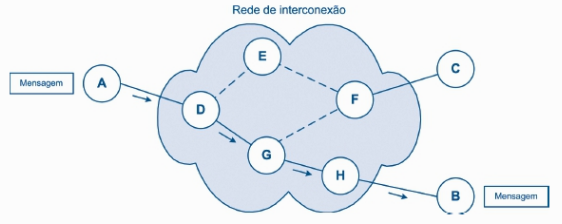
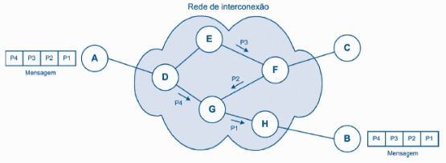

# 04. Camada de Rede

## Função da Camada de Rede:

Enquanto a camada de enlace realiza a comunicação local entre dispositivos (adjacentes), a camada de rede permite que a informação trafegue da origem até o destino através de redes interligadas e dispositivos intermediários. 

Esse processo envolve duas funções principais:

- **Roteamento:** Define os caminhos até os destinos, conforme os critérios utilizados pela rede. É a parte que organiza as informações sobre as rotas disponíveis.
- **Encaminhamento (Comutação):** É a ação prática: o equipamento recebe um pacote, consulta as informações de encaminhamento e o repassa pela saída correspondente ao próximo salto.

> No modelo Internet, o **IP** oferece esse serviço sem garantir a entrega ou a ordem de chegada dos pacotes.

## Comutação:

Permite que dispositivos se comuniquem através de equipamentos intermediários, sem exigir uma conexão direta entre as extremidades.

 
*Fonte: MAIA, Luiz Paulo. Arquitetura de Redes de Computadores, 2ª ed., 2013, p. 261.*

 
*Fonte: MAIA, Luiz Paulo. Arquitetura de Redes de Computadores, 2ª ed., 2013, p. 262.*

Nos diagramas de camadas, os roteadores executam apenas até a Camada de Rede porque esse é o nível necessário ao encaminhamento IP básico. É como um centro de distribuição dos correios: basta consultar o endereço no envelope, sem interpretar o conteúdo da carta. 

> O equipamento pode executar outras funções de camadas superiores, mas elas não são necessárias para esse encaminhamento.

### Comutação por Circuito:

Estabelece um caminho entre a origem e o destino antes da transmissão. Esse **circuito** mantém recursos reservados para a comunicação até seu encerramento. O processo ocorre em três etapas:

1. **Alocação do circuito:** Estabelece-se o caminho e reservam-se os recursos necessários.
2. **Troca de dados:** A informação é transmitida pelo circuito estabelecido.
3. **Liberação do circuito:** A conexão é encerrada e os recursos ficam disponíveis para outras comunicações.

> Funciona como uma ligação telefônica tradicional: primeiro disca-se e estabelece-se a chamada; depois ocorre a conversa; ao desligar, o circuito é liberado. Durante a ligação, a capacidade reservada permanece ocupada mesmo nos momentos de silêncio.

 
*Fonte: MAIA, Luiz Paulo. Arquitetura de Redes de Computadores, 2ª ed., 2013, p. 263.*

- **Caminho predefinido:** Os dados seguem pelo circuito estabelecido, simplificando seu encaminhamento durante a transmissão.
- **Reserva de recursos:** A capacidade atribuída ao circuito fica dedicada àquela comunicação. O mesmo enlace físico pode atender vários circuitos por multiplexação, cada um com sua parcela reservada.
- **Ociosidade:** Se houver pouco tráfego ou períodos de silêncio, a reserva permanece sem ser aproveitada por outras comunicações. Novas conexões podem ter de esperar se não houver recursos disponíveis.
- **Dependência do circuito:** Uma falha no caminho pode interromper a comunicação e exigir seu restabelecimento. Isso não significa que todos os dados já recebidos sejam perdidos; a forma de retomar a transferência depende dos mecanismos utilizados.

### Comutação por Pacotes:

Organiza os dados em pequenos blocos chamados **pacotes**, encaminhados pelos equipamentos intermediários até o destino. Uma mensagem maior pode ser dividida em vários pacotes, e os enlaces são compartilhados por diferentes comunicações.

 
*Fonte: MAIA, Luiz Paulo. Arquitetura de Redes de Computadores, 2ª ed., 2013, p. 265.*

- **Compartilhamento:** Pacotes de vários dispositivos utilizam a mesma infraestrutura, aproveitando os intervalos em que outras comunicações não estão transmitindo.
- **Uso sob demanda:** No funcionamento sem reserva de capacidade, os recursos de transmissão são utilizados conforme há pacotes para enviar, reduzindo a ociosidade característica dos circuitos dedicados.
- **Recuperação por partes:** A divisão permite que mecanismos de recuperação retransmitam partes perdidas, sem necessariamente reenviar toda a mensagem. A comutação por pacotes, sozinha, não realiza essa recuperação.
- **Processamento por pacote:** Cada equipamento precisa interpretar informações de controle para encaminhar os pacotes. O compartilhamento melhora o aproveitamento da rede, mas acrescenta trabalho em relação ao circuito já estabelecido.

## Implementações da Comutação por Pacotes:

### Datagrama (Serviço Não Orientado a Conexão):

**Cada pacote é tratado de forma independente**, sem estabelecer previamente uma conexão na camada de rede. O equipamento consulta o endereço de destino e suas informações de encaminhamento para decidir o próximo salto. É o modelo utilizado pelo IP na Internet.

- **Caminhos independentes:** Pacotes de uma mesma comunicação podem seguir rotas diferentes, mas não precisam mudar de caminho a cada envio. Consultar a rota de cada pacote não significa recalculá-la do zero.
- **Adaptação a falhas:** Havendo caminhos alternativos e atualização das rotas, novos pacotes podem contornar um equipamento ou enlace defeituoso. A recuperação não é necessariamente imediata.
- **Entrega e ordem:** No serviço oferecido pelo IP, pacotes podem se perder ou chegar fora de ordem. Retransmissão e reorganização dependem de outros mecanismos, como os oferecidos pelo TCP, já apresentado na camada de transporte.

### Circuito Virtual (Serviço Orientado a Conexão):

Estabelece um caminho lógico antes do envio dos dados. Os pacotes seguem esse caminho, e os equipamentos intermediários utilizam um **identificador do circuito** para consultar o encaminhamento correspondente. Redes ATM (*Asynchronous Transfer Mode*) são um exemplo de aplicação desse modelo.

- **Caminho estabelecido:** A escolha do percurso é feita previamente. Ainda existe processamento por pacote, mas o encaminhamento utiliza as associações do circuito, em vez de tratar cada destino de forma independente.
- **Compartilhamento:** Continua sendo comutação por pacotes: diferentes circuitos virtuais podem compartilhar os mesmos enlaces físicos. Estabelecer o circuito não implica, por si só, reservar capacidade exclusiva.
- **Entrega e ordem:** Seguir um circuito virtual não garante, por si só, que todos os pacotes sejam entregues e em sequência. Essas garantias dependem do serviço implementado.
- **Dependência do caminho:** Uma falha pode interromper os circuitos que passam pelo trecho afetado e exigir o estabelecimento de novos caminhos. Isso não implica necessariamente reiniciar toda a transferência de dados.

## Endereçamento:

Permite identificar as interfaces de rede e orientar o encaminhamento até o destino. No modelo Internet, utiliza-se um identificador lógico chamado **endereço IP** (*Internet Protocol*). Um dispositivo com várias interfaces pode ter endereços distintos associados a elas.

O cabeçalho do pacote IP contém os **endereços de origem e destino**. O destino orienta o encaminhamento do pacote pela rede; a origem informa de onde ele partiu e pode ser utilizada pelo destinatário para enviar uma resposta.

Nem todo endereço é globalmente único: endereços privados podem ser reutilizados em redes diferentes. A identificação precisa ser válida no contexto em que o endereço é utilizado.

- **IPv4:** Possui **32 *bits***, permitindo $2^{32}$ combinações. Sua representação decimal utiliza quatro blocos de 8 *bits*, separados por pontos, com valores entre 0 e 255, como `192.168.0.1`.
- **IPv6:** Possui **128 *bits***, permitindo $2^{128}$ combinações. A ampliação do espaço de endereçamento enfrenta a limitação de endereços do IPv4.

### Endereço Físico (MAC) e Endereço Lógico (IP):

- **MAC:** É utilizado no enlace para identificar interfaces na comunicação local. A interface normalmente possui um endereço atribuído pelo fabricante, mas o endereço efetivamente utilizado pode ser alterado por configuração ou aleatorização do sistema.
- **IP:** É utilizado no endereçamento lógico e no encaminhamento entre redes. Sua configuração deve corresponder à rede de conexão, podendo ser feita manualmente ou por mecanismos automáticos.

> Ao levar um notebook de casa para uma cafeteria, sua configuração IP precisa ser adequada à nova rede. O MAC pode permanecer igual, mas também pode mudar por mecanismos de privacidade. O valor numérico do IP não precisa ser diferente, pois as duas redes podem utilizar a mesma faixa privada.

### Endereçamento Hierárquico:

Se fosse necessário manter uma rota individual para cada interface da Internet, as tabelas seriam muito maiores e mais difíceis de atualizar. O endereçamento hierárquico permite agrupar destinos, dividindo o endereço em duas partes:

- **Identificador de Rede (*NetID*):** Identifica a rede à qual a interface pertence.
- **Identificador de *Host* (*HostID*):** Distingue a interface dentro dessa rede.

> É semelhante a um endereço postal: a informação sobre uma cidade permite encaminhar correspondências para muitos endereços sem conhecer cada casa individualmente. Na rede, um prefixo pode representar vários destinos em uma única entrada de encaminhamento.

### Modelo por Classes (*Classful*):

No modelo histórico por classes, os primeiros *bits* do endereço IPv4 determinavam a divisão padrão entre rede e *host*. As classes A, B e C ofereciam três tamanhos de rede; D e E tinham outras finalidades.

| Classe | *Bits* Iniciais | Divisão ou Finalidade |
| --- | --- | --- |
| **A** | `0` | 8 *bits* para rede e 24 para *host*: poucas redes muito grandes. |
| **B** | `10` | 16 *bits* para rede e 16 para *host*: redes de tamanho intermediário. |
| **C** | `110` | 24 *bits* para rede e 8 para *host*: muitas redes pequenas. |
| **D** | `1110` | Endereçamento de grupos (*multicast*), sem a divisão rede/*host* das classes anteriores. |
| **E** | `1111` | Faixa historicamente reservada para usos futuros e experimentais, com endereços de uso especial. |

> Os *bits* que identificam as classes A, B e C já estão incluídos nos tamanhos indicados para a parte de rede. Esse modelo é apresentado para compreender a evolução do endereçamento; o CIDR, abordado adiante, substitui a divisão obrigatória nessas três classes.

### Endereços de Rede e de *Broadcast*:

Nas sub-redes IPv4 convencionais com *broadcast*, dois endereços têm funções próprias e não são atribuídos às interfaces:

- **Endereço da rede:** Todos os *bits* da parte de *host* são zero. Identifica a rede inteira.
- **Endereço de *broadcast*:** Todos os *bits* da parte de *host* são um. Destina o pacote ao conjunto de interfaces daquela sub-rede, sem garantir entrega simultânea ou bem-sucedida a todas.

Em `192.168.0.0`, com máscara `255.255.255.0`, os endereços são `192.168.0.0` para a rede e `192.168.0.255` para *broadcast*. Os finais `.0` e `.255` resultam dessa divisão específica: **a parte de *host* é determinada pela máscara**, e não necessariamente pelo último bloco decimal.

> Essa regra tem um escopo: enlaces ponto a ponto com prefixo `/31`, por exemplo, utilizam os dois endereços para suas extremidades. Não é necessário tratar essa exceção como modelo para as redes locais comuns.

### Subendereçamento (Sub-redes):

Pode-se dividir um bloco de endereços em redes menores. Para isso, parte dos *bits* originalmente destinados aos *hosts* passa a identificar **sub-redes**, restando menos *bits* para os *hosts* de cada uma.

- **Organização:** Permite distribuir os endereços por áreas físicas ou funcionais, como Administração, TI e Engenharia.
- **Separação do tráfego:** Quando as sub-redes correspondem a segmentos de enlace separados, como VLANs diferentes, o *broadcast* local de um setor não se espalha pelo enlace dos demais. Apenas atribuir faixas IP diferentes no mesmo enlace não cria essa separação.
- **Hierarquia:** Permite representar um conjunto de sub-redes por um bloco maior e detalhar internamente os caminhos para cada uma. A divisão da instituição não precisa aparecer integralmente nas tabelas externas.

Por exemplo, uma rede IPv4 com 24 *bits* para rede e 8 para *hosts* pode emprestar **2 bits da parte de host** para identificar sub-redes. Isso permite formar $\displaystyle 2^2 = 4$ sub-redes de mesmo tamanho, cada uma com 26 *bits* para rede e 6 para *hosts*.

Cada sub-rede terá $\displaystyle 2^6 = 64$ endereços. Descontando o endereço da própria sub-rede e o de *broadcast*, restam **62 endereços para interfaces**. Quanto mais *bits* forem utilizados para criar sub-redes, menos endereços estarão disponíveis dentro de cada uma.

### Máscara de Rede e Operação AND:

A máscara indica quais *bits* do endereço representam a rede e quais representam o *host*. É formada por ***bits* 1 consecutivos**, correspondentes à rede, seguidos de ***bits* 0**, correspondentes ao *host*. Apesar de sua aparência, a máscara não é um endereço IP atribuído a uma interface.

*Hosts* e roteadores utilizam essa divisão para interpretar os endereços. Aplicar **AND bit a bit** entre um IP e uma máscara revela o endereço da rede correspondente:

- **Máscara com bit 1:** Preserva o bit do endereço IP.
- **Máscara com bit 0:** Zera o bit do endereço IP.

Por exemplo, `192.168.0.25 AND 255.255.255.0 = 192.168.0.0`. A operação identifica a rede; a escolha da saída para encaminhar um pacote depende também da tabela de encaminhamento.

## Endereçamento Sem Classes (CIDR):

O modelo por classes oferecia tamanhos muito rígidos: uma rede classe C podia ser pequena demais, enquanto uma classe B reservava muito mais endereços do que o necessário. O **CIDR** (*Classless Inter-Domain Routing*) permite trabalhar com prefixos de diferentes tamanhos, sem limitar a divisão aos padrões das classes A, B e C.

Na notação CIDR, uma barra seguida de um número indica **quantos *bits* pertencem ao prefixo de rede**. Em IPv4, o valor vai de 0 a 32; os demais *bits* compõem a parte de *host*.

Por exemplo, `192.168.0.0/25` utiliza 25 *bits* para rede e 7 para *host*, com máscara `255.255.255.128`. O bloco vai de `192.168.0.0` a `192.168.0.127`: o primeiro identifica a rede e o último é seu *broadcast*.

- **Melhor aproveitamento:** Permite alocar blocos mais próximos da necessidade. Seus tamanhos seguem potências de dois, portanto o desperdício pode ser reduzido, mas não necessariamente eliminado.
- **Agregação de rotas:** Blocos contíguos e alinhados podem ser representados por um prefixo maior, quando o encaminhamento permitir. Isso reduz a quantidade de entradas nas tabelas, sem exigir que todos os roteadores conheçam cada divisão interna.

### Sub-redes de Tamanhos Diferentes (VLSM):

O **VLSM** (*Variable Length Subnet Masking*) permite usar máscaras de comprimentos diferentes dentro de um bloco. Assim, um departamento maior pode receber mais endereços, enquanto outro utiliza uma sub-rede menor.

Um bloco também pode ser subdividido novamente, conforme a organização da instituição. Essa divisão é limitada pelos *bits* disponíveis e pela quantidade de interfaces que cada sub-rede precisa atender. O VLSM trata dessa distribuição interna; o CIDR também permite a alocação e a agregação de blocos no roteamento entre redes.

## Endereçamento Estático e Dinâmico:

- **Estático:** O endereço permanece configurado na interface até ser alterado, normalmente por configuração manual. Exige controle dos endereços utilizados: atribuir o mesmo IP a duas interfaces que precisam ser distintas na mesma rede pode causar um conflito.
- **Dinâmico:** No IPv4, normalmente utiliza **DHCP** (*Dynamic *Host* Configuration Protocol*). O cliente solicita uma configuração e recebe um endereço por um período de concessão, que pode ser renovado. O endereço pode mudar em outra conexão, mas isso não é obrigatório.

O endereçamento dinâmico facilita a administração e a mobilidade: ao conectar-se a outra rede, o dispositivo pode receber uma configuração compatível com ela, sem intervenção manual. Endereços cuja concessão termina podem ser reutilizados pelo servidor.

> Servidores, impressoras, câmeras e roteadores podem precisar de um endereço estável para facilitar seu acesso. Além da configuração estática, quando aplicável, uma **reserva no DHCP** permite entregar sempre o mesmo endereço a um cliente identificado.
