```
______            _                   _        
| ___ \          | |                 | |       
| |_/ /  ___   __| |  ___  ___     __| |  ___  
|    /  / _ \ / _` | / _ \/ __|   / _` | / _ \ 
| |\ \ |  __/| (_| ||  __/\__ \  | (_| ||  __/ 
\_| \_| \___| \__,_| \___||___/   \__,_| \___| 
 _____                                  _               _                         
/  __ \                                | |             | |                        
| /  \/  ___   _ __ ___   _ __   _   _ | |_   __ _   __| |  ___   _ __   ___  ___ 
| |     / _ \ | '_ ` _ \ | '_ \ | | | || __| / _` | / _` | / _ \ | '__| / _ \/ __|
| \__/\| (_) || | | | | || |_) || |_| || |_ | (_| || (_| || (_) || |   |  __/\__ \
 \____/ \___/ |_| |_| |_|| .__/  \__,_| \__| \__,_| \__,_| \___/ |_|    \___||___/ 
                         | |                 
                         |_|                                                      
```

**Autor: Kayky Moreira Praxedes**

# 0. Conceitos Básicos

> O que é uma rede de computadores e como ela permite que dispositivos troquem informações e compartilhem recursos?

## O que é uma Rede de Computadores:

"É um conjunto de computadores autônomos e interconectados por uma única tecnologia." - Tanenbaum.

Em uma rede, os dispositivos conectados podem trocar informações e compartilhar recursos. Em um escritório, vários computadores podem enviar trabalhos para a mesma impressora. Em casa, um celular pode receber a imagem de uma câmera pelo Wi-Fi. Na faculdade, professores e alunos podem acessar o mesmo portal para publicar e consultar notas.

Uma rede também pode se conectar a outras. A **Internet** é a interligação mundial de redes que permite, por exemplo, acessar o portal da faculdade a partir da rede de casa. Já a impressão entre equipamentos da mesma rede local pode funcionar mesmo quando a conexão com a Internet está indisponível.

## Elementos da Comunicação:

- **Transmissor:** Dispositivo que envia a informação.
- **Receptor:** Dispositivo que recebe a informação.
- **Canal de comunicação:** Meio pelo qual o sinal passa do transmissor ao receptor.

Quando o celular pede a imagem de uma câmera na mesma rede Wi-Fi, ele é o transmissor do pedido. Quando a câmera envia a imagem, os papéis se invertem. Nos trechos sem fio, os sinais viajam por ondas de rádio.

Para que os dispositivos se entendam, eles seguem um **protocolo**, um conjunto de regras que define como as mensagens são organizadas, enviadas e interpretadas. Por exemplo, o HTTP define como um navegador pede uma página e como o servidor responde.

## Serviços Oferecidos pelas Redes:

Na **arquitetura cliente-servidor**, o **cliente** é o programa que solicita um serviço, e o **servidor** é o programa que o oferece. Ao consultar uma nota, o navegador do aluno atua como cliente ao pedir a página ao servidor do portal. Também se costuma chamar de *servidor* o computador que executa esse programa.

- **Serviço Web:** Permite acessar páginas e sistemas pelo navegador, como o portal da faculdade.
- **Transferência de arquivos:** Permite enviar ou receber arquivos, como ao copiar um relatório do computador do laboratório para um servidor.
- **Acesso e gerenciamento remotos:** Permitem operar ou configurar um equipamento a partir de outro, como ao acessar pelo *notebook* as configurações do roteador.
- **Comunicação em tempo real:** Permite acompanhar a informação à medida que ela é produzida, como em uma chamada de voz ou videoconferência.

## Meios de Transmissão:

- **Com fio:** O sinal percorre um caminho físico, como um cabo de cobre (que conduz sinais elétricos), ou uma fibra óptica (que guia a luz).
- **Sem fio:** O sinal se propaga sem um cabo que o conduza. Wi-Fi, Bluetooth e redes celulares utilizam ondas de rádio, por exemplo.

Uma mesma comunicação pode utilizar os dois tipos de meio. Ao abrir o portal no celular, o primeiro trecho pode usar o Wi-Fi de casa. A partir do roteador, os dados podem seguir por fibra óptica até a rede da operadora.

## Tipos Geográficos de Rede:

As redes podem ser classificadas pela área que abrangem. A escala dá uma ideia de quais decisões costumam ter mais peso em cada caso.

| Tipo | Abrangência | O que costuma importar nessa escala | Exemplo |
| --- | --- | --- | --- |
| **PAN (*Personal Area Network*)** | Próxima a uma pessoa. | Conectar dispositivos próximos, considerando alcance e consumo de energia (camada física). | Celular e fones conectados por Bluetooth. |
| **LAN (*Local Area Network*)** | Casa, laboratório ou prédio. | Ligar vários dispositivos e entregar os dados ao equipamento correto dentro da rede local (camada de enlace). | Computadores e impressoras de um laboratório. |
| **MAN (*Metropolitan Area Network*)** | Cidade ou região metropolitana. | Interligar redes locais com capacidade suficiente entre as unidades (enlaces metropolitanos e, quando necessário, roteamento na camada de rede). | Rede que interliga unidades de uma faculdade na mesma cidade. |
| **WAN (*Wide Area Network*)** | Grandes distâncias, como entre estados ou países. | Alcançar redes distantes e escolher os caminhos pelos quais os dados seguem (roteamento na camada de rede). | Rede que conecta filiais de uma empresa em estados diferentes. |

## Parâmetros para Avaliação de Redes:

O **desempenho** de uma rede pode ser avaliado por diferentes medidas. Três delas ajudam a interpretar o que se percebe durante o uso.

| Medida | O que indica |
| --- | --- |
| **Capacidade nominal** | Taxa de transmissão especificada para uma conexão, normalmente expressa em *bits* por segundo (*bit*/s). |
| **Vazão (*throughput*)** | Quantidade de dados efetivamente transferida por unidade de tempo. |
| **Latência** | Tempo que a informação leva para ir da origem ao destino. |

Ao baixar um arquivo grande, uma **vazão** maior reduz o tempo para concluir a transferência. Em uma chamada de voz, a **latência** é fácil de perceber: se a fala chega atrasada, duas pessoas podem começar a responder ao mesmo tempo.

Outros critérios dependem da finalidade da rede:

- **Custo:** Inclui aquisição dos equipamentos, instalação, operação e manutenção.
- **Escalabilidade:** Facilidade de aumentar o número de dispositivos ou usuários sem comprometer o serviço.
- **Disponibilidade:** Indica por quanto tempo a rede ou o serviço está acessível quando necessário.
- **Segurança:** Envolve controlar quem pode acessar os dados, protegê-los contra alterações indevidas e manter os serviços disponíveis.
- **Padronização:** O uso de regras e interfaces comuns permite que equipamentos de fabricantes diferentes se comuniquem. Essa capacidade é chamada de **interoperabilidade**.

---

# 1. Modelo de Camadas

> Quando um navegador pede uma página, como as diferentes partes da rede dividem o trabalho para que o pedido chegue ao servidor?

## Divisão de Responsabilidades:

Ao acessar um *site*, o navegador prepara um pedido que o servidor sabe interpretar. Para chegar até ele, os dados precisam atravessar a rede de casa, passar por roteadores e percorrer trechos que podem usar rádio, cabos de cobre ou fibra óptica.

Um **modelo de camadas** organiza essas tarefas por responsabilidade. Cada camada utiliza os serviços da camada inferior e oferece um serviço à superior. Assim, o navegador pode pedir a mesma página tanto pelo Wi-Fi quanto por uma conexão cabeada (a forma de transmitir os dados muda, mas as regras para pedir a página continuam as mesmas).

Essa divisão traz três vantagens principais:

- **Menor complexidade:** Cada parte pode ser estudada e desenvolvida a partir de um problema específico, como transmitir sinais ou escolher um caminho entre redes.
- **Diagnóstico de falhas:** Identificar o que já funciona ajuda a localizar o problema. Um *notebook* pode estar conectado ao Wi-Fi e alcançar a impressora local, por exemplo, mesmo que o roteador esteja sem acesso à Internet.
- **Manutenção e evolução:** Uma tecnologia pode ser substituída preservando os serviços e as interfaces das quais as outras camadas dependem.

## Serviço, Interface e Protocolo:

| Conceito | Pergunta que responde | Exemplo |
| --- | --- | --- |
| **Serviço** | O que uma camada oferece à superior? | O transporte pode oferecer à aplicação a entrega ordenada de dados. |
| **Interface** | Como a camada superior utiliza esse serviço? | O navegador usa funções do sistema operacional para enviar e receber dados por uma conexão. |
| **Protocolo** | Quais regras a mesma camada segue nos dois lados da comunicação? | Com o TCP, as duas extremidades seguem regras comuns para identificar os dados enviados e confirmar o que foi recebido. |

## Encapsulamento e Abstração:

As camadas foram organizadas para funcionar de forma independente. Cada uma oferece um serviço à camada acima e trata o que recebe dela como dados a transportar. Essa **abstração** permite que cada camada acrescente informações de controle que serão interpretadas por sua correspondente em outro dispositivo.

### Comunicação Vertical:

A **comunicação vertical** ocorre entre camadas vizinhas do mesmo dispositivo. Quando um navegador solicita uma página, os dados descem pela pilha, uma camada por vez:

1. **Aplicação:** O navegador prepara um pedido HTTP e o entrega à camada de Transporte.
2. **Transporte:** O TCP acrescenta seu cabeçalho aos dados do pedido, formando um segmento.
3. **Rede:** O IP acrescenta seu cabeçalho ao segmento, formando um pacote.
4. **Enlace:** A camada de Enlace envolve o pacote em um quadro para enviá-lo pelo enlace local.
5. **Física:** A camada Física representa os *bits* do quadro em sinais e os transmite pelo meio.

Esse processo de envolver os dados da camada superior com as informações de controle da camada atual é o **encapsulamento**. Para o IP, por exemplo, o segmento TCP inteiro é o conteúdo do pacote.

### Comunicação Horizontal:

A **comunicação horizontal** é a relação lógica entre camadas correspondentes de dispositivos diferentes. No enlace entre o *notebook* e o roteador, a Física do roteador recebe os sinais e recupera os *bits*. Seu Enlace interpreta o quadro enviado pelo Enlace do *notebook* e entrega o pacote à Rede. A Rede interpreta o cabeçalho IP para decidir por onde encaminhar o pacote.

No servidor, os dados sobem uma camada por vez. O Enlace retira as informações do quadro e entrega o pacote à Rede. O IP interpreta seu cabeçalho e entrega o segmento ao Transporte. O TCP interpreta seu cabeçalho, reúne os dados na ordem correta e os entrega à aplicação. Por fim, o servidor Web interpreta o pedido HTTP criado pelo navegador. A retirada das informações de controle em cada etapa é o **desencapsulamento**.

<br>
*Fonte: MAIA, Luiz Paulo. Arquitetura de Redes de Computadores, 2ª ed., 2013, p. 64.*

## Modelo de Cinco Camadas:

> A apostila foca no modelo de cinco camadas. A tabela segue a ordem dos próximos capítulos, começando pela transmissão do sinal e chegando ao serviço utilizado pela aplicação.

| Camada | Responsabilidade | Exemplo |
| --- | --- | --- |
| **Física** | Representar os dados em sinais e transmiti-los pelo meio. | Transmissão por rádio no Wi-Fi ou por pulsos de luz em fibra óptica. |
| **Enlace** | Organizar os dados em quadros e entregá-los dentro de um enlace. | PPP, protocolo de enlace usado em conexões ponto a ponto. |
| **Rede** | Identificar destinos por endereços lógicos e encaminhar pacotes entre redes. | IP, protocolo usado pelos roteadores para encaminhar pacotes ao próximo salto. |
| **Transporte** | Entregar dados de ponta a ponta entre processos, conforme as garantias do protocolo utilizado. | TCP, que oferece um fluxo ordenado de dados, e UDP, que envia datagramas. |
| **Aplicação** | Definir as mensagens e as regras que os programas utilizam para prestar ou acessar um serviço. | HTTP, protocolo usado pelo navegador e pelo servidor Web para trocar pedidos e respostas. |

## Modelo TCP/IP (Quatro Camadas):

O modelo TCP/IP, ou modelo *Internet*, organiza a comunicação em **Acesso à Rede**, ***Internet***, **Transporte** e **Aplicação**. A diferença principal está na base: **Acesso à Rede** reúne a transmissão de sinais e a entrega de quadros, funções que o modelo de cinco camadas separa em **Física** e **Enlace**. A camada chamada ***Internet*** corresponde à **Rede**.

> O modelo de cinco camadas apenas representa a arquitetura TCP/IP com uma divisão mais explícita das responsabilidades de Acesso à Rede (na prática, **são o mesmo modelo, mas com níveis de detalhamento diferentes**).

## Modelo OSI (Sete Camadas):

O modelo de referência OSI organiza a comunicação em **Física**, **Enlace**, **Rede**, **Transporte**, **Sessão**, **Apresentação** e **Aplicação**. As quatro primeiras têm responsabilidades semelhantes às correspondentes no modelo de cinco camadas. Acima do Transporte, o OSI distingue duas responsabilidades adicionais:

- **Sessão:** Organiza o diálogo entre as partes e pode estabelecer pontos de sincronização para permitir a retomada de uma operação.
- **Apresentação:** Trata da representação dos dados para que os dois lados os interpretem de forma compatível, como ao utilizar uma codificação comum para transmitir texto.

No modelo de cinco camadas, protocolos e bibliotecas usados pelas aplicações podem desempenhar essas funções.

> O OSI permaneceu como modelo de referência (perdeu espaço para o TCP/IP, que já estava em uso enquanto os padrões do OSI ainda eram discutidos). A complexidade da suíte também dificultou sua adoção (mais burocracia e *overhead* mesmo em operações simples, onde a velocidade é mais importante). Recursos interessantes dessa camada foram adotados em partes em protocolos específicos da camadas de transporte e da camada de aplicação (como a criptografia no HTTPS). O Apêndice B detalha como o OSI as organiza.

---

# 2. Camada Física

> Como é possível enviar uma mensagem de um ponto a outro? Como o receptor reconhece e interpreta essa mensagem? O que pode atrapalhar a transmissão?

## Dados, Sinais e Símbolos:

Quando um *notebook* envia um arquivo pelo Wi-Fi, sua antena emite ondas de rádio. Se o arquivo seguir por fibra óptica no trecho seguinte, a informação passa a ser representada por variações na luz. Os dados podem permanecer os mesmos enquanto sua representação física muda de um enlace para outro.

| Conceito | Significado | Exemplo |
| --- | --- | --- |
| **Dado** | Informação que se deseja comunicar. | A sequência `1011`, parte de um arquivo. |
| **Sinal** | Variação de uma grandeza física utilizada para transportar a informação. | A tensão em um cabo variando ao longo do tempo. |
| **Símbolo** | Uma das formas de sinal que o transmissor pode escolher em um intervalo de transmissão. | Um entre quatro níveis de tensão, cada um associado a um par de *bits*. |

O transmissor converte os dados em sinais adequados ao meio. Para recuperá-los, o receptor precisa reconhecer **qual símbolo chegou** e **em que instante deve observá-lo**. Por isso, representação dos dados e sincronismo são duas responsabilidades da camada Física.

## Meios de Transmissão:

A escolha do meio depende da distância, da taxa de transmissão desejada e das condições de instalação e manutenção. Em uma ligação sem fio, também importam a mobilidade, os obstáculos e as interferências na área de cobertura. Outro critério é a facilidade de interceptação: em um cabo, captar o sinal geralmente exige acesso físico à instalação. Em uma rede sem fio, ele pode ser recebido por outros equipamentos dentro do alcance da transmissão.

### Transmissão com Fio (Guiados):

| Meio | Como o sinal se propaga | Característica prática |
| --- | --- | --- |
| **Par trançado** | O sinal elétrico percorre um par de fios de cobre torcidos entre si. A torção ajuda a reduzir interferências. | Há **cabos sem blindagem** (UTP) e **cabos blindados** (STP). A taxa e o alcance dependem da categoria do cabo e da tecnologia utilizada. |
| **Cabo coaxial** | O sinal elétrico se propaga entre um condutor central e um condutor externo, separados por um material isolante. | O condutor externo também funciona como blindagem contra interferências. É utilizado em redes de TV a cabo. |
| **Fibra óptica** | A luz é guiada pelo núcleo da fibra. | A baixa atenuação favorece enlaces longos. Pode ser **monomodo** (uma faixa de luz) ou **multimodo** (várias faixas de luz). Como a informação é transportada por luz, o sinal é imune a interferências eletromagnéticas externas. |

### Transmissão sem Fio (Não Guiados):

> As micro-ondas fazem parte do espectro de rádio. A tabela destaca dois de seus usos: enlaces direcionais entre antenas terrestres e comunicação por satélite.

| Meio ou tipo de enlace | Como o sinal se propaga | Característica prática |
| --- | --- | --- |
| **Ondas de rádio** | Uma antena emite ondas eletromagnéticas que podem alcançar receptores em várias direções. | Permitem a comunicação com dispositivos em movimento, como celulares e *notebooks*. O alcance depende da frequência, da potência e dos obstáculos. |
| **Micro-ondas terrestres** | Antenas direcionais concentram o sinal de rádio em direção ao receptor. | São usadas para interligar locais como dois prédios. O alcance depende da altura e do alinhamento das antenas, dos obstáculos e, em distâncias maiores, da curvatura da Terra. Em certas faixas, a chuva também atenua o sinal. |
| **Comunicação por satélite** | A estação terrestre envia o sinal ao satélite (*uplink*). A bordo, um **transponder** o recebe e retransmite em direção à Terra (*downlink*), geralmente em outra frequência. | Permite atender regiões distantes ou isoladas. A órbita influencia a cobertura, o alinhamento das antenas e o atraso de propagação. |
| **Infravermelho** | Um emissor envia luz infravermelha pelo espaço até o receptor, diretamente ou por reflexão. | É comum em comunicações de curto alcance, como em controles remotos. Paredes normalmente bloqueiam o sinal, restringindo seu uso ao mesmo ambiente. |

Os meios não guiados exigem um cuidado maior, visto que transmissões que chegam ao mesmo receptor ao mesmo tempo e em frequências sobrepostas podem interferir entre si. 

Para reduzir a interferência, sistemas sem fio podem usar canais de frequência distintos ou coordenar os instantes de transmissão. Se ainda ocorrerem erros, técnicas de correção ajudam a recuperar os dados e a reduzir a necessidade de reenvios.

## Enlaces e Topologias:

Um **enlace** é um trecho de comunicação entre dispositivos. 

### Topologias Ponto a Ponto:

Cada enlace liga dois equipamentos. A topologia descreve como esses enlaces se combinam para formar a rede.

| Topologia | Organização | Consequência |
| --- | --- | --- |
| **Totalmente conectada (malha completa)** | Cada par de dispositivos possui um enlace direto. Para $N$ dispositivos, são necessários $N(N-1)/2$ enlaces. | Oferece alta redundância, mas o custo cresce rapidamente. Quatro dispositivos exigem seis enlaces. Ao adicionar um quinto, são necessários mais quatro, totalizando dez. |
| **Árvore** | As ligações formam ramificações em níveis, interligando grupos de dispositivos. | Facilita a expansão por grupos. A falha de um enlace pode isolar um ramo inteiro. |
| **Estrela** | Cada dispositivo possui um enlace próprio com um equipamento central, como um *switch*. | A falha de um enlace costuma isolar uma estação. A falha do equipamento central afeta todas as estações que dependem dele. |
| **Distribuída (malha parcial)** | Alguns pares de dispositivos têm ligação direta. Os demais se comunicam por equipamentos intermediários. | Pode oferecer caminhos alternativos em partes da rede com menos enlaces que uma malha completa. |

<br>
*Fonte: MAIA, Luiz Paulo. Arquitetura de Redes de Computadores, 2ª ed., 2013, p. 37.*

### Topologias Multiponto (Meio Compartilhado):

Vários dispositivos utilizam o mesmo meio para se comunicar. O acesso ao meio precisa ser coordenado para evitar ou lidar com transmissões que interferem entre si.

| Topologia ou arranjo | Organização | Consequência |
| --- | --- | --- |
| **Barramento** | Os dispositivos se conectam a um trecho de cabo comum, pelo qual o sinal se propaga. | Uma falha no cabo compartilhado pode afetar vários dispositivos. |
| **Anel** | Os dispositivos formam um circuito fechado, que pode ser construído com enlaces ponto a ponto entre vizinhos. Em redes *Token Ring*, um *token* circula pelo anel e autoriza a estação que o detém a transmitir. | Uma falha pode interromper a comunicação em um anel simples. Algumas implementações oferecem caminhos de proteção. |
| **Canal sem fio compartilhado** | Vários dispositivos na mesma área usam um canal de rádio comum, como estações conectadas a um ponto de acesso Wi-Fi. | Transmissões simultâneas no mesmo canal podem interferir entre si quando chegam ao mesmo receptor. |

<br>
*Fonte: MAIA, Luiz Paulo. Arquitetura de Redes de Computadores, 2ª ed., 2013, p. 38.*

> A **topologia física** descreve como os dispositivos e os enlaces estão dispostos. A **topologia lógica** descreve como os dados circulam por essa estrutura. Por exemplo, os cabos de uma rede com um *hub* formam uma estrela, mas o equipamento repete o sinal recebido para as demais portas. Assim, os dispositivos compartilham o meio de transmissão (na prática, é um barramento).

## Técnicas para Transmissão da Informação:

### Conversão dos Dados:

A pressão sonora captada por um microfone varia continuamente. Em uma chamada de voz, o aparelho precisa converter essa informação analógica em dados digitais (**digitalização**). Uma técnica comum é o **PCM** (*Pulse Code Modulation*), que realiza a conversão em três etapas:

1. **Amostragem:** Mede a amplitude do sinal do microfone em intervalos regulares.
2. **Quantização:** Aproxima o valor de cada amostra por um dos níveis disponíveis.
3. **Codificação:** Representa o nível escolhido por uma sequência de *bits*.

<br>
*Fonte: MAIA, Luiz Paulo. Arquitetura de Redes de Computadores, 2ª ed., 2013, p. 117.*

Para transmitir esses *bits*, é preciso escolher como representá-los no meio. Duas possibilidades são associá-los a níveis ou transições de um sinal e utilizá-los para modificar uma onda portadora.

### Sinalização Digital:

Na sinalização digital, o receptor distingue um conjunto de estados ou transições. Em um exemplo simples, o transmissor mantém uma tensão alta durante um intervalo para representar `0` e uma tensão baixa para representar `1`. Para enviar `1011`, aplica os níveis baixo, alto, baixo e baixo em quatro intervalos consecutivos.

<br>
*Fonte: MAIA, Luiz Paulo. Arquitetura de Redes de Computadores, 2ª ed., 2013, p. 118.*

> Os dois últimos *bits* têm o mesmo valor e, nessa representação, a tensão permanece baixa durante ambos. Para reconhecer que recebeu **dois *bits***, o receptor precisa conhecer a duração de cada intervalo. Outras formas de codificação introduzem transições que ajudam o receptor a manter esse sincronismo.

### Sinalização Analógica e Modulação:

Uma **portadora** é uma onda cuja variação pode transportar informação. **Modular** a portadora consiste em alterar uma de suas características, como **amplitude**, **frequência** ou **fase**, de acordo com os dados enviados.

Por exemplo, o transmissor pode escolher uma frequência para representar `0` e outra para `1`. Embora a onda varie continuamente no tempo, o receptor distingue duas possibilidades e recupera um dado digital. Esse princípio permite transmitir *bits* por rádio.

<br>
*Fonte: MAIA, Luiz Paulo. Arquitetura de Redes de Computadores, 2ª ed., 2013, p. 121.*

### Sinalização Multinível:

Um símbolo pode representar vários *bits*. Se o receptor consegue distinguir **quatro níveis** de sinal, é possível associá-los a `00`, `01`, `10` e `11`. Nesse caso, a sequência `1011` exige apenas dois símbolos: o correspondente a `10` e o correspondente a `11`.

<br>
*Fonte: MAIA, Luiz Paulo. Arquitetura de Redes de Computadores, 2ª ed., 2013, p. 123.*

- **Taxa de símbolos:** Quantidade de símbolos transmitidos por segundo, medida em *baud* (Bd).
- **Taxa de *bits*:** Quantidade de *bits* transmitidos por segundo, medida em bps.

Com dois *bits* por símbolo, $1.000 \text{ Bd}$ correspondem a $2.000 \text{ bps}$. 

> Usar mais níveis permite transmitir mais *bits* no mesmo intervalo, mas exige que o receptor consiga distinguir estados mais próximos entre si para uma mesma faixa de amplitude (maior complexidade).

## Modos de Transmissão e Sincronismo:

Uma transmissão pode ser classificada pelo sentido da comunicação, pela disposição dos dados e pela forma de sincronizar o receptor.

### Sentido:

- ***Simplex*:** A informação segue em um único sentido, como na radiodifusão de uma emissora para seus ouvintes.
- ***Half-duplex*:** As duas extremidades podem transmitir, uma de cada vez, como em um par de *walkie-talkies*.
- ***Full-duplex*:** As duas extremidades podem transmitir simultaneamente, como em um par de celulares em ligação.

### Disposição:

- **Serial:** Os *bits* seguem em sequência em cada via de transmissão. Uma interface pode combinar várias vias seriais em paralelo, como ocorre no PCIe.
- **Paralela:** Vários *bits* são enviados simultaneamente por vias distintas, como em um barramento de oito linhas de dados.

> Embora o envio paralelo possa parecer mais rápido, muitas tecnologias atuais utilizam comunicação serial. Em altas frequências, a transmissão paralela exige sincronizar os *bits* que percorrem canais distintos e lidar com a interferência entre esses canais.

### Sincronismo:

- **Assíncrona (*start/stop*):** O receptor usa uma taxa combinada e ajusta o instante de leitura ao detectar o *bit* de início de cada caractere. Um ou mais *bits* de parada marcam o fim da unidade.
- **Síncrona:** O receptor mantém uma referência de tempo durante um bloco ou fluxo de dados. O relógio pode ser enviado por uma linha própria ou recuperado do sinal, dispensando *bits* de início e parada a cada caractere.

> Em uma UART configurada com oito *bits* de dados, um de início e um de parada, cada *byte* ocupa dez intervalos de *bit* no meio. Nesse formato, $80\%$ do tempo de transmissão do caractere corresponde aos dados.

## Limitações do Canal e Capacidade de Transmissão:

Ao percorrer o meio, o sinal pode chegar mais fraco e sofrer interferências. Se dois símbolos transmitidos passam a produzir valores muito parecidos no receptor, aumenta a chance de interpretar um pelo outro.

- **Ruído e interferência:** Perturbações que dificultam a identificação dos símbolos. O **ruído térmico** surge da agitação dos portadores de carga nos componentes. Já a **diafonia** (*crosstalk*) ocorre quando parte do sinal de um canal interfere em outro, como pode acontecer entre pares de fios vizinhos.

<br>
*Fonte: MAIA, Luiz Paulo. Arquitetura de Redes de Computadores, 2ª ed., 2013, p. 98.*

- **Atenuação:** Redução da potência do sinal ao longo do percurso. Quanto maior a perda, mais fraco o sinal chega ao receptor.

<br>
*Fonte: MAIA, Luiz Paulo. Arquitetura de Redes de Computadores, 2ª ed., 2013, p. 100.*

- **Relação sinal-ruído (SNR):** Razão entre a potência do sinal e a potência do ruído no receptor. Se a atenuação reduz a potência do sinal recebido e a potência do ruído permanece aproximadamente constante, a SNR diminui e os símbolos ficam mais difíceis de distinguir.
- **Largura de banda:** Extensão da faixa de frequências disponível para a transmissão, medida em hertz (Hz). Um canal que vai de $1 \text{ kHz}$ a $4 \text{ kHz}$ tem largura de banda de $3 \text{ kHz}$.

A **capacidade de transmissão** expressa uma taxa em *bit*/s. Dois limites teóricos mostram como ela se relaciona com a largura de banda e com as condições do canal:

| Limite | Condição considerada | Taxa máxima teórica |
| --- | --- | --- |
| **Nyquist** | Canal ideal sem ruído, com largura de banda $W$ e $N$ níveis de sinalização. | $C = 2W\log_2(N)$ |
| **Shannon** | Canal de largura de banda $W$ com ruído branco gaussiano aditivo. | $C = W\log_2(1+\mathrm{SNR})$ |

Em Nyquist, cada símbolo representa $\log_2(N)$ *bits*. Por exemplo, passar de dois para quatro níveis permite passar de um para dois *bits* por símbolo. 

Shannon explica por que esse ganho encontra um limite em um canal real: para uma largura de banda e uma relação sinal-ruído fixas, aumentar o número de níveis indefinidamente acaba tornando os símbolos difíceis demais de distinguir.

> Nas fórmulas, $W$ é dado em hertz. Em Shannon, a SNR entra como razão entre potências. Se estiver expressa em decibéis, a conversão é $\mathrm{SNR}=10^{\mathrm{SNR}_{\mathrm{dB}}/10}$. Por exemplo, $20 \text{ dB}$ correspondem a uma razão de $100$.

## Multiplexação:

A **multiplexação** permite transportar vários fluxos de informação por um mesmo meio físico. Na origem, o **multiplexador** combina os fluxos. No destino, o **demultiplexador** os separa pela faixa de frequência ou pelo intervalo de tempo que cada um ocupa.

| Técnica | Como os fluxos compartilham o meio | Exemplo |
| --- | --- | --- |
| **FDM (*Frequency-Division Multiplexing*)** | Cada fluxo ocupa uma faixa de frequências diferente. Vários podem transmitir ao mesmo tempo. | Emissoras de rádio transmitem simultaneamente em frequências diferentes. O ouvinte seleciona a emissora ao sintonizar sua frequência. |
| **TDM (*Time-Division Multiplexing*)** | Cada fluxo utiliza o canal durante determinados intervalos de tempo. | Um equipamento reúne medições de três sensores e transmite, em sequência, uma amostra de cada um pelo mesmo enlace. |

Na TDM, os intervalos de transmissão (*slots*) podem ser distribuídos de duas formas:

- **TDM síncrona:** Cada canal recebe uma posição fixa que se repete a cada ciclo. Se três sensores transmitem nas posições A, B e C e o sensor B está sem dados, seu intervalo fica ocioso.
- **TDM estatística (assíncrona):** Os intervalos são atribuídos conforme a demanda. Se B está sem dados, o sistema pode aproveitar esse tempo para transmitir dados de A ou C. O receptor precisa conseguir identificar a qual canal pertence cada bloco recebido.

**FDM e TDM podem ser combinadas.** Um sistema pode separar canais por frequência e, dentro de cada faixa, dividir o tempo entre várias transmissões.

> Já sabemos como transmitir uma mensagem. Mas como esses dados são direcionados para um dispositivo? Como decidir quem pode transmitir em cada momento?

---

# 3. Camada de Enlace

> Como é possível enviar dados a um ou mais dispositivos? Como confirmar a entrega e descobrir se ocorreu algum erro?

## Entrega em um Enlace:

Considere um *notebook* que precisa enviar dados a dois destinos: uma impressora na mesma rede local e um servidor na Internet. Para alcançar a impressora, o *notebook* pode enviar um **quadro** endereçado a ela. Para alcançar o servidor, ele envia o quadro ao **roteador** da rede local. Nesse segundo caso, o quadro tem como destino o roteador, enquanto o pacote que ele transporta tem como destino o servidor.

A **camada de Enlace** organiza essa entrega local. Ao encaminhar o pacote, o roteador retira o quadro recebido e prepara outro, adequado ao enlace seguinte. Cada trecho pode utilizar uma tecnologia diferente e ter suas próprias regras de endereçamento, acesso ao meio e tratamento de erros.

## Quadros e Enquadramento:

Um **quadro** (*frame*) é a unidade de dados utilizada na comunicação de enlace. Seu formato depende do protocolo, mas costuma reunir três partes:

| Parte | Função |
| --- | --- |
| **Cabeçalho** | Contém informações de controle, como os endereços locais de origem e destino ou a identificação do protocolo transportado. |
| **Carga útil** | Contém os dados transportados pelo quadro, como um pacote recebido da camada de Rede. |
| **Campo final** | Pode conter um código que permite ao receptor verificar se houve alteração nos *bits* protegidos. |

O **enquadramento** permite ao receptor reconhecer onde um quadro começa e termina. Alguns protocolos usam sequências reservadas chamadas *flags* para marcar esses limites. Outros utilizam informações de comprimento ou sinais de início e fim definidos pela tecnologia.

<br>
*Fonte: MAIA, Luiz Paulo. Arquitetura de Redes de Computadores, 2ª ed., 2013, p. 153.*

O uso de uma *flag* cria um problema: a mesma sequência pode aparecer por acaso na carga útil. Para que o receptor consiga distinguir o marcador dos dados, o transmissor pode inserir elementos extras, removidos na recepção. Essa técnica é chamada de ***stuffing***.

- ***Byte stuffing*:** O transmissor insere um *byte* de escape antes de um valor reservado que aparece nos dados. Ao encontrar o escape, o receptor sabe que deve interpretar o valor seguinte como dado.
- ***Bit stuffing*:** O transmissor insere um *bit* quando a sequência de dados está prestes a formar um marcador. O receptor reconhece a inserção pela mesma regra e remove esse *bit* para recuperar a sequência original.

## Endereçamento e Encaminhamento Local:

Em tecnologias como Ethernet, os **endereços MAC** identificam as interfaces envolvidas na comunicação local. O quadro informa qual interface o enviou (**origem**) e a qual interface ou conjunto de interfaces ele se destina (**destino**).

| Tipo de entrega | Quem deve receber | Exemplo |
| --- | --- | --- |
| ***Unicast*** | Uma interface específica. | O *notebook* envia um trabalho à impressora da rede local. |
| ***Multicast*** | Um grupo de interfaces. | Um equipamento envia dados a um grupo de receptores de vídeo. |
| ***Broadcast*** | Todas as interfaces no mesmo domínio de *broadcast*. | O *notebook* faz uma consulta a toda a rede local para descobrir o endereço de um vizinho. |

Uma **ponte** ou um ***switch*** usa o endereço de destino para decidir por onde encaminhar o quadro. Se o *switch* já sabe em qual porta está a impressora, pode encaminhar o quadro *unicast* apenas por essa porta. Se recebe um *broadcast*, distribui o quadro pelas demais portas que pertencem àquela rede lógica. O alcance dessa distribuição define o **domínio de *broadcast***.

## Controle de Acesso ao Meio:

Quando vários dispositivos compartilham um canal, dois deles podem tentar transmitir ao mesmo tempo. Se os sinais se sobrepõem no receptor e impedem a leitura correta de um quadro, ocorre uma **colisão**. O **controle de acesso ao meio** estabelece as regras para que os participantes utilizem o canal.

| Estratégia | Como os dispositivos usam o meio | Consequência |
| --- | --- | --- |
| **Acesso particionado** | Cada participante recebe um recurso, como uma faixa de frequência, um intervalo de tempo ou um código que distingue sua transmissão. | A separação permite que vários dispositivos usem o meio de forma organizada. Uma parcela reservada pode ficar ociosa. |
| **Acesso por disputa (aleatório)** | Quem tem dados tenta transmitir conforme as regras do protocolo. Uma estratégia é verificar se o canal parece livre antes de começar. | Aproveita o canal conforme a demanda. Duas estações ainda podem percebê-lo livre quase ao mesmo tempo e iniciar transmissões que colidem. |
| **Acesso ordenado** | Uma regra concede a vez de transmitir. Um controlador pode consultar as estações em sequência (*polling*), ou uma autorização pode circular entre elas (*token*). | A autorização organiza os turnos. O tempo gasto para conceder ou transferir a vez também ocupa parte da comunicação. |

> A multiplexação por tempo, vista na camada Física, explica como vários fluxos ocupam intervalos diferentes de um canal. Quando esses fluxos vêm de estações independentes, o controle de acesso também precisa definir **qual estação pode usar cada intervalo**.

## Erros:

Se um *bit* se altera durante a transmissão, o receptor pode receber uma sequência diferente da enviada. Para identificar esse tipo de falha, o transmissor acrescenta **redundância**: *bits* calculados a partir dos dados protegidos. O receptor verifica se a relação entre os dados e os *bits* adicionais continua válida. Uma inconsistência revela um erro. Se a verificação passa, sabe-se apenas que o método **não detectou erro**.

### Detecção de Erros:

| Método | Como funciona |
| --- | --- |
| ***Bit* de paridade** | Acrescenta um *bit* para que a quantidade total de *bits* `1` seja par (**paridade par**) ou ímpar (**paridade ímpar**). |
| ***Checksum*** | Combina blocos de dados, geralmente por meio de uma soma, para obter um valor de verificação. A regra de cálculo depende do protocolo. |
| **CRC (*Cyclic Redundancy Check*)** | Calcula um valor de verificação por uma divisão binária baseada em `XOR`. É utilizado, por exemplo, na verificação de quadros Ethernet. |

Na **paridade par**, os dados `1011` contêm três *bits* `1`. O transmissor acrescenta `1` e envia `10111`, agora com quatro *bits* `1`. Se o receptor ler `10011`, contará três e detectará o erro. Se dois *bits* forem invertidos, a contagem continuará par e a alteração passará despercebida.

### Distância de Hamming:

Detectar uma alteração exige reconhecer que o valor recebido é inválido. **Corrigir** exige também identificar qual valor foi enviado. A **distância de Hamming** ajuda a entender quando isso é possível: ela corresponde à quantidade de posições em que duas sequências de mesmo tamanho diferem. Por exemplo, `111000` e `110001` diferem em duas posições e têm distância 2.

A **distância mínima** ($d_{\min}$) de um código é a menor distância entre duas de suas palavras válidas. Ela determina quantas inversões de *bits* o código pode garantir que detecta ou corrige:

| Objetivo | Distância mínima necessária |
| --- | --- |
| Detectar até $n$ inversões de *bits* por palavra | $d_{\min} \geq n + 1$ |
| Corrigir até $n$ inversões de *bits* por palavra | $d_{\min} \geq 2n + 1$ |

Imagine um código cujas únicas palavras válidas são `000` e `111`. A distância entre elas é 3. Se o receptor lê `010` e houve no máximo uma inversão, consegue recuperar `000`: basta alterar um *bit* para chegar a `000`, enquanto seriam necessárias duas alterações para chegar a `111`. O código de Hamming aplica esse princípio usando *bits* de paridade em posições específicas. Sua construção é detalhada no Apêndice A.

### Recuperação por Retransmissão:

Quando um quadro se perde ou chega com um erro que o receptor só consegue detectar, uma forma de recuperar os dados é **retransmitir o quadro**. Isso depende do protocolo. Em um enlace que oferece apenas detecção e descarte, uma eventual recuperação fica a cargo de outra camada.

No esquema de **parada e espera** (*Stop-and-Wait*), o transmissor envia um quadro e aguarda a confirmação de recebimento (**ACK**, *acknowledgement*) antes de enviar o próximo.

<br>
*Fonte: **Adaptado** de MAIA, Luiz Paulo. Arquitetura de Redes de Computadores, 2ª ed., 2013, p. 163.*

Para recuperar perdas, o transmissor pode iniciar um **temporizador** após o envio. Se o prazo expirar (*timeout*) sem o ACK esperado, ele retransmite. Alguns protocolos também permitem que o receptor sinalize a falha com uma confirmação negativa (**NAK**), antecipando o reenvio.

O próprio **ACK pode se perder**. Nesse caso, o receptor já aceitou o quadro, mas o transmissor chega ao fim do prazo e envia uma segunda cópia.

<br>
*Fonte: **Adaptado** de MAIA, Luiz Paulo. Arquitetura de Redes de Computadores, 2ª ed., 2013, p. 164.*

Um **número de sequência** permite ao receptor reconhecer a duplicata e repetir a confirmação sem entregar os mesmos dados duas vezes. A combinação de verificação de erros, confirmações e retransmissões recebe o nome de **ARQ** (*Automatic Repeat reQuest*).

Esperar uma confirmação por quadro pode deixar o enlace ocioso. Protocolos com **janela de transmissão** permitem manter vários quadros enviados e ainda sem confirmação. Conforme os ACKs chegam, a janela avança e libera o envio de novos quadros.

### Controle de Fluxo:

Mesmo quando todos os quadros chegam sem erro, um transmissor rápido pode enviá-los antes que o receptor consiga processá-los. O receptor guarda temporariamente os quadros em uma área de memória (*buffer*). Se ela encher, novos quadros podem ser descartados. O **controle de fluxo** ajusta o envio à capacidade do receptor.

- **Pausa e retomada:** O receptor solicita uma pausa antes de esgotar o espaço e autoriza a retomada quando volta a ter capacidade.
- **Créditos ou janela anunciada:** O receptor informa quanto ainda pode aceitar. Se há espaço para três quadros e esse espaço é anunciado como três créditos, o transmissor pode enviar até essa quantidade antes de precisar de novos créditos.

Uma **confirmação** informa o que já foi recebido. Um **crédito** informa quanto ainda pode ser enviado. Um protocolo pode comunicar as duas informações na mesma mensagem. Já o **controle de congestionamento** trata da sobrecarga no caminho pela rede, que pode ocorrer mesmo quando o receptor final tem espaço disponível.

> Já sabemos como entregar dados a um pequeno grupo de dispositivos diretamente conectados. Mas como alcançar um dispositivo em outra rede?

---

# 4. Camada de Rede

> Como é possível identificar um dispositivo em outra rede? Como os roteadores decidem por onde os dados devem passar? O que acontece se houver um problema em um nó?

## Entrega entre Redes:

Considere um *notebook* que precisa imprimir um documento e, depois, enviá-lo a um servidor da faculdade. A impressora está na mesma rede local. O servidor está em outra rede, acessível por um roteador. Como o *notebook* decide a quem entregar cada transmissão?

A **Camada de Rede** utiliza endereços lógicos para identificar as interfaces de origem e destino e encaminha **pacotes** entre redes. Na Internet, essa função é desempenhada pelo **IP** (*Internet Protocol*). O computador consulta suas rotas para decidir se pode entregar o pacote diretamente ao destino ou se deve enviá-lo a um equipamento intermediário, o **próximo salto**.

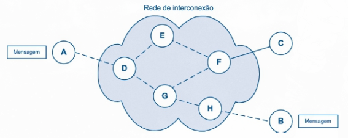<br>
*Fonte: MAIA, Luiz Paulo. Arquitetura de Redes de Computadores, 2ª ed., 2013, p. 261.*

Um **roteador** interliga redes por meio de suas interfaces. Ao receber um pacote, consulta o endereço IP de destino, escolhe uma saída e prepara a transmissão pelo enlace seguinte. Cada roteador faz sua própria consulta. Assim, o *notebook* pode alcançar o servidor conhecendo apenas o primeiro roteador do percurso.

<br>
*Fonte: MAIA, Luiz Paulo. Arquitetura de Redes de Computadores, 2ª ed., 2013, p. 262.*

> Cada roteador consulta apenas até a camada de Rede, pois essa é a última camada de que precisa para escolher o próximo salto. No exemplo do servidor, o primeiro **quadro** tem como destino de enlace a interface local do roteador. Dentro dele, o **pacote** tem como destino IP o servidor. Ao passar de um enlace roteado para outro, o pacote recebe um novo quadro, adequado à próxima entrega.

## Comutação:

A **comutação** permite interligar as extremidades por equipamentos intermediários. A maneira de utilizar os recursos do caminho depende do tipo de rede.

### Comutação por Circuito:

Na comutação por circuito, a rede estabelece um caminho entre a origem e o destino e reserva capacidade para a comunicação. Uma ligação telefônica tradicional ilustra as três fases:

1. **Estabelecimento:** Ao iniciar a chamada, a rede escolhe o caminho e reserva os recursos necessários em cada trecho.
2. **Transferência:** A conversa utiliza o circuito estabelecido. Mesmo durante uma pausa, a capacidade reservada continua à disposição daquela chamada.
3. **Liberação:** Ao desligar, os recursos são liberados e podem atender a outras comunicações.

<br>
*Fonte: MAIA, Luiz Paulo. Arquitetura de Redes de Computadores, 2ª ed., 2013, p. 263.*

Um mesmo enlace físico pode transportar vários circuitos, cada um com sua parcela de capacidade. Se um enlace do caminho falhar, a comunicação pode ser interrompida até que a rede restabeleça o circuito por outro caminho.

### Comutação por Pacotes:

Os dados são enviados em pacotes, que compartilham os enlaces com pacotes de outras comunicações. A capacidade pode ser usada conforme a demanda. Se vários pacotes precisam da mesma saída, podem formar uma fila e, se faltar espaço, sofrer descarte.

<br>
*Fonte: MAIA, Luiz Paulo. Arquitetura de Redes de Computadores, 2ª ed., 2013, p. 265.*

### Datagramas e Circuitos Virtuais:

Uma rede de pacotes pode tomar a decisão de encaminhamento de duas maneiras:

- **Datagrama:** Cada pacote traz o endereço de destino e é encaminhado de acordo com a tabela disponível em cada roteador. Pacotes de uma comunicação podem percorrer caminhos diferentes, sem garantia de entrega ou de ordem.
- **Circuito virtual:** Antes do envio, a rede estabelece um caminho lógico e registra nos equipamentos como encaminhar os pacotes daquele circuito (como na comutação por circuitos, mas permitindo compartilhar o mesmo enlace físico). Esse modelo é utilizado em redes ATM, por exemplo.

## Endereçamento Lógico e Sub-redes:

Um endereço IP identifica uma **interface de rede**. Um *notebook* conectado por cabo e por Wi-Fi pode ter um endereço em cada interface. Uma mesma interface também pode possuir endereços IPv4 e IPv6 ao mesmo tempo.

O **IPv4** utiliza 32 *bits*, representados como quatro números decimais de 0 a 255 separados por pontos. O **IPv6** utiliza 128 *bits*, organizados em grupos hexadecimais.

O endereço de uma interface pode ser interpretado em duas partes. O **identificador de rede** (*NetID*) é o prefixo comum às interfaces da mesma sub-rede. O **identificador de *host*** (*HostID*) distingue a interface dentro dessa sub-rede. O comprimento do prefixo indica onde termina uma parte e começa a outra.

Por exemplo, em `192.168.10.34/27`, os primeiros 27 *bits* identificam a sub-rede `192.168.10.32/27`. Os cinco *bits* restantes identificam a interface dentro dela. No último octeto, `34` corresponde a `00100010` em binário. Os três primeiros *bits* (`001`) ainda pertencem ao prefixo, e os cinco últimos (`00010`) formam o *HostID*.

### Atribuição de Endereços:

O endereço pode ser configurado **manualmente** na interface ou recebido **dinamicamente**. Em redes IPv4, é comum que um servidor **DHCP** (*Dynamic Host Configuration Protocol*) forneça o endereço, a máscara e outras informações, como o *gateway* padrão.

- **Concessão:** O *notebook* recebe um endereço por determinado período e pode renovar a concessão para continuar usando-o. Quando ela expira, o servidor pode voltar a oferecer o endereço.
- **Reserva:** O administrador pode associar um endereço a um cliente identificado. A impressora, por exemplo, continua usando DHCP, mas recebe sempre o mesmo IP, facilitando sua localização.
- **Conflito de IP:** Se alguém configurar manualmente em outro equipamento o endereço que a impressora já utiliza na mesma sub-rede, ambos podem responder pelo mesmo IP. O *notebook* pode acabar enviando os dados ao equipamento errado, e o acesso à impressora pode ficar intermitente.

### Endereçamento por Classes e CIDR:

No modelo histórico de **endereçamento por classes**, os *bits* iniciais do endereço IPv4 indicavam sua classe. Para A, B e C, a classe determinava o tamanho inicial da parte de rede. As classes D e E tinham finalidades próprias.

| Classe | *Bits* iniciais | Faixa do primeiro octeto | Divisão ou finalidade |
| --- | --- | --- | --- |
| **A** | `0` | 0 a 127 | 8 *bits* de rede e 24 de *host* (`/8`). |
| **B** | `10` | 128 a 191 | 16 *bits* de rede e 16 de *host* (`/16`). |
| **C** | `110` | 192 a 223 | 24 *bits* de rede e 8 de *host* (`/24`). |
| **D** | `1110` | 224 a 239 | Endereçamento de grupos (*multicast*). |
| **E** | `1111` | 240 a 255 | Faixa historicamente reservada, com endereços de uso especial. |

> A tabela mostra como identificar as classes. Algumas faixas têm uso especial, como `127.0.0.0/8`, utilizada para *loopback*.

Para uma organização com **500 interfaces**, uma rede classe C oferecia 254 endereços de *host* utilizáveis, enquanto uma classe B oferecia 65.534, reservando muito mais endereços do que o necessário. 

> Receber duas redes classe C reduziria o desperdício, mas cada rede poderia exigir uma entrada própria nas tabelas de roteamento.

O **CIDR** (*Classless Inter-Domain Routing*) tornou explícito o tamanho do prefixo na alocação de blocos e no anúncio de rotas. Nesse exemplo, um bloco `/23` oferece 512 endereços, dos quais 510 podem ser atribuídos a interfaces em uma sub-rede IPv4 convencional. O CIDR também permite **agregar rotas**. Redes contíguas e alinhadas podem ser anunciadas por um único prefixo quando compartilham o mesmo encaminhamento.

> O comprimento do prefixo faz parte da configuração local das rotas de cada roteador. Um roteador externo pode conhecer apenas a rota `192.168.10.0/24`, que abrange toda uma empresa, enquanto um roteador interno também conhece `192.168.10.32/27`, a sub-rede de um departamento.

### Exemplo de uma Sub-rede IPv4:

Com `/27`, cada bloco contém $2^5 = 32$ endereços. A máscara correspondente é `255.255.255.224`. No exemplo, o *notebook* pertence ao bloco que começa em `.32` e termina em `.63`.

| Elemento | Endereço | Interpretação |
| --- | --- | --- |
| **Endereço da sub-rede** | `192.168.10.32/27` | Identifica o bloco de endereços. |
| **Roteador local** | `192.168.10.33` | Interface do roteador que o *notebook* consegue alcançar diretamente. |
| **Notebook** | `192.168.10.34` | Interface Wi-Fi utilizada neste exemplo. |
| **Impressora** | `192.168.10.50` | Pertence ao mesmo bloco do *notebook*. |
| ***Broadcast* da sub-rede** | `192.168.10.63` | Endereço de difusão desse bloco IPv4. |
| **Servidor** | `192.168.10.70` | Pertence ao bloco seguinte, `192.168.10.64/27`. |

Embora os três primeiros números sejam iguais, a impressora e o servidor estão em sub-redes diferentes. É o comprimento do prefixo que permite fazer essa distinção.

### Endereços Públicos e Privados:

Os endereços das sub-redes do exemplo são **privados** e podem ser reutilizados em redes independentes. A escassez de IPv4 públicos motivou o uso amplo da **tradução de endereços de rede** (*Network Address Translation*, NAT). Em casa, por exemplo, o *notebook* e o celular podem acessar a Internet pelo mesmo IPv4 público do roteador. Na modalidade mais comum, o roteador também traduz portas e registra as associações para entregar cada resposta ao dispositivo correto.

## Encaminhamento e Próximo Salto:

Uma **tabela de rotas** associa redes de destino a interfaces de saída. Quando o destino precisa ser alcançado por um roteador, a rota também indica o **próximo salto**.

No laboratório, considere que o *notebook* possui apenas duas rotas para o encaminhamento do exemplo: uma para a rede diretamente conectada `192.168.10.32/27` e uma **rota padrão** pelo roteador `192.168.10.33`.

| Destino do pacote | Decisão do *notebook* | Destino do quadro local |
| --- | --- | --- |
| **Impressora `192.168.10.50`** | A impressora pertence à sub-rede diretamente conectada. | MAC da impressora. |
| **Servidor `192.168.10.70`** | O servidor está em outra sub-rede. O *notebook* usa a rota padrão. | MAC do roteador `192.168.10.33`. |

Quando mais de uma rota corresponde ao destino, prevalece o **prefixo mais longo**, que descreve o bloco mais específico. A rota padrão tem prefixo de comprimento zero (`0.0.0.0/0` em IPv4 ou `::/0` em IPv6) e atende aos destinos sem correspondência mais específica. O roteador indicado por ela é o ***gateway* padrão**.

Depois de escolher o próximo salto, o *notebook* precisa descobrir seu endereço de enlace. No laboratório, essa associação é feita por **ARP**. Para imprimir, o *notebook* procura o MAC de `.50`. Para enviar ao servidor `.70`, procura o MAC de `.33`. O endereço IP de destino do pacote continua sendo o do servidor. Em IPv6, a resolução do endereço de enlace faz parte da **descoberta de vizinhos** (*Neighbor Discovery*).

> A tabela de rotas responde "por onde envio este pacote?". A tabela de vizinhos responde "qual endereço de enlace uso para entregá-lo no próximo salto?".

## Roteamento e Descoberta de Caminhos:

O **encaminhamento** acontece quando chega um pacote e o equipamento escolhe por onde enviá-lo. O **roteamento** determina e atualiza os caminhos que tornam essa escolha possível. Por isso, um roteador pode encaminhar muitos pacotes usando a mesma rota já calculada.

### Origem das Rotas:

| Origem | Como a rota aparece | Exemplo |
| --- | --- | --- |
| **Rede diretamente conectada** | O sistema reconhece um prefixo como alcançável pela própria interface. | A configuração `192.168.10.34/27` normalmente cria uma rota para `192.168.10.32/27` pela interface do *notebook*. |
| **Rota estática** | Um administrador configura o destino e a saída. | Encaminhar `192.168.10.64/27` pelo roteador `.62`. |
| **Rota dinâmica** | Roteadores trocam informações e atualizam os caminhos conforme o protocolo utilizado. | Após uma falha, um roteador aprende que a rede passou a ser alcançável por outro vizinho. |

### Métricas e Escolha de Caminhos:

O **protocolo** define como os roteadores trocam informações. O **algoritmo** usa essas informações para calcular caminhos. A **métrica** expressa o critério de comparação. Um caminho de dois saltos, por exemplo, pode atravessar um enlace lento e levar mais tempo que outro de três. A escolha depende do que o protocolo mede.

| Métrica ou característica | O que representa |
| --- | --- |
| **Número de saltos** | Quantos saltos há até o destino. |
| **Capacidade e carga** | A taxa de transmissão que o enlace comporta e quanto dessa capacidade está em uso. |
| **Atraso** | O tempo necessário para atravessar um enlace ou caminho. |
| **Taxa de erro** | A frequência de erros de transmissão. |
| **Disponibilidade** | A parcela do tempo em que o enlace permanece operacional. |
| **Custo do enlace** | Um valor configurado pelo administrador ou calculado pelo protocolo. Com custos aditivos, somam-se os valores dos enlaces do caminho. |

Além de escolher rotas adequadas, um algoritmo precisa reagir a mudanças. Quando um cabo se rompe, interessa saber quanto tempo leva até os roteadores estabilizarem suas rotas. Esse processo é a **convergência**. Também são desejáveis a **robustez** diante de falhas e informações atrasadas, a **escalabilidade** com o crescimento da rede e o baixo consumo de memória, processamento e tráfego de controle.

### Classificações do Roteamento:

| Critério | Alternativas |
| --- | --- |
| **Atualização** | **Estático** ou **dinâmico**, conforme a forma de manutenção das rotas descrita em *Origem das Rotas*. |
| **Organização** | **Plano:** o domínio opera sem subdivisão hierárquica. **Hierárquico:** a rede é organizada em áreas ou domínios, permitindo resumir informações entre eles. |
| **Informação disponível** | **Local ou parcial:** o roteador se orienta pelas informações dos vizinhos. **Global:** o cálculo utiliza o mapa da topologia do domínio ou da área. |
| **Local do cálculo** | **Centralizado:** uma entidade calcula as rotas para os equipamentos. **Distribuído:** os roteadores participam do cálculo. |

Os critérios podem ser combinados. No estado de enlace, por exemplo, cada roteador pode ter um **mapa global da área** e calcular suas próprias rotas de forma **distribuída**.

### Vetor de Distância:

Cada roteador anuncia aos vizinhos os destinos que conhece e o custo para alcançá-los. Ao receber um anúncio, soma o custo até o vizinho ao custo anunciado. Assim, A pode descobrir um caminho até E sabendo quanto custa chegar a B e qual distância B anuncia até E.

<br>
*Fonte: MAIA, Luiz Paulo. Arquitetura de Redes de Computadores, 2ª ed., 2013, p. 301.*

Na figura, cada enlace tem custo 1. A tabela acompanha as informações disponíveis em A.

| Etapa | O que acontece | O que A sabe |
| --- | --- | --- |
| **T0 - Inicialização** | Cada roteador começa com sua própria entrada. | Chegar a A custa 0. |
| **T1 - Vizinhos** | Os roteadores identificam seus enlaces diretos. | B e D estão a custo 1. |
| **T2 - Troca de vetores** | Os vizinhos anunciam os destinos que alcançam. | B anuncia E a custo 1. A calcula $1 + 1 = 2$ até E por B. D também oferece uma rota de custo 2 até E. |
| **T3 - Convergência** | Novas trocas mantêm os menores custos encontrados. | A pode alcançar E por B ou por D. Para acompanhar a falha, considere que escolheu B no desempate. |

**O que acontece quando o enlace A-B falha?** O enlace C1 fica indisponível para todos no mesmo instante, mas a notícia leva tempo para alcançar cada roteador.

<br>
*Fonte: MAIA, Luiz Paulo. Arquitetura de Redes de Computadores, 2ª ed., 2013, p. 305.*

| Etapa | O que muda | O que A registra |
| --- | --- | --- |
| **T0 - Detecção** | A e B detectam a falha e invalidam as rotas selecionadas que dependiam de C1. | As entradas para B e E passam a custo $\infty$. O enlace direto até D continua válido. |
| **T1 - Propagação** | Os vizinhos recebem os anúncios e reavaliam suas próprias entradas. | Nesta etapa do exemplo, A ainda registra $\infty$ para B e E. |
| **T2 - Alternativas** | Anúncios recebidos por D revelam caminhos válidos. | A volta a alcançar E por `A-D-E`, a custo 2. Ainda registra $\infty$ para B. |
| **T3 - Nova convergência** | As rotas se estabilizam sem utilizar C1. | A alcança B por `A-D-E-B`, a custo 3. Antes da falha, o enlace direto custava 1. |

> O custo $\infty$ indica que o roteador considera o destino inalcançável com as informações disponíveis naquele instante. E continuava fisicamente acessível por D. A sequência T0-T3 ilustra uma ordem possível de atualização. Um roteador que já mantenha uma alternativa válida pode utilizá-la mais cedo.

### Estado de Enlace:

No **estado de enlace**, cada roteador anuncia quais são seus vizinhos e quanto custa alcançá-los diretamente. Os anúncios se propagam pela área. Com eles, cada roteador monta uma cópia do mapa e calcula os caminhos a partir de sua própria posição.

<br>
*Fonte: MAIA, Luiz Paulo. Arquitetura de Redes de Computadores, 2ª ed., 2013, p. 308.*

1. **Conhecimento local:** A identifica dois enlaces diretos. Chegar a B custa 2, e chegar a G custa 6.
2. **Construção do mapa:** B anuncia, entre outros, seu enlace até E, de custo 2. E anuncia seu enlace até G, de custo 1. Os anúncios dos oito roteadores permitem reconstruir a topologia da figura.
3. **Escolha do próximo salto:** A compara o enlace direto até G, de custo 6, com `A-B-E-G`, de custo $2 + 2 + 1 = 5$. Para chegar a G pelo caminho de menor custo, A envia o pacote primeiro a B.

<br>
*Fonte: MAIA, Luiz Paulo. Arquitetura de Redes de Computadores, 2ª ed., 2013, p. 310.*

A figura mostra a **árvore de caminhos mínimos de A**. O enlace `A-G` continua disponível e pode ser escolhido se algum custo mudar. Quando um enlace falha, a mudança é anunciada. À medida que os roteadores recebem a atualização, recalculam os caminhos afetados. Até que os mapas sejam atualizados, podem ocorrer perdas ou ciclos temporários. O cálculo para os oito roteadores aparece no tópico “Cálculo de Caminhos com Dijkstra”, no Apêndice A.

### Hierarquia e Sistemas Autônomos:

Na escala da Internet, as redes são organizadas em **sistemas autônomos** (AS), conjuntos de redes sob uma administração técnica comum e com uma política de roteamento definida. Uma operadora, por exemplo, pode administrar vários prefixos e roteadores dentro de um mesmo AS.

Dentro do AS, o roteamento pode privilegiar custos internos. Entre sistemas autônomos, a escolha de caminhos também considera políticas, como quais redes uma operadora aceita alcançar por determinado vizinho. Os **roteadores de borda** fazem a interligação com outros sistemas. A agregação de prefixos ajuda a anunciar destinos externos sem expor cada subdivisão interna.

<br>
*Fonte: MAIA, Luiz Paulo. Arquitetura de Redes de Computadores, 2ª ed., 2013, p. 317.*

## Distribuição para Múltiplos Destinos:

Se um servidor envia o mesmo conteúdo para vinte receptores por **unicast**, ele mantém envios individuais. Se os caminhos compartilham um enlace, várias cópias idênticas podem passar pelo mesmo trecho. Uma rede com suporte à entrega em grupo pode transportar uma cópia pelo trecho comum e replicá-la onde os caminhos se separam.

| Forma de entrega | Destinatários | Alcance |
| --- | --- | --- |
| ***Unicast*** | Uma interface de destino. | Segue o caminho escolhido para aquele endereço. |
| ***Broadcast*** | Todos os participantes de um âmbito de difusão. | No laboratório, `192.168.10.63` identifica a difusão da sub-rede `192.168.10.32/27`. |
| ***Multicast*** | Interfaces interessadas em um grupo. | Pode atravessar várias redes quando os roteadores oferecem suporte à distribuição para o grupo. |

<br>
*Fonte: MAIA, Luiz Paulo. Arquitetura de Redes de Computadores, 2ª ed., 2013, p. 318.*

### Inundação e Árvore de Cobertura:

Na **inundação** (*flooding*), cada nó que recebe uma mensagem a replica pelas demais saídas participantes. Se existem ciclos, cópias podem voltar ao mesmo nó. Identificadores de mensagens e registros das cópias já vistas permitem descartar duplicatas. Um limite de saltos também restringe por quanto tempo uma cópia pode circular.

<br>
*Fonte: MAIA, Luiz Paulo. Arquitetura de Redes de Computadores, 2ª ed., 2013, p. 318.*

Uma **árvore de cobertura** (*spanning tree*) seleciona enlaces que alcançam todos os roteadores sem formar ciclos. Na distribuição por essa árvore, cada roteador replica a mensagem apenas nas ramificações necessárias. Isso reduz as cópias redundantes. A escolha da árvore, porém, pode concentrar tráfego ou alongar o caminho para alguns emissores. Se um enlace selecionado falhar, o ramo que dependia dele pode ficar sem receber mensagens até que a árvore seja ajustada.

> A inundação é uma técnica de distribuição usada por protocolos específicos. O *broadcast* local do laboratório fica no seu domínio de difusão. Em IPv6, funções de entrega a grupos utilizam *multicast*.

### Grupos *Multicast* e Poda:

Um endereço de *multicast* identifica um **grupo**. Em um **grupo permanente**, o endereço continua atribuído à sua finalidade mesmo quando ninguém recebe a transmissão. Um **grupo temporário** pode existir durante um evento, como a distribuição de uma aula ao vivo. Em ambos os casos, os dispositivos podem entrar e sair do grupo.

Uma forma de alcançar os receptores é construir uma **árvore por origem**. No **roteamento multicast por caminho reverso** (RPM), cada roteador verifica se o pacote chegou pela interface que usaria para alcançar a origem. Na distribuição inicial, ainda podem ser alcançados ramos sem receptores.

<br>
*Fonte: MAIA, Luiz Paulo. Arquitetura de Redes de Computadores, 2ª ed., 2013, p. 322.*

A **poda** retira essas saídas da distribuição. Se o ramo de um roteador não leva a nenhum receptor, ele sinaliza ao roteador anterior que as próximas cópias daquele tráfego podem deixar de ser enviadas por ali.

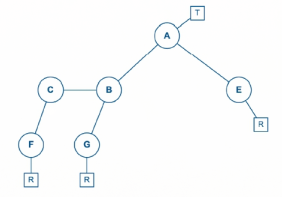<br>
*Fonte: **Adaptado** de MAIA, Luiz Paulo. Arquitetura de Redes de Computadores, 2ª ed., 2013, p. 322.*

Compare `B-H` e `A-D-I`, retirados da distribuição, com o roteador `C`, que permanece. Mesmo sem receptor local, `C` leva até `F`. Os enlaces podados continuam disponíveis para outros tráfegos, e o ramo pode voltar a ser usado se surgir um receptor.

Após a poda, economiza-se banda nos envios seguintes. Há, porém, um custo inicial ao alcançar ramos sem interessados, além das mensagens de controle e das informações mantidas para cada combinação de origem e grupo.

### Árvore Compartilhada:

Vários emissores também podem utilizar uma **árvore compartilhada pelo grupo**. Na abordagem baseada em núcleo, os roteadores com receptores interessados solicitam a entrada na árvore em direção a um ponto comum, chamado **núcleo**.

<br>
*Fonte: MAIA, Luiz Paulo. Arquitetura de Redes de Computadores, 2ª ed., 2013, p. 322.*

Formar a árvore pela adesão dos interessados evita a inundação inicial. Uma única estrutura atende a vários emissores, mas sua posição em relação ao núcleo pode produzir percursos mais longos ou concentrar tráfego em certos enlaces. A disponibilidade do núcleo também importa para a adesão de novos ramos. O tópico “Roteamento *Multicast*”, no Apêndice A, mostra como CBT e PIM-SM organizam essa participação.

## MTU e Fragmentação:

A **MTU** (*Maximum Transmission Unit*) de um enlace limita o tamanho do pacote de rede que ele pode transportar como uma unidade. A **MTU do caminho** é a menor MTU entre os enlaces do percurso.

Considere um pacote IP de **1.500 *bytes*** que chega a um roteador cuja próxima saída aceita apenas **1.280 *bytes***. O pacote cabe no primeiro enlace e excede o limite do seguinte. O resultado depende da versão de IP e, no IPv4, da autorização para fragmentar.

| Situação | O que acontece |
| --- | --- |
| **IPv4 com fragmentação permitida** | O roteador pode dividir o datagrama em fragmentos que caibam no próximo enlace. Cada fragmento segue com seu próprio cabeçalho IPv4, e o destino usa as informações de identificação e posição para remontar o datagrama. |
| **IPv4 com DF (*Don't Fragment*)** | O roteador descarta o pacote grande demais e, no funcionamento previsto, informa a origem por ICMP de que seria necessário fragmentar. |
| **IPv6** | A fragmentação cabe à origem. Se um roteador encontra um pacote grande demais para a saída, ele o descarta e envia uma mensagem ICMPv6 *Packet Too Big*, indicando a MTU. |

Remontar um datagrama exige receber **todos** os seus fragmentos. Se um deles se perder, o destino não consegue entregar o datagrama completo. Conhecer a MTU do caminho permite à origem ajustar o tamanho dos pacotes antes do envio.

> Uma MTU de 1.500 *bytes* no *notebook* informa o limite da interface local. Um enlace mais adiante pode ter uma MTU menor.

## VPN:

Uma **VPN** (*Virtual Private Network*) estabelece um **túnel** entre duas extremidades para transportar tráfego privado por uma rede como a Internet. Com criptografia, o conteúdo dos pacotes fica protegido durante a travessia do túnel.

### *Remote Access* VPN:

O *notebook* estabelece um túnel com o *gateway* da VPN. Quando o usuário acessa um *site* pelo túnel, o *gateway* desencapsula o pacote e, neste exemplo, traduz o IP e a porta de origem para seu próprio IP público e uma porta de saída. Funciona como uma segunda tradução por NAT: a resposta chega ao *gateway*, que a encaminha pelo túnel de volta ao *notebook*.

<br>
*Fonte: Elaborado pelo autor com auxílio do ChatGPT, 2026.*

> A criptografia protege o conteúdo entre o *notebook* e o *gateway*. O *site* vê como origem o *socket* de saída da VPN. O *gateway* mantém a associação entre esse *socket* e o *socket* público do usuário. Esse é o sentido do “anonimato” no exemplo. O *site* ainda pode reconhecer o usuário pela conta ou por informações pessoais no conteúdo da mensagem.

### *Site-to-site* VPN:

Dois *gateways* mantêm um túnel entre as redes de dois campi. No envio, o *gateway* de origem encapsula o pacote IP inteiro e acrescenta um cabeçalho externo para entregá-lo ao outro *gateway*. Na chegada, o *gateway* remove o encapsulamento e encaminha o pacote original pela rede interna. Assim, mesmo em sub-redes distintas, os computadores se comunicam por seus endereços privados, e o destinatário vê o IP privado do emissor.

<br>
*Fonte: Elaborado pelo autor com auxílio do ChatGPT, 2026.*

## *Onion Routing*:

No ***onion routing***, o cliente prepara camadas de criptografia para retransmissores sucessivos. No **Tor**, esses retransmissores formam um **circuito** sobre a Internet. Para acessar um *site* público, um circuito típico passa por três papéis:

| Retransmissor | O que faz no percurso de ida |
| --- | --- |
| **Entrada (*guard*)** | Recebe a conexão do cliente, remove sua camada de criptografia e encaminha os dados ao retransmissor intermediário. Conhece o endereço do cliente e o próximo nó do circuito. |
| **Intermediário (*middle relay*)** | Remove sua camada e encaminha os dados à saída. Na troca normal, vê os retransmissores adjacentes. |
| **Saída (*exit relay*)** | Remove a última camada de proteção do circuito e abre a conexão com o *site* público. O *site* recebe a conexão a partir do endereço da saída. |

A imagem da **cebola** vem dessas camadas sucessivas. O cliente prepara os dados para que cada retransmissor consiga remover apenas a camada correspondente à sua etapa. No caminho de volta, os retransmissores acrescentam suas camadas, e o cliente as remove. 

> O objetivo é distribuir o conhecimento do percurso entre os participantes (descentralizar a informação e deixar a associação mais difícil de ser rastreada).

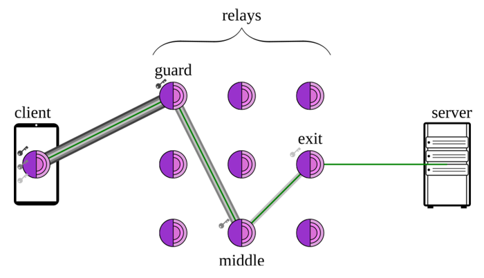<br>
*Fonte: Tga.D - Tor Circuit Diagram, Wikimedia Commons. Disponível em: [https://en.wikipedia.org/wiki/File:Tor_Circuit_Diagram.svg](https://en.wikipedia.org/wiki/File:Tor_Circuit_Diagram.svg). Acesso em: 24 nov. 2026.*

O Tor é uma **rede sobreposta**. A entrada, o intermediário e a saída são os nós escolhidos para o circuito Tor. Entre quaisquer dois deles, os pacotes continuam atravessando os roteadores IP da Internet. A proteção do circuito alcança o nó de saída. 

> Ao acessar um *site* por **HTTPS**, a conexão criptográfica entre o navegador e o *site* continua protegendo o conteúdo também no trecho entre a saída e o servidor.

> Já sabemos como encaminhar dados até o dispositivo de destino. Mas como entregá-los ao processo certo?

---

# 5. Camada de Transporte

> Como vários processos podem se comunicar ao mesmo tempo? Quando a entrega precisa ser confiável, como lidar com perdas e dados fora de ordem?

## Comunicação Fim a Fim e Portas:

A **Camada de Transporte** permite a comunicação **fim a fim** entre processos. Os roteadores encaminham os pacotes ao longo do caminho. Nas extremidades, o sistema operacional entrega os dados à aplicação correspondente.

Um *notebook* pode, por exemplo, receber uma página da Web e uma resposta DNS pelo mesmo endereço IP. O cabeçalho IP identifica o protocolo de transporte, como TCP ou UDP. O cabeçalho de transporte contém as **portas de origem e de destino**, usadas para distinguir as comunicações. Reunir os dados de várias aplicações para transmissão é a **multiplexação**. Separá-los na recepção é a **demultiplexação**.

- **Porta de origem:** Identifica a extremidade que envia. Ao iniciar uma comunicação, o cliente geralmente recebe do sistema uma porta temporária, chamada **efêmera**.
- **Porta de destino:** Identifica a extremidade que deve receber. O cliente normalmente conhece a porta do serviço. Na resposta, a porta do servidor passa a ser a origem, e a do cliente, o destino.

As portas têm **16 *bits***. A IANA divide seus números em três faixas:

| Faixa | Classificação | Uso |
| --- | --- | --- |
| `0–1023` | Portas de sistema ou bem conhecidas | Incluem portas padrão de serviços como SSH (`22/TCP`) e HTTPS (`443/TCP`). A porta `0` é reservada. |
| `1024–49151` | Portas de usuário ou registradas | Podem ser atribuídas pela IANA a serviços específicos. |
| `49152–65535` | Portas dinâmicas ou privadas | Disponíveis para escolha local. A faixa que o sistema usa para portas efêmeras pode variar. |

> Uma **porta padrão** indica onde o cliente normalmente encontra um serviço. O servidor pode usar outra porta, desde que o cliente saiba qual usar. TCP e UDP têm espaços de portas independentes: `53/TCP` e `53/UDP` podem coexistir no mesmo dispositivo.

## *Sockets*:

Um ***socket*** é uma extremidade de comunicação que o sistema operacional disponibiliza a um processo. Em uma comunicação por IP, o endereço dessa extremidade costuma ser escrito como `IP:porta`, considerando o protocolo de transporte utilizado.

Uma **conexão TCP** é identificada pelo par de extremidades. Em `192.168.10.34:51000 - 192.168.10.70:443`, a primeira pertence ao navegador e a segunda, ao servidor. Se o navegador abrir outra conexão pela porta local `51001`, o servidor poderá distinguir as duas, embora ambas cheguem à sua porta `443`.

## UDP:

O **UDP** (*User Datagram Protocol*) envia mensagens em **datagramas**, sem estabelecer uma conexão prévia. Cada datagrama conserva seu limite: se uma aplicação enviar duas mensagens e ambas chegarem, o receptor poderá lê-las separadamente.

O UDP permite detectar erros pelo *checksum*, mas não garante entrega, ordem ou retransmissão. Em uma consulta DNS por UDP, por exemplo, cabe ao cliente decidir se repetirá a consulta quando a resposta demorar.

## TCP:

O **TCP** (*Transmission Control Protocol*) estabelece uma conexão e oferece à aplicação um **fluxo ordenado de *bytes*** em cada sentido. Para transmitir, divide os dados em **segmentos**. Na recepção, recompõe o fluxo. Por isso, duas escritas do remetente podem chegar juntas em uma única leitura da aplicação.

### Controle de Erros e Entrega em Ordem:

- **Detecção de erros:** O receptor verifica o *checksum* do segmento. Se detectar corrupção, descarta o segmento.
- **Confirmação e retransmissão:** O emissor conserva no ***buffer* de transmissão** os *bytes* enviados que ainda aguardam confirmação. Os ACKs indicam o próximo *byte* esperado. Se o emissor detectar indícios de perda ou se o prazo de confirmação expirar, poderá retransmitir os dados pendentes.
- **Ordenação:** Os números de sequência indicam a posição dos *bytes* no fluxo. Se um trecho chegar antes do anterior, o receptor pode guardá-lo no ***buffer* de recepção**. Quando a lacuna for preenchida, os dados poderão ser entregues em ordem à aplicação.

### Controle de Fluxo:

O **controle de fluxo** evita que o emissor sobrecarregue o **receptor**. O receptor informa, no cabeçalho TCP, quanto pode receber a partir do próximo *byte* esperado. Esse valor é a **janela de recepção** (*receive window*, `rwnd`) e depende do espaço disponível em seu *buffer*.

Se os dados chegam mais rápido do que a aplicação os lê, o *buffer* vai enchendo e o receptor anuncia uma janela menor. Se anunciar zero, o emissor suspende o envio normal de novos dados. Conforme a aplicação lê os *bytes* e libera espaço, o receptor pode anunciar uma janela maior.

### Controle de Congestionamento:

O **controle de congestionamento** ajusta o envio às condições da **rede**. O emissor mantém uma **janela de congestionamento** (*congestion window*, `cwnd`), calculada a partir do que observa na comunicação. No TCP clássico, ACKs duplicados podem indicar uma perda, e uma demora que ultrapasse o prazo de retransmissão também leva o emissor a reduzir o envio. Alguns algoritmos consideram ainda o aumento do tempo de ida e volta como sinal de formação de filas.

> Os dois controles atuam ao mesmo tempo. O limite para os dados enviados e ainda não confirmados é o **menor valor entre `rwnd` e `cwnd`**. Assim, tanto um receptor com pouco espaço quanto um caminho congestionado podem limitar a transmissão.

> Já sabemos como os dados chegam ao processo certo. Agora, como as aplicações interpretam o que recebem?

---

# 6. Camada de Aplicação

Como duas aplicações combinam o formato e o significado das mensagens? Por exemplo, como um navegador pede uma página e entende a resposta do servidor?

Um **protocolo de aplicação** define o formato das mensagens, o que elas significam e como os participantes devem agir ao recebê-las. No modelo **cliente-servidor**, o cliente inicia uma solicitação e o servidor oferece o serviço. Um mesmo programa pode assumir os dois papéis: ao receber o pedido de um navegador, um servidor Web pode atuar como cliente de um banco de dados para preparar a resposta.

## Resolução de Nomes - DNS:

O **DNS** (*Domain Name System*) permite consultar informações associadas a um nome. Por exemplo, o navegador pode consultar `www.faculdade.br` para descobrir o endereço IP do servidor. No DNS convencional, a porta padrão é `53`, tanto em UDP quanto em TCP. Consultas comuns geralmente usam UDP. Se a resposta vier truncada, o cliente pode repetir a consulta por TCP.

> Ao ingressar na rede, o computador pode receber por **DHCP** seu endereço IPv4, a máscara, o *gateway* padrão e o endereço do servidor DNS que deverá consultar.

### Espaço de Nomes e Zonas de Autoridade:

Os nomes do DNS formam uma **árvore**. Em `www.faculdade.br.`, o ponto final representa a raiz e costuma ser omitido. A partir dela, `br` identifica um domínio de primeiro nível, `faculdade` identifica um domínio dentro de `br`, e `www` identifica um nome dentro de `faculdade.br`.

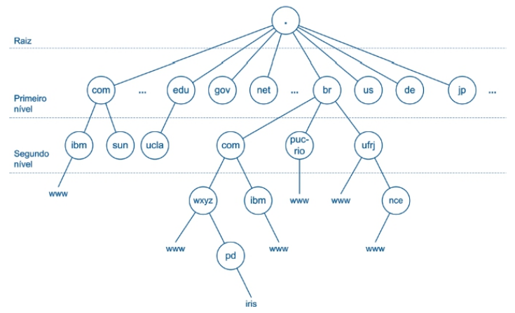<br>
*Fonte: MAIA, Luiz Paulo. Arquitetura de Redes de Computadores, 2ª ed., 2013, p. 408.*

- **Domínio:** É uma parte da árvore de nomes. O domínio `faculdade.br` abrange também os nomes abaixo dele, como `www.faculdade.br` e `lab.faculdade.br`.
- **Zona de autoridade:** É a parte da árvore cujos registros são administrados em conjunto. A faculdade pode delegar `lab.faculdade.br` a outros servidores. Nesse caso, o laboratório continua dentro do domínio `faculdade.br`, mas passa a ter sua própria zona.

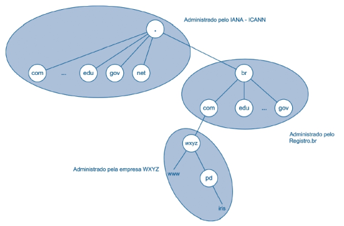<br>
*Fonte: MAIA, Luiz Paulo. Arquitetura de Redes de Computadores, 2ª ed., 2013, p. 410.*

O tipo de **registro** indica qual informação está sendo consultada:

| Registro | Informação fornecida |
| --- | --- |
| **A / AAAA** | Endereço IPv4 ou IPv6 associado ao nome, respectivamente. |
| **CNAME** | Outro nome DNS do qual o nome consultado é um *alias*. |
| **NS** | Nome de um servidor de autoridade da zona. |
| **MX** | Nome de um servidor que recebe e-mail para o domínio e sua preferência de uso. |

### Consultas Recursivas e Iterativas:

- **Iterativa:** Quando precisa buscar a informação, o resolvedor consulta outros servidores. Cada um responde com o que conhece ou indica quais servidores consultar em seguida. Assim, o resolvedor pode partir da raiz e chegar ao servidor de autoridade da zona.

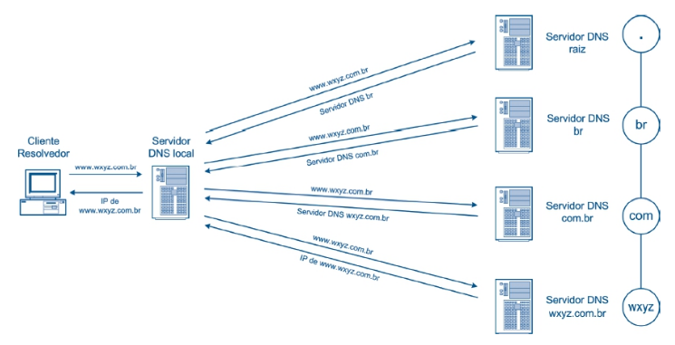<br>
*Fonte: MAIA, Luiz Paulo. Arquitetura de Redes de Computadores, 2ª ed., 2013, p. 413.*

- **Recursiva:** O computador pede ao **resolvedor recursivo** que obtenha a resposta final. Se já tiver uma resposta válida em *cache*, o resolvedor pode devolvê-la imediatamente.
 
<br>
*Fonte: MAIA, Luiz Paulo. Arquitetura de Redes de Computadores, 2ª ed., 2013, p. 414.*

O **TTL** (*Time to Live*) de um registro indica por quanto tempo ele pode permanecer em *cache*. Enquanto a informação estiver válida, outras consultas podem aproveitar o resultado.

## Páginas Web - HTTP e HTTPS:

O **HTTP** (*Hypertext Transfer Protocol*) organiza a comunicação entre o navegador e o servidor em **requisições e respostas**. Na URL `https://www.faculdade.br/horarios`, `https` indica o esquema de acesso, `www.faculdade.br` identifica o servidor e `/horarios` indica o recurso solicitado.

- **Requisição:** O navegador informa o método, o recurso e os cabeçalhos pertinentes. O método `GET` solicita uma representação do recurso. O `POST` envia dados para processamento, como os campos de um formulário.
- **Resposta:** O servidor devolve um código de estado, cabeçalhos e, quando aplicável, um corpo. Por exemplo, `200 OK` indica sucesso e `404 Not Found` informa que o recurso solicitado não foi encontrado.

### Conteúdo Estático e Dinâmico:

- **Conteúdo estático:** O servidor lê um arquivo armazenado, como uma imagem ou um documento HTML, e envia seu conteúdo.
- **Conteúdo dinâmico:** O servidor executa código para produzir a resposta. Por exemplo, ao receber `/horarios`, pode consultar as disciplinas do aluno e gerar a página correspondente. O caminho da URL pode, portanto, identificar uma operação da aplicação.

Um *script* também pode ser executado **no navegador**. Nesse caso, o servidor envia o código junto dos recursos da página, e o navegador o executa para atualizar a interface ou solicitar novos dados.

### HTTPS e *Cookies*:

- **HTTPS:** É o uso de HTTP em uma comunicação protegida por TLS. O navegador verifica o certificado apresentado pelo servidor, e a conexão protege a confidencialidade e a integridade dos dados em trânsito. HTTP/1.1 e HTTP/2 usam TCP. HTTP/3 usa QUIC sobre UDP, com TLS integrado ao QUIC.
- ***Cookie*:** É um dado que o servidor pede ao navegador que armazene e devolva em requisições posteriores, conforme as regras do *cookie*. Depois da autenticação, por exemplo, um identificador de sessão permite ao servidor associar o próximo pedido à sessão já aberta pelo aluno.

## Transferência de Arquivos - FTP, TFTP e SFTP:

| Protocolo | Transporte e porta padrão | Como funciona |
| --- | --- | --- |
| **FTP** (*File Transfer Protocol*) | TCP, porta `21` para controle. | Mantém uma conexão para comandos e respostas e abre outra para os dados, como o conteúdo de um arquivo. No FTP clássico, credenciais e dados trafegam em texto claro. |
| **TFTP** (*Trivial File Transfer Protocol*) | UDP, porta `69` para o pedido inicial. | Transfere o arquivo em blocos. O próprio TFTP confirma os blocos recebidos e prevê retransmissão em caso de perda. É usado, por exemplo, para carregar arquivos de inicialização em uma rede local. |
| **SFTP** (*SSH File Transfer Protocol*) | SSH sobre TCP, normalmente na porta `22`. | Usa um canal SSH para listar diretórios e transferir arquivos com autenticação e criptografia. |

> **SFTP** e **FTPS** são protocolos distintos. SFTP usa SSH. FTPS acrescenta proteção TLS ao FTP.

## Acesso Remoto - Telnet e SSH:

O acesso remoto permite usar um terminal local para executar comandos em outro equipamento. O cliente envia a entrada do usuário, e o equipamento remoto executa o comando e devolve a saída.

- **Telnet:** Usa TCP, normalmente na porta `23`. Em seu uso clássico, envia os dados do terminal, inclusive as credenciais digitadas, em texto claro.
- **SSH** (*Secure Shell*): Usa TCP, normalmente na porta `22`. O cliente verifica a identidade do servidor por sua chave, e o usuário pode se autenticar por senha ou chave pública. A sessão é criptografada. A mesma conexão SSH pode oferecer serviços como SFTP.

## Correio Eletrônico - SMTP, POP3 e IMAP:

O percurso de um e-mail tem três etapas:

1. **Submissão:** O cliente do remetente entrega a mensagem ao seu servidor de saída por **SMTP** (*Simple Mail Transfer Protocol*). A porta `587/TCP` é usual para submissão autenticada com negociação de TLS. A porta `465/TCP` é usada para submissão com TLS desde o início.
2. **Transferência:** Para entregar a mensagem a outro domínio, o servidor de saída consulta o registro **MX** desse domínio e abre uma conexão SMTP com o servidor indicado, normalmente na porta `25/TCP`. Após a entrega, a mensagem fica disponível na caixa postal do destinatário.
3. **Acesso à caixa postal:** O cliente do destinatário pode usar **POP3** ou **IMAP** para acessar as mensagens armazenadas.

| Protocolo de acesso | Como o cliente usa a caixa postal | Portas TCP usuais |
| --- | --- | --- |
| **POP3** (*Post Office Protocol Version 3*) | Obtém mensagens para leitura local. Conforme a configuração, pode conservar ou remover a cópia do servidor. | `110`; `995` com TLS desde o início. |
| **IMAP** (*Internet Message Access Protocol*) | Sincroniza mensagens, pastas e estados mantidos no servidor. Uma mensagem marcada como lida no celular também pode aparecer como lida no computador. | `143`; `993` com TLS desde o início. |

<br>
*Fonte: MAIA, Luiz Paulo. Arquitetura de Redes de Computadores, 2ª ed., 2013, p. 425.*

> **MIME** (*Multipurpose Internet Mail Extensions*) permite organizar uma mensagem em partes e indicar o tipo e a codificação de cada uma. Assim, o mesmo e-mail pode conter texto, uma versão em HTML e um arquivo anexo.

## Gerenciamento de Redes - SNMP:

O **SNMP** (*Simple Network Management Protocol*) permite consultar informações de equipamentos de rede, alterar parâmetros quando houver permissão e receber notificações de eventos.

- **Gerente:** Aplicação de gerenciamento que consulta os equipamentos. Pode perguntar, por exemplo, se uma interface do roteador está operacional.
- **Agente:** Componente do equipamento que atende às solicitações e fornece os valores dos objetos gerenciados. Normalmente recebe consultas na porta `161/UDP`.
- **MIB** (*Management Information Base*): Define os objetos que podem ser gerenciados, com seus nomes, tipos e significados. Cada objeto é identificado por um **OID** (*Object Identifier*). A MIB define, por exemplo, como interpretar o estado operacional de uma interface; o agente fornece seu valor atual.

<br>
*Fonte: MAIA, Luiz Paulo. Arquitetura de Redes de Computadores, 2ª ed., 2013, p. 432.*

Em uma **consulta**, o gerente solicita um valor e o agente responde. Em uma **notificação**, o equipamento toma a iniciativa: pode enviar um *trap* quando uma interface perde o enlace. O gerente normalmente recebe notificações na porta `162/UDP`.

---

# Apêndice A. Arquitetura Prática de Redes

> Como os equipamentos e protocolos de uma rede realizam na prática as funções descritas nos modelos de camadas?

## 1. Camadas Física e de Enlace:

### Sinalização Digital:

Na **codificação de linha**, os *bits* são representados por níveis do sinal ou por transições entre esses níveis.

- **NRZ-L (*Non-Return-to-Zero Level*):** O nível do sinal durante o intervalo indica o *bit* transmitido. Os dois níveis podem ser, por exemplo, $+5 \text{ V}$ e $-5 \text{ V}$ ou $+5 \text{ V}$ e $0 \text{ V}$.

<br>
*Fonte: MAIA, Luiz Paulo. Arquitetura de Redes de Computadores, 2ª ed., 2013, p. 118.*

> A correspondência é uma convenção. Na figura, por exemplo, o nível alto representa `0` e o nível baixo representa `1`.

- **NRZ-I (*Non-Return-to-Zero Inverted*):** O *bit* é indicado pela mudança ou manutenção do nível no início do intervalo. Na figura, o nível muda para transmitir `1` e permanece igual para transmitir `0`.

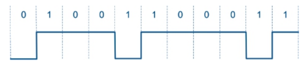<br>
*Fonte: MAIA, Luiz Paulo. Arquitetura de Redes de Computadores, 2ª ed., 2013, p. 118.*

- **Manchester:** O sinal muda de nível no meio de cada intervalo. O sentido da transição, de baixo para alto ou de alto para baixo, indica o *bit* conforme a convenção adotada.

<br>
*Fonte: MAIA, Luiz Paulo. Arquitetura de Redes de Computadores, 2ª ed., 2013, p. 119.*

> A transição central ocorre até quando vários *bits* iguais se repetem. O receptor usa essas transições para sincronizar seu relógio com o do transmissor, dispensando um sinal de relógio separado.

### Sinalização Analógica:

- **ASK (*Amplitude Shift Keying*):** Cada símbolo corresponde a uma amplitude da portadora. No caso mais simples, a presença da onda representa um *bit* e sua ausência representa o outro.

<br>
*Fonte: MAIA, Luiz Paulo. Arquitetura de Redes de Computadores, 2ª ed., 2013, p. 121.*

- **FSK (*Frequency Shift Keying*):** Cada símbolo corresponde a uma frequência da portadora. No mesmo intervalo de tempo, a frequência mais alta produz mais ciclos da onda.

<br>
*Fonte: MAIA, Luiz Paulo. Arquitetura de Redes de Computadores, 2ª ed., 2013, p. 121.*

- **PSK (*Phase Shift Keying*):** Cada símbolo corresponde a uma fase da portadora. Na PSK binária, as duas fases diferem em $180^\circ$, de modo que uma onda aparece invertida em relação à outra.

<br>
*Fonte: MAIA, Luiz Paulo. Arquitetura de Redes de Computadores, 2ª ed., 2013, p. 122.*

- **QAM (*Quadrature Amplitude Modulation*):** Cada símbolo combina as amplitudes de duas componentes da portadora defasadas de $90^\circ$. Na 16-QAM, cada uma das 16 combinações é um ponto da **constelação** e representa quatro *bits*.

<br>
*Fonte: FRAGA, Marcelo Caramuru Pimentel. Redes de Computadores - 6ª Aula, p. 23.*

**Exemplo de interface física:** em uma conexão discada com modem externo, o computador pode se comunicar com o modem por uma interface serial **EIA-232-F** (família RS-232). O modem adapta os dados à linha telefônica. A recomendação **V.92** especifica características da comunicação entre o modem do assinante e o equipamento de acesso da operadora. Assim, a ligação computador-modem e o percurso pela rede telefônica têm especificações físicas próprias.

### Verificação de Erros:

- **Paridade em duas dimensões:** Os dados são organizados em linhas e colunas, cada uma com sua verificação de paridade. Se um único *bit* de dados mudar, falham a linha e a coluna que o contêm. A interseção indica a posição. Com vários erros, algumas alterações podem se compensar: inverter os quatro cantos de um retângulo altera dois *bits* em cada linha e coluna envolvida, preservando suas paridades.

<br>
*Fonte: MAIA, Luiz Paulo. Arquitetura de Redes de Computadores, 2ª ed., 2013, p. 159.*

- ***Checksum*:** Uma regra simples consiste em somar os *bytes* e guardar o resto da divisão por 256. Para a mensagem `MODEM!`, os valores ASCII são `77, 79, 68, 69, 77, 33`. A soma é `403`, e o valor de verificação é $403 \bmod 256 = 147$. O receptor repete a operação. Essa regra deixa passar, por exemplo, a troca de posição de dois *bytes*, pois a soma permanece igual.

- **CRC (*Cyclic Redundancy Check*):** O transmissor e o receptor usam o mesmo **polinômio gerador**, representado por uma sequência de *bits*. No modelo simplificado, um gerador de quatro *bits* produz um resto de três *bits*:

    1. Para proteger os dados `1101` com o gerador `1011`, o transmissor acrescenta três zeros e obtém `1101000`.
    2. Ele divide `1101000` por `1011` em aritmética binária módulo 2. A cada etapa, combina os *bits* por `XOR`, sem empréstimo. O resto é `001`.
    3. Substitui os três zeros pelo resto e transmite `1101001`. Ao dividir essa sequência pelo mesmo gerador, o receptor obtém resto zero. Um resto diferente de zero revela erro.

<br>
*Fonte: MAIA, Luiz Paulo. Arquitetura de Redes de Computadores, 2ª ed., 2013, p. 161.*

- **Código de Hamming:** Para proteger $n$ *bits* de dados e corrigir um erro simples, escolhe-se a menor quantidade $r$ de *bits* de paridade que satisfaça $2^r \geq n+r+1$. As combinações dos resultados de paridade precisam identificar cada posição da palavra e o caso em que nenhuma verificação falha.

Com **16 *bits* de dados**, são necessários **5 *bits* de paridade**, totalizando 21 posições. As paridades ocupam as potências de dois (`1`, `2`, `4`, `8` e `16`), e os dados ocupam as demais posições. Cada posição participa das verificações indicadas por sua representação binária. A posição `5`, por exemplo, corresponde a `00101` e participa das paridades `1` e `4`.

| Paridade | Posições verificadas | Resultado do exemplo |
| --- | --- | --- |
| `1` | 1, 3, 5, 7, 9, 11, 13, 15, 17, 19, 21 | Falha |
| `2` | 2, 3, 6, 7, 10, 11, 14, 15, 18, 19 | Correta |
| `4` | 4, 5, 6, 7, 12, 13, 14, 15, 20, 21 | Falha |
| `8` | 8 a 15 | Correta |
| `16` | 16 a 21 | Correta |

Somando as posições das paridades que falharam, obtém-se $1 + 4 = 5$. Sob a hipótese de um único erro, basta inverter o *bit* da posição 5. Esse código tem distância mínima 3. Se dois *bits* forem alterados, um decodificador que tente corrigir um erro simples pode inverter a posição errada.

### Retransmissão:

- **ARQ:** O transmissor mantém um quadro pendente, inicia um temporizador e aguarda o ACK. Se o prazo vencer, envia o quadro novamente (retransmissão *stop-and-wait*). Um NAK pode antecipar o reenvio quando o receptor detecta uma falha.

<br>
*Fonte: **Adaptado** de MAIA, Luiz Paulo. Arquitetura de Redes de Computadores, 2ª ed., 2013, p. 163.*

- **Protocolo de *bit* alternado:** Usa `0` e `1` para distinguir quadros novos de retransmissões. Se o receptor já aceitou o quadro `0` e o ACK se perdeu, ele continua esperando o `1`. Ao receber outra cópia do `0`, confirma novamente e entrega a carga útil uma única vez.

<br>
*Fonte: MAIA, Luiz Paulo. Arquitetura de Redes de Computadores, 2ª ed., 2013, p. 167.*

- **Retransmissão com janela.** Considere que o transmissor enviou os quadros `1`, `2`, `3` e `4`. O quadro `1` se perdeu e os outros três chegaram. A escolha do protocolo muda tanto o uso da memória do receptor quanto a quantidade de dados reenviados.

| Protocolo | O que o receptor faz com `2`, `3` e `4` | Como a perda é recuperada |
| --- | --- | --- |
| ***Go-Back-N*** | No funcionamento clássico, descarta os quadros fora de ordem e continua esperando o `1`. | Ao expirar o prazo, o transmissor reenvia o `1` e os quadros seguintes ainda pendentes. |
| ***Selective Repeat*** | Guarda os quadros válidos dentro da janela e confirma os que recebeu. | O transmissor reenvia o `1`. Quando ele chega, o receptor pode entregar `1`, `2`, `3` e `4` em ordem. |

<br>
*Fonte: MAIA, Luiz Paulo. Arquitetura de Redes de Computadores, 2ª ed., 2013, p. 170.*

<br>
*Fonte: MAIA, Luiz Paulo. Arquitetura de Redes de Computadores, 2ª ed., 2013, p. 175.*

### Métodos de Acesso ao Meio:

Quando várias estações compartilham um meio de transmissão, o método de acesso define em que condições cada uma pode transmitir. Há três formas de organizar esse acesso:

- **Acesso particionado:** As transmissões são separadas por frequência, tempo ou código. Cada estação utiliza o recurso que lhe foi atribuído.

| Método | Como funciona |
| --- | --- |
| **FDMA** | Cada estação transmite em uma faixa de frequência própria. As transmissões podem ocorrer ao mesmo tempo, e faixas de guarda ajudam a reduzir a interferência entre canais vizinhos. |
| **TDMA** | As estações compartilham o canal em intervalos de tempo (*slots*). Cada uma transmite no intervalo que lhe foi reservado, que pode ficar ocioso se ela estiver sem dados. |
| **CDMA** | As estações podem transmitir ao mesmo tempo e na mesma faixa de frequência. Cada transmissão usa um código, que permite ao receptor recuperar o sinal de interesse. |

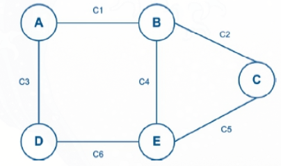<br>
*Fonte: MAIA, Luiz Paulo. Arquitetura de Redes de Computadores, 2ª ed., 2013, p. 188.*

- **Acesso por disputa:** Uma estação com um quadro pronto pode disputar o meio. Como duas estações podem tentar transmitir ao mesmo tempo, cada método define quando iniciar a tentativa e como lidar com a possibilidade de colisão.

| Método | Como funciona |
| --- | --- |
| **ALOHA puro** | A estação transmite assim que tem um quadro. Se a confirmação não chegar, espera um tempo aleatório antes de tentar novamente. |
| **ALOHA com *slots*** | A estação só pode iniciar a transmissão no começo de um intervalo. Duas estações que escolhem o mesmo intervalo ainda podem colidir. |
| **CSMA (*Carrier Sense Multiple Access*)** | A estação escuta o canal antes de transmitir. Como o sinal leva tempo para se propagar, duas estações ainda podem perceber o canal livre e transmitir juntas. |

> No modelo clássico do ALOHA, com quadros de mesma duração e tentativas aleatórias independentes, alinhar o início das transmissões aos *slots* reduz o período em que pode ocorrer colisão. A utilização máxima ideal passa de cerca de $18\%$ para $37\%$.

No **CSMA**, a regra de **persistência** define o que fazer quando o canal está ocupado. Já **CD** e **CA** indicam como o método lida com possíveis colisões.

| Variante | Aspecto | Como funciona |
| --- | --- | --- |
| **CSMA 1-persistente** | Persistência | A estação continua escutando e transmite assim que percebe o canal livre. Várias estações em espera podem tentar juntas. |
| **CSMA não persistente** | Persistência | A estação espera um tempo aleatório antes de voltar a escutar. Isso reduz a chance de tentativas simultâneas, mas pode deixar o canal ocioso. |
| **CSMA/CD (*Collision Detection*)** | Colisões | A estação monitora o meio enquanto transmite. Ao detectar uma colisão, sinaliza o evento, interrompe o envio e aguarda antes de tentar novamente. No Ethernet compartilhado clássico, a faixa de espera aumenta após colisões sucessivas, até um limite. |
| **CSMA/CA (*Collision Avoidance*)** | Colisões | A estação escuta o canal e usa intervalos de espera e um tempo aleatório de recuo (*backoff*) para reduzir a chance de transmissões simultâneas. É a base do acesso por disputa no Wi-Fi. |

No meio sem fio, o transmissor e o receptor podem perceber o canal de maneiras diferentes. Isso explica dois casos:

| Situação | O que acontece |
| --- | --- |
| **Estação escondida** | X e Z alcançam Y, mas não se ouvem. Ambos podem perceber o canal livre e transmitir ao mesmo tempo, causando uma colisão em Y. |
| **Estação exposta** | Uma estação ouve uma transmissão próxima e adia seu envio, embora os dois receptores estejam em posições que permitiriam receber as transmissões simultaneamente. |

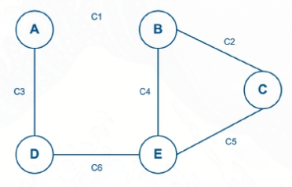<br>
*Fonte: MAIA, Luiz Paulo. Arquitetura de Redes de Computadores, 2ª ed., 2013, p. 196.*

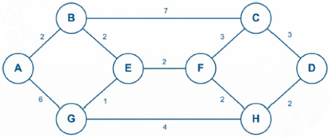<br>
*Fonte: MAIA, Luiz Paulo. Arquitetura de Redes de Computadores, 2ª ed., 2013, p. 197.*

- **Acesso ordenado:** Cada estação aguarda autorização para transmitir. A vez pode ser concedida por um controlador ou passada de uma estação para outra.

| Método | Como funciona |
| --- | --- |
| **Consulta centralizada (*polling*)** | Um controlador consulta as estações e concede a vez a quem tem dados. Cada consulta consome tempo, mesmo quando a estação está sem dados para enviar. |
| **Passagem de *token*** | Uma autorização, o *token*, circula entre as estações. Em *Token Ring*, quem recebe o *token* livre pode transmitir. Se ele se perder, o protocolo precisa restabelecê-lo. |

### Família de Padrões IEEE 802:

**IEEE 802** reúne padrões para redes locais e metropolitanas. Dentro dessa família, **IEEE 802.3** especifica Ethernet e **IEEE 802.11** especifica redes locais sem fio que servem de base ao Wi-Fi. Ambos abrangem características físicas e de enlace.

| Referência | Assunto principal |
| --- | --- |
| **IEEE 802.1** | Integração de redes locais, pontes, VLANs e funções de controle. |
| **IEEE 802.2** | Controle lógico de enlace (LLC). Referência histórica para os serviços dessa subcamada. |
| **IEEE 802.3** | Ethernet, incluindo o formato do quadro e diferentes meios e taxas de transmissão. |
| **IEEE 802.4** | *Token Bus*: passagem de autorização em uma ordem lógica sobre um meio compartilhado. |
| **IEEE 802.5** | *Token Ring*: passagem de autorização em um anel lógico. |
| **IEEE 802.11** | Acesso ao meio e transmissão física em redes locais sem fio. |
| **IEEE 802.15** | Família de tecnologias sem fio, incluindo redes pessoais de curto alcance. |
| **IEEE 802.16** | Acesso sem fio de banda larga, associado a tecnologias como WiMAX. |

Na organização IEEE 802, duas funções de enlace aparecem com frequência:

- **MAC (*Medium Access Control*):** Trata do acesso ao meio e de aspectos do quadro, como endereçamento e verificação de erros. A expressão **endereço MAC** designa um endereço utilizado nessa subcamada.
- **LLC (*Logical Link Control*):** Oferece uma interface lógica para protocolos superiores. O modelo clássico prevê serviços sem conexão, com ou sem confirmação, e serviços orientados à conexão. No formato Ethernet II, o próprio campo **EtherType** identifica diretamente o protocolo transportado.

### Quadro Ethernet:

Antes do quadro, o transmissor envia um **preâmbulo** para sincronização e um **marcador de início**. No formato básico, sem marca de VLAN, os campos do quadro são:

| Campo | Tamanho | Função |
| --- | --- | --- |
| **MAC de destino** | 6 *bytes* | Identifica a interface ou o grupo a que o quadro se destina. |
| **MAC de origem** | 6 *bytes* | Identifica a interface que enviou o quadro. |
| **Comprimento/Tipo** | 2 *bytes* | Indica o comprimento dos dados ou identifica o protocolo transportado, conforme o valor. |
| **Dados e eventual preenchimento** | 46 a 1.500 *bytes* | Transporta a carga útil. Se ela for curta, o transmissor acrescenta preenchimento (*padding*). |
| **FCS** | 4 *bytes* | Contém o CRC usado para detectar alterações no quadro. |

No formato **Ethernet II** (DIX), um valor como `0x0800` identifica IPv4. No formato com **comprimento**, o protocolo superior é identificado com auxílio de LLC e, quando aplicável, SNAP. A figura compara os dois usos do campo após o MAC de origem.

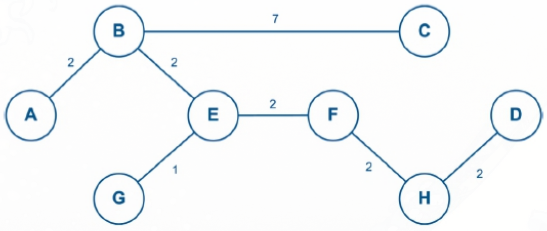<br>
*Fonte: FRAGA, Marcelo Caramuru Pimentel. Redes de Computadores - 11ª Aula, p. 15.*

O tamanho mínimo do quadro básico é **64 *bytes***, do MAC de destino ao FCS. No Ethernet compartilhado clássico, esse mínimo e o limite de extensão do segmento permitiam que uma colisão distante fosse percebida enquanto a estação ainda transmitia.

**Endereço MAC.** Um endereço Ethernet tem 48 *bits*, geralmente escritos como seis pares hexadecimais. Pode ser administrado globalmente, com identificadores atribuídos à organização responsável, ou localmente, inclusive por *software*.

**Evolução do meio.** Em **10BASE5** e **10BASE2**, várias estações compartilhavam um barramento coaxial. O **10BASE-T** levou um cabo de par trançado de cada estação a um ponto central. O equipamento instalado nesse ponto determina se as estações ainda compartilham o meio ou se cada ligação opera de forma independente. Entre as taxas posteriores estão **Fast Ethernet** ($100 \text{ Mbps}$) e **Gigabit Ethernet** ($1 \text{ Gbps}$).

### Equipamentos de Interconexão:

- **Repetidor:** Atua na camada Física. Recebe o sinal digital em um trecho do enlace, recupera sua temporização e o retransmite com os níveis de sinal restabelecidos. Para isso, seu circuito **regenerador** precisa identificar os símbolos recebidos. Se interpretar um símbolo incorretamente, o repetidor poderá retransmitir um sinal bem formado com o dado errado.

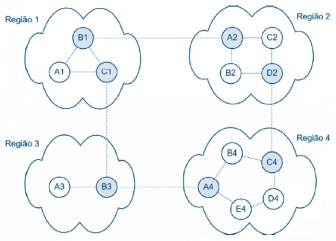<br>
*Fonte: MAIA, Luiz Paulo. Arquitetura de Redes de Computadores, 2ª ed., 2013, p. 100.*

<br>
*Fonte: MAIA, Luiz Paulo. Arquitetura de Redes de Computadores, 2ª ed., 2013, p. 220.*

- ***Hub*:** Funciona como um repetidor de várias portas. O sinal recebido em uma porta é repetido nas demais. Embora os cabos formem uma estrela, as estações compartilham o meio e pertencem ao mesmo **domínio de colisão**.

<br>
*Fonte: MAIA, Luiz Paulo. Arquitetura de Redes de Computadores, 2ª ed., 2013, p. 220.*

- **Ponte:** Atua na camada de Enlace. Interliga segmentos e usa o endereço MAC de destino para decidir se um quadro precisa passar de um segmento para outro. Quando sabe que o destino está no mesmo segmento da origem, a ponte **filtra** o quadro e evita que ele ocupe o outro segmento.

<br>
*Fonte: MAIA, Luiz Paulo. Arquitetura de Redes de Computadores, 2ª ed., 2013, p. 223.*

- ***Switch*:** Funciona como uma ponte de várias portas. Usa o MAC de **origem** de cada quadro para aprender em qual porta está o remetente e consulta o MAC de **destino** para decidir por onde encaminhar o quadro. Considere A na porta 1 e B na porta 4, ambos na mesma VLAN, com a tabela MAC inicialmente vazia.

    1. **A envia para B.** O *switch* aprende `A - porta 1`. Como ainda desconhece a porta de B, envia uma cópia pelas demais portas que podem encaminhar tráfego nessa VLAN.
    2. **B responde a A.** O *switch* aprende `B - porta 4`. Como já conhece a porta de A, encaminha a resposta apenas pela porta 1.
    3. **A volta a enviar para B.** A tabela já indica `B - porta 4`, e o quadro segue apenas por essa porta. Se a porta indicada para um destino coincidir com a de entrada, o *switch* filtra o quadro.

<br>
*Fonte: MAIA, Luiz Paulo. Arquitetura de Redes de Computadores, 2ª ed., 2013, p. 224.*

> Em uma ligação Ethernet *full-duplex* entre estação e *switch*, as duas extremidades podem transmitir ao mesmo tempo, dispensando o CSMA/CD. Um quadro de *broadcast* é encaminhado por todas as demais portas que podem transmitir naquela VLAN.

### Wi-Fi e IEEE 802.11:

- **BSS (*Basic Service Set*):** Conjunto de estações que se comunicam em uma rede Wi-Fi. Pode se organizar de duas formas:

    - **Rede de infraestrutura:** As estações se comunicam por meio de um ponto de acesso (AP, *Access Point*).
    - ***Ad hoc*:** As estações se comunicam diretamente e formam um conjunto independente.

<br>
*Fonte: MAIA, Luiz Paulo. Arquitetura de Redes de Computadores, 2ª ed., 2013, p. 229.*

- **ESS (*Extended Service Set*):** Um sistema de distribuição (DS) interliga os BSS de infraestrutura em uma mesma rede lógica. Assim, um *notebook* pode mudar de AP ao passar de um corredor para outro da faculdade.

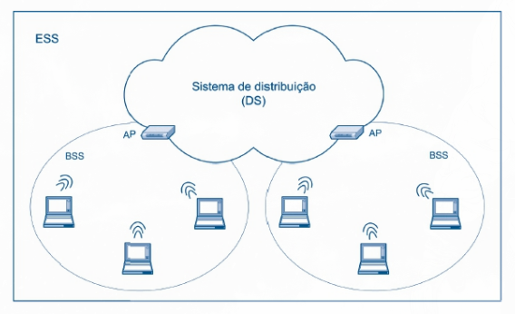<br>
*Fonte: MAIA, Luiz Paulo. Arquitetura de Redes de Computadores, 2ª ed., 2013, p. 230.*

- **Entrega de quadros:** O receptor de um quadro no enlace de rádio pode ser diferente do destino dos dados. Quando um *notebook* envia dados a uma impressora cabeada na mesma rede, o **AP** recebe o quadro pelo rádio e o encaminha à **impressora**. Para identificar quem transmite e recebe em cada trecho, além da origem e do destino dos dados, um quadro 802.11 pode conter até quatro campos de endereço.

- **Acesso ao meio:** No modelo clássico do IEEE 802.11, o uso do canal pode ser distribuído entre as estações ou coordenado pelo AP.

| Método | Como funciona |
| --- | --- |
| **DCF (*Distributed Coordination Function*)** | As estações disputam o canal por CSMA/CA. Durante o *backoff*, o contador diminui enquanto o canal está livre e pausa quando ele fica ocupado. A estação transmite quando a contagem chega a zero. |
| **PCF (*Point Coordination Function*)** | Em períodos coordenados, o AP consulta as estações e concede a vez de transmitir. É um mecanismo opcional. |

<br>
*Fonte: MAIA, Luiz Paulo. Arquitetura de Redes de Computadores, 2ª ed., 2013, p. 233.*

- **Confirmação e reserva:** Em uma entrega *unicast* com confirmação, a sequência é `Dados - ACK`. Com reserva, passa a ser `RTS - CTS - Dados - ACK`: o transmissor solicita o envio e o receptor autoriza. Uma estação escondida que ouve o CTS pode usar a duração anunciada para ajustar seu temporizador **NAV** e aguardar o fim da troca.
- **Intervalos entre quadros:** No modelo clássico, `SIFS < PIFS < DIFS`. Respostas como CTS e ACK usam o intervalo mais curto (SIFS), o coordenador da PCF usa PIFS e uma nova disputa pela DCF aguarda DIFS. Assim, uma troca em andamento tem prioridade.
- **Fragmentação:** Dividir os dados em quadros menores reduz o volume a retransmitir em caso de erro, mas acrescenta cabeçalhos e confirmações.

**Segurança do Wi-Fi**

| Tecnologia | Característica principal |
| --- | --- |
| **WEP** | Proteção inicial do Wi-Fi, hoje considerada insegura. |
| **WPA** | Solução de transição que utilizou TKIP em equipamentos da época. |
| **WPA2** | Consolidou o uso de AES-CCMP para proteger os dados. No modo pessoal, utiliza uma chave pré-compartilhada (PSK). |
| **WPA3** | No modo pessoal, utiliza SAE para autenticar os participantes a partir de uma senha e estabelecer chaves. |

No **modo pessoal**, os usuários normalmente compartilham uma senha. No **modo corporativo** (*Enterprise*), cada usuário ou dispositivo pode se autenticar com credenciais próprias ou certificado, geralmente por 802.1X com apoio de um servidor de autenticação.

### Organização de Redes Locais:

Dois *switches* podem reunir várias conexões físicas em uma ligação lógica (**agregação de enlaces**). O tráfego de diferentes fluxos é distribuído entre os enlaces participantes. Isso aumenta a capacidade total e permite manter a ligação ativa caso um deles falhe, com capacidade reduzida.

- **STP (*Spanning Tree Protocol*):** Considere três *switches* ligados em triângulo. Se todos encaminharem um *broadcast* pelas duas direções, cópias do quadro poderão circular repetidamente. O STP seleciona uma **árvore de encaminhamento**: os *switches* continuam fisicamente conectados, mas algumas portas ficam fora do encaminhamento de dados para eliminar ciclos. Se o caminho ativo falhar, o protocolo pode ativar um caminho alternativo.

<br>
*Fonte: MAIA, Luiz Paulo. Arquitetura de Redes de Computadores, 2ª ed., 2013, p. 241.*

**VLAN (*Virtual Local Area Network*):** Em um *switch* cujas portas pertencem à mesma VLAN, um *broadcast* enviado pelo laboratório pode chegar também às máquinas da administração. Ao atribuir os dois grupos a VLANs distintas, cada grupo passa a ter seu próprio domínio de *broadcast*, mesmo compartilhando o equipamento.

<br>
*Fonte: MAIA, Luiz Paulo. Arquitetura de Redes de Computadores, 2ª ed., 2013, p. 243.*

<br>
*Fonte: MAIA, Luiz Paulo. Arquitetura de Redes de Computadores, 2ª ed., 2013, p. 246.*

| Tipo de porta ou ligação | Uso |
| --- | --- |
| **Porta de acesso** | Normalmente associa o tráfego de um dispositivo final a uma VLAN. O computador pode enviar um quadro sem marca, e o *switch* identifica a VLAN pela porta de entrada. |
| ***Trunk* (entroncamento)** | Transporta várias VLANs entre equipamentos. A marca IEEE 802.1Q identifica a VLAN de um quadro. Conforme a configuração, uma VLAN nativa pode trafegar sem marca. |

Se laboratório e administração ocupam dois prédios, um *trunk* entre os *switches* pode transportar as duas VLANs preservando a separação dos grupos. Um *broadcast* do laboratório pode atravessar esse enlace e alcançar as portas do laboratório no outro prédio. Para enviar um pacote à rede da administração, é necessário **roteamento entre as VLANs**, realizado por um roteador ou por um *switch* com função de camada de Rede.

## 2. Camada de Rede:

### Interfaces e Endereços IP:

O *notebook* do laboratório tem o endereço IPv4 `192.168.10.34/27` na interface Wi-Fi. A mesma interface também pode ter endereços IPv6. O alcance de cada endereço determina onde ele pode ser usado.

- ***Loopback*:** Os endereços `127.0.0.1` (IPv4) e `::1` (IPv6) permitem acessar um serviço no próprio *notebook*. O tráfego permanece no equipamento.

- **IPv4 privado:** O endereço do *notebook* pertence a um dos três blocos reservados para redes privadas. Organizações diferentes podem usar os mesmos endereços em suas redes internas.

| Prefixo | Faixa |
| --- | --- |
| `10.0.0.0/8` | `10.0.0.0` a `10.255.255.255` |
| `172.16.0.0/12` | `172.16.0.0` a `172.31.255.255` |
| `192.168.0.0/16` | `192.168.0.0` a `192.168.255.255` |

- **IPv6 de enlace local:** Um endereço como `fe80::70db:aa5b:82c0:622c/64` permite comunicar-se com vizinhos no mesmo enlace. Os roteadores mantêm esse tráfego restrito ao enlace de origem. Esse endereço é só a forma abreviada (uma sequência de grupos zerados pode ser substituída por `::` uma única vez no endereço). O endereço completo é: `fe80:0000:0000:0000:70db:aa5b:82c0:622c/64`.

O Apêndice C mostra como consultar os endereços, o estado e a MTU de cada interface.

### Cabeçalhos IPv4 e IPv6:

Os cabeçalhos IPv4 e IPv6 têm formatos diferentes. A tabela compara os campos que desempenham funções semelhantes:

| Item | IPv4 | IPv6 |
| --- | --- | --- |
| Identificador de origem e destino | Endereços de 32 *bits*. | Endereços de 128 *bits*. |
| Limitador da circulação do pacote (decrementado a cada roteador) | **TTL** (*Time to Live*). | *Hop Limit*. |
| Identificador do que vem em seguida | *Protocol*, como TCP, UDP ou ICMP. | *Next Header*, que pode identificar um cabeçalho de extensão ou o protocolo transportado. |
| Tamanho | *Total Length*, incluindo o cabeçalho IPv4. | *Payload Length*, que conta os *bytes* após o cabeçalho básico, incluindo eventuais cabeçalhos de extensão. |

### Cálculo de uma Sub-rede IPv4:

Em `192.168.10.34/27`, o prefixo deixa $32 - 27 = 5$ *bits* para os endereços dentro da sub-rede. Cada bloco contém $2^5 = 32$ endereços. Como `.34` está no bloco de `.32` a `.63`, o *notebook* pertence à sub-rede **`192.168.10.32/27`**.

- **Identificador da sub-rede:** `192.168.10.32`, o primeiro endereço do bloco.
- **Endereços úteis:** de `192.168.10.33` a `192.168.10.62`. Por convenção, costuma-se atribuir o primeiro (`.33`) ao *gateway* da sub-rede, embora ele possa usar outro endereço útil.
- ***Broadcast*:** `192.168.10.63`, o último endereço do bloco.

### Divisão de um Bloco com VLSM:

Como dividir `192.168.20.0/24` entre grupos de **100, 50 e 20 interfaces**? Com **VLSM** (*Variable Length Subnet Mask*), cada sub-rede recebe um prefixo adequado ao seu tamanho. Começar pelo maior grupo facilita colocar cada bloco em um limite válido.

| Grupo | Sub-rede atribuída | Faixa de interfaces | *Broadcast* |
| --- | --- | --- | --- |
| 100 interfaces | `192.168.20.0/25` | `.1` a `.126` | `.127` |
| 50 interfaces | `192.168.20.128/26` | `.129` a `.190` | `.191` |
| 20 interfaces | `192.168.20.192/27` | `.193` a `.222` | `.223` |
| Reserva | `192.168.20.224/27` | `.225` a `.254` | `.255` |

### Agregação de Rotas com CIDR:

Um roteador pode anunciar várias redes por um prefixo mais curto quando elas formam um bloco alinhado e ele pode encaminhar o tráfego para todo o conjunto.

- **Blocos que formam um único prefixo:** `192.168.10.0/27` e `192.168.10.32/27` cobrem os endereços de `.0` a `.63`. O anúncio `192.168.10.0/26` representa exatamente as duas redes.

<br>
*Fonte: Elaborado pelo autor com auxílio do ChatGPT, 2026.*

- **Blocos vizinhos sem o alinhamento necessário:** `192.168.10.32/27` e `192.168.10.64/27` cobrem de `.32` a `.95`. Esse intervalo cruza o limite entre dois blocos `/26`, em `.64`. Um único anúncio que abrangesse ambos incluiria endereços adicionais.

### Escolha da Rota e do Próximo Salto:

Um roteador conhece as redes diretamente conectadas às suas interfaces. Se o destino está em uma delas, entrega o pacote pelo enlace correspondente. Para outras redes, consulta a tabela de rotas. 

Se nenhuma entrada mais específica corresponder ao destino, usa a **rota padrão** (`0.0.0.0/0`), quando configurada, para encaminhar o pacote ao próximo roteador.

<br>
*Fonte: MAIA, Luiz Paulo. Arquitetura de Redes de Computadores, 2ª ed., 2013, p. 292.*

### Resolução de Vizinhos:

Suponha que a rota para o servidor `192.168.10.70` indique o roteador `192.168.10.62` como próximo salto. Falta descobrir o **endereço MAC de `.62`** para montar o quadro. Uma associação entre IP e MAC pode ser configurada manualmente ou aprendida quando houver tráfego para aquele vizinho.

- **ARP no IPv4:** O *notebook* consulta seu *cache*. Se ainda não conhece a associação, envia uma solicitação por *broadcast* no enlace: “Quem tem `192.168.10.62`?”. O roteador responde com seu MAC, e o *notebook* guarda a associação para os próximos envios.
- ***Neighbor Discovery* no IPv6:** A interface usa mensagens ICMPv6 de solicitação e anúncio de vizinho para descobrir o endereço de enlace do próximo salto. A associação também pode ser reutilizada.

### Tradução de Endereços e Portas:

- **NAT:** O roteador de borda traduz um endereço IP interno (privado) em um endereço externo (público). Na resposta, faz a tradução inversa para entregar o pacote à origem interna.

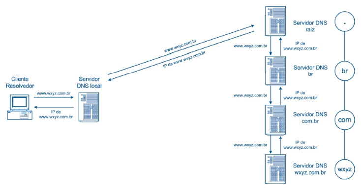<br>
*Fonte: MAIA, Luiz Paulo. Arquitetura de Redes de Computadores, 2ª ed., 2013, p. 288.*

- **PAT (*Port Address Translation*):** Modalidade de NAT que também traduz portas. O roteador pode distinguir as conexões pelas portas externas e permitir que vários dispositivos compartilhem um IPv4 público ao acessar a Internet.

> Um roteador doméstico pode exercer três funções. Como *gateway*, encaminha pacotes para outra rede. Com NAT, traduz endereços e, no PAT, também portas. Com o *firewall*, aplica as regras que permitem ou bloqueiam tráfego.

### MTU do Caminho:

A **MTU do caminho** é a menor MTU entre os enlaces do percurso. Se um pacote excede a MTU da próxima saída, o comportamento depende da versão do IP e, no IPv4, da permissão para fragmentar.

- **IPv4 com DF:** Com o *bit* *Don't Fragment* ativo, o roteador descarta o pacote grande demais e informa à origem, por ICMP, que seria necessário fragmentá-lo.
- **IPv6:** O roteador descarta o pacote grande demais e envia à origem uma mensagem ICMPv6 *Packet Too Big* com a MTU da saída. A origem pode ajustar o tamanho dos pacotes.

> Em uma VPN, os cabeçalhos e a proteção do túnel ocupam parte do espaço disponível para o pacote interno.

### Fragmentação em IPv4:

Um roteador recebe um datagrama de **1.500 *bytes***, com cabeçalho de 20 *bytes*, e precisa enviá-lo por um enlace com **MTU de 1.280 *bytes***. Neste exemplo, a fragmentação é permitida.

1. **Descontar o cabeçalho.** Cada fragmento terá seu próprio cabeçalho de 20 *bytes*. Restam até $1.280 - 20 = 1.260$ *bytes* para dados.
2. **Alinhar a carga.** O *Fragment Offset* indica a posição dos dados em unidades de oito *bytes*. A carga de cada fragmento anterior ao último precisa ser múltipla de oito. O primeiro leva 1.256 *bytes*.
3. **Posicionar o restante.** Dos 1.480 *bytes* de dados originais, sobram 224. O segundo fragmento começa na posição $1.256 / 8 = 157$.

| Fragmento | *Bytes* dos dados originais | Carga | Total com cabeçalho | Offset | MF |
| --- | --- | --- | --- | --- | --- |
| **1** | 0 a 1.255 | 1.256 *bytes* | 1.276 *bytes* | `0` | `1` |
| **2** | 1.256 a 1.479 | 224 *bytes* | 244 *bytes* | `157` | `0` |

Na remontagem, a identificação comum associa os fragmentos ao datagrama, e o *offset* posiciona cada trecho. O indicador **MF** (*More Fragments*) vale `1` no primeiro fragmento e `0` no último. Com os dois trechos, o destino recupera os 1.480 *bytes* de dados.

### Protocolos de Roteamento:

- **RIP:** Dentro de um sistema autônomo, os roteadores anunciam aos vizinhos as distâncias em saltos. Após uma falha, anúncios desatualizados podem levar dois vizinhos a indicar um ao outro como caminho para o destino. A distância anunciada aumenta a cada troca até chegar a `16`, valor que indica destino inalcançável. É a **contagem ao infinito**.
- **OSPF:** Também opera dentro de um sistema autônomo, que pode ser organizado em áreas. Os roteadores divulgam o estado e o custo dos enlaces. Cada um usa essas informações para calcular seus caminhos de menor custo.
- **BGP:** Troca anúncios de prefixos entre sistemas autônomos e distribui essas rotas dentro de um mesmo sistema. A escolha considera políticas e atributos, como o `AS_PATH`, que registra os sistemas autônomos do caminho anunciado.

### Cálculo de Caminhos com Dijkstra:

Na rede de **Estado de Enlace** do capítulo 4, o roteador A começa com custo zero para si mesmo. A cada etapa, confirma o roteador de menor custo provisório e verifica se passar por ele melhora o caminho até algum vizinho.

| Roteador confirmado | Custo a partir de A | O que muda no cálculo |
| --- | --- | --- |
| **A** | 0 | B recebe custo provisório 2, e G recebe 6. |
| **B** | 2 | Chegar a E por B custa 4. Chegar a C por B custa 9. |
| **E** | 4 | O custo até G cai de 6 para 5. F recebe custo 6. |
| **G** | 5 | H recebe custo provisório 9. |
| **F** | 6 | O custo até H cai de 9 para 8. O caminho até C por F também custa 9. |
| **H** | 8 | D recebe custo 10. |
| **C** | 9 | Passar por C para chegar a D custaria 12. Permanece o custo 10. |
| **D** | 10 | Todos os destinos estão confirmados. |

> A árvore resultante é um dos resultados possíveis. Os caminhos `A-B-C` e `A-B-E-F-C` custam 9. Nos dois casos, o primeiro salto a partir de A é B.

### *Broadcast* em IPv4:

- **Limitado:** O endereço `255.255.255.255` alcança o enlace local. A transmissão termina nesse enlace.
- **Direcionado:** O endereço identifica todos os dispositivos de uma sub-rede específica. Para `192.168.10.32/27`, é `192.168.10.63`. O encaminhamento desse *broadcast* a partir de outra rede é desabilitado por padrão nos roteadores.

### Participação em Grupos *Multicast*:

- **Endereço do grupo:** A faixa IPv4 `224.0.0.0/4` identifica grupos *multicast*. Uma interface conserva seu endereço individual ao participar de um grupo como `239.1.1.1`.
- **Adesão por IGMP:** Quando uma aplicação solicita a recepção de um grupo, o IGMP (*Internet Group Management Protocol*) permite informar ao roteador local que há receptores interessados naquele enlace.

### Roteamento *Multicast*:

Em uma rede de IPTV, vários receptores podem assistir ao mesmo canal. Uma cópia do fluxo percorre o trecho comum, e os roteadores a replicam onde os caminhos para os receptores se separam.

- **Caminho reverso e poda:** No exemplo de RPM das **figuras 024 e 025**, o roteador verifica se o pacote chegou pela interface que usaria para retornar à origem. Essa verificação (*Reverse Path Forwarding*, RPF) orienta a distribuição inicial. A poda retira da árvore os ramos sem receptores.
- **Árvore baseada em núcleo (CBT):** O roteador que atende um receptor solicita adesão em direção ao núcleo. Ao encontrar um roteador que já participa da árvore, o novo ramo pode se ligar a ele.
- **Ponto de encontro (PIM-SM):** Os roteadores dos receptores formam uma árvore em direção ao ponto de encontro (*Rendezvous Point*, RP). O roteador da fonte pode encapsular os pacotes iniciais e enviá-los ao RP para distribuição. Depois, o ramo que atende um receptor pode passar a seguir um caminho de menor custo até a fonte.

## 3. Camada de Transporte:

### Portas de Serviços e Conexões Simultâneas:

| Serviço | Protocolo de transporte | Porta padrão |
| --- | --- | --- |
| SSH | TCP | `22` |
| DNS | UDP ou TCP | `53` |
| HTTP/1.1 | TCP | `80` |
| HTTPS com HTTP/1.1 ou HTTP/2 | TCP | `443` |
| HTTPS com HTTP/3 | QUIC sobre UDP | `443` |

Um servidor pode manter um *socket* de escuta na porta `443` e atender várias conexões nessa mesma porta. Considere duas conexões TCP abertas pelo navegador do laboratório:

| Conexão | Extremidade do navegador | Extremidade do servidor |
| --- | --- | --- |
| **1** | `192.168.10.34:51000` | `192.168.10.70:443` |
| **2** | `192.168.10.34:51001` | `192.168.10.70:443` |

Os endereços IP e a porta do servidor são iguais nas duas conexões. A porta do navegador distingue os pares de extremidades. Ao receber um segmento vindo de `192.168.10.34:51001`, o servidor o entrega ao *socket* da **conexão 2**.

### Cabeçalhos UDP e TCP:

| Informação | UDP | TCP |
| --- | --- | --- |
| **Portas** | Origem e destino. | Origem e destino. |
| **Comprimento** | *Length* informa o tamanho do datagrama, incluindo o cabeçalho. | *Data Offset* indica onde começam os dados e, portanto, o tamanho do cabeçalho TCP. |
| **Verificação de erros** | *Checksum*, opcional no UDP sobre IPv4. | *Checksum* obrigatório. |
| **Sequência e confirmação** | - | O número de sequência posiciona os *bytes* no fluxo. O número de confirmação indica o próximo *byte* esperado. |
| **Janela de recepção** | - | O campo *Window* anuncia quanto o receptor aceita receber a partir do próximo *byte* esperado. |
| **Sinalizadores** | - | SYN, ACK e FIN participam da abertura, das confirmações e do encerramento da conexão. |

> A janela anunciada no cabeçalho TCP é a **janela de recepção** (`rwnd`). Cada emissor calcula e mantém localmente sua própria **janela de congestionamento** (`cwnd`).

### Aplicação das Duas Janelas:

Considere o envio do *notebook* para o servidor. O servidor anuncia `rwnd`, e o *notebook* calcula `cwnd`. Os valores da tabela se aplicam a esse sentido da conexão.

| Situação | `rwnd` do servidor | `cwnd` do *notebook* | Limite de dados em trânsito |
| --- | --- | --- | --- |
| A aplicação do servidor demora a ler os dados | 4.000 *bytes* | 10.000 *bytes* | **4.000 *bytes***, pelo controle de fluxo. |
| O emissor detecta indícios de congestionamento | 12.000 *bytes* | 3.000 *bytes* | **3.000 *bytes***, pelo controle de congestionamento. |

Na segunda situação, se o *notebook* já enviou **2.000 *bytes*** que aguardam confirmação, pode enviar mais **1.000 *bytes*** antes de atingir o limite. À medida que os ACKs chegam, liberam espaço para novos envios. Por isso, o tempo de ida e volta também influencia a taxa alcançada.

### Uma Conexão TCP Passo a Passo:

1. **Abertura - *three-way handshake*.** O navegador envia **SYN** com seu número inicial de sequência. O servidor responde com **SYN + ACK**, confirma o SYN recebido e informa seu próprio número inicial. O navegador confirma com **ACK**. A sequência é `SYN - SYN + ACK - ACK`.

2. **Transferência e confirmação.** Suponha que o servidor espere o *byte* `1001`. Se receber os *bytes* `1101` a `1200` primeiro, pode guardá-los e continuar indicando `ACK = 1001`. Quando chegarem os *bytes* `1001` a `1100`, o trecho estará completo. O servidor poderá entregar os 200 *bytes* em ordem e enviar `ACK = 1201`. Essa **confirmação cumulativa** cobre todos os *bytes* até `1200`.

3. **Encerramento - *four-way handshake*.** O navegador envia **FIN** para indicar que terminou de transmitir. O servidor confirma com **ACK** e ainda pode enviar dados no sentido inverso. Quando também termina, envia seu próprio **FIN**, e o navegador confirma com **ACK**. Com os envios separados, a sequência é `FIN - ACK - FIN - ACK`. Se o servidor já estiver pronto para encerrar, pode reunir seu ACK e seu FIN no mesmo segmento.

## 4. Camada de Aplicação:

### Da URL à Página:

Um aluno digita `https://www.faculdade.br/horarios` no navegador. Considere um primeiro acesso, sem resposta DNS em *cache*, usando HTTP/1.1.

1. **Resolver o nome.** O computador envia ao resolvedor uma consulta recursiva por `www.faculdade.br`. O resolvedor consulta a raiz, recebe uma indicação para `br` e segue as delegações até o servidor de autoridade de `faculdade.br`. Esse servidor fornece o registro de endereço. O resolvedor guarda o resultado pelo TTL e devolve o IP ao computador.
2. **Estabelecer a conexão.** O navegador abre uma conexão TCP com o IP recebido, na porta `443`, e negocia TLS. Durante a negociação, verifica se o certificado é válido para `www.faculdade.br`.
3. **Solicitar o recurso.** Pela conexão protegida, o navegador envia `GET /horarios HTTP/1.1` com o cabeçalho `Host: www.faculdade.br`. O servidor pode gerar a página consultando o sistema de horários e responder com `200 OK`. O cabeçalho `Content-Type: text/html` informa como interpretar o corpo.
4. **Manter a sessão.** Se o aluno se autenticar, o servidor pode incluir `Set-Cookie: sessao=abc123; Path=/; Secure; HttpOnly` na resposta. Em outra requisição HTTPS ao mesmo servidor, o navegador envia `Cookie: sessao=abc123`. O servidor usa esse identificador para localizar a sessão do aluno.

> O DNS recebe o nome `www.faculdade.br` para resolução. O caminho `/horarios` segue depois, na requisição HTTP enviada ao servidor Web.

### Percurso de um E-mail:

Ana usa um aplicativo de e-mail para enviar uma mensagem a `bruno@faculdade.br`. Bruno lê a mensagem em dois dispositivos.

| Etapa | Quem se comunica | Protocolo e resultado |
| --- | --- | --- |
| **1. Envio por Ana** | Aplicativo de Ana - servidor de saída | **SMTP:** o aplicativo se autentica e submete a mensagem. |
| **2. Localização do servidor** | Servidor de saída - DNS | **DNS:** a consulta ao registro `MX` de `faculdade.br` fornece o nome do servidor de correio. O endereço IP desse nome permite estabelecer a conexão. |
| **3. Entrega à faculdade** | Servidor de saída - servidor de correio da faculdade | **SMTP:** a mensagem é transferida e encaminhada à caixa postal de Bruno. |
| **4. Leitura por Bruno** | Celular e computador - servidor da caixa postal | **IMAP:** os dispositivos sincronizam a mensagem e seu estado de leitura. Com POP3, cada cliente poderia obter uma cópia para leitura local. |

> No *webmail*, o navegador de Bruno se comunica por **HTTPS** com a aplicação Web do provedor. A aplicação acessa a caixa postal do lado do servidor. A entrega entre os provedores continua usando **SMTP**.

### Consulta e Notificação por SNMP:

Uma estação de gerenciamento acompanha a interface de índice `2` de um roteador. Na MIB de interfaces, `ifOperStatus` representa o **estado operacional**. A instância `ifOperStatus.2` corresponde àquela interface.

| Situação | Troca | O que o gerente descobre |
| --- | --- | --- |
| **Consulta periódica** | O gerente envia um `GET` para `ifOperStatus.2`. O agente responde com `up(1)`. | A interface estava operacional no momento da consulta. A MIB define o significado do valor `1`. |
| **Queda do enlace** | Se as notificações estiverem habilitadas, o agente envia um *trap* `linkDown` que identifica a interface afetada. | O gerente recebe o aviso sem precisar esperar a próxima consulta periódica. |

O gerente pode então consultar `ifOperStatus.2` novamente para verificar o estado atual. O *trap* informa que ocorreu uma mudança; a consulta mostra qual é o estado no momento da resposta.

---

# Apêndice B. Modelo OSI

A ISO desenvolveu o **modelo OSI** (*Open Systems Interconnection*) para orientar a criação de padrões que permitissem a comunicação entre sistemas de diferentes fabricantes. O modelo organiza essa comunicação em sete camadas. Da mesma forma que o modelo TCP/IP, cada camada oferece um serviço à camada superior e utiliza os serviços da camada inferior.

As três primeiras camadas - **Física**, **Enlace**, **Rede** e **Transporte** - tratam da transmissão de sinais, da entrega de quadros em cada enlace, do encaminhamento de pacotes entre redes e processos (funcionamento idêntico). Após a quarta camada, o foco passa para os processos nas extremidades: como o diálogo é coordenado, como o conteúdo é representado e qual serviço a aplicação utiliza.

5. **Sessão:** Estabelece, coordena e encerra o diálogo entre as aplicações. Pode organizar de quem é a vez de transmitir e inserir **pontos de sincronização** ao longo de uma operação. Em uma transferência longa, esses pontos permitem retomar o trabalho a partir de uma etapa já concluída após uma interrupção.

6. **Apresentação:** Define como os dados são representados para que ambos os sistemas atribuam o mesmo significado aos *bytes* recebidos. Dois computadores podem, por exemplo, usar codificações de caracteres diferentes internamente e adotar uma codificação comum para trocar um texto. O modelo também atribui a essa camada funções como compressão e criptografia.

7. **Aplicação:** Oferece os serviços de rede utilizados pelos programas, como transferência de arquivos, correio eletrônico e acesso remoto. É nessa camada que se define o significado de um pedido ou de uma resposta. Em um serviço de arquivos, por exemplo, uma mensagem pode solicitar a listagem de um diretório ou a leitura de um arquivo.

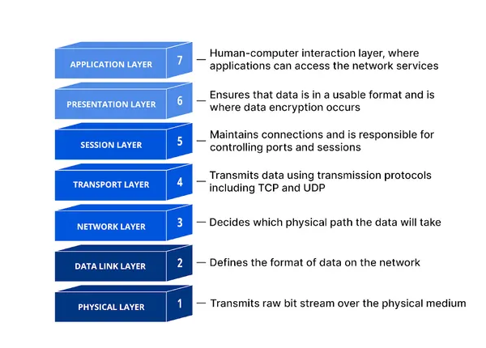<br>
*Fonte: Delta Protect - Capas del Modelo OSI. Disponível em: [https://www.deltaprotect.com/blog/modelo-osi](https://www.deltaprotect.com/blog/modelo-osi). Acesso em: 26 nov. 2026.*

> No modelo de cinco camadas usado nesta apostila, o Transporte continua responsável pela comunicação fim a fim. As funções que o OSI distribui entre **Sessão**, **Apresentação** e **Aplicação** ficam reunidas na camada de Aplicação e podem ser realizadas pelos próprios programas, por protocolos ou por bibliotecas.

---

# Apêndice C. Comandos Importantes

> Nos modelos de sintaxe, **os elementos entre chaves indicam valores a substituir**. Digite o valor sem as chaves. `{opções}` e `{função}` indicam modificadores opcionais; a descrição principal apresenta o comportamento sem eles, considerando os argumentos indicados. Os demais elementos entre chaves são obrigatórios na forma apresentada.

## Linux:

### Consultar Interfaces e Endereços:

- `ip {opções} link {função}` - Mostra os dados de enlace das interfaces, incluindo o endereço MAC e a MTU local (limite do enlace).

    - `ip link show dev {interface}` - Mostra apenas a interface indicada, como `wlo1`.
    - `ip -d link` - Exibe detalhes do enlace. Em uma interface VLAN, permite confirmar o tipo e o ID da VLAN.

- `ip {opções} address {função}` - Lista as interfaces, o estado do enlace, a MTU e os endereços configurados. `ip a` é a forma abreviada de `ip address`.

    - `ip -br a` - Resume o nome, o estado e os endereços IP de cada interface em uma linha.
    - `ip a show dev {interface}` - Mostra apenas a interface indicada, como `wlo1`.

### Consultar Rotas e Vizinhos:

- `ip {opções} route {função}` - Lista as rotas IPv4 por padrão.

    - `ip -6 route` - Mostra apenas as rotas IPv6.
    - `ip route get {destino}` - Mostra como o sistema encaminharia um pacote para o destino. Se a rota para o servidor passar pelo roteador `.62` na interface `wlo1`, `ip route get 192.168.10.70` indica `via 192.168.10.62 dev wlo1`. A consulta é local e independe de o servidor estar disponível.

- `ip {opções} neigh {função}` - Mostra os vizinhos IPv4 e IPv6, seus endereços de enlace e o estado de cada entrada.

    - `ip neigh show dev {interface}` - Mostra apenas os vizinhos da interface indicada.
    - `ip -6 neigh` - Mostra apenas os vizinhos IPv6. Use `-4` para consultar os vizinhos IPv4.

- `tracepath {destino}` - Mostra os saltos que respondem às sondas e estima a MTU do caminho com base nas respostas recebidas.

- `traceroute {opções} {destino}` - Rastreia o caminho até o destino enviando sondas com limites de saltos crescentes. Para cada salto que responde, mostra o endereço IP e os tempos de ida e volta.

    - `traceroute -n {destino}` - Exibe os endereços IP dos saltos sem consultar seus nomes.

> O `traceroute` usa UDP por padrão e permite escolher outros tipos de sonda, como ICMP. O `tracepath` usa UDP e estima a MTU do caminho. No modo UDP padrão, ambos podem rastrear o percurso sem privilégios administrativos.

### Testar a Conectividade:

- `ping {opções} {destino}` - Envia solicitações de eco ICMP e mede o tempo de ida e volta de cada resposta. Por padrão, continua até ser interrompido com `Ctrl+C`.

    - `ping -c {quantidade} {destino}` - Define quantas solicitações enviar.

## Windows:

### Consultar a Configuração de Rede:

- `ipconfig /all` - Exibe a configuração dos adaptadores, incluindo endereços IP, configuração DHCP e *gateways*. O campo "Endereço Físico" mostra o endereço MAC do adaptador.

### Consultar Rotas e Vizinhos:

- `route print` - Lista as rotas IPv4 e IPv6 por padrão.

- `Get-NetNeighbor {opções}` - Mostra os vizinhos IPv4 e IPv6, seus endereços de enlace e o estado de cada entrada. Execute no PowerShell.

    - `Get-NetNeighbor -AddressFamily IPv6` - Mostra apenas os vizinhos IPv6. Use `IPv4` para consultar os vizinhos IPv4.

- `tracert {opções} {destino}` - Rastreia o caminho até o destino enviando sondas com limites de saltos crescentes. Para cada salto que responde, mostra o endereço IP e os tempos de ida e volta. As sondas são solicitações de eco ICMP.

    - `tracert /d {destino}` - Exibe os endereços IP dos saltos sem consultar seus nomes.

- `pathping {destino}` - Identifica os saltos do percurso e depois envia várias sondas para estimar a perda de pacotes ao longo do caminho. Um roteador pode responder a poucas sondas e ainda encaminhar normalmente o tráfego para os saltos seguintes.

### Testar a Conectividade e Portas:

- `ping {opções} {destino}` - Envia solicitações de eco ICMP e mede o tempo de ida e volta de cada resposta. Por padrão, envia quatro solicitações.

    - `ping /n {quantidade} {destino}` - Define quantas solicitações enviar.

- `Test-NetConnection -ComputerName {destino} -Port {porta}` - Testa se é possível estabelecer uma conexão TCP com a porta indicada. Execute no PowerShell. Por exemplo, `Test-NetConnection -ComputerName 192.168.10.70 -Port 443` testa a porta HTTPS do servidor do laboratório. O campo `TcpTestSucceeded` indica se a conexão foi estabelecida.

## Multiplataforma:

### Consultar o DNS:

- `nslookup {opções} {nome}` - Consulta o servidor DNS configurado no computador para obter os registros associados a um nome. Execute `nslookup` sem argumentos para abrir o modo interativo.

    - `nslookup -type={tipo} {nome}` - Escolhe o tipo de registro. Por exemplo, `nslookup -type=A example.org` consulta endereços IPv4 e `nslookup -type=AAAA example.org` consulta endereços IPv6.
    - `nslookup {nome} {servidor_DNS}` - Envia a consulta ao servidor indicado. Por exemplo, `nslookup example.org 1.1.1.1` permite comparar a resposta com a do DNS configurado no computador.

---

# Fontes

- MAIA, Luiz Paulo. *Arquitetura de Redes de Computadores*. 2. ed. Rio de Janeiro: LTC, 2013.
- TANENBAUM, Andrew; FEAMSTER, Nick; WETHERALL, David. *Redes de Computadores*. 6. ed. São Paulo: Pearson, 2021.
- FOROUZAN, Behrouz A. *Comunicação de Dados e Redes de Computadores*. 4. ed. Porto Alegre: AMGH, 2010.
- FRAGA, Marcelo Caramuru Pimentel. *Disciplina: Redes de Computadores I*. Curso de graduação em Engenharia de Computação - Centro Federal de Educação Tecnológica de Minas Gerais (CEFET-MG), 2026.
- NEWMAN-WOLFE, Richard E. *Multiplexing*. CEN 4500C: Fundamentals of Computer Communication Networks. Gainesville: University of Florida, 1995. Disponível em: [https://www.cise.ufl.edu/~nemo/cen4500/mux.html](https://www.cise.ufl.edu/~nemo/cen4500/mux.html). Acesso em: 24 set. 2026.
- BRADEN, R. (ed.). *Requirements for Internet Hosts - Communication Layers*. RFC 1122. Marina del Rey: RFC Editor, 1989. Disponível em: [https://www.rfc-editor.org/rfc/rfc1122.html](https://www.rfc-editor.org/rfc/rfc1122.html). Acesso em: 8 out. 2026.
- SIMPSON, W. (ed.). *PPP in HDLC-like Framing*. RFC 1662. Madison Heights: RFC Editor, 1994. Disponível em: [https://www.rfc-editor.org/rfc/rfc1662.html](https://www.rfc-editor.org/rfc/rfc1662.html). Acesso em: 8 out. 2026.
- FORNEY, G. David. *Principles of Digital Communication II: The Gap Between Uncoded Performance and the Shannon Limit*. Cambridge: MIT OpenCourseWare, 2005. Disponível em: [https://ocw.mit.edu/courses/6-451-principles-of-digital-communication-ii-spring-2005/b286123989945cef13e5a9aa20e56a18_chap4.pdf](https://ocw.mit.edu/courses/6-451-principles-of-digital-communication-ii-spring-2005/b286123989945cef13e5a9aa20e56a18_chap4.pdf). Acesso em: 8 out. 2026.
- CISCO. *WPA3 Deployment Guide*. San Jose: Cisco Systems, 2025. Disponível em: [https://www.cisco.com/c/en/us/td/docs/wireless/controller/9800/technical-reference/wpa3-dg.html](https://www.cisco.com/c/en/us/td/docs/wireless/controller/9800/technical-reference/wpa3-dg.html). Acesso em: 8 out. 2026.
- NIST. *Guide to IPsec VPNs*. Special Publication 800-77, revisão 1, 2020. [Publicação do NIST](https://csrc.nist.gov/pubs/sp/800/77/r1/final).
- KENT, S.; SEO, K. *Security Architecture for the Internet Protocol*. RFC 4301, 2005. [RFC Editor](https://www.rfc-editor.org/rfc/rfc4301).
- THE TOR PROJECT. *A Short Introduction to Tor*. In: *Tor Specifications*. [Documentação do Tor Project](https://spec.torproject.org/intro/index.html).
