```
______            _                   _        
| ___ \          | |                 | |       
| |_/ /  ___   __| |  ___  ___     __| |  ___  
|    /  / _ \ / _` | / _ \/ __|   / _` | / _ \ 
| |\ \ |  __/| (_| ||  __/\__ \  | (_| ||  __/ 
\_| \_| \___| \__,_| \___||___/   \__,_| \___| 
 _____                                  _               _                         
/  __ \                                | |             | |                        
| /  \/  ___   _ __ ___   _ __   _   _ | |_   __ _   __| |  ___   _ __   ___  ___ 
| |     / _ \ | '_ ` _ \ | '_ \ | | | || __| / _` | / _` | / _ \ | '__| / _ \/ __|
| \__/\| (_) || | | | | || |_) || |_| || |_ | (_| || (_| || (_) || |   |  __/\__ \
 \____/ \___/ |_| |_| |_|| .__/  \__,_| \__| \__,_| \__,_| \___/ |_|    \___||___/ 
                         | |                 
                         |_|                                                      
```

**Autor: Kayky Moreira Praxedes**

# 0. Conceitos Básicos

> O que é uma rede de computadores e como ela permite que dispositivos troquem informações e compartilhem recursos?

## Redes de Computadores:

“É um conjunto de computadores autônomos e interconectados por uma única tecnologia.” - Tanenbaum.

Em uma rede, os dispositivos conectados podem trocar informações e compartilhar recursos. Em um laboratório, vários computadores podem enviar trabalhos para a mesma impressora. Em casa, um celular pode receber a imagem de uma câmera pelo Wi-Fi. Na faculdade, professores e alunos podem acessar o mesmo portal para publicar e consultar notas.

Uma rede também pode se conectar a outras. A **Internet** é a interligação mundial de redes que permite, por exemplo, acessar o portal da faculdade a partir da rede de casa. Já a impressão entre equipamentos da mesma rede local pode funcionar mesmo quando a conexão com a Internet está indisponível.

## Elementos da Comunicação:

- **Transmissor:** Dispositivo que envia a informação.
- **Receptor:** Dispositivo que recebe a informação.
- **Canal de comunicação:** Meio pelo qual o sinal passa do transmissor ao receptor.

Quando o celular pede a imagem de uma câmera na mesma rede Wi-Fi, ele é o transmissor do pedido. Quando a câmera envia a imagem, os papéis se invertem. Nos trechos sem fio, os sinais viajam por ondas de rádio.

Para que os dispositivos se entendam, eles seguem um **protocolo**, um conjunto de regras que define como as mensagens são organizadas, enviadas e interpretadas. Por exemplo, o HTTP define como um navegador pede uma página e como o servidor responde.

## Serviços Oferecidos pelas Redes:

Na **arquitetura cliente-servidor**, o **cliente** é o programa que solicita um serviço, e o **servidor** é o programa que o oferece. Ao consultar uma nota, o navegador do aluno atua como cliente ao pedir a página ao servidor do portal. Também se costuma chamar de *servidor* o computador que executa esse programa.

- **Serviço Web:** Permite acessar páginas e sistemas pelo navegador, como o portal da faculdade.
- **Transferência de arquivos:** Permite enviar ou receber arquivos, como ao copiar um relatório do computador do laboratório para um servidor.
- **Acesso e gerenciamento remoto:** Permitem operar ou configurar um equipamento a partir de outro, como ao acessar pelo *notebook* as configurações do roteador.
- **Comunicação em tempo real:** Permite acompanhar a informação à medida que ela é produzida, como em uma chamada de voz ou videoconferência.

## Meios de Transmissão:

- **Com fio (guiados):** O sinal percorre um caminho físico, como um cabo de cobre, que conduz sinais elétricos, ou uma fibra óptica, que guia a luz.
- **Sem fio (não guiados):** O sinal se propaga sem um cabo que o conduza. Wi-Fi, Bluetooth e redes celulares utilizam ondas de rádio.

Uma mesma comunicação pode utilizar os dois tipos de meio. Ao abrir o portal no celular, o primeiro trecho pode usar o Wi-Fi de casa. A partir do roteador, os dados podem seguir por fibra óptica até a rede da operadora.

## Tipos Geográficos de Rede:

As redes podem ser classificadas pela área que abrangem. A escala dá uma ideia de quais decisões costumam ter mais peso em cada caso.

| Tipo | Abrangência | O que costuma importar nessa escala | Exemplo |
| --- | --- | --- | --- |
| **PAN** (*Personal Area Network*) | Próxima a uma pessoa. | Conectar dispositivos próximos, considerando alcance e consumo de energia (camada física). | Celular e fones conectados por Bluetooth. |
| **LAN** (*Local Area Network*) | Casa, laboratório ou prédio. | Ligar vários dispositivos e entregar os dados ao equipamento correto dentro da rede local (camada de enlace). | Computadores e impressoras de um laboratório. |
| **MAN** (*Metropolitan Area Network*) | Cidade ou região metropolitana. | Interligar redes locais com capacidade suficiente entre as unidades (enlaces metropolitanos e, quando necessário, roteamento na camada de rede). | Rede que interliga unidades de uma faculdade na mesma cidade.|
| **WAN** (*Wide Area Network*) | Grandes distâncias, como entre estados ou países. | Alcançar redes distantes e escolher os caminhos pelos quais os dados seguem (roteamento na camada de rede). | Rede que conecta filiais de uma empresa em estados diferentes.|

## Parâmetros para Avaliação de Redes:

O **desempenho** de uma rede pode ser avaliado por diferentes medidas. Três delas ajudam a interpretar o que se percebe durante o uso.

| Medida | O que indica |
| --- | --- |
| **Capacidade nominal** | Taxa de transmissão especificada para uma conexão, normalmente expressa em *bits* por segundo (*bit*/s). |
| **Vazão** (*throughput*) | Quantidade de dados efetivamente transferida por unidade de tempo. |
| **Latência** | Tempo que a informação leva para ir da origem ao destino. |

Ao baixar um arquivo grande, uma **vazão** maior reduz o tempo para concluir a transferência. Em uma chamada de voz, a **latência** é fácil de perceber: se a fala chega atrasada, duas pessoas podem começar a responder ao mesmo tempo.

Outros critérios dependem da finalidade da rede:

- **Custo:** Inclui aquisição dos equipamentos, instalação, operação e manutenção.
- **Escalabilidade:** Facilidade de aumentar o número de dispositivos ou usuários sem comprometer o serviço.
- **Disponibilidade:** Indica por quanto tempo a rede ou o serviço está acessível quando necessário.
- **Segurança:** Envolve controlar quem pode acessar os dados, protegê-los contra alterações indevidas e manter os serviços disponíveis.
- **Padronização:** O uso de regras e interfaces comuns permite que equipamentos de fabricantes diferentes se comuniquem. Essa capacidade é chamada de **interoperabilidade**.

---

# 1. Modelo de Camadas

> Quando um navegador pede uma página, como as diferentes partes da rede dividem o trabalho para que o pedido chegue ao servidor?

## Divisão de Responsabilidades:

Ao abrir o portal da faculdade, o navegador prepara um pedido que o servidor sabe interpretar. Para chegar até ele, os dados precisam atravessar a rede de casa, passar por roteadores e percorrer trechos que podem usar rádio, cabos de cobre ou fibra óptica.

Um **modelo de camadas** organiza essas tarefas por responsabilidade. Cada camada utiliza os serviços da camada inferior e oferece um serviço à superior. Assim, o navegador pode pedir a mesma página tanto pelo Wi-Fi quanto por uma conexão cabeada. A forma de transmitir os dados muda, mas as regras para pedir a página continuam as mesmas.

Essa divisão traz três vantagens principais:

- **Menor complexidade:** Cada parte pode ser estudada e desenvolvida a partir de um problema específico, como transmitir sinais ou escolher um caminho entre redes.
- **Diagnóstico de falhas:** Identificar o que já funciona ajuda a localizar o problema. Um *notebook* pode estar conectado ao Wi-Fi e alcançar a impressora local, por exemplo, mesmo que o roteador esteja sem acesso à Internet.
- **Manutenção e evolução:** Uma tecnologia pode ser substituída preservando os serviços e as interfaces dos quais as outras camadas dependem.

## Serviço, Interface e Protocolo:

| Conceito | Pergunta que responde | Exemplo |
| --- | --- | --- |
| **Serviço** | O que uma camada oferece à superior? | O transporte pode oferecer à aplicação a entrega ordenada de dados. |
| **Interface** | Como a camada superior utiliza esse serviço? | O navegador usa funções do sistema operacional para enviar e receber dados por uma conexão. |
| **Protocolo** | Quais regras a mesma camada segue nos dois lados da comunicação? | Com o TCP, as duas extremidades seguem regras comuns para identificar os dados enviados e confirmar o que foi recebido. |

## Comunicação Vertical e Horizontal:

A **comunicação vertical** ocorre dentro de um dispositivo, entre camadas vizinhas. Na transmissão, os dados descem a partir da aplicação. Na recepção, sobem até a aplicação de destino.

Considere um pedido de página enviado por HTTP sobre TCP:

1. O navegador prepara a **mensagem HTTP**, indicando qual página deseja obter.
2. A camada de Transporte organiza os dados em **segmentos TCP**. Cada segmento recebe um **cabeçalho** com informações de controle, como as portas que identificam as extremidades da comunicação.
3. A camada de Rede acrescenta seu cabeçalho, que inclui o endereço IP de destino, formando um **pacote IP**.
4. A camada de Enlace coloca o pacote em um **quadro** para entregá-lo pelo enlace local. A camada Física representa os dados desse quadro em sinais e os transmite pelo meio.

Esse processo de envolver os dados recebidos da camada superior com informações de controle é o **encapsulamento**. Por exemplo, o pacote IP inteiro passa a ser o conteúdo transportado pelo quadro. Além do cabeçalho, algumas tecnologias de enlace acrescentam um campo de verificação ao final do quadro.

No servidor ocorre o **desencapsulamento**. A camada de Enlace interpreta o quadro e entrega o pacote à camada de Rede. A Rede interpreta o cabeçalho IP e entrega o segmento ao Transporte. O TCP reúne os dados na ordem correta e os disponibiliza à aplicação, que pode então interpretar o pedido HTTP.

A **comunicação horizontal** é a relação lógica entre participantes da mesma camada. O pedido HTTP é produzido pelo navegador e interpretado pelo servidor Web. Já o quadro que sai do *notebook* em direção ao roteador vale para aquele enlace. Ao encaminhar o pacote por outro enlace, o roteador o encapsula em um novo quadro adequado à saída.

## Modelo de Cinco Camadas:

> A apostila foca no modelo de cinco camadas. A tabela segue a ordem dos próximos capítulos, começando pela transmissão do sinal e chegando ao serviço utilizado pela aplicação.

| Camada | Responsabilidade | Exemplo |
| --- | --- | --- |
| **Física** | Representar os dados em sinais e transmiti-los pelo meio. | Transmissão por rádio no Wi-Fi ou por pulsos de luz em fibra óptica. |
| **Enlace** | Organizar os dados em quadros e entregá-los dentro de um enlace. | PPP, protocolo de enlace usado em conexões ponto a ponto. |
| **Rede** | Identificar destinos por endereços lógicos e encaminhar pacotes entre redes. | IP, protocolo usado pelos roteadores para encaminhar pacotes ao próximo salto. |
| **Transporte** | Entregar dados de ponta a ponta entre processos, conforme as garantias do protocolo utilizado. | TCP, que oferece um fluxo ordenado de dados, e UDP, que envia datagramas. |
| **Aplicação** | Definir as mensagens e as regras que os programas utilizam para prestar ou acessar um serviço. | HTTP, protocolo usado pelo navegador e pelo servidor Web para trocar pedidos e respostas. |

## Modelo TCP/IP (Quatro Camadas):

O modelo TCP/IP, ou modelo *Internet*, organiza a comunicação em **Acesso à Rede**, ***Internet***, **Transporte** e **Aplicação**. A diferença principal está na base: **Acesso à Rede** reúne a transmissão de sinais e a entrega de quadros, funções que o modelo de cinco camadas separa em **Física** e **Enlace**. A camada chamada ***Internet*** corresponde à **Rede**.

> O modelo de cinco camadas representa a arquitetura TCP/IP com uma divisão mais explícita das responsabilidades de Acesso à Rede (na prática, **são o mesmo modelo, mas com níveis de detalhamento diferentes**). A Física cuida de como o sinal atravessa o meio. O Enlace cuida de como os dados são organizados em quadros e entregues no trecho local. Assim, uma mesma tecnologia de enlace, como Ethernet, pode manter suas regras de enquadramento ao usar cobre ou fibra para transmitir os sinais.

## Modelo OSI (Sete Camadas):

O modelo de referência OSI organiza a comunicação em **Física**, **Enlace**, **Rede**, **Transporte**, **Sessão**, **Apresentação** e **Aplicação**. As quatro primeiras têm responsabilidades semelhantes às correspondentes no modelo de cinco camadas. Acima do Transporte, o OSI distingue duas responsabilidades adicionais:

- **Sessão:** Organiza o diálogo entre as partes e pode estabelecer pontos de sincronização para permitir a retomada de uma operação.
- **Apresentação:** Trata da representação dos dados para que os dois lados os interpretem de forma compatível, como ao utilizar uma codificação comum para transmitir texto.

No modelo de cinco camadas, protocolos e bibliotecas usados pelas aplicações podem desempenhar essas funções.

> O OSI permaneceu como modelo de referência. Sua suíte de protocolos perdeu espaço para o TCP/IP, que já estava em uso enquanto os padrões do OSI ainda eram discutidos e implementados. A complexidade da suíte também dificultou sua adoção. Na prática, uma aplicação pode usar a conexão oferecida pelo transporte e recorrer a protocolos ou bibliotecas para funções como codificação de dados e retomada de uma operação. Quando um recurso exige mensagens de controle ou processamento adicional, aplicá-lo apenas onde é necessário evita esse custo nas demais aplicações. O Apêndice B detalha como o OSI as organiza.

---

# 2. Camada Física

> Como uma sequência de *bits* atravessa um cabo, uma fibra ou o ar e volta a ser reconhecida pelo receptor?

## Dados, Sinais e Símbolos:

Quando um *notebook* envia um arquivo pelo *Wi-Fi*, sua antena emite ondas de rádio. Se o arquivo seguir por fibra óptica no trecho seguinte, a informação passa a ser representada por variações na luz. Os dados podem permanecer os mesmos enquanto sua representação física muda de um enlace para outro.

| Conceito | Significado | Exemplo |
| --- | --- | --- |
| **Dado** | Informação que se deseja comunicar. | A sequência `1011`, parte de um arquivo. |
| **Sinal** | Variação de uma grandeza física utilizada para transportar a informação. | A tensão em um cabo variando ao longo do tempo. |
| **Símbolo** | Uma das formas de sinal que o transmissor pode escolher em um intervalo de transmissão. | Um entre quatro níveis de tensão, cada um associado a um par de *bits*. |

O transmissor converte os dados em sinais adequados ao meio. Para recuperá-los, o receptor precisa reconhecer **qual símbolo chegou** e **em que instante deve observá-lo**. Por isso, representação dos dados e sincronismo são duas responsabilidades da camada Física.

## Meios de Transmissão:

A escolha do meio depende da distância, da taxa de transmissão desejada e das condições de instalação e manutenção. Em uma ligação sem fio, também importam a mobilidade, os obstáculos e as interferências na área de cobertura. Outro critério é a facilidade de interceptação: em um cabo, captar o sinal geralmente exige acesso físico à instalação. Em uma rede sem fio, ele pode ser recebido por outros equipamentos dentro do alcance da transmissão.

### Transmissão com Fio (Guiados):

| Meio | Como o sinal se propaga | Característica prática |
| --- | --- | --- |
| **Par trançado** | O sinal elétrico percorre um par de fios de cobre torcidos entre si. A torção ajuda a reduzir interferências. | Há cabos sem blindagem (UTP) e cabos blindados (STP). A blindagem exige instalação e aterramento adequados. A taxa e o alcance dependem da categoria do cabo e da tecnologia utilizada. |
| **Cabo coaxial** | O sinal elétrico se propaga entre um condutor central e um condutor externo, separados por um material isolante. | O condutor externo também funciona como blindagem contra interferências. É utilizado em redes de TV a cabo. |
| **Fibra óptica** | A luz é guiada pelo núcleo da fibra. | A baixa atenuação favorece enlaces longos. Como a informação é transportada por luz, o sinal é imune a interferências eletromagnéticas externas. |

Na **fibra óptica**, o núcleo e seu revestimento guiam a luz por terem índices de refração diferentes. As fibras se dividem em dois tipos conforme os modos de propagação da luz:

- **Monomodo:** Admite um único modo de propagação na faixa de operação. É adequada a enlaces de longa distância.
- **Multimodo:** Admite vários modos de propagação. Como a luz pode chegar ao receptor em instantes ligeiramente diferentes, cada pulso se alarga ao longo do percurso. Isso limita a distância em que pulsos sucessivos ainda podem ser distinguidos para uma dada taxa de transmissão.

### Transmissão sem Fio (Não Guiados):

> As micro-ondas fazem parte do espectro de rádio. A tabela destaca dois de seus usos: enlaces direcionais entre antenas terrestres e comunicação por satélite.

| Meio ou tipo de enlace | Como o sinal se propaga | Característica prática |
| --- | --- | --- |
| **Ondas de rádio** | Uma antena emite ondas eletromagnéticas que podem alcançar receptores em várias direções. | Permitem a comunicação com dispositivos em movimento, como celulares e *notebooks*. O alcance depende da frequência, da potência e dos obstáculos. |
| **Micro-ondas terrestres** | Antenas direcionais concentram o sinal de rádio em direção ao receptor. | São usadas para interligar locais como dois prédios. O alcance depende da altura e do alinhamento das antenas, dos obstáculos e, em distâncias maiores, da curvatura da Terra. Em certas faixas, a chuva também atenua o sinal. |
| **Comunicação por satélite** | A estação terrestre envia o sinal ao satélite (*uplink*). A bordo, um **transponder** o recebe e retransmite em direção à Terra (*downlink*), geralmente em outra frequência. | Permite atender regiões distantes ou isoladas. A órbita influencia a cobertura, o alinhamento das antenas e o atraso de propagação. |
| **Infravermelho** | Um emissor envia luz infravermelha pelo espaço até o receptor, diretamente ou por reflexão. | É comum em comunicações de curto alcance, como em controles remotos. Paredes normalmente bloqueiam o sinal, restringindo seu uso ao mesmo ambiente. |

> Um satélite **geoestacionário** permanece na mesma direção para um observador em solo, o que facilita o uso de antenas fixas. Como sua órbita fica a cerca de 36.000 km de altitude, o sinal leva aproximadamente 250 ms para ir de uma estação terrestre a outra passando pelo satélite. Esse valor corresponde a um único sentido da comunicação.

Nos meios não guiados, transmissões que chegam ao mesmo receptor ao mesmo tempo e em frequências sobrepostas podem interferir entre si. Uma antena omnidirecional pode captar sinais vindos de várias direções, enquanto uma antena direcional favorece a recepção em uma direção. Para reduzir a interferência, sistemas sem fio podem usar canais de frequência distintos ou coordenar os instantes de transmissão. Se ainda ocorrerem erros, técnicas de correção ajudam a recuperar os dados e a reduzir a necessidade de reenvios.

## Enlaces e Topologias:

Um **enlace** é um trecho de comunicação entre dispositivos. 

### Topologias com Enlaces Ponto a Ponto:

Cada enlace liga dois equipamentos. A topologia descreve como esses enlaces se combinam para formar a rede.

| Topologia | Organização | Consequência |
| --- | --- | --- |
| **Totalmente conectada (malha completa)** | Cada par de dispositivos possui um enlace direto. Para $N$ dispositivos, são necessários $N(N-1)/2$ enlaces. | Oferece alta redundância, mas o custo cresce rapidamente. Quatro dispositivos exigem seis enlaces. Ao adicionar um quinto, são necessários mais quatro, totalizando dez. |
| **Árvore** | As ligações formam ramificações em níveis, interligando grupos de dispositivos. | Facilita a expansão por grupos. A falha de um enlace pode isolar um ramo inteiro. |
| **Estrela** | Cada dispositivo possui um enlace próprio com um equipamento central, como um *switch*. | A falha de um enlace costuma isolar uma estação. A falha do equipamento central afeta todas as estações que dependem dele. |
| **Distribuída (malha parcial)** | Alguns pares de dispositivos têm ligação direta. Os demais se comunicam por equipamentos intermediários. | Pode oferecer caminhos alternativos em partes da rede com menos enlaces que uma malha completa. |

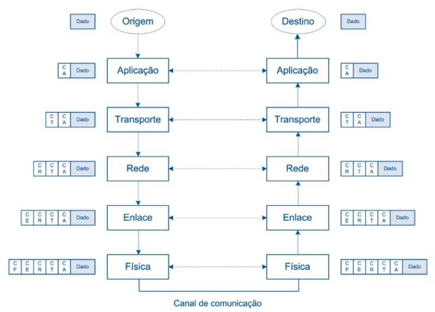<br>
*Fonte: MAIA, Luiz Paulo. Arquitetura de Redes de Computadores, 2ª ed., 2013, p. 37.*

### Topologias com Meio Compartilhado (Multiponto):

Vários dispositivos utilizam o mesmo meio para se comunicar. O acesso ao meio precisa ser coordenado para evitar ou lidar com transmissões que interferem entre si.

| Topologia ou arranjo | Organização | Consequência |
| --- | --- | --- |
| **Barramento** | Os dispositivos se conectam a um trecho de cabo comum, pelo qual o sinal se propaga. | Uma falha no cabo compartilhado pode afetar vários dispositivos. |
| **Anel** | Os dispositivos formam um circuito fechado, que pode ser construído com enlaces ponto a ponto entre vizinhos. Em redes *Token Ring*, um *token* circula pelo anel e autoriza a estação que o detém a transmitir. | Uma falha pode interromper a comunicação em um anel simples. Algumas implementações oferecem caminhos de proteção. |
| **Canal sem fio compartilhado** | Vários dispositivos na mesma área usam um canal de rádio comum, como estações conectadas a um ponto de acesso Wi-Fi. | Transmissões simultâneas no mesmo canal podem interferir entre si quando chegam ao mesmo receptor. |

<br>
*Fonte: MAIA, Luiz Paulo. Arquitetura de Redes de Computadores, 2ª ed., 2013, p. 38.*

> A **topologia física** descreve como os dispositivos e os enlaces estão dispostos. A **topologia lógica** descreve como os dados circulam por essa estrutura. Por exemplo, os cabos de uma rede com um *hub* formam uma estrela, mas o equipamento repete o sinal recebido para as demais portas. Assim, os dispositivos compartilham o meio de transmissão (na prática, é um barramento).

## Técnicas para Transmissão da Informação:

### Conversão dos Dados:

A pressão sonora captada por um microfone varia continuamente. Em uma chamada de voz, o aparelho precisa converter essa informação analógica em dados digitais (**digitalização**). Uma técnica comum é o **PCM** (*Pulse Code Modulation*), que realiza a conversão em três etapas:

1. **Amostragem:** Mede a amplitude do sinal do microfone em intervalos regulares.
2. **Quantização:** Aproxima o valor de cada amostra por um dos níveis disponíveis.
3. **Codificação:** Representa o nível escolhido por uma sequência de bits.

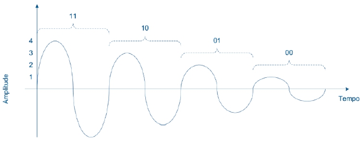<br>
*Fonte: MAIA, Luiz Paulo. Arquitetura de Redes de Computadores, 2ª ed., 2013, p. 117.*

Para transmitir esses *bits*, é preciso escolher como representá-los no meio. Duas possibilidades são associá-los a níveis ou transições de um sinal e utilizá-los para modificar uma onda portadora.

### Sinalização Digital:

Na sinalização digital, o receptor distingue um conjunto de estados ou transições. Em um exemplo simples, o transmissor mantém uma tensão baixa durante um intervalo para representar `0` e uma tensão alta para representar `1`. Para enviar `1011`, aplica os níveis alto, baixo, alto e alto em quatro intervalos consecutivos.

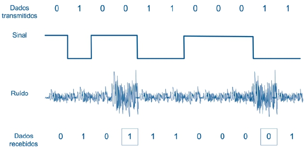<br>
*Fonte: MAIA, Luiz Paulo. Arquitetura de Redes de Computadores, 2ª ed., 2013, p. 118.*

Os dois últimos *bits* têm o mesmo valor e, nessa representação, a tensão permanece alta durante ambos. Para reconhecer que recebeu **dois *bits***, o receptor precisa conhecer a duração de cada intervalo. Outras formas de codificação introduzem transições que ajudam o receptor a manter esse sincronismo.

### Sinalização Analógica e Modulação:

Uma **portadora** é uma onda cuja variação pode transportar informação. **Modular** a portadora consiste em alterar uma de suas características, como **amplitude**, **frequência** ou **fase**, de acordo com os dados enviados.

Por exemplo, o transmissor pode escolher uma frequência para representar `0` e outra para `1`. Embora a onda varie continuamente no tempo, o receptor distingue duas possibilidades e recupera um dado digital. Esse princípio permite transmitir *bits* por rádio.

<br>
*Fonte: MAIA, Luiz Paulo. Arquitetura de Redes de Computadores, 2ª ed., 2013, p. 121.*

### Sinalização Multinível:

Um símbolo pode representar vários *bits*. Se o receptor consegue distinguir **quatro níveis** de sinal, é possível associá-los a `00`, `01`, `10` e `11`. Nesse caso, a sequência `1011` exige apenas dois símbolos: o correspondente a `10` e o correspondente a `11`.

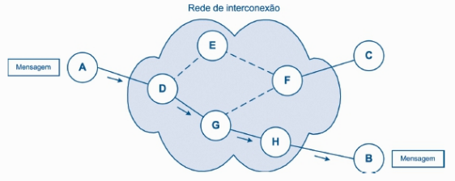<br>
*Fonte: MAIA, Luiz Paulo. Arquitetura de Redes de Computadores, 2ª ed., 2013, p. 123.*

- **Taxa de símbolos:** Quantidade de símbolos transmitidos por segundo, medida em *baud* (Bd).
- **Taxa de *bits*:** Quantidade de *bits* transmitidos por segundo, medida em *bit*/s.

Com dois *bits* por símbolo, `1.000 Bd` correspondem a `2.000 bit/s`. Usar mais níveis permite transmitir mais *bits* no mesmo intervalo, mas exige que o receptor consiga distinguir estados mais próximos entre si para uma mesma faixa de amplitude.

## Modos de Transmissão e Sincronismo:

Uma transmissão pode ser classificada pelo sentido da comunicação, pela disposição dos dados e pela forma de sincronizar o receptor.

| Critério | Modo | Funcionamento |
| --- | --- | --- |
| **Sentido** | *Simplex* | A informação segue em um único sentido, como na radiodifusão de uma emissora para seus ouvintes. |
| **Sentido** | *Half-duplex* | As duas extremidades podem transmitir, uma de cada vez, como em um par de rádios comunicadores. |
| **Sentido** | *Full-duplex* | As duas extremidades podem transmitir simultaneamente, como em um enlace Ethernet de um computador a um switch operando nesse modo. |
| **Disposição** | Serial | Os bits seguem em sequência em cada via de transmissão. Uma interface pode combinar várias vias seriais em paralelo, como ocorre no PCIe. |
| **Disposição** | Paralela | Vários *bits* são enviados simultaneamente por vias distintas, como em um barramento de oito linhas de dados. |
| **Sincronismo** | Assíncrona (*start/stop*) | O receptor usa uma taxa combinada e ajusta o instante de leitura ao detectar o bit de início de cada caractere. Um ou mais bits de parada marcam o fim da unidade. |
| **Sincronismo** | Síncrona | O receptor mantém uma referência de tempo durante um bloco ou fluxo de dados. O relógio pode ser enviado por uma linha própria ou recuperado do sinal, dispensando bits de início e parada a cada caractere. |

> Em uma UART configurada com oito bits de dados, um de início e um de parada, cada byte ocupa dez intervalos de bit no meio. Nesse formato, 80% do tempo de transmissão do caractere corresponde aos dados.

## Limitações do Canal e Capacidade de Transmissão:

Ao percorrer o meio, o sinal pode chegar mais fraco e sofrer interferências. Se dois símbolos transmitidos passam a produzir valores muito parecidos no receptor, aumenta a chance de interpretar um pelo outro.

- **Ruído e interferência:** Perturbações que dificultam a identificação dos símbolos. O **ruído térmico** surge da agitação dos portadores de carga nos componentes. Já a **diafonia** (*crosstalk*) ocorre quando parte do sinal de um canal interfere em outro, como pode acontecer entre pares de fios vizinhos.

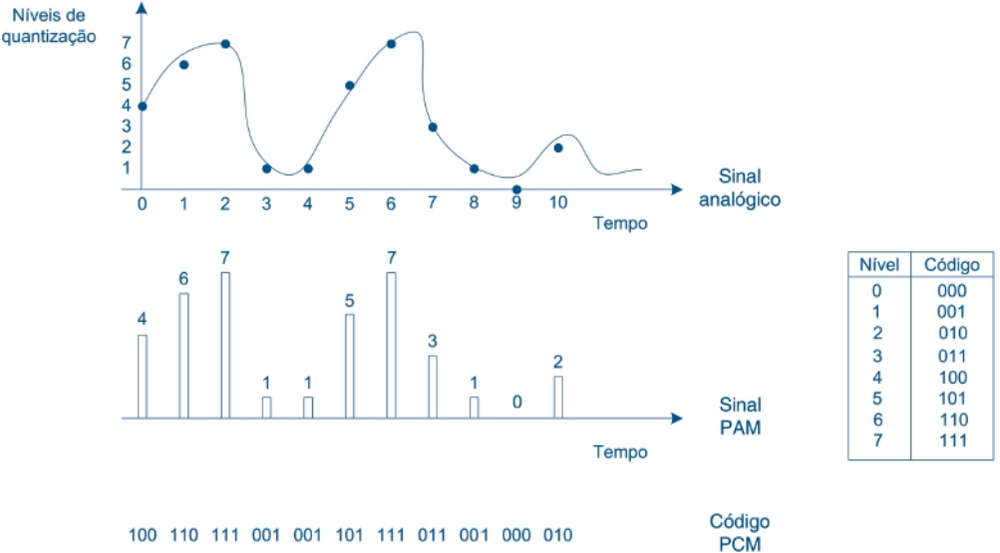<br>
*Fonte: MAIA, Luiz Paulo. Arquitetura de Redes de Computadores, 2ª ed., 2013, p. 98.*

- **Atenuação:** Redução da potência do sinal ao longo do percurso. Quanto maior a perda, mais fraco o sinal chega ao receptor.

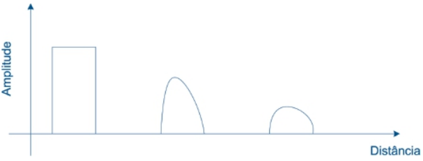<br>
*Fonte: MAIA, Luiz Paulo. Arquitetura de Redes de Computadores, 2ª ed., 2013, p. 100.*

- **Relação sinal-ruído (SNR):** Razão entre a potência do sinal e a potência do ruído no receptor. Se a atenuação reduz a potência do sinal recebido e a potência do ruído permanece aproximadamente constante, a SNR diminui e os símbolos ficam mais difíceis de distinguir.
- **Largura de banda:** Extensão da faixa de frequências disponível para a transmissão, medida em hertz (Hz). Um canal que vai de `1 kHz` a `4 kHz` tem largura de banda de `3 kHz`.

A **capacidade de transmissão** expressa uma taxa em *bit*/s. Dois limites teóricos mostram como ela se relaciona com a largura de banda e com as condições do canal:

| Limite | Condição considerada | Taxa máxima teórica |
| --- | --- | --- |
| **Nyquist** | Canal ideal sem ruído, com largura de banda $W$ e $N$ níveis de sinalização. | $C = 2W\log_2(N)$ |
| **Shannon** | Canal de largura de banda $W$ com ruído branco gaussiano aditivo. | $C = W\log_2(1+\mathrm{SNR})$ |

Em Nyquist, cada símbolo representa $\log_2(N)$ *bits*. Por exemplo, passar de dois para quatro níveis permite passar de um para dois *bits* por símbolo. Shannon explica por que esse ganho encontra um limite em um canal real: para uma largura de banda e uma relação sinal-ruído fixas, aumentar o número de níveis indefinidamente acaba tornando os símbolos difíceis demais de distinguir.

> Nas fórmulas, $W$ é dado em hertz. Em Shannon, a SNR entra como razão entre potências. Se estiver expressa em decibéis, a conversão é $\mathrm{SNR}=10^{\mathrm{SNR}_{\mathrm{dB}}/10}$. Por exemplo, `20 dB` correspondem a uma razão de `100`.

## Multiplexação:

A **multiplexação** permite transportar vários fluxos de informação por um mesmo meio físico. Na origem, o **multiplexador** combina os fluxos. No destino, o **demultiplexador** os separa pela faixa de frequência ou pelo intervalo de tempo que cada um ocupa.

| Técnica | Como os fluxos compartilham o meio | Exemplo |
| --- | --- | --- |
| **Divisão de frequência (FDM)** | Cada fluxo ocupa uma faixa de frequências diferente. Vários podem transmitir ao mesmo tempo. | Emissoras de rádio transmitem simultaneamente em frequências diferentes. O ouvinte seleciona a emissora ao sintonizar sua frequência. |
| **Divisão de tempo (TDM)** | Cada fluxo utiliza o canal durante determinados intervalos de tempo. | Um equipamento reúne medições de três sensores e transmite, em sequência, uma amostra de cada um pelo mesmo enlace. |

Na **divisão de tempo (TDM)**, os intervalos de transmissão (*slots*) podem ser distribuídos de duas formas:

- **TDM síncrono:** Cada canal recebe uma posição fixa que se repete a cada ciclo. Se três sensores transmitem nas posições A, B e C e o sensor B está sem dados, seu intervalo fica ocioso.
- **TDM estatístico (assíncrono):** Os intervalos são atribuídos conforme a demanda. Se B está sem dados, o sistema pode aproveitar esse tempo para transmitir dados de A ou C. O receptor precisa conseguir identificar a qual canal pertence cada bloco recebido.

> FDM e TDM podem ser combinados. Um sistema pode separar canais por frequência e, dentro de cada faixa, dividir o tempo entre várias transmissões.

Quando vários dispositivos podem iniciar transmissões por conta própria, surge outra questão: **como decidir quem pode transmitir em cada momento?** Esse é um dos problemas tratados pela camada de Enlace.

---

# 3. Camada de Enlace

> Como um dispositivo organiza os dados em quadros e os entrega ao próximo equipamento no caminho?

## Entrega em um Enlace:

Considere um *notebook* que precisa enviar dados a dois destinos: uma impressora na mesma rede local e um servidor na Internet. Para alcançar a impressora, o *notebook* pode enviar um **quadro** endereçado a ela. Para alcançar o servidor, ele envia o quadro ao **roteador** da rede local. Nesse segundo caso, o quadro tem como destino o roteador, enquanto o pacote que ele transporta tem como destino o servidor.

A **camada de Enlace** organiza essa entrega local. Ao encaminhar o pacote, o roteador retira o quadro recebido e prepara outro, adequado ao enlace seguinte. Cada trecho pode utilizar uma tecnologia diferente e ter suas próprias regras de endereçamento, acesso ao meio e tratamento de erros.

## Quadros e Enquadramento:

Um **quadro** (*frame*) é a unidade de dados utilizada na comunicação de enlace. Seu formato depende do protocolo, mas costuma reunir três partes:

| Parte | Função |
| --- | --- |
| **Cabeçalho** | Contém informações de controle, como os endereços locais de origem e destino ou a identificação do protocolo transportado. |
| **Carga útil** | Contém os dados transportados pelo quadro, como um pacote recebido da camada de Rede. |
| **Campo final** | Pode conter um código que permite ao receptor verificar se houve alteração nos bits protegidos. |

O **enquadramento** permite ao receptor reconhecer onde um quadro começa e termina. Alguns protocolos usam sequências reservadas chamadas *flags* para marcar esses limites. Outros utilizam informações de comprimento ou sinais de início e fim definidos pela tecnologia.

<br>
*Fonte: MAIA, Luiz Paulo. Arquitetura de Redes de Computadores, 2ª ed., 2013, p. 153.*

O uso de uma *flag* cria um problema: a mesma sequência pode aparecer por acaso na carga útil. Para que o receptor consiga distinguir o marcador dos dados, o transmissor pode inserir elementos extras, removidos na recepção. Essa técnica é chamada de ***stuffing***.

- ***Byte stuffing*:** O transmissor insere um byte de escape antes de um valor reservado que aparece nos dados. Ao encontrar o escape, o receptor sabe que deve interpretar o valor seguinte como dado.
- ***Bit stuffing*:** O transmissor insere um bit quando a sequência de dados está prestes a formar um marcador. O receptor reconhece a inserção pela mesma regra e remove esse bit para recuperar a sequência original.

## Endereçamento e Encaminhamento Local:

Em tecnologias como Ethernet, os **endereços MAC** identificam as interfaces envolvidas na comunicação local. O quadro informa qual interface o enviou (**origem**) e a qual interface ou conjunto de interfaces ele se destina (**destino**).

| Tipo de entrega | Quem deve receber | Exemplo |
| --- | --- | --- |
| ***Unicast*** | Uma interface específica. | O *notebook* envia um trabalho à impressora da rede local. |
| ***Multicast*** | Um grupo de interfaces. | Um equipamento envia dados a um grupo de receptores de vídeo. |
| ***Broadcast*** | Todas as interfaces no mesmo domínio de *broadcast*. | O *notebook* faz uma consulta a toda a rede local para descobrir o endereço de um vizinho. |

Uma **ponte** ou um ***switch*** usa o endereço de destino para decidir por onde encaminhar o quadro. Se o switch já sabe em qual porta está a impressora, pode encaminhar o quadro *unicast* apenas por essa porta. Se recebe um *broadcast*, distribui o quadro pelas demais portas que pertencem àquela rede lógica. O alcance dessa distribuição define o **domínio de broadcast**.

## Controle de Acesso ao Meio:

Quando vários dispositivos compartilham um canal, dois deles podem tentar transmitir ao mesmo tempo. Se os sinais se sobrepõem no receptor e impedem a leitura correta de um quadro, ocorre uma **colisão**. O **controle de acesso ao meio** estabelece as regras para que os participantes utilizem o canal.

| Estratégia | Como os dispositivos usam o meio | Consequência |
| --- | --- | --- |
| **Acesso particionado** | Cada participante recebe um recurso, como uma faixa de frequência, um intervalo de tempo ou um código que distingue sua transmissão. | A separação permite que vários dispositivos usem o meio de forma organizada. Uma parcela reservada pode ficar ociosa. |
| **Acesso por disputa (aleatório)** | Quem tem dados tenta transmitir conforme as regras do protocolo. Uma estratégia é verificar se o canal parece livre antes de começar. | Aproveita o canal conforme a demanda. Duas estações ainda podem percebê-lo livre quase ao mesmo tempo e iniciar transmissões que colidem. |
| **Acesso ordenado** | Uma regra concede a vez de transmitir. Um controlador pode consultar as estações em sequência (*polling*), ou uma autorização pode circular entre elas (*token*). | A autorização organiza os turnos. O tempo gasto para conceder ou transferir a vez também ocupa parte da comunicação. |

> A multiplexação por tempo, vista na camada Física, explica como vários fluxos ocupam intervalos diferentes de um canal. Quando esses fluxos vêm de estações independentes, o controle de acesso também precisa definir **qual estação pode usar cada intervalo**.

## Detecção e Correção de Erros:

Se um bit se altera durante a transmissão, o receptor pode receber uma sequência diferente da enviada. Para identificar esse tipo de falha, o transmissor acrescenta **redundância**: bits calculados a partir dos dados protegidos. O receptor verifica se a relação entre os dados e os bits adicionais continua válida. Uma inconsistência revela um erro. Se a verificação passa, sabe-se apenas que o método **não detectou erro**.

### Paridade, Checksum e CRC:

| Método | Como funciona |
| --- | --- |
| **Bit de paridade** | Acrescenta um bit para que a quantidade total de bits `1` seja par (**paridade par**) ou ímpar (**paridade ímpar**). |
| ***Checksum*** | Combina blocos de dados, geralmente por meio de uma soma, para obter um valor de verificação. A regra de cálculo depende do protocolo. |
| **CRC** (*Cyclic Redundancy Check*) | Calcula um valor de verificação por uma divisão binária baseada em `XOR`. É utilizado, por exemplo, na verificação de quadros Ethernet. |

Na **paridade par**, os dados `1011` contêm três bits `1`. O transmissor acrescenta `1` e envia `10111`, agora com quatro bits `1`. Se o receptor ler `10011`, contará três e detectará o erro. Se dois bits forem invertidos, a contagem continuará par e a alteração passará despercebida.

### Distância de Hamming:

Detectar uma alteração exige reconhecer que o valor recebido é inválido. **Corrigir** exige também identificar qual valor foi enviado. A **distância de Hamming** ajuda a entender quando isso é possível: ela corresponde à quantidade de posições em que duas sequências de mesmo tamanho diferem. Por exemplo, `111000` e `110001` diferem em duas posições e têm distância 2.

A **distância mínima** ($d_{\min}$) de um código é a menor distância entre duas de suas palavras válidas. Ela determina quantas inversões de bits o código pode garantir que detecta ou corrige:

| Objetivo | Distância mínima necessária |
| --- | --- |
| Detectar até $n$ inversões de bits por palavra | $d_{\min} \geq n + 1$ |
| Corrigir até $n$ inversões de bits por palavra | $d_{\min} \geq 2n + 1$ |

Imagine um código cujas únicas palavras válidas são `000` e `111`. A distância entre elas é 3. Se o receptor lê `010` e houve no máximo uma inversão, consegue recuperar `000`: basta alterar um bit para chegar a `000`, enquanto seriam necessárias duas alterações para chegar a `111`. O código de Hamming aplica esse princípio usando bits de paridade em posições específicas. Sua construção é detalhada no Apêndice A.

## Recuperação de Perdas e Controle de Fluxo:

### Recuperação por Retransmissão:

Quando um quadro se perde ou chega com um erro que o receptor só consegue detectar, uma forma de recuperar os dados é **retransmitir o quadro**. Isso depende do protocolo. Em um enlace que oferece apenas detecção e descarte, uma eventual recuperação fica a cargo de outra camada.

No esquema de **parada e espera** (*Stop-and-Wait*), o transmissor envia um quadro e aguarda a confirmação de recebimento (**ACK**, *acknowledgement*) antes de enviar o próximo.

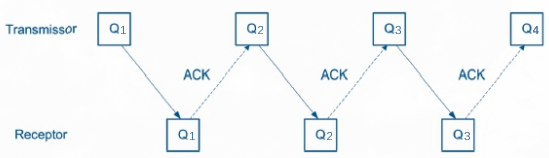<br>
*Fonte: MAIA, Luiz Paulo. Arquitetura de Redes de Computadores, 2ª ed., 2013, p. 163.*

Para recuperar perdas, o transmissor pode iniciar um **temporizador** após o envio. Se o prazo expirar (*timeout*) sem o ACK esperado, ele retransmite. Alguns protocolos também permitem que o receptor sinalize a falha com uma confirmação negativa (**NAK**), antecipando o reenvio.

O próprio **ACK pode se perder**. Nesse caso, o receptor já aceitou o quadro, mas o transmissor chega ao fim do prazo e envia uma segunda cópia.

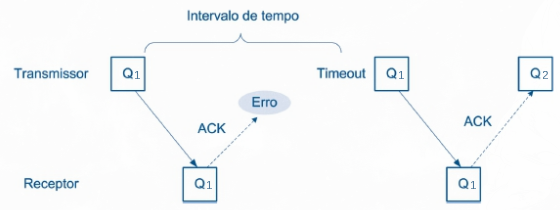<br>
*Fonte: MAIA, Luiz Paulo. Arquitetura de Redes de Computadores, 2ª ed., 2013, p. 164.*

Um **número de sequência** permite ao receptor reconhecer a duplicata e repetir a confirmação sem entregar os mesmos dados duas vezes. A combinação de verificação de erros, confirmações e retransmissões recebe o nome de **ARQ** (*Automatic Repeat reQuest*).

Esperar uma confirmação por quadro pode deixar o enlace ocioso. Protocolos com **janela de transmissão** permitem manter vários quadros enviados e ainda sem confirmação. Conforme os ACKs chegam, a janela avança e libera o envio de novos quadros.

### Controle de Fluxo:

Mesmo quando todos os quadros chegam sem erro, um transmissor rápido pode enviá-los antes que o receptor consiga processá-los. O receptor guarda temporariamente os quadros em uma área de memória (*buffer*). Se ela encher, novos quadros podem ser descartados. O **controle de fluxo** ajusta o envio à capacidade do receptor.

- **Pausa e retomada:** O receptor solicita uma pausa antes de esgotar o espaço e autoriza a retomada quando volta a ter capacidade.
- **Créditos ou janela anunciada:** O receptor informa quanto ainda pode aceitar. Se há espaço para três quadros e esse espaço é anunciado como três créditos, o transmissor pode enviar até essa quantidade antes de precisar de novos créditos.

Uma **confirmação** informa o que já foi recebido. Um **crédito** informa quanto ainda pode ser enviado. Um protocolo pode comunicar as duas informações na mesma mensagem. Já o **controle de congestionamento** trata da sobrecarga no caminho pela rede, que pode ocorrer mesmo quando o receptor final tem espaço disponível.

---

# 4. Camada de Rede

> Quando o destino está em outra rede, como cada equipamento decide para onde enviar o pacote até que ele chegue ao destino?

## Entrega entre Redes:

Considere um notebook que precisa imprimir um documento e, depois, enviá-lo a um servidor da faculdade. A impressora está na mesma rede local. O servidor está em outra rede, acessível por um roteador. Como o notebook decide a quem entregar cada transmissão?

A **camada de Rede** utiliza endereços lógicos para identificar as interfaces de origem e destino e encaminha os **pacotes** entre redes. Na Internet, essa função é desempenhada pelo **IP** (*Internet Protocol*). O computador consulta suas rotas para decidir se pode entregar o pacote diretamente ao destino ou se deve enviá-lo a um equipamento intermediário, o **próximo salto**.

<br>
*Fonte: MAIA, Luiz Paulo. Arquitetura de Redes de Computadores, 2ª ed., 2013, p. 261.*

Um **roteador** possui interfaces em diferentes redes. Ao receber um pacote, ele consulta o endereço IP de destino, escolhe uma saída e prepara o pacote para o enlace seguinte. Cada roteador faz sua própria consulta. Assim, o notebook pode alcançar o servidor conhecendo apenas o primeiro roteador do percurso.

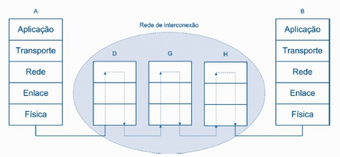<br>
*Fonte: MAIA, Luiz Paulo. Arquitetura de Redes de Computadores, 2ª ed., 2013, p. 262.*

No exemplo do servidor, o primeiro **quadro** tem como destino de enlace a interface local do roteador. Dentro dele, o **pacote** tem como destino IP o servidor. Ao passar de um enlace roteado para outro, o pacote recebe um novo quadro, adequado à próxima entrega.

## Comutação:

A **comutação** permite interligar as extremidades por equipamentos intermediários. A maneira de utilizar os recursos do caminho depende do tipo de rede.

### Comutação por Circuito:

Na comutação por circuito, a rede estabelece um caminho entre a origem e o destino e reserva capacidade para a comunicação. Uma ligação telefônica tradicional ilustra as três fases:

1. **Estabelecimento:** Ao iniciar a chamada, a rede escolhe o caminho e reserva os recursos necessários em cada trecho.
2. **Transferência:** A conversa utiliza o circuito estabelecido. Mesmo durante uma pausa, a capacidade reservada continua à disposição daquela chamada.
3. **Liberação:** Ao desligar, os recursos são liberados e podem atender a outras comunicações.

<br>
*Fonte: MAIA, Luiz Paulo. Arquitetura de Redes de Computadores, 2ª ed., 2013, p. 263.*

Um mesmo enlace físico pode transportar vários circuitos, cada um com sua parcela de capacidade. Se um enlace do caminho falhar, a comunicação pode ser interrompida até que a rede restabeleça o circuito por outro caminho.

### Comutação por Pacotes:

Os dados são enviados em pacotes, que compartilham os enlaces com pacotes de outras comunicações. A capacidade pode ser usada conforme a demanda. Se vários pacotes precisam da mesma saída, podem formar uma fila e, se faltar espaço, sofrer descarte.

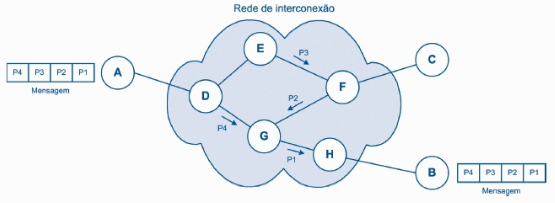<br>
*Fonte: MAIA, Luiz Paulo. Arquitetura de Redes de Computadores, 2ª ed., 2013, p. 265.*

### Datagramas e Circuitos Virtuais:

Uma rede de pacotes pode tomar a decisão de encaminhamento de duas maneiras:

- **Datagrama:** Cada pacote traz o endereço de destino e é encaminhado de acordo com a tabela disponível em cada roteador. É o modelo do IP. Pacotes de uma comunicação podem seguir pelo mesmo caminho enquanto as rotas forem estáveis ou percorrer caminhos diferentes após uma mudança. O IP oferece entrega de **melhor esforço**, sem garantia de entrega ou de ordem.
- **Circuito virtual:** Antes do envio, a rede estabelece um caminho lógico e registra nos equipamentos como encaminhar os pacotes daquele circuito. Durante a comunicação, um identificador permite consultar essa associação. Vários circuitos virtuais podem compartilhar o mesmo enlace físico, e a reserva de capacidade depende do serviço oferecido.

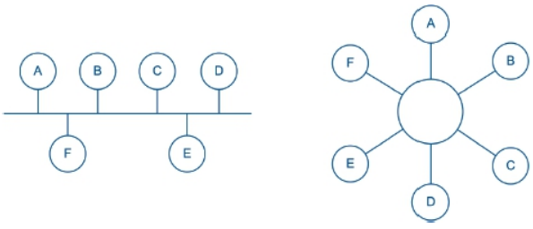<br>
*Fonte: MAIA, Luiz Paulo. Arquitetura de Redes de Computadores, 2ª ed., 2013, p. 41.*

## Endereçamento Lógico e Sub-redes:

Um endereço IP identifica uma **interface de rede**. Um notebook conectado por cabo e por Wi-Fi pode ter um endereço em cada interface. Uma mesma interface também pode possuir endereços IPv4 e IPv6 ao mesmo tempo.

O **IPv4** utiliza 32 bits, geralmente escritos como quatro números decimais separados por pontos. O **IPv6** utiliza 128 bits, organizados em grupos hexadecimais. 

O endereço de uma interface pode ser interpretado em duas partes. O **identificador de rede** (*NetID*) é o prefixo comum às interfaces da mesma sub-rede. O **identificador de host** (*HostID*) distingue a interface dentro dessa sub-rede. O comprimento do prefixo indica onde termina uma parte e começa a outra.

Por exemplo, em `192.168.10.34/27`, os primeiros 27 bits identificam a sub-rede `192.168.10.32/27`. Os cinco bits restantes identificam a interface dentro dela. No último octeto, `34` corresponde a `00100010` em binário. Os três primeiros bits (`001`) ainda pertencem ao prefixo, e os cinco últimos (`00010`) formam o HostID.

A atribuição de endereços pode ser **estática**, quando configurada diretamente, ou **dinâmica**, como ocorre no IPv4 quando o computador recebe sua configuração por DHCP. Endereços privados, como os do exemplo, podem ser reutilizados em redes independentes. Ao acessar a Internet por IPv4, essas redes frequentemente usam **NAT** para traduzir os endereços na saída.

> No Linux, `ip a` permite observar duas camadas na mesma interface: `link/ether` mostra o endereço de enlace, enquanto `inet` e `inet6` mostram os endereços IPv4 e IPv6 com seus prefixos. A leitura da saída está em A.2.1.

### Endereçamento por Classes e CIDR:

No modelo histórico de **endereçamento por classes**, os bits iniciais do endereço IPv4 indicavam sua classe. Para A, B e C, a classe determinava o tamanho inicial da parte de rede. As classes D e E tinham finalidades próprias.

| Classe | Bits iniciais | Faixa do primeiro octeto | Divisão ou finalidade |
| --- | --- | --- | --- |
| **A** | `0` | 0 a 127 | 8 bits de rede e 24 de host (`/8`). |
| **B** | `10` | 128 a 191 | 16 bits de rede e 16 de host (`/16`). |
| **C** | `110` | 192 a 223 | 24 bits de rede e 8 de host (`/24`). |
| **D** | `1110` | 224 a 239 | Endereçamento de grupos (*multicast*). |
| **E** | `1111` | 240 a 255 | Faixa historicamente reservada, com endereços de uso especial. |

> A tabela mostra como identificar as classes. Algumas faixas têm uso especial, como `127.0.0.0/8`, utilizada para *loopback*.

Considere uma organização com **500 interfaces**. Uma rede classe C oferecia 254 endereços de host utilizáveis. Uma classe B oferecia 65.534, reservando muito mais endereços que o necessário. Receber duas redes classe C reduziria o desperdício, mas cada rede poderia exigir uma entrada própria nas tabelas de roteamento.

O **CIDR** (*Classless Inter-Domain Routing*) tornou explícito o tamanho do prefixo na alocação de blocos e no anúncio de rotas. Nesse exemplo, um bloco `/23` oferece 512 endereços, dos quais 510 podem ser atribuídos a interfaces em uma sub-rede IPv4 convencional. Além de permitir blocos mais adequados à demanda, o CIDR permite **agregar rotas**: redes contíguas e alinhadas podem ser anunciadas por um único prefixo quando compartilham o mesmo encaminhamento.

### Exemplo de uma Sub-rede IPv4:

Com `/27`, cada bloco contém $2^5 = 32$ endereços. A máscara correspondente é `255.255.255.224`. No exemplo, o notebook pertence ao bloco que começa em `.32` e termina em `.63`.

| Elemento | Endereço | Interpretação |
| --- | --- | --- |
| **Endereço da sub-rede** | `192.168.10.32/27` | Identifica o bloco de endereços. |
| **Roteador local** | `192.168.10.33` | Interface do roteador que o notebook consegue alcançar diretamente. |
| **Notebook** | `192.168.10.34` | Interface Wi-Fi utilizada neste exemplo. |
| **Impressora** | `192.168.10.50` | Pertence ao mesmo bloco do notebook. |
| ***Broadcast* da sub-rede** | `192.168.10.63` | Endereço de difusão desse bloco IPv4. |
| **Servidor** | `192.168.10.70` | Pertence ao bloco seguinte, `192.168.10.64/27`. |

Embora os três primeiros números sejam iguais, a impressora e o servidor estão em sub-redes diferentes. É o comprimento do prefixo que permite fazer essa distinção. A configuração do endereço e do prefixo pode ser **estática**, informada diretamente, ou **dinâmica**, como ocorre no IPv4 quando o computador recebe sua configuração por DHCP.

O endereçamento por prefixos também permite **agregar rotas**. Por exemplo, `192.168.10.0/27` e `192.168.10.32/27` formam, juntos, o bloco `192.168.10.0/26`. Se ambos puderem ser alcançados pela mesma direção, outro roteador pode representá-los por uma única rota. Essa organização por prefixos de comprimento variável é a base do **CIDR** (*Classless Inter-Domain Routing*).

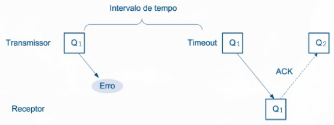<br>
*Fonte: Elaborado pelo autor com auxílio do ChatGPT, 2026.*

## Encaminhamento e Próximo Salto:

Uma **tabela de rotas** associa redes de destino a interfaces de saída. Quando o destino precisa ser alcançado por um roteador, a rota também indica o **próximo salto**.

No laboratório, considere que o notebook possui apenas duas rotas: uma para a rede diretamente conectada `192.168.10.32/27` e uma **rota padrão** pelo roteador `192.168.10.33`.

| Destino do pacote | Decisão do notebook | Destino do quadro local |
| --- | --- | --- |
| **Impressora `192.168.10.50`** | A impressora pertence à sub-rede diretamente conectada. | MAC da impressora. |
| **Servidor `192.168.10.70`** | O servidor está em outra sub-rede. O notebook usa a rota padrão. | MAC do roteador `192.168.10.33`. |

Quando mais de uma rota corresponde ao destino, prevalece o **prefixo mais longo**, que descreve o bloco mais específico. A rota padrão tem prefixo de comprimento zero (`0.0.0.0/0` em IPv4 ou `::/0` em IPv6) e atende aos destinos sem correspondência mais específica. O roteador indicado por ela é o **gateway padrão**.

Depois de escolher o próximo salto, o notebook precisa descobrir seu endereço de enlace. Em uma rede Ethernet com IPv4, essa associação é feita por **ARP**. Para imprimir, o notebook procura o MAC de `.50`. Para enviar ao servidor `.70`, procura o MAC de `.33`. O endereço IP de destino do pacote continua sendo o do servidor. Em IPv6, a resolução do endereço de enlace faz parte da **descoberta de vizinhos** (*Neighbor Discovery*).

> A tabela de rotas responde “por onde envio este pacote?”. A tabela de vizinhos responde “qual endereço de enlace uso para entregá-lo no próximo salto?”.

## Roteamento e Descoberta de Caminhos:

O **encaminhamento** acontece quando chega um pacote e o equipamento escolhe por onde enviá-lo. O **roteamento** determina e atualiza os caminhos que tornam essa escolha possível. Por isso, um roteador pode encaminhar muitos pacotes usando a mesma rota já calculada.

### Origem das Rotas:

| Origem | Como a rota aparece | Exemplo |
| --- | --- | --- |
| **Rede diretamente conectada** | O sistema reconhece um prefixo como alcançável pela própria interface. | A configuração `192.168.10.34/27` normalmente cria uma rota local para `192.168.10.32/27`. |
| **Rota estática** | Um administrador configura o destino e a saída. | Encaminhar `192.168.10.64/27` pelo roteador `.62`. |
| **Rota dinâmica** | Roteadores trocam informações e atualizam os caminhos conforme o protocolo utilizado. | Um roteador aprende que uma rede passou a ser alcançável por outro vizinho após uma falha. |

Três termos descrevem partes diferentes dessa decisão. A **métrica** mede o custo de um caminho, como a quantidade de saltos. O **algoritmo** usa as informações disponíveis para determinar os caminhos. O **protocolo** define as mensagens e as regras que os roteadores seguem para trocar e atualizar essas informações.

### Vetor de Distância e Estado de Enlace:

Imagine que o roteador A alcança uma rede passando por B. Se um enlace adiante falhar, como A descobrirá uma alternativa? Duas estratégias diferem principalmente pelo que A aprende dos outros roteadores.

| Estratégia | O que cada roteador conhece | Como escolhe o caminho |
| --- | --- | --- |
| **Vetor de distância** | Os destinos e custos anunciados pelos vizinhos. | Soma o custo de chegar ao vizinho ao custo que ele anunciou para o destino. Compara as alternativas e escolhe o próximo salto. O RIP é um exemplo. |
| **Estado de enlace** | Informações sobre enlaces e custos distribuídas pelos roteadores da área. | Monta um mapa da topologia e calcula caminhos a partir de si mesmo. O OSPF utiliza essa abordagem e o algoritmo de Dijkstra. |

<br>
*Fonte: MAIA, Luiz Paulo. Arquitetura de Redes de Computadores, 2ª ed., 2013, p. 301.*

No vetor de distância, se B deixa de alcançar o destino, A precisa receber a atualização ou perceber que a informação expirou. No estado de enlace, a mudança do enlace é anunciada, permitindo aos roteadores recalcular seus caminhos. Até que as atualizações se propaguem, alguns equipamentos podem continuar usando informações antigas, provocando perdas ou ciclos temporários.

<br>
*Fonte: MAIA, Luiz Paulo. Arquitetura de Redes de Computadores, 2ª ed., 2013, p. 305.*

A **convergência** ocorre quando os roteadores se ajustam à nova situação e as rotas se estabilizam. Um caminho alternativo só ajuda se estiver disponível e se os equipamentos conseguirem passar a utilizá-lo.

### Hierarquia e Sistemas Autônomos:

Na escala da Internet, as redes são organizadas em **sistemas autônomos** (AS), conjuntos de redes sob uma administração técnica comum e com uma política de roteamento definida. Uma operadora, por exemplo, pode administrar vários prefixos e roteadores dentro de um mesmo AS.

Dentro do AS, o roteamento pode privilegiar custos internos. Entre sistemas autônomos, a escolha de caminhos também considera políticas, como quais redes uma operadora aceita alcançar por determinado vizinho. Os **roteadores de borda** fazem a interligação com outros sistemas. A agregação de prefixos ajuda a anunciar destinos externos sem expor cada subdivisão interna.

<br>
*Fonte: MAIA, Luiz Paulo. Arquitetura de Redes de Computadores, 2ª ed., 2013, p. 317.*

## Distribuição para Múltiplos Destinos:

Se um servidor envia o mesmo conteúdo para vinte receptores por **unicast**, ele mantém envios individuais. Se os caminhos compartilham um mesmo enlace, várias cópias idênticas podem passar por esse trecho. Uma rede com suporte à entrega em grupo pode transportar uma cópia pelo trecho comum e replicá-la onde os caminhos se separam.

| Forma de entrega | Destinatários | Alcance |
| --- | --- | --- |
| ***Unicast*** | Uma interface de destino. | Segue o caminho escolhido para aquele endereço. |
| ***Broadcast*** | Todos os participantes de um âmbito de difusão. | No laboratório, o *broadcast* IPv4 `192.168.10.63` identifica a difusão da sub-rede `/27`. Seu alcance é delimitado pela rede e pelas regras de encaminhamento. |
| ***Multicast*** | Interfaces interessadas em um grupo. | Pode atravessar várias redes quando os roteadores oferecem suporte à distribuição para o grupo. |

<br>
*Fonte: MAIA, Luiz Paulo. Arquitetura de Redes de Computadores, 2ª ed., 2013, p. 318.*

### Inundação e Árvores de Distribuição:

Na **inundação** (*flooding*), cada nó que recebe uma mensagem a replica pelas demais saídas participantes. Se existem ciclos, cópias podem voltar ao mesmo nó. Identificadores de mensagens e registros das cópias já vistas permitem descartar duplicatas. Um limite de saltos também restringe por quanto tempo uma cópia pode circular.

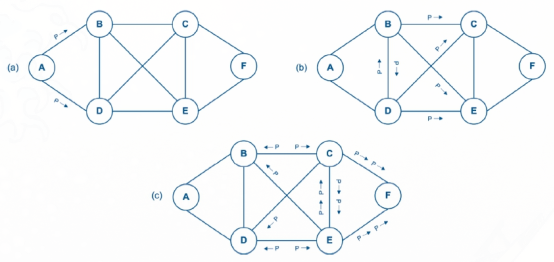<br>
*Fonte: MAIA, Luiz Paulo. Arquitetura de Redes de Computadores, 2ª ed., 2013, p. 318.*

Uma **árvore de distribuição** seleciona caminhos sem ciclos. No *multicast*, os ramos precisam alcançar as redes com receptores interessados. Uma **árvore por origem** pode favorecer os caminhos a partir de cada emissor. Uma **árvore compartilhada** permite que vários emissores usem a mesma estrutura, embora o percurso possa ficar mais longo para alguns deles.

> A inundação é uma técnica de distribuição utilizada por protocolos específicos. O *broadcast* local do laboratório fica no seu domínio de difusão. Em IPv6, funções de comunicação com grupos utilizam *multicast*.

## MTU e Fragmentação:

A **MTU** (*Maximum Transmission Unit*) de um enlace limita o tamanho do pacote de rede que ele pode transportar como uma unidade. A **MTU do caminho** é a menor MTU entre os enlaces do percurso.

Considere um pacote IP de **1.500 bytes** que chega a um roteador cuja próxima saída aceita apenas **1.280 bytes**. O pacote cabe no primeiro enlace e excede o limite do seguinte. O resultado depende da versão de IP e, no IPv4, da autorização para fragmentar.

| Situação | O que acontece |
| --- | --- |
| **IPv4 com fragmentação permitida** | O roteador pode dividir o datagrama em fragmentos que caibam no próximo enlace. Cada fragmento segue com seu próprio cabeçalho IPv4, e o destino usa as informações de identificação e posição para remontar o datagrama. |
| **IPv4 com DF (*Don't Fragment*)** | O roteador descarta o pacote grande demais e, no funcionamento previsto, informa a origem por ICMP de que seria necessário fragmentar. |
| **IPv6** | A fragmentação cabe à origem. Se um roteador encontra um pacote grande demais para a saída, ele o descarta e envia uma mensagem ICMPv6 *Packet Too Big*, indicando a MTU. |

Remontar um datagrama exige receber **todos** os seus fragmentos. Se um deles se perder, o destino não consegue entregar o datagrama completo. Conhecer a MTU do caminho permite à origem ajustar o tamanho dos pacotes antes do envio.

> **No Linux:** o campo `mtu` de `ip a` ou `ip link show` informa a MTU **da interface local**. Um valor de `1500` no notebook, por si só, não informa qual é a menor MTU do percurso até o servidor.

## Túneis, VPNs e Roteamento em Cebola:

### Túneis e VPNs:

Um aluno em casa precisa acessar `192.168.10.70`, endereço privado do servidor da faculdade. Para que o pacote atravesse a Internet e chegue à rede do laboratório, uma **VPN** (*Virtual Private Network*) pode estabelecer um **túnel** entre o notebook e um gateway da instituição. O princípio do túnel é encapsular o pacote original para transportá-lo entre suas extremidades.

Em uma VPN **IPsec em modo túnel**, com proteção criptográfica, o percurso de ida pode ser entendido em três etapas:

1. **No notebook:** Uma rota direciona o tráfego do laboratório para o túnel. O pacote interno mantém `192.168.10.70` como destino. O encapsulamento adiciona um cabeçalho IP externo cujo destino é o endereço público do gateway da VPN.
2. **Na Internet:** Os roteadores intermediários consultam o destino **externo** para encaminhar o pacote até a faculdade. A proteção do túnel cobre o pacote **interno** no trecho entre as extremidades.
3. **Na faculdade:** O gateway verifica a proteção, remove o encapsulamento e consulta o destino **interno**. A partir daí, encaminha o pacote ao servidor pelas rotas da instituição.

<br>
*Fonte: [preencher após a escolha da imagem].*

Esse é um exemplo de **acesso remoto**, em que um dispositivo se conecta à rede da instituição. Em uma VPN **entre redes** (*site-to-site*), os dois extremos do túnel podem ser gateways, por exemplo, um em cada campus. O encapsulamento acrescenta cabeçalhos e informações de proteção: para a mesma MTU externa, sobra menos espaço para o pacote interno.

### Roteamento em Cebola (*Onion Routing*):

No **roteamento em cebola**, o cliente prepara camadas de criptografia para retransmissores sucessivos. No **Tor**, esses retransmissores formam um **circuito** sobre a Internet. Para acessar um site público, um circuito típico passa por três papéis:

| Retransmissor | O que faz no percurso de ida |
| --- | --- |
| **Entrada** (*guard*) | Recebe a conexão do cliente, remove sua camada de criptografia e encaminha os dados ao retransmissor intermediário. Conhece o endereço do cliente e o próximo nó do circuito. |
| **Intermediário** (*middle relay*) | Remove sua camada e encaminha os dados à saída. Na troca normal, vê os retransmissores adjacentes. |
| **Saída** (*exit relay*) | Remove a última camada de proteção do circuito e abre a conexão com o site público. O site recebe a conexão a partir do endereço da saída. |

A imagem da **cebola** vem dessas camadas sucessivas: o cliente prepara os dados para que cada retransmissor consiga remover apenas a camada correspondente à sua etapa. O caminho de volta recebe proteção na direção inversa. O objetivo é distribuir o conhecimento do percurso entre os participantes.

<br>
*Fonte: [preencher após a escolha da imagem].*

O Tor é uma **rede sobreposta**. A entrada, o intermediário e a saída são os nós escolhidos para o circuito Tor. Entre quaisquer dois deles, os pacotes continuam atravessando os roteadores IP da Internet. A proteção do circuito alcança o nó de saída. Ao acessar um site por **HTTPS**, a conexão criptográfica entre o navegador e o site continua protegendo o conteúdo também no trecho entre a saída e o servidor.

---

# Apêndice A. Arquitetura Prática de Redes

> Como os equipamentos e protocolos de uma rede realizam as funções descritas nos modelos de camadas?

## 1. Camadas Física e de Enlace:

> Como Ethernet, Wi-Fi e outras tecnologias representam os dados no meio, organizam os quadros e decidem quando e para onde transmiti-los?

### Sinalização e Interfaces Físicas:

**Codificação de linha** é a regra que associa os bits a níveis ou transições do sinal. Para interpretar um diagrama de transmissão, é preciso saber **o que observar** e **em que momento do intervalo de bit**.

| Codificação | O que o receptor observa | Como interpreta |
| --- | --- | --- |
| **NRZ-L** (*Non-Return-to-Zero Level*) | O nível do sinal durante o intervalo. | Um nível representa `0` e o outro representa `1`. Bits iguais consecutivos mantêm o mesmo nível. |
| **NRZ-I** (*Non-Return-to-Zero Inverted*) | A ocorrência de uma transição no início do intervalo. | Na convenção apresentada, uma transição representa `1`. Se o nível permanecer igual, o bit é `0`. |
| **Manchester** | O sentido da transição no meio do intervalo. | Uma transição ascendente representa um valor e uma descendente representa o outro. A convenção define qual sentido corresponde a `1`. |

No **NRZ-I**, dois bits `1` consecutivos produzem duas mudanças de nível. Uma sequência longa de zeros, porém, mantém o sinal constante e oferece poucas referências para o receptor ajustar seu relógio.

<br>
*Fonte: MAIA, Luiz Paulo. Arquitetura de Redes de Computadores, 2ª ed., 2013, p. 118.*

Na codificação **Manchester**, todo bit tem uma transição central. Mesmo quando vários bits iguais se repetem, o receptor continua recebendo uma referência de tempo.

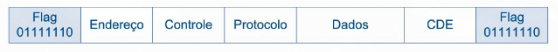<br>
*Fonte: MAIA, Luiz Paulo. Arquitetura de Redes de Computadores, 2ª ed., 2013, p. 119.*

**Modulação de uma portadora** permite representar símbolos pela escolha da amplitude, da frequência ou da fase de uma onda.

| Técnica | O que varia | Como reconhecer |
| --- | --- | --- |
| **ASK** (*Amplitude Shift Keying*) | Amplitude. | A intensidade da onda muda entre os símbolos. Um caso simples usa presença e ausência de portadora. |
| **FSK** (*Frequency Shift Keying*) | Frequência. | Em intervalos de mesma duração, uma frequência produz mais ciclos que a outra. É o exemplo das duas frequências do capítulo 2. |
| **PSK** (*Phase Shift Keying*) | Fase. | O símbolo determina a posição da onda dentro do ciclo. Na PSK binária, os dois estados podem estar separados por 180°. |
| **QAM** (*Quadrature Amplitude Modulation*) | Duas componentes da portadora defasadas de 90°. | As combinações formam pontos de uma **constelação**, cada um associado a um símbolo. Em 16-QAM, 16 pontos permitem representar quatro bits por símbolo. |

<br>
*Fonte: MAIA, Luiz Paulo. Arquitetura de Redes de Computadores, 2ª ed., 2013, p. 121.*

<br>
*Fonte: MAIA, Luiz Paulo. Arquitetura de Redes de Computadores, 2ª ed., 2013, p. 122.*

<br>
*Fonte: FRAGA, Marcelo Caramuru Pimentel. Redes de Computadores - 6ª Aula, p. 23.*

**Exemplo de interface física:** em uma conexão discada com modem externo, o computador pode se comunicar com o modem por uma interface serial **EIA-232-F** (família RS-232). O modem adapta os dados à linha telefônica. A recomendação **V.92** especifica características da comunicação entre o modem do assinante e o equipamento de acesso da operadora. Assim, a ligação computador–modem e o percurso pela rede telefônica têm especificações físicas próprias.

### Protocolos de Enlace Ponto a Ponto:

Na conexão discada, o **PPP** (*Point-to-Point Protocol*) permite ao computador estabelecer um enlace lógico com o equipamento do provedor e transportar pacotes por ele. O campo **Protocolo** identifica o conteúdo recebido: `0x0021`, por exemplo, indica um pacote IPv4.

O PPP pode usar um **enquadramento inspirado no HDLC** (*High-Level Data Link Control*). Uma *flag* com o valor `0x7E` (`01111110`) delimita o quadro, e um campo final **FCS** (*Frame Check Sequence*) permite verificar erros. A forma de preservar os limites do quadro depende de como o enlace transmite os dados:

| Método | Regra de transmissão | Exemplo |
| --- | --- | --- |
| ***Byte stuffing*** | Um byte reservado é substituído pelo escape `0x7D`, seguido do valor original combinado com `0x20` por `XOR`. | Dentro dos dados, `0x7E` é enviado como `0x7D 0x5E`. O próprio `0x7D` é enviado como `0x7D 0x5D`. |
| ***Bit stuffing*** | Entre as *flags*, o transmissor insere um `0` após cinco bits `1` consecutivos. O receptor retira esse zero ao recompor o quadro. | Se os dados contêm `01111110`, a sequência transmitida nesse trecho é `011111010`. A *flag* que delimita o quadro conserva seu padrão original. |

> **HDLC** também define procedimentos de controle de enlace. **LAPB** (*Link Access Procedure, Balanced*) é um procedimento derivado do HDLC usado no enlace de redes X.25. O PPP aproveita o formato de enquadramento descrito acima e define seus próprios mecanismos de controle.

### Verificação de Erros e Retransmissão:

**Paridade em duas dimensões.** Os dados são organizados em linhas e colunas, cada uma com sua verificação de paridade. Se um único bit de dados mudar, falham a linha e a coluna que o contêm. A interseção indica a posição. Com vários erros, algumas alterações podem se compensar: inverter os quatro cantos de um retângulo altera dois bits em cada linha e coluna envolvida, preservando suas paridades.

<br>
*Fonte: MAIA, Luiz Paulo. Arquitetura de Redes de Computadores, 2ª ed., 2013, p. 159.*

***Checksum*.** Uma regra simples consiste em somar os bytes e guardar o resto da divisão por 256. Para a mensagem `MODEM!`, os valores ASCII são `77, 79, 68, 69, 77, 33`. A soma é `403`, e o valor de verificação é `403 mod 256 = 147`. O receptor repete a operação. Essa regra deixa passar, por exemplo, a troca de posição de dois bytes, pois a soma permanece igual.

**CRC** (*Cyclic Redundancy Check*). O transmissor e o receptor usam o mesmo **polinômio gerador**, representado por uma sequência de bits. No modelo simplificado, um gerador de quatro bits produz um resto de três bits:

1. Para proteger os dados `1101` com o gerador `1011`, o transmissor acrescenta três zeros e obtém `1101000`.
2. Ele divide `1101000` por `1011` em aritmética binária módulo 2. A cada etapa, combina os bits por `XOR`, sem empréstimo. O resto é `001`.
3. Substitui os três zeros pelo resto e transmite `1101001`. Ao dividir essa sequência pelo mesmo gerador, o receptor obtém resto zero. Um resto diferente de zero revela erro.

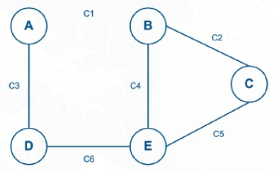<br>
*Fonte: MAIA, Luiz Paulo. Arquitetura de Redes de Computadores, 2ª ed., 2013, p. 161.*

**Código de Hamming.** Para proteger $n$ bits de dados e corrigir um erro simples, escolhe-se a menor quantidade $r$ de bits de paridade que satisfaça $2^r \geq n+r+1$. As combinações dos resultados de paridade precisam identificar cada posição da palavra e o caso em que nenhuma verificação falha.

Com **16 bits de dados**, são necessários **5 bits de paridade**, totalizando 21 posições. As paridades ocupam as potências de dois (`1`, `2`, `4`, `8` e `16`), e os dados ocupam as demais posições. Cada posição participa das verificações indicadas por sua representação binária. A posição `5`, por exemplo, corresponde a `00101` e participa das paridades `1` e `4`.

| Paridade | Posições verificadas | Resultado do exemplo |
| --- | --- | --- |
| `1` | 1, 3, 5, 7, 9, 11, 13, 15, 17, 19, 21 | Falha |
| `2` | 2, 3, 6, 7, 10, 11, 14, 15, 18, 19 | Correta |
| `4` | 4, 5, 6, 7, 12, 13, 14, 15, 20, 21 | Falha |
| `8` | 8 a 15 | Correta |
| `16` | 16 a 21 | Correta |

Somando as posições das paridades que falharam, obtém-se `1 + 4 = 5`. Sob a hipótese de um único erro, basta inverter o bit da posição 5. Esse código tem distância mínima 3. Se dois bits forem alterados, um decodificador que tente corrigir um erro simples pode inverter a posição errada.

**Retransmissão por parada e espera.** No *Stop-and-Wait* ARQ, o transmissor mantém um quadro pendente, inicia um temporizador e aguarda o ACK. Se o prazo vencer, envia o quadro novamente. Um NAK pode antecipar o reenvio quando o receptor detecta uma falha.

<br>
*Fonte: MAIA, Luiz Paulo. Arquitetura de Redes de Computadores, 2ª ed., 2013, p. 163.*

O **protocolo de bit alternado** usa `0` e `1` para distinguir quadros novos de retransmissões. Se o receptor já aceitou o quadro `0` e o ACK se perdeu, ele continua esperando o `1`. Ao receber outra cópia do `0`, confirma novamente e entrega a carga útil uma única vez.

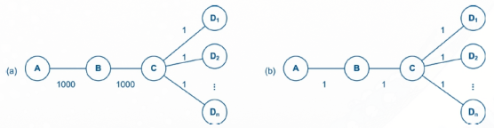<br>
*Fonte: MAIA, Luiz Paulo. Arquitetura de Redes de Computadores, 2ª ed., 2013, p. 167.*

**Retransmissão com janela.** Considere que o transmissor enviou os quadros `1`, `2`, `3` e `4`. O quadro `1` se perdeu e os outros três chegaram. A escolha do protocolo muda tanto o uso da memória do receptor quanto a quantidade de dados reenviados.

| Protocolo | O que o receptor faz com `2`, `3` e `4` | Como a perda é recuperada |
| --- | --- | --- |
| **Go-Back-N** | No funcionamento clássico, descarta os quadros fora de ordem e continua esperando o `1`. | Ao expirar o prazo, o transmissor reenvia o `1` e os quadros seguintes ainda pendentes. |
| **Selective Repeat** | Guarda os quadros válidos dentro da janela e confirma os que recebeu. | O transmissor reenvia o `1`. Quando ele chega, o receptor pode entregar `1`, `2`, `3` e `4` em ordem. |

<br>
*Fonte: MAIA, Luiz Paulo. Arquitetura de Redes de Computadores, 2ª ed., 2013, p. 170.*

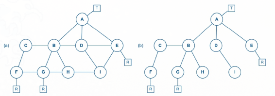<br>
*Fonte: MAIA, Luiz Paulo. Arquitetura de Redes de Computadores, 2ª ed., 2013, p. 175.*

### Métodos de Acesso ao Meio:

**Acesso particionado.** Cada estação recebe um recurso que permite distinguir sua transmissão das demais.

| Método | Recurso utilizado | Consequência prática |
| --- | --- | --- |
| **FDMA** | Uma faixa de frequência por participante. | Os participantes podem transmitir simultaneamente. Faixas de guarda ajudam a limitar a interferência entre canais vizinhos. |
| **TDMA** | Intervalos de tempo (*slots*) em um canal. | Cada participante transmite na sua vez. Um intervalo reservado pode ficar ocioso se a estação estiver sem dados. |
| **CDMA** | Um código que distingue a transmissão. | Várias estações podem ocupar a mesma faixa ao mesmo tempo. O receptor usa o código correspondente para recuperar o sinal de interesse. |

<br>
*Fonte: MAIA, Luiz Paulo. Arquitetura de Redes de Computadores, 2ª ed., 2013, p. 188.*

**Acesso por disputa.** No **ALOHA puro**, uma estação transmite assim que tem um quadro. Se a tentativa fica sem confirmação, ela aguarda um tempo aleatório antes de repetir. No **ALOHA com slots**, cada tentativa começa no início de um intervalo. No modelo clássico, com quadros de mesma duração e tentativas aleatórias independentes, a utilização máxima ideal passa de cerca de **18%** para **37%**: alinhar os inícios reduz o intervalo em que outra tentativa pode provocar colisão.

No **CSMA** (*Carrier Sense Multiple Access*), a estação escuta o canal antes de transmitir. Ainda podem ocorrer colisões porque um sinal leva tempo para alcançar as outras estações.

| Variante | Decisão da estação |
| --- | --- |
| **CSMA 1-persistente** | Se o canal está ocupado, continua escutando e transmite assim que o percebe livre. Várias estações em espera podem tentar juntas. |
| **CSMA não persistente** | Se o canal está ocupado, espera um intervalo aleatório antes de consultá-lo novamente. Isso reduz a disputa imediata, mas pode deixar o meio livre por mais tempo. |
| **CSMA/CD** (*Collision Detection*) | Monitora o meio durante o envio. Ao detectar colisão, sinaliza o evento, interrompe a tentativa e aguarda antes de retransmitir. No Ethernet compartilhado clássico, a faixa de espera cresce após colisões sucessivas, até um limite. |
| **CSMA/CA** (*Collision Avoidance*) | Usa observação do canal, intervalos de espera e sorteio de tempo (*backoff*) para reduzir transmissões simultâneas. É a base do acesso por disputa no Wi-Fi. |

Em um meio sem fio, **o canal percebido pelo transmissor pode ser diferente daquele percebido pelo receptor**. Dois casos mostram por que escutar antes de transmitir tem limitações:

- **Estação escondida:** X e Z alcançam Y, mas não se ouvem. Se X e Z enviarem ao mesmo tempo, os sinais podem colidir em Y, embora ambos tenham percebido o canal livre.

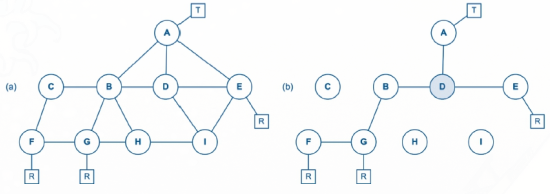<br>
*Fonte: MAIA, Luiz Paulo. Arquitetura de Redes de Computadores, 2ª ed., 2013, p. 196.*

- **Estação exposta:** Uma estação ouve uma transmissão próxima e adia o envio. Dependendo da posição dos dois receptores, as transmissões poderiam ocorrer ao mesmo tempo sem impedir a recepção.

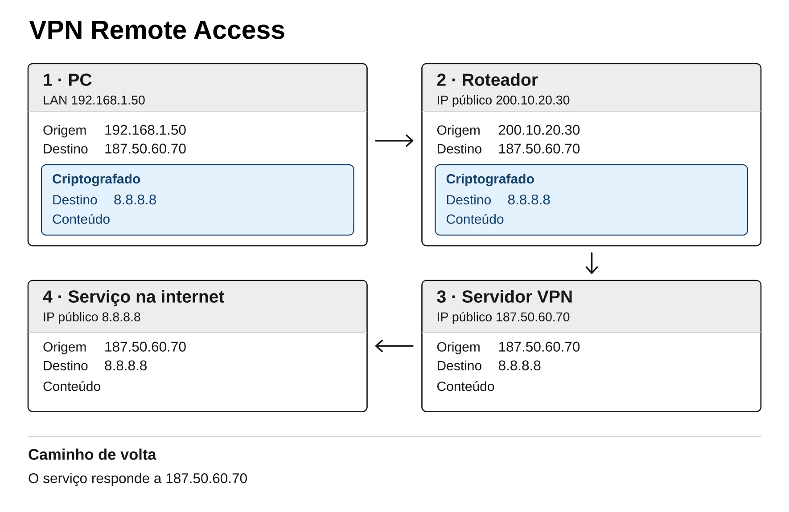<br>
*Fonte: MAIA, Luiz Paulo. Arquitetura de Redes de Computadores, 2ª ed., 2013, p. 197.*

**Acesso ordenado.** Na **consulta centralizada** (*polling*), um controlador pergunta às estações quais têm dados e concede a vez de transmitir. Cada consulta consome tempo, inclusive quando a estação está sem dados. Na **passagem de token**, uma autorização circula entre as estações. Em *Token Ring*, quem recebe o *token* livre pode transmitir. O protocolo também precisa recuperar a autorização se ela se perder.

### Família de Padrões IEEE 802:

**IEEE 802** reúne padrões para redes locais e metropolitanas. Dentro dessa família, **IEEE 802.3** especifica Ethernet e **IEEE 802.11** especifica redes locais sem fio que servem de base ao Wi-Fi. Ambos abrangem características físicas e de enlace.

| Referência | Assunto principal |
| --- | --- |
| **IEEE 802.1** | Integração de redes locais, pontes, VLANs e funções de controle. |
| **IEEE 802.2** | Controle lógico de enlace (LLC). Referência histórica para os serviços dessa subcamada. |
| **IEEE 802.3** | Ethernet, incluindo o formato do quadro e diferentes meios e taxas de transmissão. |
| **IEEE 802.4** | *Token Bus*: passagem de autorização em uma ordem lógica sobre um meio compartilhado. |
| **IEEE 802.5** | *Token Ring*: passagem de autorização em um anel lógico. |
| **IEEE 802.11** | Acesso ao meio e transmissão física em redes locais sem fio. |
| **IEEE 802.15** | Família de tecnologias sem fio, incluindo redes pessoais de curto alcance. |
| **IEEE 802.16** | Acesso sem fio de banda larga, associado a tecnologias como WiMAX. |

Na organização IEEE 802, duas funções de enlace aparecem com frequência:

- **MAC** (*Medium Access Control*): trata do acesso ao meio e de aspectos do quadro, como endereçamento e verificação de erros. A expressão **endereço MAC** designa um endereço utilizado nessa subcamada.
- **LLC** (*Logical Link Control*): oferece uma interface lógica para protocolos superiores. O modelo clássico prevê serviços sem conexão, com ou sem confirmação, e serviços orientados à conexão. No formato Ethernet II, o próprio campo **EtherType** identifica diretamente o protocolo transportado.

### Ethernet e Equipamentos de Interconexão:

**Quadro Ethernet.** Antes do quadro, o transmissor envia um **preâmbulo** para sincronização e um **marcador de início**. No formato básico, sem marca de VLAN, os campos do quadro são:

| Campo | Tamanho | Função |
| --- | --- | --- |
| **MAC de destino** | 6 bytes | Identifica a interface ou o grupo a que o quadro se destina. |
| **MAC de origem** | 6 bytes | Identifica a interface que enviou o quadro. |
| **Comprimento/Tipo** | 2 bytes | Indica o comprimento dos dados ou identifica o protocolo transportado, conforme o valor. |
| **Dados e eventual preenchimento** | 46 a 1.500 bytes | Transporta a carga útil. Se ela for curta, o transmissor acrescenta preenchimento (*padding*). |
| **FCS** | 4 bytes | Contém o CRC usado para detectar alterações no quadro. |

No formato **Ethernet II** (DIX), um valor como `0x0800` identifica IPv4. No formato com **comprimento**, o protocolo superior é identificado com auxílio de LLC e, quando aplicável, SNAP. A figura compara os dois usos do campo após o MAC de origem.

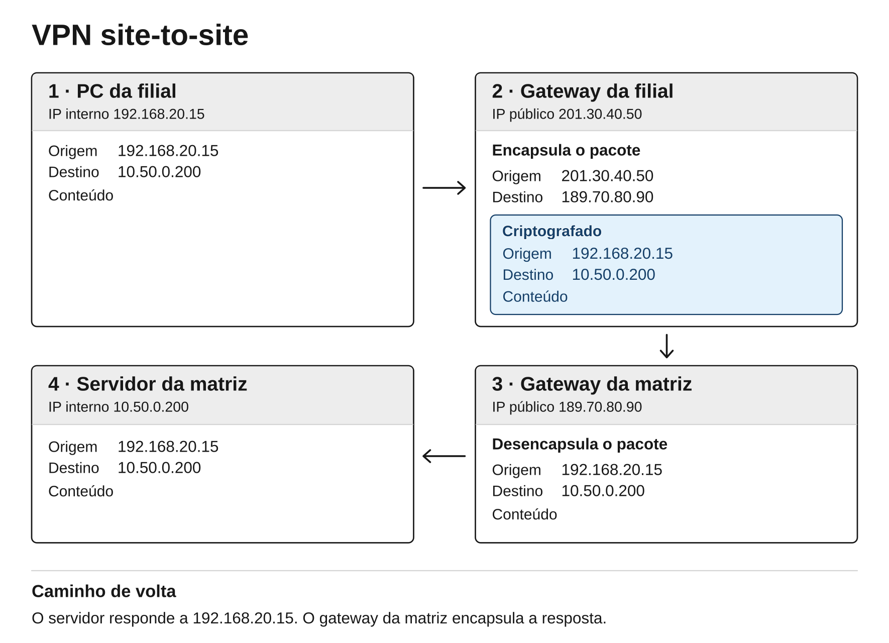<br>
*Fonte: FRAGA, Marcelo Caramuru Pimentel. Redes de Computadores - 11ª Aula, p. 15.*

O tamanho mínimo do quadro básico é **64 bytes**, do MAC de destino ao FCS. No Ethernet compartilhado clássico, esse mínimo e o limite de extensão do segmento permitiam que uma colisão distante fosse percebida enquanto a estação ainda transmitia.

**Endereço MAC.** Um endereço Ethernet tem 48 bits, geralmente escritos como seis pares hexadecimais. Pode ser administrado globalmente, com identificadores atribuídos à organização responsável, ou localmente, inclusive por software. Para consultar o endereço de uma interface, use `ip a` no Linux (campo `link/ether`) ou `ipconfig /all` no Windows (campo “Endereço Físico”).

**Evolução do meio.** Em **10BASE5** e **10BASE2**, várias estações compartilhavam um barramento coaxial. O **10BASE-T** levou um cabo de par trançado de cada estação a um ponto central. O equipamento instalado nesse ponto determina se as estações ainda compartilham o meio ou se cada ligação opera de forma independente. Entre as taxas posteriores estão **Fast Ethernet** (100 Mbit/s) e **Gigabit Ethernet** (1 Gbit/s).

| Equipamento | O que observa | O que faz ao receber uma transmissão |
| --- | --- | --- |
| **Repetidor** | Sinal físico. | Recupera a temporização e os níveis do sinal digital e o retransmite no próximo trecho. |
| ***Hub*** | Sinal físico. | Funciona como repetidor de várias portas. Repete o sinal recebido nas demais portas, formando um meio compartilhado. |
| **Ponte** | Quadro e endereços MAC. | Interliga segmentos e filtra quadros cujo destino se encontra no mesmo segmento da origem. |
| ***Switch*** | Quadro, endereços MAC e porta de entrada. | Funciona como ponte de múltiplas portas. Aprende por onde alcançar as interfaces e usa essa informação para encaminhar os quadros. |

O **regenerador** precisa decidir quais símbolos recebeu antes de reconstruir o sinal. Se interpretar um símbolo incorretamente, poderá retransmitir um sinal bem formado que contém o dado errado. O **repetidor** aplica essa regeneração entre trechos do enlace.

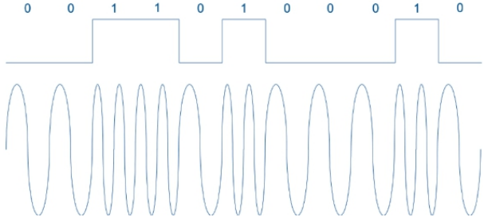<br>
*Fonte: MAIA, Luiz Paulo. Arquitetura de Redes de Computadores, 2ª ed., 2013, p. 100.*

<br>
*Fonte: MAIA, Luiz Paulo. Arquitetura de Redes de Computadores, 2ª ed., 2013, p. 220.*

Com um ***hub***, a disposição dos cabos é uma estrela, mas as estações compartilham um domínio de colisão. Uma **ponte** separa os segmentos e decide quais quadros precisam atravessar de um para o outro.

<br>
*Fonte: MAIA, Luiz Paulo. Arquitetura de Redes de Computadores, 2ª ed., 2013, p. 220.*

<br>
*Fonte: MAIA, Luiz Paulo. Arquitetura de Redes de Computadores, 2ª ed., 2013, p. 223.*

**Aprendizado do switch.** Considere dois computadores na mesma VLAN: A está na porta 1 e B na porta 4. Inicialmente, a tabela MAC está vazia.

1. **A envia para B.** Ao receber o quadro, o switch lê o MAC de **origem** e aprende `A → porta 1`. Como ainda desconhece a porta de B, envia cópias pelas demais portas que podem encaminhar tráfego nessa VLAN.
2. **B responde a A.** O switch aprende `B → porta 4`. Como já conhece A, encaminha a resposta apenas à porta 1.
3. **A volta a enviar para B.** A tabela já indica a porta 4. Se, em outro caso, a porta conhecida para o destino for a própria porta de entrada, o switch filtra o quadro.

<br>
*Fonte: MAIA, Luiz Paulo. Arquitetura de Redes de Computadores, 2ª ed., 2013, p. 224.*

> Em uma ligação Ethernet *full-duplex* entre estação e switch, cada extremidade pode transmitir simultaneamente e o CSMA/CD fica dispensado. Um *broadcast*, porém, continua sendo distribuído pelas demais portas elegíveis da VLAN.

### Wi-Fi e IEEE 802.11:

**Organização das estações.** Em uma rede de infraestrutura, uma estação se associa a um **ponto de acesso** (AP, *Access Point*). O AP e as estações associadas formam um **BSS** (*Basic Service Set*). No modo clássico *ad hoc*, as estações formam um conjunto independente (**IBSS**) e podem se comunicar diretamente.

<br>
*Fonte: MAIA, Luiz Paulo. Arquitetura de Redes de Computadores, 2ª ed., 2013, p. 229.*

Um **sistema de distribuição** (DS) interliga os BSS de infraestrutura. Quando esses conjuntos integram a mesma rede lógica estendida, formam um **ESS** (*Extended Service Set*). Em uma faculdade, por exemplo, APs de corredores diferentes podem atender áreas distintas e permitir que um notebook mude de associação enquanto se desloca.

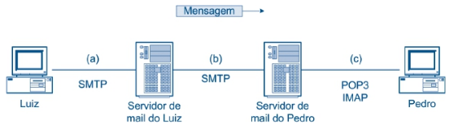<br>
*Fonte: MAIA, Luiz Paulo. Arquitetura de Redes de Computadores, 2ª ed., 2013, p. 230.*

**Endereçamento.** Imagine que o notebook envia um quadro a uma impressora conectada por cabo ao mesmo segmento de rede. No trecho de rádio, o **transmissor** é o notebook e o **receptor imediato** é o AP. O **destino** dos dados continua sendo a impressora. Quadros de dados 802.11 podem usar até quatro campos de endereço para representar esses diferentes papéis, conforme o percurso.

**Acesso ao meio.** No modelo clássico, duas funções ilustram maneiras de organizar o uso do canal:

- **DCF** (*Distributed Coordination Function*): as estações disputam o meio usando CSMA/CA. Durante o *backoff*, a estação decrementa um contador sorteado enquanto o canal está livre. Se o canal ficar ocupado, congela a contagem e a retoma depois que o meio volta a ficar livre pelo intervalo exigido.
- **PCF** (*Point Coordination Function*): mecanismo opcional do modelo clássico. O AP pode consultar as estações para conceder oportunidades de transmissão em períodos coordenados.

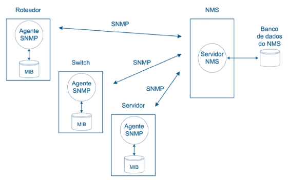<br>
*Fonte: MAIA, Luiz Paulo. Arquitetura de Redes de Computadores, 2ª ed., 2013, p. 233.*

**Reserva e confirmação.** Em uma transmissão *unicast* convencional com confirmação, a troca básica é `Dados → ACK`. Com a reserva opcional do canal, passa a ser `RTS → CTS → Dados → ACK`.

| Elemento | Função na troca |
| --- | --- |
| **RTS** (*Request to Send*) | O transmissor solicita a oportunidade de enviar. |
| **CTS** (*Clear to Send*) | O receptor responde. Estações próximas que ouvem essa resposta podem adiar suas transmissões, inclusive quando não ouviram o RTS. |
| **ACK** | Confirma que o receptor aceitou o quadro correspondente. |
| **NAV** (*Network Allocation Vector*) | Temporizador local. Uma estação usa a informação de duração presente nos quadros que ouve para saber por quanto tempo deve adiar o acesso. |

RTS/CTS pode reduzir o problema da estação escondida, mas também consome tempo de rádio. A **fragmentação de enlace** oferece outra escolha: dividir os dados em quadros menores reduz a quantidade a retransmitir quando um fragmento falha, ao custo de mais cabeçalhos e confirmações.

**Intervalos entre quadros** (IFS). No modelo DCF/PCF, a relação é $\mathrm{SIFS} < \mathrm{PIFS} < \mathrm{DIFS}$. Uma resposta imediata, como CTS ou ACK, usa **SIFS**. O coordenador da PCF pode usar **PIFS**, enquanto uma nova disputa pela DCF aguarda **DIFS** e, quando aplicável, o *backoff*. Assim, a resposta de uma troca em andamento tem oportunidade de ocorrer antes de uma nova transmissão.

**Segurança do Wi-Fi.**

| Tecnologia | Característica principal |
| --- | --- |
| **WEP** | Proteção inicial do Wi-Fi. Suas fragilidades tornaram-na inadequada para proteger redes. |
| **WPA** | Solução de transição que introduziu o TKIP para equipamentos da época. |
| **WPA2** | Consolidou o uso de AES-CCMP para proteger o tráfego. No modo pessoal, a autenticação usa uma chave pré-compartilhada (PSK). |
| **WPA3** | No modo pessoal, utiliza SAE para autenticar os participantes a partir da senha e estabelecer chaves. |

No **modo pessoal**, os participantes normalmente conhecem uma senha comum. No **modo corporativo** (*Enterprise*), o acesso pode ser concedido a partir de credenciais individuais ou certificados, geralmente com autenticação 802.1X e apoio de um servidor.

### Organização de Redes Locais:

**Agregação de enlaces.** Dois switches podem reunir várias conexões físicas em uma ligação lógica. O tráfego de diferentes fluxos é distribuído entre os enlaces participantes. Isso aumenta a capacidade total e permite manter a ligação ativa caso um deles falhe, com capacidade reduzida.

> Dois enlaces de 1 Gbit/s podem atender simultaneamente a dois fluxos distribuídos entre eles. Uma única transferência pode continuar limitada a 1 Gbit/s, pois os quadros do mesmo fluxo costumam seguir pelo mesmo enlace para preservar a ordem.

**STP** (*Spanning Tree Protocol*). Considere três switches ligados em triângulo. Se todos encaminharem um *broadcast* pelas duas direções, cópias do quadro poderão circular repetidamente. O STP seleciona uma **árvore de encaminhamento**: os switches continuam fisicamente conectados, mas algumas portas ficam fora do encaminhamento de dados para eliminar ciclos. Se o caminho ativo falhar, o protocolo pode ativar um caminho alternativo.

<br>
*Fonte: MAIA, Luiz Paulo. Arquitetura de Redes de Computadores, 2ª ed., 2013, p. 241.*

**VLAN** (*Virtual Local Area Network*). Em um switch cujas portas pertencem à mesma VLAN, um *broadcast* enviado pelo laboratório pode chegar também às máquinas da administração. Ao atribuir os dois grupos a VLANs distintas, cada grupo passa a ter seu próprio domínio de *broadcast*, mesmo compartilhando o equipamento.

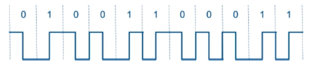<br>
*Fonte: MAIA, Luiz Paulo. Arquitetura de Redes de Computadores, 2ª ed., 2013, p. 243.*

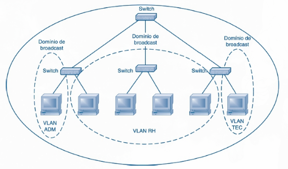<br>
*Fonte: MAIA, Luiz Paulo. Arquitetura de Redes de Computadores, 2ª ed., 2013, p. 246.*

| Tipo de porta ou ligação | Uso |
| --- | --- |
| **Porta de acesso** | Normalmente associa o tráfego de um dispositivo final a uma VLAN. O computador pode enviar um quadro sem marca, e o switch identifica a VLAN pela porta de entrada. |
| ***Trunk* (entroncamento)** | Transporta várias VLANs entre equipamentos. A marca IEEE 802.1Q identifica a VLAN de um quadro. Conforme a configuração, uma VLAN nativa pode trafegar sem marca. |

Se laboratório e administração ocupam dois prédios, um *trunk* entre os switches pode transportar as duas VLANs preservando a separação dos grupos. Um *broadcast* do laboratório pode atravessar esse enlace e alcançar as portas do laboratório no outro prédio. Para enviar um pacote à rede da administração, é necessário **roteamento entre as VLANs**, realizado por um roteador ou por um switch com função de camada de Rede.

## 2. Camada de Rede:

> Dado um endereço IP de destino, como verificar por onde o pacote vai sair, a quem o primeiro quadro será entregue e como os roteadores escolhem o restante do caminho?

### Interfaces, Endereços e Pacotes IP:

No Linux, `ip a` é a forma abreviada de `ip address`. A saída é organizada por **interface**: primeiro aparecem seu nome, estado e MTU; abaixo, o endereço de enlace e os endereços IP configurados. Uma saída abreviada do notebook do laboratório poderia ser:

```text
1: lo: <LOOPBACK,UP,LOWER_UP> mtu 65536
    link/loopback 00:00:00:00:00:00
    inet 127.0.0.1/8 scope host lo
    inet6 ::1/128 scope host

2: enp2s0: <NO-CARRIER,BROADCAST,MULTICAST,UP> mtu 1500
    link/ether 02:11:22:33:44:54 brd ff:ff:ff:ff:ff:ff

3: wlo1: <BROADCAST,MULTICAST,UP,LOWER_UP> mtu 1500
    link/ether 02:11:22:33:44:55 brd ff:ff:ff:ff:ff:ff
    inet 192.168.10.34/27 brd 192.168.10.63 scope global wlo1
    inet6 fe80::1234:5678:9abc:def0/64 scope link
```

| Nome ou campo | Como interpretar |
| --- | --- |
| **`lo`** | Interface de *loopback*. Os endereços `127.0.0.1` e `::1` permitem acessar serviços no próprio computador. |
| **`en...`** | Na convenção de nomes previsíveis, `en` identifica Ethernet. Em `enp2s0`, o restante indica a localização do dispositivo no barramento PCI. |
| **`wl...`** | `wl` identifica Wi-Fi. Em `wlo1`, `o1` indica um índice de dispositivo integrado atribuído pelo firmware. Outros equipamentos podem ter nomes como `wlp2s0`. |
| **`<interface>.<ID>`** | Nome convencional de uma interface VLAN. Por exemplo, `enp2s0.10` costuma representar a VLAN 10 sobre `enp2s0`. Como o nome é configurável, `ip -d link show` permite confirmar o tipo e o ID. |
| **`UP`, `LOWER_UP` e `NO-CARRIER`** | `UP` indica que a interface está administrativamente habilitada. `LOWER_UP` indica que a camada inferior sinaliza enlace ativo. No exemplo, a Ethernet está habilitada, mas `NO-CARRIER` indica ausência de enlace, como ocorre com um cabo desconectado. |
| **`link/ether`** | Mostra o MAC utilizado pela interface Ethernet ou Wi-Fi. Na mesma linha, `brd ff:ff:ff:ff:ff:ff` é o endereço de *broadcast* de enlace. |
| **`inet` e `inet6`** | Identificam IPv4 e IPv6. Na linha `inet`, `brd 192.168.10.63` é o *broadcast* IPv4 da sub-rede. |
| **`scope`** | Indica alcance. `host` corresponde ao próprio equipamento e `link` ao enlace local. O Linux também pode exibir `scope global` para um IPv4 privado, como `.34`; esse rótulo não implica que o endereço seja público. |
| **`mtu`** | Tamanho máximo do pacote de rede que a interface pode transportar pelo enlace como uma unidade. |

> Os números antes dos dois-pontos (`1:`, `2:`, `3:`) são índices das interfaces no sistema. Já os números dentro de nomes como `enp2s0` descrevem atributos do dispositivo. Assim, as únicas duas interfaces Ethernet de um computador poderiam se chamar `enp2s0` e `enp5s0`.

Para consultar apenas os endereços, use `ip -br addr`. Para examinar uma interface, use `ip addr show dev wlo1`, substituindo `wlo1` pelo nome exibido no computador. No Windows, `ipconfig /all` reúne os adaptadores, endereços físicos, endereços IP, configuração DHCP e gateways.

**Leitura de um IPv6.** Cada grupo hexadecimal representa 16 bits. Zeros à esquerda de um grupo podem ser omitidos. Uma sequência de grupos inteiramente zerados pode ser abreviada por `::`, uma única vez no endereço. Assim, `fe80::70db:aa5b:82c0:622c` corresponde a `fe80:0000:0000:0000:70db:aa5b:82c0:622c`. O `/64`, quando presente, é o comprimento do prefixo.

**Da interface para o pacote.** `ip a` mostra a configuração local. Em um pacote transmitido por essa interface, alguns dos campos que orientam o processamento são:

| Função | IPv4 | IPv6 |
| --- | --- | --- |
| Identificar origem e destino | Endereços de 32 bits. | Endereços de 128 bits. |
| Limitar a circulação do pacote | **TTL** (*Time to Live*), decrementado a cada roteador. | **Hop Limit**, com a mesma função prática de limite de saltos. |
| Identificar o que vem em seguida | **Protocol**, como TCP, UDP ou ICMP. | **Next Header**, que pode identificar um cabeçalho de extensão ou o protocolo transportado. |
| Informar o tamanho | **Total Length**, incluindo o cabeçalho IPv4. | **Payload Length**, contando o que vem depois do cabeçalho IPv6 básico. |

### Máscaras, Sub-redes e Agregação:

**Como localizar um endereço no seu bloco.** Considere `192.168.10.34/27`. Os primeiros 24 bits ocupam os três primeiros octetos. Para completar o prefixo, a máscara usa mais três bits no quarto octeto.

1. **Máscara:** O quarto octeto é `11100000`, equivalente a `224`. A máscara completa é `255.255.255.224`.
2. **Tamanho do bloco:** Sobram cinco bits, portanto cada bloco contém $2^5 = 32$ endereços.
3. **Início do bloco:** Os blocos começam em `.0`, `.32`, `.64`, `.96` e assim por diante. O endereço `.34` está no bloco iniciado em `.32`.
4. **Fim do bloco:** O próximo bloco começa em `.64`. O último endereço do bloco atual é `.63`.

| Elemento | Resultado |
| --- | --- |
| Rede | `192.168.10.32/27` |
| Primeiro e último endereços atribuíveis a interfaces | `192.168.10.33` a `192.168.10.62` |
| *Broadcast* | `192.168.10.63` |
| Total | 32 endereços, dos quais 30 são atribuíveis neste exemplo. |

O mesmo resultado pode ser obtido por uma operação **AND** entre endereço e máscara. No quarto octeto, `00100010 AND 11100000 = 00100000`, isto é, `34 AND 224 = 32`.

> A regra de reservar o primeiro e o último endereços vale para a sub-rede IPv4 convencional do exemplo. Em um enlace ponto a ponto com `/31`, os dois endereços podem identificar as extremidades. Um `/32` identifica um único endereço.

**VLSM — máscaras de comprimentos variáveis.** Uma rede pode ser subdividida em blocos de tamanhos diferentes. Suponha que `192.168.20.0/24` precise atender a três grupos de 100, 50 e 20 interfaces. Alocar primeiro o maior bloco facilita respeitar o alinhamento dos demais.

| Grupo | Sub-rede atribuída | Faixa de interfaces | *Broadcast* |
| --- | --- | --- | --- |
| 100 interfaces | `192.168.20.0/25` | `.1` a `.126` | `.127` |
| 50 interfaces | `192.168.20.128/26` | `.129` a `.190` | `.191` |
| 20 interfaces | `192.168.20.192/27` | `.193` a `.222` | `.223` |
| Reserva | `192.168.20.224/27` | `.225` a `.254` | `.255` |

**Agregação de rotas.** Agora, considere o caminho inverso: um roteador deseja anunciar vários blocos por um prefixo menor. `192.168.10.0/27` e `192.168.10.32/27` cobrem `.0` a `.63`. Juntos, correspondem exatamente a `192.168.10.0/26`. O anúncio agregado é apropriado quando a rede que o anuncia pode encaminhar o tráfego destinado ao conjunto.

O **alinhamento** importa. Os blocos `192.168.10.32/27` e `192.168.10.64/27` também são vizinhos, mas cobrem `.32` a `.95`. Os blocos `/26` começam em `.0`, `.64`, `.128` e `.192`. Portanto, nenhum `/26` representa exatamente aquele intervalo. Um anúncio mais abrangente incluiria endereços adicionais.

<br>
*Fonte: Elaborado pelo autor com auxílio do ChatGPT, 2026.*

> No endereçamento histórico por **classes**, as classes A, B e C associavam faixas de endereços a prefixos padrão `/8`, `/16` e `/24`. A classe D destinava-se ao *multicast* e a E era reservada. Com CIDR, a tabela informa o prefixo explicitamente: para interpretar `192.168.10.34/27`, usa-se o `/27` fornecido.

### Consulta de Rotas e Resolução de Vizinhos:

No capítulo 4, o notebook alcançava a impressora `.50` diretamente e usava o gateway `.33` para o servidor `.70`. Considere agora uma mudança: o laboratório instalou um segundo roteador, `.62`, para atender à rede do servidor. Uma consulta com `ip -4 route` poderia produzir a seguinte saída abreviada:

```text
default via 192.168.10.33 dev wlo1
192.168.10.32/27 dev wlo1 proto kernel scope link src 192.168.10.34
192.168.10.64/27 via 192.168.10.62 dev wlo1
```

| Trecho da saída | Significado |
| --- | --- |
| **`dev wlo1`** | Interface pela qual o pacote deve sair. |
| **`scope link`** | A rota alcança diretamente o destino pelo enlace. |
| **`via 192.168.10.62`** | O próximo salto é o roteador `.62`. |
| **`src 192.168.10.34`** | Endereço de origem preferido para essa rota. |
| **`default`** | Rota utilizada quando não há uma correspondência mais específica. |

A ordem em que as linhas aparecem na tela não determina a escolha. Entre os prefixos correspondentes, prevalece o mais longo.

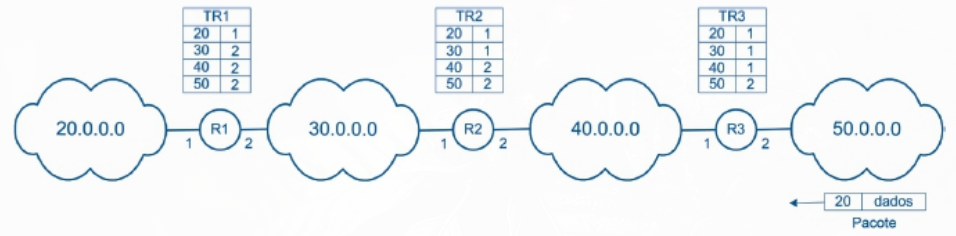<br>
*Fonte: MAIA, Luiz Paulo. Arquitetura de Redes de Computadores, 2ª ed., 2013, p. 291.*

| Destino consultado | Rota escolhida | De quem o notebook precisa conhecer o MAC? |
| --- | --- | --- |
| Impressora `192.168.10.50` | Rede diretamente conectada `.32/27`. | Da impressora `.50`. |
| Servidor `192.168.10.70` | Rede `.64/27`, via `.62`. | Do roteador `.62`. |
| Destino `203.0.113.80` | Rota padrão, via `.33`. | Do roteador `.33`. |

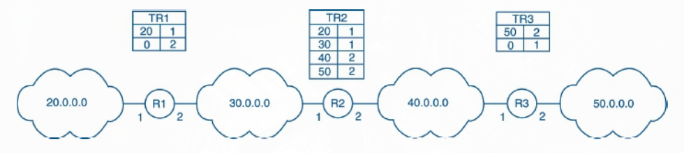<br>
*Fonte: MAIA, Luiz Paulo. Arquitetura de Redes de Computadores, 2ª ed., 2013, p. 292.*

> **Consulta prática:** `ip route get 192.168.10.70` mostra a decisão que o sistema tomaria para esse destino. Com a tabela acima, o resultado indica `via 192.168.10.62 dev wlo1`. O comando consulta o roteamento local; a disponibilidade do servidor precisa ser verificada separadamente.

**Resolução de vizinhos.** Depois da escolha da rota, o notebook precisa do endereço de enlace do vizinho. Um mapeamento **estático** é configurado manualmente. No mapeamento **dinâmico** por ARP, a máquina consulta o cache e, se necessário, envia uma solicitação IPv4 por *broadcast* local. No caso do servidor, a pergunta é “quem tem `192.168.10.62`?”. O roteador responde com seu MAC, e a associação pode ser reutilizada nos envios seguintes.

Uma saída ilustrativa de `ip neigh show dev wlo1` seria:

```text
192.168.10.50 lladdr 02:11:22:33:44:50 REACHABLE
192.168.10.62 lladdr 02:11:22:33:44:62 STALE
```

`lladdr` indica o endereço de enlace. `REACHABLE` indica que a alcançabilidade foi confirmada recentemente. `STALE` indica que a associação é conhecida, mas pode precisar de nova confirmação quando utilizada. É possível ter uma rota válida para `.70` antes de existir uma entrada para `.62` no cache: a descoberta ocorre quando necessária.

Em IPv6, o **Neighbor Discovery** utiliza mensagens ICMPv6 de solicitação e anúncio de vizinho. O Linux também mostra essas associações em `ip neigh`. Para consultar somente rotas e vizinhos IPv6, use `ip -6 route` e `ip -6 neigh`. No Windows, `route print` exibe as rotas e `arp -a` mostra o cache ARP do IPv4.

### Endereços Privados e Tradução por NAT:

Os três blocos IPv4 reservados para redes privadas são:

| Prefixo | Faixa |
| --- | --- |
| `10.0.0.0/8` | `10.0.0.0` a `10.255.255.255` |
| `172.16.0.0/12` | `172.16.0.0` a `172.31.255.255` |
| `192.168.0.0/16` | `192.168.0.0` a `192.168.255.255` |

Esses endereços podem se repetir em organizações diferentes. Para conexões de saída pela Internet IPv4, um roteador de borda pode realizar **NAT** (*Network Address Translation*). No NAT básico, a tradução altera endereços IP. No **NAPT**, também chamado de **PAT**, a tradução inclui identificadores de transporte, como as portas TCP ou UDP. Isso permite compartilhar um único IPv4 público entre várias conexões.

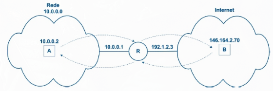<br>
*Fonte: MAIA, Luiz Paulo. Arquitetura de Redes de Computadores, 2ª ed., 2013, p. 288.*

Considere dois computadores que acessam o mesmo servidor HTTPS, ambos utilizando a porta local `51000`. A tabela mostra um exemplo de traduções TCP; os endereços externos utilizados são reservados para documentação.

| Origem interna | Origem apresentada externamente | Destino |
| --- | --- | --- |
| `192.168.10.34:51000` | `198.51.100.20:40001` | `203.0.113.80:443` |
| `192.168.10.35:51000` | `198.51.100.20:40002` | `203.0.113.80:443` |

1. **Ida:** O primeiro computador envia ao servidor. Na borda, o roteador substitui a origem `192.168.10.34:51000` por `198.51.100.20:40001` e registra a associação.
2. **Resposta:** O servidor responde para `198.51.100.20:40001`. O roteador consulta a associação e traduz o destino de volta para `192.168.10.34:51000`.
3. **Segunda conexão:** Uma resposta destinada à porta externa `40002` pertence ao segundo computador, mesmo que ambos tenham escolhido a mesma porta interna.

> Um equipamento pode atuar como **gateway padrão** e executar **NAT**. O encaminhamento escolhe por onde o pacote segue; a tradução modifica campos para permitir a comunicação entre os espaços de endereçamento.

### Fragmentação e Diagnóstico da MTU:

Um roteador recebe um datagrama **IPv4 de 1.500 bytes**, com cabeçalho de 20 bytes, sem opções e com fragmentação permitida. A interface de saída tem MTU de **1.280 bytes**. Como cada fragmento precisa de seu próprio cabeçalho, sobram no máximo `1.280 − 20 = 1.260 bytes` para dados por fragmento.

O campo **Fragment Offset** mede posições em blocos de **8 bytes** a partir do início dos dados originais. Por isso, a carga de cada fragmento anterior ao último precisa ser múltipla de oito. O maior múltiplo de oito que cabe em `1.260` é `1.256`.

| Fragmento | Bytes dos dados originais | Carga | Total com cabeçalho | Offset | MF |
| --- | --- | --- | --- | --- | --- |
| **1** | 0 a 1.255 | 1.256 bytes | 1.276 bytes | `0` | `1` |
| **2** | 1.256 a 1.479 | 224 bytes | 244 bytes | `157` | `0` |

O segundo offset vale `1.256 / 8 = 157`. O indicador **MF** (*More Fragments*) vale `1` enquanto ainda houver fragmentos depois daquele. Os dois conservam a identificação do datagrama. No destino, os offsets posicionam cada trecho e o último fragmento informa onde a carga termina. A soma das cargas é `1.256 + 224 = 1.480 bytes`, exatamente a carga original.

Se o bit **DF** (*Don't Fragment*) estiver ativo, o roteador descarta o datagrama grande demais e o funcionamento previsto é informar o problema por ICMP. Em IPv6, roteadores também descartam pacotes que excedem a MTU de saída e informam a origem por **ICMPv6 Packet Too Big**. A origem pode então ajustar o tamanho dos pacotes.

> **Consulta prática:** `ip link show dev wlo1` mostra a MTU local. Quando disponível, `tracepath <destino>` pode ajudar a estimar a MTU do caminho. O resultado depende das respostas recebidas. Em uma VPN, parte da MTU externa é consumida pelos cabeçalhos e pela proteção do túnel, reduzindo o espaço disponível para o pacote interno.

### Algoritmos e Protocolos de Roteamento:

Considere quatro roteadores, **A**, **B**, **C** e **D**. Os enlaces são bidirecionais, e o exemplo utiliza custos ilustrativos:

| Enlace | A–B | A–C | B–D | C–D |
| --- | --- | --- | --- | --- |
| **Custo** | 1 | 2 | 2 | 4 |

**Vetor de distância.** Para alcançar D, A compara o custo do enlace até cada vizinho com a distância que esse vizinho anuncia para D.

| Informação recebida por A | Cálculo | Decisão |
| --- | --- | --- |
| B anuncia custo `2` para D. | `1 + 2 = 3` | Candidato via B. |
| C anuncia custo `4` para D. | `2 + 4 = 6` | Candidato via C. |
| Os anúncios estão atualizados. | `3 < 6` | A registra D com próximo salto B e custo 3. |

Se **B–D falhar**, B perde sua rota direta e pode anunciar que o destino ficou inalcançável por aquele caminho. Quando A recebe essa alteração e conhece o anúncio válido de C, passa a alcançar D **via C, com custo 6**. A ordem e o tempo de propagação dos anúncios importam: durante a convergência, um roteador pode agir com base em uma informação antiga de outro. Isso pode produzir ciclos e aumentos sucessivos de custo, fenômeno conhecido como **contagem ao infinito**.

O **RIP** aplica vetor de distância com uma métrica própria: a quantidade de saltos. Um custo `16` indica destino inalcançável. Os pesos arbitrários da tabela acima servem para demonstrar o algoritmo geral.

**Estado de enlace.** Cada roteador anuncia informações sobre seus enlaces. Depois que essas informações se propagam pela área, A consegue calcular caminhos usando um mapa da topologia. O **OSPF** aplica esse princípio e utiliza o algoritmo de **Dijkstra** para calcular caminhos de menor custo a partir dos dados conhecidos.

<br>
*Fonte: MAIA, Luiz Paulo. Arquitetura de Redes de Computadores, 2ª ed., 2013, p. 308.*

Com os custos do exemplo numérico, Dijkstra parte de A e confirma, a cada etapa, o destino ainda pendente de menor custo:

| Etapa | Resultado a partir de A |
| --- | --- |
| **Examinar A** | Descobre B com custo `1` e C com custo `2`. D ainda não tem caminho conhecido. |
| **Confirmar B** | O caminho A–B–D custa `1 + 2 = 3`. D passa a ter custo provisório `3`, via B. |
| **Confirmar C** | A alternativa A–C–D custa `2 + 4 = 6`. O melhor caminho conhecido para D continua custando `3`. |
| **Confirmar D** | O caminho escolhido é A–B–D. Para encaminhar um pacote a D, a informação necessária em A é o primeiro salto: **B**. |

<br>
*Fonte: MAIA, Luiz Paulo. Arquitetura de Redes de Computadores, 2ª ed., 2013, p. 310.*

Se B–D falhar, a mudança é anunciada. Com o mapa atualizado, A recalcula e passa a usar A–C–D. O resultado final coincide com o do exemplo de vetor de distância, mas A chegou a ele a partir de informações diferentes.

| Protocolo | Âmbito típico | Informação usada na decisão |
| --- | --- | --- |
| **RIP** | Dentro de um sistema autônomo. | Destinos e distâncias anunciados por vizinhos, medidos em saltos. |
| **OSPF** | Dentro de um sistema autônomo, com organização em áreas. | Estado e custo dos enlaces, usados para calcular caminhos. |
| **BGP** | Troca de rotas entre sistemas autônomos e distribuição dessas informações dentro de um AS. | Prefixos, atributos e políticas. O caminho de sistemas autônomos (`AS_PATH`) é um dos atributos considerados. |

### Broadcast e Multicast em IPv4:

**Broadcast limitado e direcionado.** Um mesmo quadro Ethernet de difusão pode carregar destinos IPv4 com significados diferentes:

| Tipo | Endereço no laboratório | Comportamento |
| --- | --- | --- |
| **Broadcast limitado** | `255.255.255.255` | Destina-se ao enlace local. Os roteadores não o encaminham para outra rede. |
| **Broadcast direcionado** | `192.168.10.63` para a sub-rede `192.168.10.32/27` | Identifica todas as interfaces daquela sub-rede. Em roteadores, o encaminhamento de *broadcast* direcionado vindo de outra rede é desabilitado por padrão. |

**Participação em grupos.** No IPv4, `224.0.0.0/4` é a faixa de endereços *multicast*. Um endereço, como `239.1.1.1`, representa um grupo. Uma interface pode manter seu endereço individual e participar desse grupo. O endereço escolhido e a configuração da rede influenciam o alcance da distribuição.

Quando um programa solicita a recepção de um grupo, o **IGMP** (*Internet Group Management Protocol*) permite informar aos roteadores do enlace que existem receptores interessados. O roteador pode usar essa informação para decidir se precisa entregar o tráfego naquela rede local. Para trazer o tráfego desde outra rede, os roteadores precisam também de informações de **roteamento multicast**.

**Caminho reverso e poda.** Para avaliar um pacote recebido de uma origem S, o roteador consulta qual interface usaria para voltar em direção a S. A verificação de **caminho reverso** (*Reverse Path Forwarding*, RPF) compara essa interface com a de chegada. Isso ajuda a impedir que uma cópia recebida pelo lado errado seja reencaminhada pela topologia.

No **RPM** (*Reverse Path Multicasting*), a distribuição inicial pode alcançar ramos sem receptores. A **poda** informa aos roteadores anteriores quais ramos podem deixar de receber aquele tráfego.

<br>
*Fonte: MAIA, Luiz Paulo. Arquitetura de Redes de Computadores, 2ª ed., 2013, p. 322.*

<br>
*Fonte: **Adaptado** de MAIA, Luiz Paulo. Arquitetura de Redes de Computadores, 2ª ed., 2013, p. 322.*

**Árvore compartilhada baseada em núcleo.** No **CBT** (*Core Based Trees*), um roteador com receptores interessados solicita a entrada na árvore em direção a um núcleo. O ramo se conecta ao núcleo ou a uma parte da árvore já estabelecida. Diferentes emissores podem usar essa estrutura para alcançar os receptores do grupo.

<br>
*Fonte: MAIA, Luiz Paulo. Arquitetura de Redes de Computadores, 2ª ed., 2013, p. 322.*

Uma árvore por origem pode aproveitar melhor a posição de cada emissor, mas exige manter informações específicas para diferentes origens. Uma árvore compartilhada concentra a distribuição em uma estrutura comum, com percursos que podem ser mais longos para alguns emissores.

> Uma aplicação prática é a distribuição de canais de IPTV em uma rede administrada. Se vários receptores de um mesmo canal estão atrás de um roteador, uma cópia pode percorrer o enlace comum e ser replicada apenas a partir do ponto em que os caminhos se separam.

---

# Fontes

- MAIA, Luiz Paulo. *Arquitetura de Redes de Computadores*. 2. ed. Rio de Janeiro: LTC, 2013.
- TANENBAUM, Andrew; FEAMSTER, Nick; WETHERALL, David. *Redes de Computadores*. 6. ed. São Paulo: Pearson, 2021.
- FRAGA, Marcelo Caramuru Pimentel. *Disciplina: Redes de Computadores I*. Curso de graduação em Engenharia de Computação - Centro Federal de Educação Tecnológica de Minas Gerais (CEFET-MG), 2026.
- NEWMAN-WOLFE, Richard E. *Multiplexing*. CEN 4500C: Fundamentals of Computer Communication Networks. Gainesville: University of Florida, 1995. Disponível em: [https://www.cise.ufl.edu/~nemo/cen4500/mux.html](https://www.cise.ufl.edu/~nemo/cen4500/mux.html). Acesso em: 24 set. 2026.
- BRADEN, R. (ed.). *Requirements for Internet Hosts - Communication Layers*. RFC 1122. Marina del Rey: RFC Editor, 1989. Disponível em: [https://www.rfc-editor.org/rfc/rfc1122.html](https://www.rfc-editor.org/rfc/rfc1122.html). Acesso em: 8 out. 2026.
- SIMPSON, W. (ed.). *PPP in HDLC-like Framing*. RFC 1662. Madison Heights: RFC Editor, 1994. Disponível em: [https://www.rfc-editor.org/rfc/rfc1662.html](https://www.rfc-editor.org/rfc/rfc1662.html). Acesso em: 8 out. 2026.
- FORNEY, G. David. *Principles of Digital Communication II: The Gap Between Uncoded Performance and the Shannon Limit*. Cambridge: MIT OpenCourseWare, 2005. Disponível em: [https://ocw.mit.edu/courses/6-451-principles-of-digital-communication-ii-spring-2005/b286123989945cef13e5a9aa20e56a18_chap4.pdf](https://ocw.mit.edu/courses/6-451-principles-of-digital-communication-ii-spring-2005/b286123989945cef13e5a9aa20e56a18_chap4.pdf). Acesso em: 8 out. 2026.
- CISCO. *WPA3 Deployment Guide*. San Jose: Cisco Systems, 2025. Disponível em: [https://www.cisco.com/c/en/us/td/docs/wireless/controller/9800/technical-reference/wpa3-dg.html](https://www.cisco.com/c/en/us/td/docs/wireless/controller/9800/technical-reference/wpa3-dg.html). Acesso em: 8 out. 2026.
- NIST. *Guide to IPsec VPNs*. Special Publication 800-77, revisão 1, 2020. [Publicação do NIST](https://csrc.nist.gov/pubs/sp/800/77/r1/final).
- KENT, S.; SEO, K. *Security Architecture for the Internet Protocol*. RFC 4301, 2005. [RFC Editor](https://www.rfc-editor.org/rfc/rfc4301).
- THE TOR PROJECT. *A Short Introduction to Tor*. In: *Tor Specifications*. [Documentação do Tor Project](https://spec.torproject.org/intro/index.html).
