```
 _____                                  _               
/  __ \                                | |              
| /  \/  ___   _ __ ___   _ __   _   _ | |_   ___  _ __ 
| |     / _ \ | '_ ` _ \ | '_ \ | | | || __| / _ \| '__|
| \__/\| (_) || | | | | || |_) || |_| || |_ |  __/| |   
 \____/ \___/ |_| |_| |_|| .__/  \__,_| \__| \___||_|   
                         | |                            
                         |_|                            
 _   _        _                           _         
| \ | |      | |                         | |        
|  \| |  ___ | |_ __      __  ___   _ __ | | __ ___ 
| . ` | / _ \| __|\ \ /\ / / / _ \ | '__|| |/ // __|
| |\  ||  __/| |_  \ V  V / | (_) || |   |   < \__ \
\_| \_/ \___| \__|  \_/\_/   \___/ |_|   |_|\_\|___/
```

**Author: Kayky Moreira Praxedes**

# 0. Basic Concepts

> What is a computer network, and how does it allow devices to exchange information and share resources?

## What Is a Computer Network:

"It is a collection of autonomous computers interconnected by a single technology." - Tanenbaum.

Devices on a network can exchange information and share resources. In an office, several computers can send jobs to the same printer. At home, a phone can receive images from a camera over Wi-Fi. At a college, instructors and students can access the same portal to post and check grades.

A network can also connect to other networks. The **Internet** is the worldwide interconnection of networks that lets you, for example, access the college portal from your home network. Printing between devices on the same local network can still work when the Internet connection is unavailable.

## Elements of Communication:

- **Transmitter:** The device that sends information.
- **Receiver:** The device that receives information.
- **Communication channel:** The medium through which the signal travels from transmitter to receiver.

When a phone requests an image from a camera on the same Wi-Fi network, it is the transmitter of the request. When the camera sends the image, the roles reverse. On wireless links, the signals travel as radio waves.

To understand each other, devices follow a **protocol**, a set of rules defining how messages are organized, sent, and interpreted. For example, HTTP defines how a browser requests a page and how the server responds.

## Services Provided by Networks:

In a **client-server architecture**, the **client** is the program that requests a service, and the **server** is the program that provides it. When a student checks a grade, the browser acts as the client by requesting the page from the portal server. The computer running the server program is also commonly called a *server*.

- **Web service:** Provides access to pages and systems through a browser, such as the college portal.
- **File transfer:** Allows files to be sent or received, as when copying a report from a lab computer to a server.
- **Remote access and management:** Allow one device to be operated or configured from another, as when accessing the router settings from a laptop.
- **Real-time communication:** Allows information to be followed as it is produced, as in a voice call or videoconference.

## Transmission Media:

- **Wired:** The signal follows a physical path, such as a copper cable (which conducts electrical signals) or an optical fiber (which guides light).
- **Wireless:** The signal travels without a cable to guide it. Wi-Fi, Bluetooth, and cellular networks use radio waves, for example.

A single exchange can use both types of media. When you open the portal on your phone, the first leg may use your home Wi-Fi. From the router, the data may travel over optical fiber to the service provider's network.

## Network Types by Geographic Scope:

Networks can be classified by the area they cover. Their scale gives an idea of which decisions tend to matter most in each case.

| Type | Coverage | What usually matters at this scale | Example |
| --- | --- | --- | --- |
| **PAN (Personal Area Network)** | Around one person. | Connecting nearby devices while accounting for range and power consumption (physical layer). | A phone and headphones connected via Bluetooth. |
| **LAN (Local Area Network)** | A home, lab, or building. | Connecting multiple devices and delivering data to the correct device within the local network (data link layer). | Computers and printers in a lab. |
| **MAN (Metropolitan Area Network)** | A city or metropolitan area. | Interconnecting local networks with sufficient capacity between sites (metropolitan links and, where needed, network-layer routing). | A network connecting college campuses in the same city. |
| **WAN (Wide Area Network)** | Long distances, such as between states or countries. | Reaching distant networks and selecting the paths data takes (network-layer routing). | A network connecting a company's branches in different countries. |

## Network Evaluation Criteria:

Network **performance** can be evaluated using different measures. Three of them help explain what users experience.

| Measure | What it indicates |
| --- | --- |
| **Nominal capacity** | The transmission rate specified for a connection, usually expressed in bits per second (bit/s). |
| **Throughput** | The amount of data actually transferred per unit of time. |
| **Latency** | The time information takes to travel from source to destination. |

When downloading a large file, higher **throughput** reduces the time needed to complete the transfer. In a voice call, **latency** is easy to notice: if speech arrives late, two people may start responding at the same time.

Other criteria depend on the purpose of the network:

- **Cost:** Includes equipment acquisition, installation, operation, and maintenance.
- **Scalability:** The ease of increasing the number of devices or users without compromising service.
- **Availability:** Indicates how much of the time the network or service is accessible when needed.
- **Security:** Involves controlling who can access data, protecting it against unauthorized changes, and keeping services available.
- **Standardization:** Common rules and interfaces allow equipment from different manufacturers to communicate. This capability is called **interoperability**.

---

# 1. Layered Models

> When a browser requests a page, how do the different parts of the network divide up the work of getting the request to the server?

## Division of Responsibilities:

When you visit a website, the browser prepares a request the server can interpret. To reach it, the data must cross your home network, pass through routers, and travel over links that may use radio, copper cables, or optical fiber.

A **layered model** organizes these tasks by responsibility. Each layer uses the services of the layer below and provides a service to the layer above. A browser can therefore request the same page over Wi-Fi or a wired connection (the transmission method changes, but the rules for requesting a page stay the same).

This division has three main advantages:

- **Reduced complexity:** Each part can be studied and developed around a specific problem, such as transmitting signals or choosing a path between networks.
- **Troubleshooting:** Identifying what already works helps locate the problem. A laptop might be connected to Wi-Fi and able to reach the local printer, for example, even if the router has no Internet access.
- **Maintenance and evolution:** One technology can replace another while preserving the services and interfaces on which the other layers depend.

## Service, Interface, and Protocol:

| Concept | Question it answers | Example |
| --- | --- | --- |
| **Service** | What does a layer offer the layer above? | The transport layer can provide the application with ordered data delivery. |
| **Interface** | How does the upper layer use that service? | The browser uses operating system functions to send and receive data over a connection. |
| **Protocol** | What rules does the same layer follow at either end of the exchange? | With TCP, both ends follow common rules for identifying the data sent and acknowledging what was received. |

## Encapsulation and Abstraction:

The layers are organized to work independently. Each provides a service to the layer above and treats what it receives from that layer as data to carry. This **abstraction** allows each layer to add control information that its counterpart on another device will interpret.

### Vertical Communication:

**Vertical communication** takes place between adjacent layers on the same device. When a browser requests a page, the data moves down the stack one layer at a time:

1. **Application:** The browser prepares an HTTP request and passes it to the transport layer.
2. **Transport:** TCP adds its header to the request data, forming a segment.
3. **Network:** IP adds its header to the segment, forming a packet.
4. **Data link:** The data link layer wraps the packet in a frame to send it over the local link.
5. **Physical:** The physical layer represents the bits of the frame as signals and transmits them over the medium.

Wrapping data from the layer above with the current layer's control information is called **encapsulation**. For IP, for example, the entire TCP segment is the payload of the packet.

### Horizontal Communication:

**Horizontal communication** is the logical relationship between corresponding layers on different devices. On the link between the laptop and the router, the router's physical layer receives the signals and recovers the bits. Its data link layer interprets the frame sent by the laptop's data link layer and passes the packet to the network layer. The network layer interprets the IP header to decide where to forward the packet.

At the server, the data moves up one layer at a time. The data link layer removes the framing information and passes the packet to the network layer. IP interprets its header and passes the segment to the transport layer. TCP interprets its header, assembles the data in the correct order, and delivers it to the application. Finally, the web server interprets the HTTP request created by the browser. Removing the control information at each stage is called **decapsulation**.

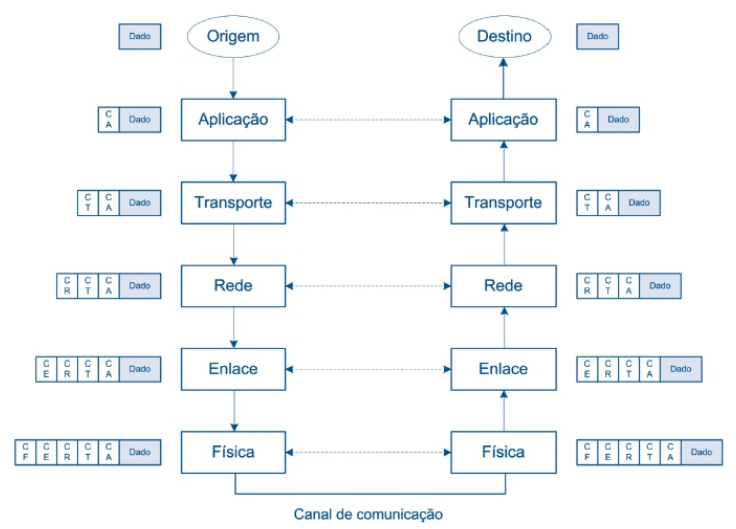<br>
*Source: MAIA, Luiz Paulo. Arquitetura de Redes de Computadores, 2nd ed., 2013, p. 64.*

## Five-Layer Model:

> This guide focuses on the five-layer model. The table follows the order of the upcoming chapters, starting with signal transmission and ending with the service the application uses.

| Layer | Responsibility | Example |
| --- | --- | --- |
| **Physical** | Represent data as signals and transmit them over the medium. | Radio transmission in Wi-Fi or light pulses in optical fiber. |
| **Data link** | Organize data into frames and deliver them over a link. | PPP, a data link protocol used on point-to-point connections. |
| **Network** | Identify destinations by logical addresses and forward packets between networks. | IP, the protocol routers use to forward packets to the next hop. |
| **Transport** | Deliver data end to end between processes according to the guarantees of the protocol in use. | TCP, which provides an ordered data stream, and UDP, which sends datagrams. |
| **Application** | Define the messages and rules programs use to provide or access a service. | HTTP, the protocol browsers and web servers use to exchange requests and responses. |

## TCP/IP Model (Four Layers):

The TCP/IP model, or Internet model, organizes communication into **Network Access**, **Internet**, **Transport**, and **Application**. The main difference is at the bottom: **Network Access** combines signal transmission and frame delivery, functions that the five-layer model separates into the **Physical** and **Data Link** layers. The **Internet** layer corresponds to the **Network** layer.

> The five-layer model simply represents the TCP/IP architecture with a more explicit division of network access responsibilities (in practice, **they are the same model at different levels of detail**).

## OSI Model (Seven Layers):

The OSI reference model organizes communication into **Physical**, **Data Link**, **Network**, **Transport**, **Session**, **Presentation**, and **Application** layers. The first four have responsibilities similar to their counterparts in the five-layer model. Above transport, OSI distinguishes two additional responsibilities:

- **Session:** Organizes the dialogue between the parties and can establish synchronization points so an operation can resume.
- **Presentation:** Handles data representation so that both sides interpret the data consistently, as when using a common encoding to transmit text.

In the five-layer model, protocols and libraries used by applications can perform these functions.

> OSI remained a reference model (it lost ground to TCP/IP, which was already in use while the OSI standards were still under discussion). The complexity of the suite also hindered its adoption (more bureaucracy and overhead even for simple operations where speed matters more). Some useful features were adopted in specific transport- and application-layer protocols (such as encryption in HTTPS). Appendix B details how OSI organizes these functions.

---

# 2. Physical Layer

> How can a message be sent from one point to another? How does the receiver recognize and interpret it? What can disrupt transmission?

## Data, Signals, and Symbols:

When a laptop sends a file over Wi-Fi, its antenna emits radio waves. If the file travels over optical fiber on the next link, variations in light represent the information. The data can stay the same while its physical representation changes from one link to the next.

| Concept | Meaning | Example |
| --- | --- | --- |
| **Data** | The information to be communicated. | The sequence `1011`, part of a file. |
| **Signal** | A variation in a physical quantity used to carry information. | The voltage on a cable varying over time. |
| **Symbol** | One of the signal forms a transmitter can choose during a transmission interval. | One of four voltage levels, each associated with a pair of bits. |

The transmitter converts the data into signals suited to the medium. To recover the data, the receiver needs to recognize **which symbol arrived** and **when to sample it**. Data representation and synchronization are therefore two responsibilities of the physical layer.

## Transmission Media:

The choice of medium depends on distance, the required transmission rate, and installation and maintenance conditions. For wireless connections, mobility, obstacles, and interference in the coverage area also matter. Another criterion is ease of interception: tapping a cable generally requires physical access to the installation. In a wireless network, other devices within range can receive the signal.

### Wired Transmission (Guided Media):

| Medium | How the signal propagates | Practical characteristic |
| --- | --- | --- |
| **Twisted pair** | The electrical signal travels along two copper wires twisted together. Twisting helps reduce interference. | Both **unshielded cables** (UTP) and **shielded cables** (STP) are available. Rate and reach depend on the cable category and the technology used. |
| **Coaxial cable** | The electrical signal propagates between a central conductor and an outer conductor, separated by insulation. | The outer conductor also acts as a shield against interference. Coaxial cable is used in cable TV networks, for example. |
| **Optical fiber** | Light is guided through the fiber core. | Low attenuation favors long links. Fiber can be **single-mode** (one light path) or **multimode** (multiple light paths). Because light carries the information, the signal is immune to external electromagnetic interference. |

### Wireless Transmission (Unguided Media):

> Microwaves are part of the radio spectrum. The table highlights two uses: directional links between terrestrial antennas and satellite communication.

| Medium or link type | How the signal propagates | Practical characteristic |
| --- | --- | --- |
| **Radio waves** | An antenna emits electromagnetic waves that can reach receivers in several directions. | They enable communication with moving devices such as phones and laptops. Range depends on frequency, power, and obstacles. |
| **Terrestrial microwaves** | Directional antennas concentrate the radio signal toward the receiver. | They connect sites such as two buildings. Range depends on antenna height and alignment, obstacles, and, over longer distances, the curvature of the Earth. In some bands, rain also attenuates the signal. |
| **Satellite communication** | The ground station sends the signal to the satellite (uplink). An onboard **transponder** receives it and retransmits it toward Earth (downlink), usually on another frequency. | Provides coverage for remote or isolated regions. The orbit affects coverage, alignment, and propagation delay. |
| **Infrared** | A transmitter sends infrared light through space to the receiver, directly or by reflection. | Common for short-range communication, as in remote controls. Walls usually block the signal, limiting its use to the same room. |

Unguided media require extra care because transmissions arriving at the same receiver at the same time on overlapping frequencies can interfere with each other.

To reduce interference, wireless systems can use separate frequency channels or coordinate transmission times. If errors still occur, correction techniques help recover the data and reduce the need for retransmission.

## Links and Topologies:

A **link** is a communication path between devices.

### Point-to-Point Topologies:

Each link connects two devices. The topology describes how these links combine to form the network.

| Topology | Organization | Consequence |
| --- | --- | --- |
| **Fully connected (full mesh)** | Each pair of devices has a direct link. For $N$ devices, $N(N-1)/2$ links are required. | Provides high redundancy, but cost grows quickly. Four devices require six links. Adding a fifth requires four more, bringing the total to ten. |
| **Tree** | Links form branches at successive levels, connecting groups of devices. | Makes expansion by group easier. A link failure can isolate an entire branch. |
| **Star** | Each device has its own link to a central device such as a switch. | A link failure usually isolates one station. Failure of the central device affects all stations that depend on it. |
| **Distributed (partial mesh)** | Some device pairs are directly connected. Others communicate through intermediate devices. | Can provide alternative paths in parts of the network with fewer links than a full mesh. |

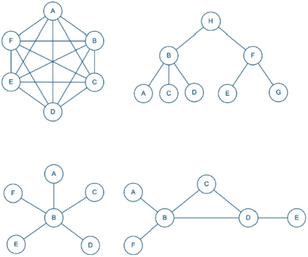<br>
*Source: MAIA, Luiz Paulo. Arquitetura de Redes de Computadores, 2nd ed., 2013, p. 37.*

### Multipoint Topologies (Shared Medium):

Several devices use the same medium to communicate. Access must be coordinated to avoid or handle transmissions that interfere with one another.

| Topology or arrangement | Organization | Consequence |
| --- | --- | --- |
| **Bus** | Devices connect to a common length of cable along which the signal propagates. | A shared cable failure can affect several devices. |
| **Ring** | Devices form a closed circuit that can be built from point-to-point links between neighbors. In Token Ring networks, a token circulates around the ring and authorizes the station holding it to transmit. | A failure can interrupt communication on a simple ring. Some implementations provide protection paths. |
| **Shared wireless channel** | Several devices in the same area use a common radio channel, as when stations connect to a Wi-Fi access point. | Simultaneous transmissions on the same channel can interfere when they reach the same receiver. |

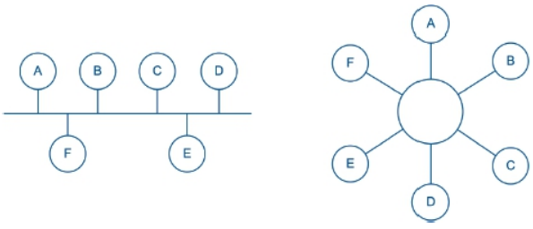<br>
*Source: MAIA, Luiz Paulo. Arquitetura de Redes de Computadores, 2nd ed., 2013, p. 38.*

> The **physical topology** describes how devices and links are arranged. The **logical topology** describes how data moves through that structure. For example, the cables in a network with a hub form a star, but the hub repeats the received signal on the other ports. The devices thus share the transmission medium (in practice, a bus).

## Information Transmission Techniques:

### Data Conversion:

The sound pressure picked up by a microphone varies continuously. In a voice call, the device needs to convert this analog information into digital data (**digitization**). A common technique is **PCM** (Pulse Code Modulation), which performs the conversion in three stages:

1. **Sampling:** Measures the amplitude of the microphone signal at regular intervals.
2. **Quantization:** Approximates each sample value using one of the available levels.
3. **Encoding:** Represents the selected level as a sequence of bits.

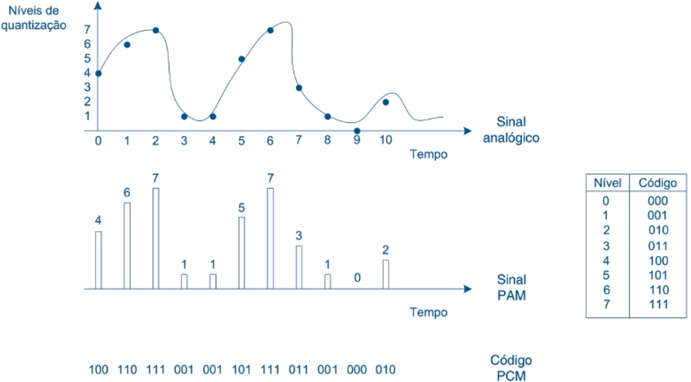<br>
*Source: MAIA, Luiz Paulo. Arquitetura de Redes de Computadores, 2nd ed., 2013, p. 117.*

Transmitting these bits requires choosing how to represent them on the medium. Two possibilities are to associate them with signal levels or transitions, or to use them to modify a carrier wave.

### Digital Signaling:

In digital signaling, the receiver distinguishes a set of states or transitions. In a simple example, the transmitter maintains a high voltage for one interval to represent `0` and a low voltage to represent `1`. To send `1011`, it applies low, high, low, and low levels over four consecutive intervals.

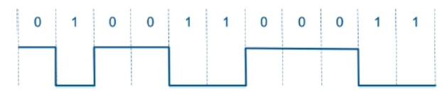<br>
*Source: MAIA, Luiz Paulo. Arquitetura de Redes de Computadores, 2nd ed., 2013, p. 118.*

> The last two bits have the same value, so in this representation the voltage stays low for both. To recognize that it received **two bits**, the receiver needs to know the length of each interval. Other coding schemes introduce transitions that help the receiver maintain synchronization.

### Analog Signaling and Modulation:

A **carrier** is a wave whose variation can convey information. **Modulating** a carrier means changing one of its characteristics, such as **amplitude**, **frequency**, or **phase**, according to the data being sent.

For example, the transmitter can choose one frequency to represent `0` and another for `1`. Although the wave varies continuously over time, the receiver distinguishes two possibilities and recovers a digital value. This principle allows bits to be transmitted by radio.

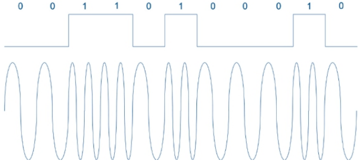<br>
*Source: MAIA, Luiz Paulo. Arquitetura de Redes de Computadores, 2nd ed., 2013, p. 121.*

### Multilevel Signaling:

One symbol can represent several bits. If the receiver can distinguish **four signal levels**, they can be associated with `00`, `01`, `10`, and `11`. In this case, the sequence `1011` requires only two symbols: the one corresponding to `10` and the one corresponding to `11`.

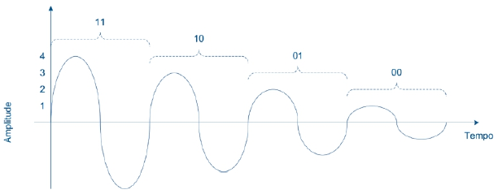<br>
*Source: MAIA, Luiz Paulo. Arquitetura de Redes de Computadores, 2nd ed., 2013, p. 123.*

- **Symbol rate:** The number of symbols transmitted per second, measured in baud (Bd).
- **Bit rate:** The number of bits transmitted per second, measured in bps.

At two bits per symbol, $1{,}000 \text{ Bd}$ corresponds to $2{,}000 \text{ bps}$.

> Using more levels allows more bits to be transmitted in the same interval, but requires the receiver to distinguish states that are closer together within the same amplitude range (greater complexity).

## Transmission Modes and Synchronization:

A transmission can be classified by its direction, how the data is arranged, and how the receiver synchronizes.

### Direction:

- **Simplex:** Information travels in one direction only, as in a radio broadcast from a station to its listeners.
- **Half-duplex:** Both ends can transmit, one at a time, as with a pair of walkie-talkies.
- **Full-duplex:** Both ends can transmit simultaneously, as with two phones on a call.

### Arrangement:

- **Serial:** Bits travel in sequence on each transmission lane. An interface can combine several serial lanes in parallel, as PCIe does.
- **Parallel:** Several bits are sent simultaneously on separate paths, as on a bus with eight data lines.

> Although parallel transmission may seem faster, many modern technologies use serial communication. At high frequencies, parallel transmission requires synchronizing bits that travel on different paths and dealing with interference between those paths.

### Synchronization:

- **Asynchronous (start/stop):** The receiver uses an agreed rate and adjusts its sampling time when it detects the start bit of each character. One or more stop bits mark the end of the unit.
- **Synchronous:** The receiver maintains a timing reference throughout a block or stream of data. The clock can be sent on a separate line or recovered from the signal, eliminating the need for start and stop bits for each character.

> On a UART configured with eight data bits, one start bit, and one stop bit, each byte occupies ten bit intervals on the medium. In this format, data accounts for $80\%$ of the character transmission time.

## Channel Limitations and Transmission Capacity:

As it travels through the medium, the signal may weaken and encounter interference. If two transmitted symbols produce very similar values at the receiver, the likelihood of mistaking one for the other increases.

- **Noise and interference:** Disturbances that make symbols harder to identify. **Thermal noise** arises from the agitation of charge carriers in components. **Crosstalk** occurs when part of the signal on one channel interferes with another, as can happen between adjacent wire pairs.

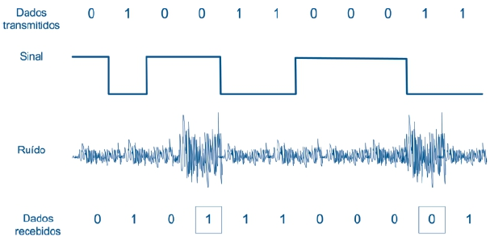<br>
*Source: MAIA, Luiz Paulo. Arquitetura de Redes de Computadores, 2nd ed., 2013, p. 98.*

- **Attenuation:** A reduction in signal power along the path. The greater the loss, the weaker the signal reaching the receiver.

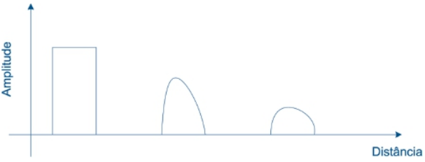<br>
*Source: MAIA, Luiz Paulo. Arquitetura de Redes de Computadores, 2nd ed., 2013, p. 100.*

- **Signal-to-noise ratio (SNR):** The ratio of signal power to noise power at the receiver. If attenuation reduces received signal power while noise power remains approximately constant, the SNR decreases and symbols become harder to distinguish.
- **Bandwidth:** The width of the frequency range available for transmission, measured in hertz (Hz). A channel ranging from $1 \text{ kHz}$ to $4 \text{ kHz}$ has a bandwidth of $3 \text{ kHz}$.

**Transmission capacity** expresses a rate in bit/s. Two theoretical limits show how it relates to bandwidth and channel conditions:

| Limit | Assumed conditions | Theoretical maximum rate |
| --- | --- | --- |
| **Nyquist** | Ideal noiseless channel with bandwidth $W$ and $N$ signaling levels. | $C = 2W\log_2(N)$ |
| **Shannon** | Channel with bandwidth $W$ and additive white Gaussian noise. | $C = W\log_2(1+\mathrm{SNR})$ |

In the Nyquist formula, each symbol represents $\log_2(N)$ bits. For example, going from two to four levels increases the number of bits per symbol from one to two.

Shannon explains why this gain reaches a limit on a real channel: for a fixed bandwidth and signal-to-noise ratio, increasing the number of levels indefinitely eventually makes the symbols too difficult to distinguish.

> In the formulas, $W$ is given in hertz. In Shannon's formula, SNR is a power ratio. If it is expressed in decibels, the conversion is $\mathrm{SNR}=10^{\mathrm{SNR}_{\mathrm{dB}}/10}$. For example, $20 \text{ dB}$ corresponds to a ratio of $100$.

## Multiplexing:

**Multiplexing** allows multiple information streams to share one physical medium. At the source, the **multiplexer** combines the streams. At the destination, the **demultiplexer** separates them according to the frequency band or time interval each occupies.

| Technique | How streams share the medium | Example |
| --- | --- | --- |
| **FDM (Frequency-Division Multiplexing)** | Each stream occupies a different frequency band. Several can transmit at the same time. | Radio stations broadcast simultaneously on different frequencies. Listeners select a station by tuning to its frequency. |
| **TDM (Time-Division Multiplexing)** | Each stream uses the channel during specific time intervals. | A device collects readings from three sensors and transmits one sample from each in turn over the same link. |

In TDM, transmission intervals (slots) can be allocated in two ways:

- **Synchronous TDM:** Each channel receives a fixed position that repeats every cycle. If three sensors transmit in positions A, B, and C and sensor B has no data, its slot remains idle.
- **Statistical (asynchronous) TDM:** Slots are allocated according to demand. If B has no data, the system can use that time to transmit data from A or C. The receiver must be able to identify the channel to which each received block belongs.

**FDM and TDM can be combined.** A system can separate channels by frequency and divide the time within each band among several transmissions.

> We now know how to transmit a message. But how is that data directed to a device? How do we decide who can transmit at any given moment?

---

# 3. Data Link Layer

> How can data be sent to one or more devices? How can delivery be confirmed and errors detected?

## Delivery over a Link:

Consider a laptop that needs to send data to two destinations: a printer on the same local network and a server on the Internet. To reach the printer, the laptop can send a **frame** addressed to it. To reach the server, it sends the frame to the local network's **router**. In the second case, the frame is destined for the router, while the packet it carries is destined for the server.

The **Data Link layer** handles this local delivery. When forwarding the packet, the router removes the frame it received and prepares another suited to the next link. Each link can use a different technology and have its own rules for addressing, medium access, and error handling.

## Frames and Framing:

A **frame** is the unit of data used for communication over a link. Its format depends on the protocol, but it usually has three parts:

| Part | Function |
| --- | --- |
| **Header** | Contains control information, such as the local source and destination addresses or an identifier for the protocol being carried. |
| **Payload** | Contains the data carried by the frame, such as a packet received from the Network layer. |
| **Trailer** | May contain a code that allows the receiver to check whether any protected bits have changed. |

**Framing** allows the receiver to recognize where a frame begins and ends. Some protocols use reserved sequences called flags to mark these boundaries. Others use length information or start and end signals defined by the technology.

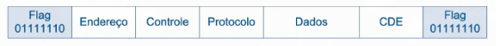<br>
*Source: MAIA, Luiz Paulo. Arquitetura de Redes de Computadores, 2nd ed., 2013, p. 153.*

Using a flag creates a problem: the same sequence may occur by chance in the payload. To let the receiver distinguish the marker from the data, the transmitter can insert extra elements that are removed on reception. This technique is called **stuffing**.

- **Byte stuffing:** The transmitter inserts an escape byte before a reserved value that appears in the data. When the receiver sees the escape byte, it knows to interpret the next value as data.
- **Bit stuffing:** The transmitter inserts a bit when the data sequence is about to form a marker. The receiver recognizes the insertion by the same rule and removes the bit to recover the original sequence.

## Addressing and Local Forwarding:

In technologies such as Ethernet, **MAC addresses** identify the interfaces involved in local communication. The frame indicates which interface sent it (the **source**) and which interface or set of interfaces it is intended for (the **destination**).

| Delivery type | Intended recipient | Example |
| --- | --- | --- |
| **Unicast** | One specific interface. | The laptop sends a job to the printer on the local network. |
| **Multicast** | A group of interfaces. | A device sends data to a group of video receivers. |
| **Broadcast** | All interfaces in the same broadcast domain. | The laptop queries the entire local network to discover a neighbor's address. |

A **bridge** or **switch** uses the destination address to decide where to forward the frame. If the switch already knows which port leads to the printer, it can forward the unicast frame through that port alone. If it receives a broadcast, it distributes the frame through the other ports that belong to that logical network. The reach of that distribution defines the **broadcast domain**.

## Medium Access Control:

When several devices share a channel, two may try to transmit at the same time. If their signals overlap at the receiver and prevent it from reading a frame correctly, a **collision** occurs. **Medium access control** establishes the rules that participants follow when using the channel.

| Strategy | How devices use the medium | Consequence |
| --- | --- | --- |
| **Channel partitioning** | Each participant is allocated a resource, such as a frequency band, a time slot, or a code that distinguishes its transmission. | This separation lets several devices use the medium in an organized way. A reserved portion may sit idle. |
| **Contention-based (random) access** | A device with data tries to transmit according to the protocol's rules. One strategy is to check whether the channel seems idle before starting. | Devices use the channel as needed. Two stations can still sense an idle channel at almost the same time and start transmissions that collide. |
| **Controlled access** | A rule grants each participant a turn to transmit. A controller can query the stations in sequence (polling), or permission can circulate among them (a token). | Permission determines whose turn it is. Granting or passing a turn also takes up communication time. |

> Time-division multiplexing, introduced in the Physical layer, explains how several streams occupy different time slots on a channel. When those streams come from independent stations, access control must also determine **which station can use each slot**.

## Errors:

If a bit changes during transmission, the receiver may receive a sequence different from the one sent. To identify this type of error, the transmitter adds **redundancy**: bits calculated from the protected data. The receiver checks whether the relationship between the data and the additional bits still holds. An inconsistency reveals an error. If the check passes, all we know is that the method **detected no error**.

### Error Detection:

| Method | How it works |
| --- | --- |
| **Parity bit** | Adds a bit so that the total number of `1` bits is even (**even parity**) or odd (**odd parity**). |
| **Checksum** | Combines blocks of data, usually by addition, to obtain a check value. The calculation depends on the protocol. |
| **CRC (Cyclic Redundancy Check)** | Calculates a check value using binary division based on `XOR`. One application is checking Ethernet frames. |

With **even parity**, the data `1011` contain three `1` bits. The transmitter appends `1` and sends `10111`, now with four `1` bits. If the receiver reads `10011`, it counts three and detects the error. If two bits are flipped, the count remains even and the change goes unnoticed.

### Hamming Distance:

Detecting a change requires recognizing that the received value is invalid. **Correcting** it also requires identifying which value was sent. **Hamming distance** helps explain when this is possible: it is the number of positions at which two sequences of equal length differ. For example, `111000` and `110001` differ in two positions and have a distance of 2.

The **minimum distance** ($d_{\min}$) of a code is the smallest distance between any two valid codewords. It determines how many bit flips the code can guarantee to detect or correct:

| Goal | Minimum distance required |
| --- | --- |
| Detect up to $n$ bit flips per codeword | $d_{\min} \geq n + 1$ |
| Correct up to $n$ bit flips per codeword | $d_{\min} \geq 2n + 1$ |

Imagine a code whose only valid codewords are `000` and `111`. The distance between them is 3. If the receiver reads `010` and at most one bit was flipped, it can recover `000`: changing just one bit gives `000`, whereas two changes would be needed to obtain `111`. The Hamming code applies this principle using parity bits in specific positions. Its construction is described in Appendix A.

### Recovery by Retransmission:

When a frame is lost or arrives with an error that the receiver can only detect, one way to recover the data is to **retransmit the frame**. This depends on the protocol. On a link that only detects and discards damaged frames, any recovery is left to another layer.

In **stop-and-wait**, the transmitter sends one frame and waits for an acknowledgement (**ACK**) before sending the next.

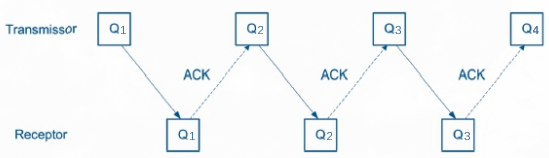<br>
*Source: **Adapted** from MAIA, Luiz Paulo. Arquitetura de Redes de Computadores, 2nd ed., 2013, p. 163.*

To recover from losses, the transmitter can start a **timer** after sending a frame. If the timer expires (a timeout) without the expected ACK, it retransmits. Some protocols also allow the receiver to signal failure with a negative acknowledgement (**NAK**), prompting an earlier retransmission.

The **ACK itself can be lost**. In that case the receiver has already accepted the frame, but the transmitter times out and sends a second copy.

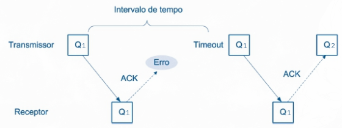<br>
*Source: **Adapted** from MAIA, Luiz Paulo. Arquitetura de Redes de Computadores, 2nd ed., 2013, p. 164.*

A **sequence number** allows the receiver to recognize the duplicate and repeat the acknowledgement without delivering the same data twice. The combination of error checking, acknowledgements, and retransmissions is called **ARQ** (Automatic Repeat reQuest).

Waiting for an acknowledgement for every frame can leave the link idle. Protocols with a **send window** allow several frames to be outstanding at once. As ACKs arrive, the window advances and new frames can be sent.

### Flow Control:

Even when all frames arrive without errors, a fast transmitter may send them before the receiver can process them. The receiver temporarily stores frames in an area of memory (a buffer). If it fills up, new frames may be discarded. **Flow control** adjusts transmission to the receiver's capacity.

- **Pause and resume:** The receiver requests a pause before it runs out of space and authorizes transmission to resume when space becomes available again.
- **Credits or advertised window:** The receiver reports how much more it can accept. If there is room for three frames and the receiver advertises three credits, the transmitter can send up to that many frames before it needs more credits.

An **acknowledgement** indicates what has already been received. A **credit** indicates how much more may be sent. A protocol may communicate both in the same message. **Congestion control** deals with overload along the network path, which can occur even when the final receiver has space available.

> We now know how to deliver data to a small group of directly connected devices. But how do we reach a device on another network?

---

# 4. Network Layer

> How can a device on another network be identified? How do routers decide where data should go? What happens if a node has a problem?

## Delivery Between Networks:

Consider a laptop that needs to print a document and then send it to a university server. The printer is on the same local network. The server is on another network, reachable through a router. How does the laptop decide where to deliver each transmission?

The **Network layer** uses logical addresses to identify the source and destination interfaces and forwards **packets** between networks. On the Internet, **IP** (Internet Protocol) performs this function. The computer consults its routes to decide whether it can deliver the packet directly to the destination or must send it to an intermediate device, the **next hop**.

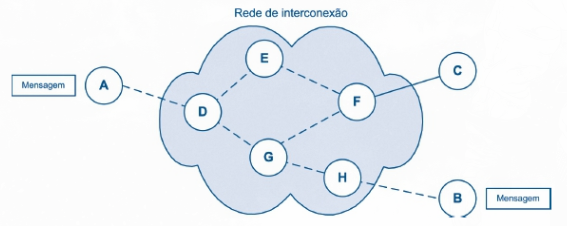<br>
*Source: MAIA, Luiz Paulo. Arquitetura de Redes de Computadores, 2nd ed., 2013, p. 261.*

A **router** connects networks through its interfaces. When it receives a packet, it looks up the destination IP address, chooses an outgoing interface, and prepares to transmit over the next link. Each router performs its own lookup. The laptop can therefore reach the server knowing only the first router on the path.

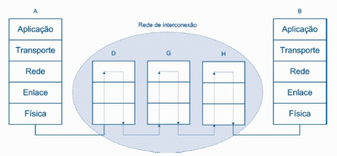<br>
*Source: MAIA, Luiz Paulo. Arquitetura de Redes de Computadores, 2nd ed., 2013, p. 262.*

> Each router looks only as far as the Network layer because that is the last layer it needs to choose the next hop. In the server example, the link-layer destination of the first **frame** is the router's local interface. Inside the frame, the **packet** has the server as its IP destination. As the packet moves from one routed link to the next, it is placed in a new frame suited to the next delivery.

## Switching:

**Switching** connects endpoints through intermediate devices. How the resources along the path are used depends on the type of network.

### Circuit Switching:

In circuit switching, the network establishes a path between the source and destination and reserves capacity for the communication. A traditional telephone call illustrates the three phases:

1. **Setup:** When the call begins, the network chooses a path and reserves the required resources on each link.
2. **Transfer:** The conversation uses the established circuit. Even during a pause, the reserved capacity remains available to that call.
3. **Release:** When the call ends, the resources are released and can serve other communications.

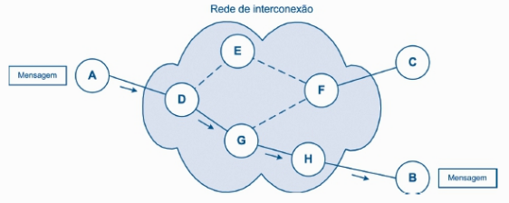<br>
*Source: MAIA, Luiz Paulo. Arquitetura de Redes de Computadores, 2nd ed., 2013, p. 263.*

A single physical link can carry several circuits, each with its share of capacity. If a link along the path fails, communication may be interrupted until the network reestablishes the circuit along another path.

### Packet Switching:

Data are sent in packets that share the links with packets from other communications. Capacity can be used according to demand. If several packets need the same outgoing interface, they may form a queue and may be dropped if space runs out.

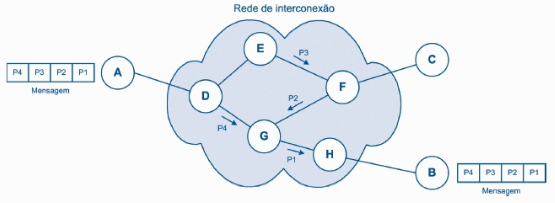<br>
*Source: MAIA, Luiz Paulo. Arquitetura de Redes de Computadores, 2nd ed., 2013, p. 265.*

### Datagrams and Virtual Circuits:

A packet network can make its forwarding decision in two ways:

- **Datagram:** Each packet carries the destination address and is forwarded according to the table available at each router. Packets from the same communication can take different paths, with no guarantee of delivery or order.
- **Virtual circuit:** Before transmission, the network establishes a logical path and records on each device how to forward packets for that circuit (as in circuit switching, but allowing the same physical link to be shared). ATM networks, for example, use this model.

## Logical Addressing and Subnets:

An IP address identifies a **network interface**. A laptop connected by both cable and Wi-Fi can have an address on each interface. The same interface can also have IPv4 and IPv6 addresses at the same time.

**IPv4** uses 32 bits, represented as four decimal numbers from 0 to 255 separated by dots. **IPv6** uses 128 bits, arranged in hexadecimal groups.

An interface address can be interpreted in two parts. The **network identifier** (NetID) is the prefix shared by interfaces on the same subnet. The **host identifier** (HostID) distinguishes the interface within that subnet. The prefix length indicates where one part ends and the other begins.

For example, in `192.168.10.34/27`, the first 27 bits identify the subnet `192.168.10.32/27`. The remaining five bits identify the interface within it. In the last octet, `34` is `00100010` in binary. The first three bits (`001`) still belong to the prefix, and the last five (`00010`) form the HostID.

### Address Assignment:

An address can be configured **manually** on an interface or obtained **dynamically**. In IPv4 networks, a **DHCP** (Dynamic Host Configuration Protocol) server commonly supplies the address, the subnet mask, and other information, such as the default gateway.

- **Lease:** The laptop receives an address for a set period and can renew the lease to continue using it. When the lease expires, the server can offer the address again.
- **Reservation:** The administrator can associate an address with a particular client. The printer, for example, still uses DHCP but always receives the same IP address, making it easy to locate.
- **IP address conflict:** If someone manually assigns the address already used by the printer to another device on the same subnet, both may respond to the same IP address. The laptop may end up sending data to the wrong device, and access to the printer may become intermittent.

### Classful Addressing and CIDR:

In the historical **classful addressing** model, the leading bits of an IPv4 address indicated its class. For classes A, B, and C, the class determined the initial size of the network portion. Classes D and E had their own purposes.

| Class | Leading bits | First-octet range | Division or purpose |
| --- | --- | --- | --- |
| **A** | `0` | 0 to 127 | 8 network bits and 24 host bits (`/8`). |
| **B** | `10` | 128 to 191 | 16 network bits and 16 host bits (`/16`). |
| **C** | `110` | 192 to 223 | 24 network bits and 8 host bits (`/24`). |
| **D** | `1110` | 224 to 239 | Group addressing (multicast). |
| **E** | `1111` | 240 to 255 | Historically reserved range, including special-purpose addresses. |

> The table shows how to identify the classes. Some ranges have special uses, such as `127.0.0.0/8`, used for loopback.

For an organization with **500 interfaces**, a class C network provided 254 usable host addresses, while a class B network provided 65,534, reserving far more addresses than necessary.

> Receiving two class C networks would reduce waste, but each network could require its own entry in routing tables.

**CIDR** (Classless Inter-Domain Routing) made the prefix length explicit in block allocation and route advertisements. In this example, a `/23` block provides 512 addresses, of which 510 can be assigned to interfaces on a conventional IPv4 subnet. CIDR also allows **route aggregation**. Contiguous, aligned networks can be advertised as a single prefix when they share the same forwarding behavior.

> The prefix length is part of each router's local route configuration. An external router may know only the `192.168.10.0/24` route covering an entire company, while an internal router also knows `192.168.10.32/27`, a department's subnet.

### IPv4 Subnet Example:

With `/27`, each block contains $2^5 = 32$ addresses. The corresponding mask is `255.255.255.224`. In this example, the laptop belongs to the block that starts at `.32` and ends at `.63`.

| Element | Address | Interpretation |
| --- | --- | --- |
| **Subnet address** | `192.168.10.32/27` | Identifies the address block. |
| **Local router** | `192.168.10.33` | Router interface that the laptop can reach directly. |
| **Laptop** | `192.168.10.34` | Wi-Fi interface used in this example. |
| **Printer** | `192.168.10.50` | Belongs to the same block as the laptop. |
| **Subnet broadcast** | `192.168.10.63` | Broadcast address for this IPv4 block. |
| **Server** | `192.168.10.70` | Belongs to the next block, `192.168.10.64/27`. |

Although the first three numbers are the same, the printer and server are on different subnets. The prefix length makes this distinction possible.

### Public and Private Addresses:

The addresses of the example subnets are **private** and can be reused in independent networks. The scarcity of public IPv4 addresses led to widespread use of **network address translation** (NAT). At home, for example, a laptop and a phone can access the Internet through the router's same public IPv4 address. In the most common form, the router also translates ports and records the mappings to deliver each response to the correct device.

## Forwarding and the Next Hop:

A **routing table** associates destination networks with outgoing interfaces. When the destination must be reached through a router, the route also indicates the **next hop**.

In the lab, assume the laptop has only two routes for the forwarding example: one for the directly connected network `192.168.10.32/27` and a **default route** through router `192.168.10.33`.

| Packet destination | Laptop's decision | Local frame destination |
| --- | --- | --- |
| **Printer `192.168.10.50`** | The printer belongs to the directly connected subnet. | Printer's MAC address. |
| **Server `192.168.10.70`** | The server is on another subnet. The laptop uses the default route. | MAC address of router `192.168.10.33`. |

When more than one route matches the destination, the **longest prefix** wins because it describes the most specific block. The default route has a zero-length prefix (`0.0.0.0/0` in IPv4 or `::/0` in IPv6) and serves destinations with no more specific match. The router it specifies is the **default gateway**.

After choosing the next hop, the laptop needs to discover its link-layer address. In the lab, **ARP** provides this mapping. To print, the laptop looks for the MAC address of `.50`. To send to server `.70`, it looks for the MAC address of `.33`. The packet's destination IP address is still the server's. In IPv6, link-layer address resolution is part of **Neighbor Discovery**.

> The routing table answers “Which way do I send this packet?” The neighbor table answers “Which link-layer address do I use to deliver it to the next hop?”

## Routing and Path Discovery:

**Forwarding** takes place when a packet arrives and the device chooses where to send it. **Routing** determines and updates the paths that make this choice possible. A router can therefore forward many packets using the same previously calculated route.

### Route Origins:

| Origin | How the route is established | Example |
| --- | --- | --- |
| **Directly connected network** | The system recognizes a prefix as reachable through its own interface. | Configuring `192.168.10.34/27` normally creates a route to `192.168.10.32/27` through the laptop's interface. |
| **Static route** | An administrator configures the destination and the outgoing path. | Forward `192.168.10.64/27` through router `.62`. |
| **Dynamic route** | Routers exchange information and update paths according to the protocol in use. | After a failure, a router learns that a network is now reachable through another neighbor. |

### Metrics and Path Selection:

The **protocol** defines how routers exchange information. The **algorithm** uses that information to calculate paths. The **metric** expresses the comparison criterion. A two-hop path, for example, might cross a slow link and take longer than a three-hop path. The choice depends on what the protocol measures.

| Metric or characteristic | What it represents |
| --- | --- |
| **Hop count** | The number of hops to the destination. |
| **Capacity and load** | The transmission rate a link supports and how much of that capacity is in use. |
| **Delay** | The time it takes to traverse a link or path. |
| **Error rate** | How frequently transmission errors occur. |
| **Availability** | The proportion of time the link remains operational. |
| **Link cost** | A value configured by the administrator or calculated by the protocol. With additive costs, the values of the links along the path are summed. |

Besides choosing suitable routes, an algorithm must respond to changes. When a cable breaks, an important question is how long it takes the routers' routes to stabilize. This process is called **convergence**. Other desirable properties include **robustness** in the face of failures and delayed information, **scalability** as the network grows, and low memory, processing, and control-traffic overhead.

### Routing Classifications:

| Criterion | Alternatives |
| --- | --- |
| **Updates** | **Static** or **dynamic**, depending on how routes are maintained, as described in *Route Origins*. |
| **Organization** | **Flat:** the domain operates without hierarchical subdivisions. **Hierarchical:** the network is organized into areas or domains, allowing information to be summarized between them. |
| **Available information** | **Local or partial:** the router relies on information from its neighbors. **Global:** the calculation uses a topology map of the domain or area. |
| **Where the calculation takes place** | **Centralized:** one entity calculates routes for the devices. **Distributed:** the routers participate in the calculation. |

The criteria can be combined. With link-state routing, for example, each router can have a **global map of the area** and calculate its own routes in a **distributed** manner.

### Distance Vector:

Each router advertises to its neighbors the destinations it knows and the cost of reaching them. When it receives an advertisement, it adds the cost of reaching the neighbor to the advertised cost. A can therefore discover a path to E by knowing how much it costs to reach B and what distance B advertises to E.

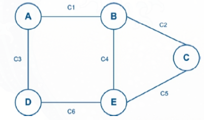<br>
*Source: MAIA, Luiz Paulo. Arquitetura de Redes de Computadores, 2nd ed., 2013, p. 301.*

In the figure, each link has a cost of 1. The table tracks the information available at A.

| Stage | What happens | What A knows |
| --- | --- | --- |
| **T0 - Initialization** | Each router starts with its own entry. | The cost of reaching A is 0. |
| **T1 - Neighbors** | The routers identify their direct links. | B and D each have a cost of 1. |
| **T2 - Vector exchange** | The neighbors advertise the destinations they can reach. | B advertises E at a cost of 1. A calculates $1 + 1 = 2$ to reach E through B. D also offers a route to E with a cost of 2. |
| **T3 - Convergence** | Further exchanges retain the lowest costs found. | A can reach E through B or D. To follow the failure, assume it chose B to break the tie. |

**What happens when the A-B link fails?** Link C1 becomes unavailable to everyone at the same instant, but the news takes time to reach each router.

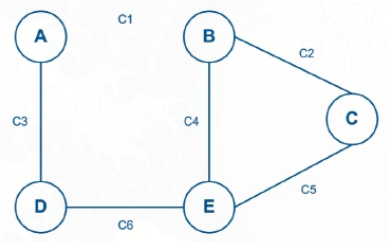<br>
*Source: MAIA, Luiz Paulo. Arquitetura de Redes de Computadores, 2nd ed., 2013, p. 305.*

| Stage | What changes | What A records |
| --- | --- | --- |
| **T0 - Detection** | A and B detect the failure and invalidate the selected routes that depended on C1. | The entries for B and E now have a cost of $\infty$. The direct link to D remains valid. |
| **T1 - Propagation** | Neighbors receive the advertisements and reassess their own entries. | At this stage of the example, A still records $\infty$ for B and E. |
| **T2 - Alternatives** | Advertisements received through D reveal valid paths. | A can once again reach E via `A-D-E` at a cost of 2. It still records $\infty$ for B. |
| **T3 - New convergence** | The routes stabilize without using C1. | A reaches B via `A-D-E-B` at a cost of 3. Before the failure, the direct link cost 1. |

> A cost of $\infty$ indicates that the router considers the destination unreachable given the information available at that instant. E was still physically reachable through D. The T0-T3 sequence illustrates one possible update order. A router that already maintains a valid alternative can use it sooner.

### Link State:

In **link-state routing**, each router advertises its neighbors and the cost of reaching each directly. The advertisements propagate throughout the area. Each router uses them to build a copy of the map and calculate paths from its own position.

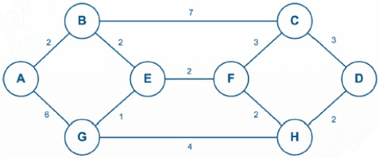<br>
*Source: MAIA, Luiz Paulo. Arquitetura de Redes de Computadores, 2nd ed., 2013, p. 308.*

1. **Local knowledge:** A identifies two direct links. Reaching B costs 2, and reaching G costs 6.
2. **Building the map:** Among its links, B advertises a link to E with a cost of 2. E advertises its link to G with a cost of 1. The advertisements from all eight routers allow the topology in the figure to be reconstructed.
3. **Choosing the next hop:** A compares the direct link to G, which costs 6, with `A-B-E-G`, which costs $2 + 2 + 1 = 5$. To reach G along the lowest-cost path, A first sends the packet to B.

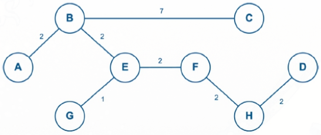<br>
*Source: MAIA, Luiz Paulo. Arquitetura de Redes de Computadores, 2nd ed., 2013, p. 310.*

The figure shows **A's shortest-path tree**. Link `A-G` remains available and may be selected if a cost changes. When a link fails, the change is advertised. As routers receive the update, they recalculate the affected paths. Until the maps are updated, temporary losses or loops may occur. The calculation for all eight routers appears in “Calculating Paths with Dijkstra's Algorithm” in Appendix A.

### Hierarchy and Autonomous Systems:

At the scale of the Internet, networks are organized into **autonomous systems** (ASes), sets of networks under common technical administration with a defined routing policy. A network operator, for example, can manage several prefixes and routers within the same AS.

Within an AS, routing can prioritize internal costs. Between autonomous systems, path selection also takes policies into account, such as which networks an operator is willing to reach through a particular neighbor. **Border routers** connect to other systems. Prefix aggregation helps advertise destinations externally without exposing every internal subdivision.

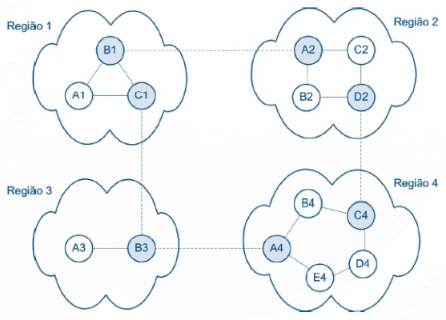<br>
*Source: MAIA, Luiz Paulo. Arquitetura de Redes de Computadores, 2nd ed., 2013, p. 317.*

## Distribution to Multiple Destinations:

If a server sends the same content to twenty receivers by **unicast**, it sends to each separately. If their paths share a link, multiple identical copies may traverse the same link. A network that supports group delivery can carry one copy over the shared link and replicate it where the paths diverge.

| Delivery method | Recipients | Scope |
| --- | --- | --- |
| **Unicast** | One destination interface. | Follows the path chosen for that address. |
| **Broadcast** | All participants within a broadcast scope. | In the lab, `192.168.10.63` identifies the broadcast address of subnet `192.168.10.32/27`. |
| **Multicast** | Interfaces interested in a group. | Can traverse multiple networks when routers support distribution to the group. |

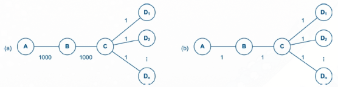<br>
*Source: MAIA, Luiz Paulo. Arquitetura de Redes de Computadores, 2nd ed., 2013, p. 318.*

### Flooding and Spanning Trees:

In **flooding**, each node that receives a message replicates it through its other participating outgoing interfaces. If there are loops, copies can return to the same node. Message identifiers and records of previously seen copies allow duplicates to be discarded. A hop limit also restricts how long a copy can circulate.

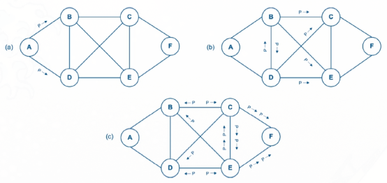<br>
*Source: MAIA, Luiz Paulo. Arquitetura de Redes de Computadores, 2nd ed., 2013, p. 318.*

A **spanning tree** selects links that reach every router without forming loops. When distributing along this tree, each router replicates the message only on the necessary branches. This reduces redundant copies. Where the tree runs, however, can concentrate traffic or lengthen the path for some senders. If a selected link fails, the branch that depended on it may stop receiving messages until the tree is adjusted.

> Flooding is a distribution technique used by specific protocols. The lab's local broadcasts stay within their broadcast domain. In IPv6, group delivery functions use multicast.

### Multicast Groups and Pruning:

A multicast address identifies a **group**. In a **permanent group**, the address remains assigned to its purpose even when nobody is receiving the transmission. A **temporary group** may exist for the duration of an event, such as a live class. In either case, devices can join and leave the group.

One way to reach receivers is to build a **source-based tree**. In **reverse path multicasting** (RPM), each router checks whether the packet arrived on the interface it would use to reach the source. The initial distribution may still reach branches with no receivers.

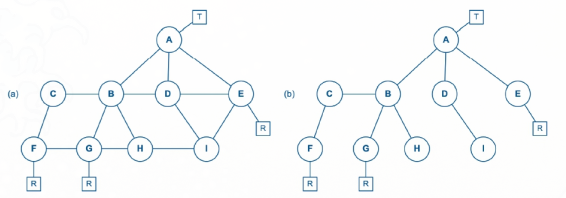<br>
*Source: MAIA, Luiz Paulo. Arquitetura de Redes de Computadores, 2nd ed., 2013, p. 322.*

**Pruning** removes those outgoing interfaces from the distribution. If a router's branch leads to no receiver, it signals to the preceding router that subsequent copies of that traffic need no longer be sent that way.

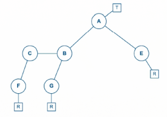<br>
*Source: **Adapted** from MAIA, Luiz Paulo. Arquitetura de Redes de Computadores, 2nd ed., 2013, p. 322.*

Compare `B-H` and `A-D-I`, removed from the distribution, with router `C`, which remains. Even without a local receiver, `C` leads to `F`. The pruned links remain available for other traffic, and the branch can be used again if a receiver appears.

After pruning, subsequent transmissions save bandwidth. There is, however, an initial cost to reaching branches without interested receivers, in addition to the control messages and information maintained for each source and group combination.

### Shared Tree:

Several senders can also use a **tree shared by the group**. In the core-based approach, routers with interested receivers request to join the tree in the direction of a common point called the **core**.

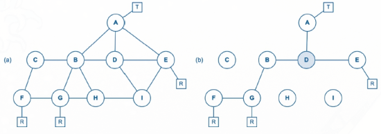<br>
*Source: MAIA, Luiz Paulo. Arquitetura de Redes de Computadores, 2nd ed., 2013, p. 322.*

Building the tree as interested parties join avoids initial flooding. A single structure serves multiple senders, but their positions relative to the core may produce longer paths or concentrate traffic on certain links. The core's availability also matters when new branches join. “Multicast Routing” in Appendix A shows how CBT and PIM-SM organize participation.

## MTU and Fragmentation:

A link's **MTU** (Maximum Transmission Unit) limits the size of the network packet it can carry as a unit. The **path MTU** is the smallest MTU among the links along the path.

Consider a **1,500-byte** IP packet that reaches a router whose next outgoing link accepts only **1,280 bytes**. The packet fits on the first link and exceeds the limit of the next one. The outcome depends on the IP version and, for IPv4, on whether fragmentation is permitted.

| Situation | What happens |
| --- | --- |
| **IPv4 with fragmentation permitted** | The router can divide the datagram into fragments that fit on the next link. Each fragment travels with its own IPv4 header, and the destination uses the identification and position information to reassemble the datagram. |
| **IPv4 with DF (Don't Fragment)** | The router drops the oversized packet and, as designed, informs the source via ICMP that fragmentation would be required. |
| **IPv6** | Fragmentation is the responsibility of the source. If a router encounters a packet that is too large for the outgoing link, it drops it and sends an ICMPv6 Packet Too Big message indicating the MTU. |

Reassembling a datagram requires receiving **all** its fragments. If one is lost, the destination cannot deliver the complete datagram. Knowing the path MTU allows the source to adjust packet sizes before transmission.

> An MTU of 1,500 bytes on the laptop indicates the limit of the local interface. A link farther along the path may have a smaller MTU.

## VPN:

A **VPN** (Virtual Private Network) establishes a **tunnel** between two endpoints to carry private traffic over a network such as the Internet. With encryption, the contents of the packets are protected as they cross the tunnel.

### Remote Access VPN:

The laptop establishes a tunnel to the VPN gateway. When the user accesses a website through the tunnel, the gateway decapsulates the packet and, in this example, translates the source IP address and port to its own public IP address and an outgoing port. This works like a second NAT translation: the response reaches the gateway, which forwards it back to the laptop through the tunnel.

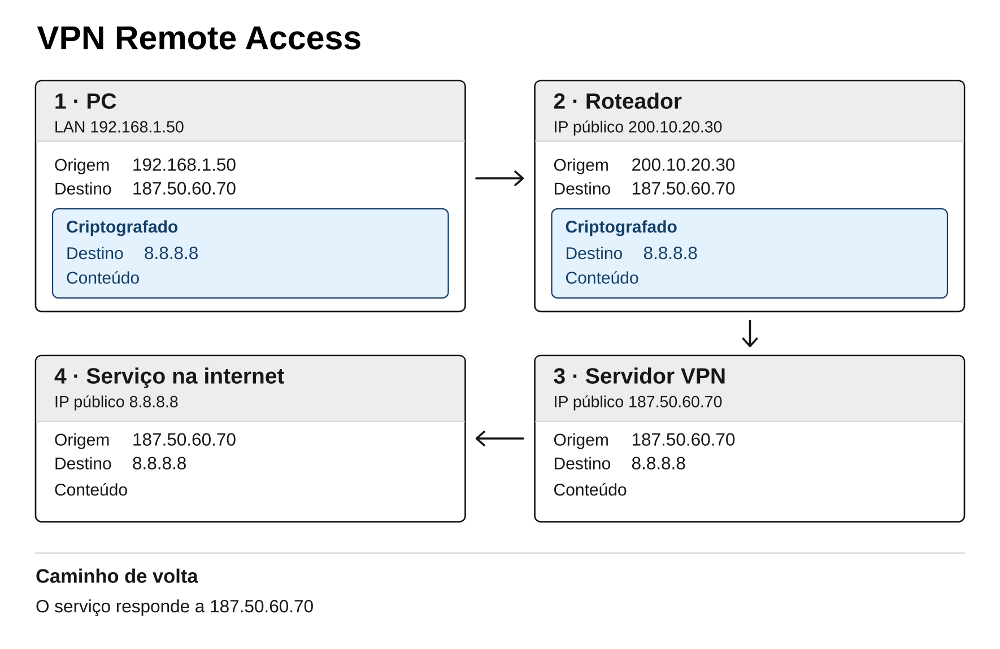<br>
*Source: Created by the author with the assistance of ChatGPT, 2026.*

> Encryption protects the contents between the laptop and the gateway. The website sees the VPN's outgoing socket as the source. The gateway maintains the mapping between that socket and the user's public socket. This is what “anonymity” means in this example. The website can still recognize the user by their account or by personal information in the message.

### Site-to-Site VPN:

Two gateways maintain a tunnel between the networks of two campuses. When sending, the source gateway encapsulates the entire IP packet and adds an outer header to deliver it to the other gateway. On arrival, the gateway removes the encapsulation and forwards the original packet over the internal network. Thus, even on different subnets, the computers communicate using their private addresses, and the recipient sees the sender's private IP address.

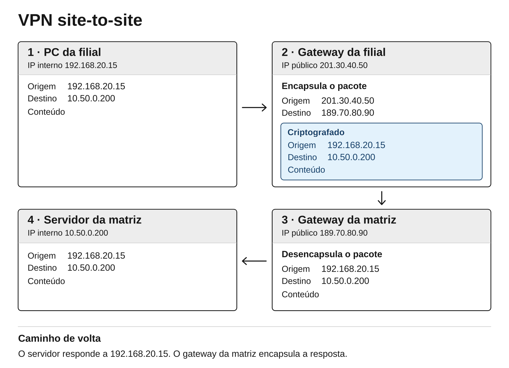<br>
*Source: Created by the author with the assistance of ChatGPT, 2026.*

## Onion Routing:

In **onion routing**, the client prepares layers of encryption for successive relays. In **Tor**, these relays form a **circuit** over the Internet. To access a public website, a typical circuit passes through relays with three roles:

| Relay | What it does on the outward path |
| --- | --- |
| **Entry (guard)** | Receives the client's connection, removes its layer of encryption, and forwards the data to the middle relay. It knows the client's address and the next node in the circuit. |
| **Middle relay** | Removes its layer and forwards the data to the exit. In a normal exchange, it sees the adjacent relays. |
| **Exit relay** | Removes the last layer of circuit protection and opens the connection to the public website. The website receives the connection from the exit's address. |

The **onion** image comes from these successive layers. The client prepares the data so that each relay can remove only the layer corresponding to its stage. On the return path, the relays add their layers and the client removes them.

> The aim is to distribute knowledge of the path among participants (to decentralize the information and make the association harder to trace).

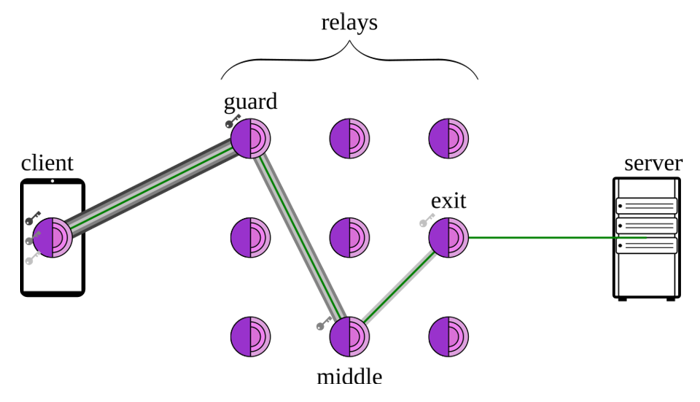<br>
*Source: Tga.D - Tor Circuit Diagram, Wikimedia Commons. Available at: [https://en.wikipedia.org/wiki/File:Tor_Circuit_Diagram.svg](https://en.wikipedia.org/wiki/File:Tor_Circuit_Diagram.svg). Accessed: Nov. 24, 2026.*

Tor is an **overlay network**. The entry, middle, and exit are the nodes chosen for the Tor circuit. Between any two of them, packets still traverse the Internet's IP routers. Circuit protection extends to the exit node.

> When a website is accessed over **HTTPS**, the encrypted connection between the browser and the website also protects the content on the leg between the exit and the server.

> We now know how to forward data to the destination device. But how do we deliver it to the right process?

---

# 5. Transport Layer

> How can several processes communicate at the same time? When delivery must be reliable, how are losses and out-of-order data handled?

## End-to-End Communication and Ports:

The **Transport layer** enables **end-to-end** communication between processes. Routers forward packets along the path. At the endpoints, the operating system delivers the data to the corresponding application.

A laptop can, for example, receive a web page and a DNS response at the same IP address. The IP header identifies the transport protocol, such as TCP or UDP. The transport header contains the **source and destination ports**, which distinguish communications. Combining data from multiple applications for transmission is called **multiplexing**. Separating them at the receiver is called **demultiplexing**.

- **Source port:** Identifies the sending endpoint. When initiating communication, the client usually receives a temporary port from the system, called an **ephemeral port**.
- **Destination port:** Identifies the receiving endpoint. The client normally knows the service's port. In the response, the server's port becomes the source and the client's port becomes the destination.

Port numbers are **16 bits** long. IANA divides them into three ranges:

| Range | Classification | Use |
| --- | --- | --- |
| `0–1023` | System or well-known ports | Include the default ports for services such as SSH (`22/TCP`) and HTTPS (`443/TCP`). Port `0` is reserved. |
| `1024–49151` | User or registered ports | Can be assigned by IANA to specific services. |
| `49152–65535` | Dynamic or private ports | Available for local selection. The range a system uses for ephemeral ports may vary. |

> A **default port** indicates where the client normally finds a service. The server can use another port as long as the client knows which one to use. TCP and UDP have independent port spaces: `53/TCP` and `53/UDP` can coexist on the same device.

## Sockets:

A **socket** is a communication endpoint that the operating system makes available to a process. In IP communication, the address of that endpoint is typically written as `IP:port`, with the transport protocol in use understood.

A **TCP connection** is identified by its pair of endpoints. In `192.168.10.34:51000 - 192.168.10.70:443`, the first belongs to the browser and the second to the server. If the browser opens another connection using local port `51001`, the server can distinguish the two even though both arrive at its port `443`.

## UDP:

**UDP** (User Datagram Protocol) sends messages in **datagrams**, without first establishing a connection. Each datagram retains its boundary: if an application sends two messages and both arrive, the receiver can read them separately.

UDP can detect errors using its checksum, but it does not guarantee delivery, ordering, or retransmission. In a DNS query over UDP, for example, the client decides whether to repeat the query if the response takes too long.

## TCP:

**TCP** (Transmission Control Protocol) establishes a connection and provides the application with an **ordered byte stream** in each direction. For transmission, it divides the data into **segments**. On reception, it reconstructs the stream. Thus, two writes by the sender may arrive together in a single application read.

### Error Control and In-Order Delivery:

- **Error detection:** The receiver verifies the segment's checksum. If it detects corruption, it discards the segment.
- **Acknowledgement and retransmission:** The sender keeps bytes that have been sent but are still awaiting acknowledgement in the **send buffer**. ACKs indicate the next expected byte. If the sender detects signs of loss or the acknowledgement timer expires, it may retransmit the outstanding data.
- **Ordering:** Sequence numbers indicate the position of bytes in the stream. If one part arrives before the preceding part, the receiver can store it in the **receive buffer**. Once the gap is filled, the data can be delivered to the application in order.

### Flow Control:

**Flow control** prevents the sender from overwhelming the **receiver**. In the TCP header, the receiver indicates how much it can accept starting at the next expected byte. This value is the **receive window** (`rwnd`) and depends on the available space in its buffer.

If data arrive faster than the application reads them, the buffer fills and the receiver advertises a smaller window. If it advertises zero, the sender suspends normal transmission of new data. As the application reads bytes and frees space, the receiver can advertise a larger window.

### Congestion Control:

**Congestion control** adjusts transmission to conditions in the **network**. The sender maintains a **congestion window** (`cwnd`), calculated from what it observes during communication. In classic TCP, duplicate ACKs can indicate loss, and a delay that exceeds the retransmission timeout also causes the sender to reduce transmission. Some algorithms also treat an increase in round-trip time as a sign that queues are building up.

> Both controls operate at the same time. The limit on data sent but not yet acknowledged is the **smaller of `rwnd` and `cwnd`**. Thus, either a receiver with little space or a congested path can limit transmission.

> We now know how data reach the right process. How do applications interpret what they receive?

---

# 6. Application Layer

How do two applications agree on the format and meaning of messages? For example, how does a browser request a page and understand the server's response?

An **application protocol** defines the format of messages, what they mean, and how participants should act when they receive them. In the **client-server** model, the client initiates a request and the server provides the service. The same program can take both roles: when a web server receives a browser's request, it can act as a database client to prepare the response.

## Name Resolution - DNS:

**DNS** (Domain Name System) allows information associated with a name to be looked up. For example, the browser can look up `www.faculdade.br` to discover the server's IP address. In conventional DNS, the default port is `53` for both UDP and TCP. Ordinary queries generally use UDP. If the response is truncated, the client can repeat the query over TCP.

> When joining the network, the computer can receive its IPv4 address, subnet mask, default gateway, and the address of the DNS server it should query via **DHCP**.

### Namespace and Zones of Authority:

DNS names form a **tree**. In `www.faculdade.br.`, the final dot represents the root and is usually omitted. Starting from the root, `br` identifies a top-level domain, `faculdade` identifies a domain within `br`, and `www` identifies a name within `faculdade.br`.

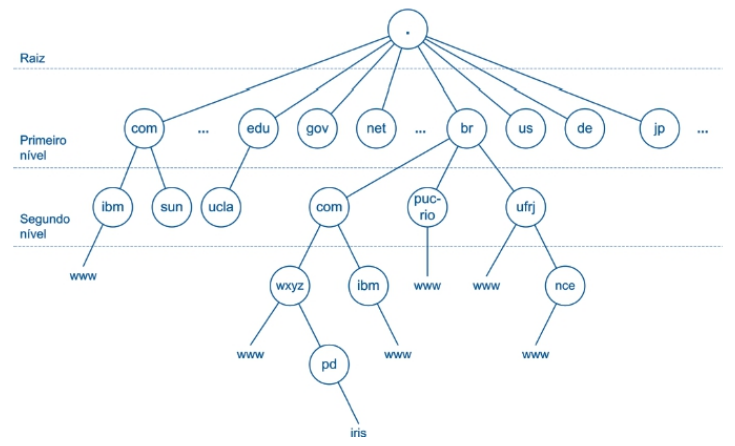<br>
*Source: MAIA, Luiz Paulo. Arquitetura de Redes de Computadores, 2nd ed., 2013, p. 408.*

- **Domain:** A portion of the name tree. The domain `faculdade.br` also includes names below it, such as `www.faculdade.br` and `lab.faculdade.br`.
- **Zone of authority:** The part of the tree whose records are administered together. The university can delegate `lab.faculdade.br` to other servers. The lab then remains within the `faculdade.br` domain but has its own zone.

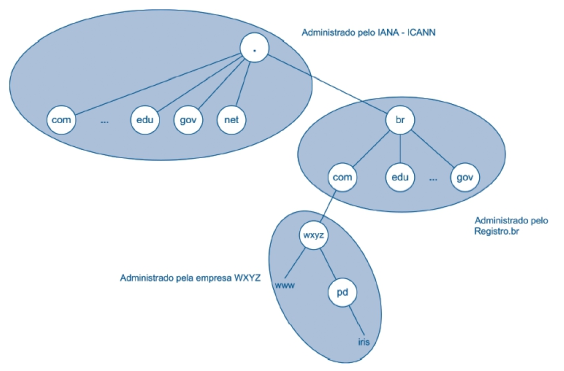<br>
*Source: MAIA, Luiz Paulo. Arquitetura de Redes de Computadores, 2nd ed., 2013, p. 410.*

The **record** type indicates what information is being queried:

| Record | Information provided |
| --- | --- |
| **A / AAAA** | The IPv4 or IPv6 address associated with the name, respectively. |
| **CNAME** | Another DNS name for which the queried name is an alias. |
| **NS** | The name of an authoritative server for the zone. |
| **MX** | The name of a server that receives email for the domain and its preference value. |

### Recursive and Iterative Queries:

- **Iterative:** When it needs to look up information, the resolver queries other servers. Each responds with what it knows or indicates which servers to query next. In this way, the resolver can start at the root and reach the authoritative server for the zone.

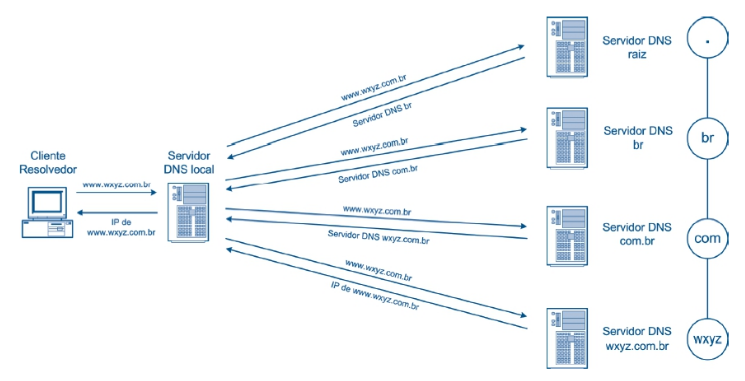<br>
*Source: MAIA, Luiz Paulo. Arquitetura de Redes de Computadores, 2nd ed., 2013, p. 413.*

- **Recursive:** The computer asks the **recursive resolver** to obtain the final answer. If the resolver already has a valid cached answer, it can return it immediately.
 
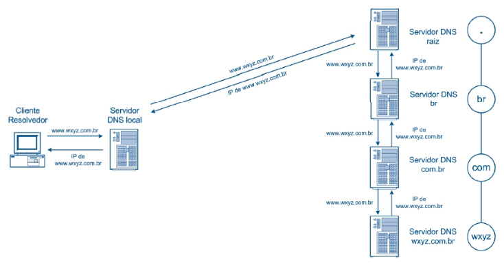<br>
*Source: MAIA, Luiz Paulo. Arquitetura de Redes de Computadores, 2nd ed., 2013, p. 414.*

A record's **TTL** (Time to Live) indicates how long it may remain in a cache. While the information is valid, other queries can reuse the result.

## Web Pages - HTTP and HTTPS:

**HTTP** (Hypertext Transfer Protocol) organizes communication between the browser and server into **requests and responses**. In the URL `https://www.faculdade.br/horarios`, `https` indicates the access scheme, `www.faculdade.br` identifies the server, and `/horarios` indicates the requested resource.

- **Request:** The browser specifies the method, the resource, and the relevant headers. The `GET` method requests a representation of the resource. `POST` submits data for processing, such as the fields of a form.
- **Response:** The server returns a status code, headers and, when applicable, a body. For example, `200 OK` indicates success and `404 Not Found` indicates that the requested resource was not found.

### Static and Dynamic Content:

- **Static content:** The server reads a stored file, such as an image or an HTML document, and sends its contents.
- **Dynamic content:** The server runs code to produce the response. For example, when it receives `/horarios`, it can look up the student's courses and generate the corresponding page. A URL path can therefore identify an application operation.

A script can also run **in the browser**. In this case, the server sends the code along with the page's resources, and the browser runs it to update the interface or request new data.

### HTTPS and Cookies:

- **HTTPS:** HTTP over a connection secured by TLS. The browser verifies the certificate presented by the server, and the connection protects the confidentiality and integrity of data in transit. HTTP/1.1 and HTTP/2 use TCP. HTTP/3 uses QUIC over UDP, with TLS integrated into QUIC.
- **Cookie:** A piece of data that the server asks the browser to store and return in later requests according to the cookie's rules. After authentication, for example, a session identifier allows the server to associate the next request with the session the student has already opened.

## File Transfer - FTP, TFTP, and SFTP:

| Protocol | Transport and default port | How it works |
| --- | --- | --- |
| **FTP** (File Transfer Protocol) | TCP, port `21` for control. | Maintains one connection for commands and responses and opens another for data, such as file contents. In classic FTP, credentials and data travel in cleartext. |
| **TFTP** (Trivial File Transfer Protocol) | UDP, port `69` for the initial request. | Transfers a file in blocks. TFTP itself acknowledges the blocks received and provides for retransmission in case of loss. It is used, for example, to load boot files on a local network. |
| **SFTP** (SSH File Transfer Protocol) | SSH over TCP, normally on port `22`. | Uses an SSH channel to list directories and transfer files with authentication and encryption. |

> **SFTP** and **FTPS** are distinct protocols. SFTP uses SSH. FTPS adds TLS protection to FTP.

## Remote Access - Telnet and SSH:

Remote access allows a local terminal to be used to run commands on another device. The client sends the user's input, and the remote device executes the command and returns the output.

- **Telnet:** Uses TCP, normally on port `23`. In classic use, it sends terminal data, including credentials entered by the user, in cleartext.
- **SSH** (Secure Shell): Uses TCP, normally on port `22`. The client verifies the server's identity using its key, and the user can authenticate with a password or public key. The session is encrypted. The same SSH connection can provide services such as SFTP.

## Email - SMTP, POP3, and IMAP:

An email's journey has three stages:

1. **Submission:** The sender's client delivers the message to its outgoing mail server using **SMTP** (Simple Mail Transfer Protocol). Port `587/TCP` is commonly used for authenticated submission with TLS negotiation. Port `465/TCP` is used for submission with TLS from the start.
2. **Transfer:** To deliver the message to another domain, the outgoing server looks up that domain's **MX** record and opens an SMTP connection to the indicated server, normally on port `25/TCP`. After delivery, the message is available in the recipient's mailbox.
3. **Mailbox access:** The recipient's client can use **POP3** or **IMAP** to access stored messages.

| Access protocol | How the client uses the mailbox | Usual TCP ports |
| --- | --- | --- |
| **POP3** (Post Office Protocol Version 3) | Retrieves messages for local reading. Depending on the configuration, it may keep or remove the server copy. | `110`; `995` with TLS from the start. |
| **IMAP** (Internet Message Access Protocol) | Synchronizes messages, folders, and states kept on the server. A message marked as read on a phone can also appear as read on a computer. | `143`; `993` with TLS from the start. |

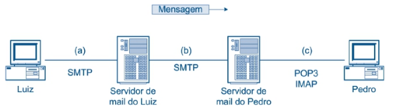<br>
*Source: MAIA, Luiz Paulo. Arquitetura de Redes de Computadores, 2nd ed., 2013, p. 425.*

> **MIME** (Multipurpose Internet Mail Extensions) allows a message to be organized into parts and indicates each part's type and encoding. A single email can therefore contain text, an HTML version, and an attached file.

## Network Management - SNMP:

**SNMP** (Simple Network Management Protocol) allows network devices to be queried, parameters to be changed when authorized, and event notifications to be received.

- **Manager:** A management application that queries devices. It can ask, for example, whether a router interface is operational.
- **Agent:** A component on the device that handles requests and provides the values of managed objects. It normally receives queries on port `161/UDP`.
- **MIB** (Management Information Base): Defines the objects that can be managed, including their names, types, and meanings. Each object is identified by an **OID** (Object Identifier). The MIB defines, for example, how to interpret an interface's operational state; the agent supplies its current value.

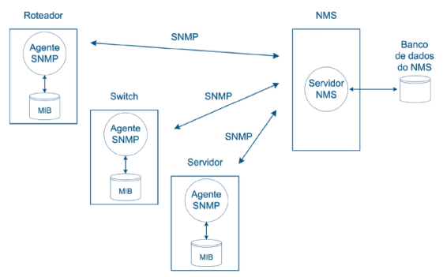<br>
*Source: MAIA, Luiz Paulo. Arquitetura de Redes de Computadores, 2nd ed., 2013, p. 432.*

In a **query**, the manager requests a value and the agent replies. In a **notification**, the device takes the initiative: it can send a trap when an interface loses its link. The manager normally receives notifications on port `162/UDP`.

---

# Appendix A. Practical Network Architecture

> How do the devices and protocols in a network perform the functions described in layered models in practice?

## 1. Physical and Data Link Layers:

### Digital Signaling:

In **line coding**, bits are represented by signal levels or by transitions between those levels.

- **NRZ-L (Non-Return-to-Zero Level):** The signal level during the interval indicates the transmitted bit. The two levels could be, for example, $+5 \text{ V}$ and $-5 \text{ V}$ or $+5 \text{ V}$ and $0 \text{ V}$.

<br>
*Source: MAIA, Luiz Paulo. Arquitetura de Redes de Computadores, 2nd ed., 2013, p. 118.*

> The mapping is a convention. In the figure, for example, the high level represents `0` and the low level represents `1`.

- **NRZ-I (Non-Return-to-Zero Inverted):** A bit is indicated by whether the level changes or stays the same at the beginning of the interval. In the figure, the level changes to transmit `1` and stays the same to transmit `0`.

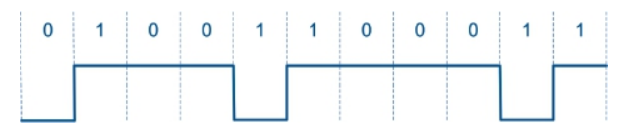<br>
*Source: MAIA, Luiz Paulo. Arquitetura de Redes de Computadores, 2nd ed., 2013, p. 118.*

- **Manchester:** The signal changes level in the middle of each interval. The direction of the transition, low to high or high to low, indicates the bit according to the convention used.

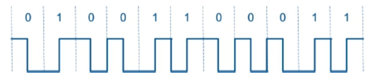<br>
*Source: MAIA, Luiz Paulo. Arquitetura de Redes de Computadores, 2nd ed., 2013, p. 119.*

> The mid-bit transition occurs even when several identical bits appear in succession. The receiver uses these transitions to synchronize its clock with the transmitter's, eliminating the need for a separate clock signal.

### Analog Signaling:

- **ASK (Amplitude Shift Keying):** Each symbol corresponds to a carrier amplitude. In the simplest case, the presence of the wave represents one bit value and its absence represents the other.

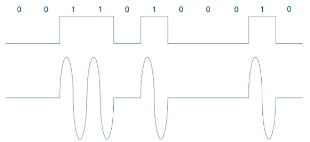<br>
*Source: MAIA, Luiz Paulo. Arquitetura de Redes de Computadores, 2nd ed., 2013, p. 121.*

- **FSK (Frequency Shift Keying):** Each symbol corresponds to a carrier frequency. Over the same time interval, the higher frequency produces more cycles of the wave.

<br>
*Source: MAIA, Luiz Paulo. Arquitetura de Redes de Computadores, 2nd ed., 2013, p. 121.*

- **PSK (Phase Shift Keying):** Each symbol corresponds to a carrier phase. In binary PSK, the two phases differ by $180^\circ$, so one wave appears inverted relative to the other.

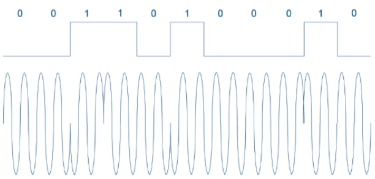<br>
*Source: MAIA, Luiz Paulo. Arquitetura de Redes de Computadores, 2nd ed., 2013, p. 122.*

- **QAM (Quadrature Amplitude Modulation):** Each symbol combines the amplitudes of two carrier components that are $90^\circ$ out of phase. In 16-QAM, each of the 16 combinations is a point in the **constellation** and represents four bits.

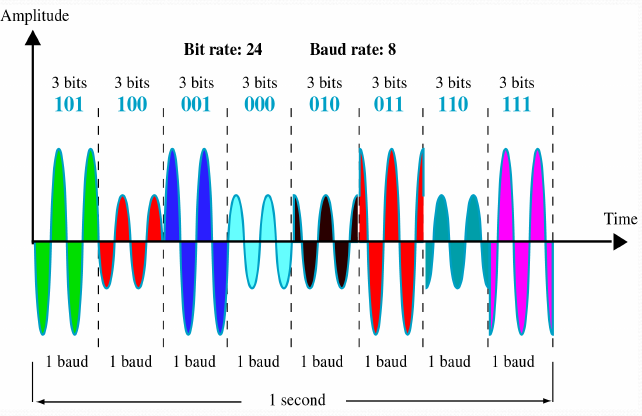<br>
*Source: FRAGA, Marcelo Caramuru Pimentel. Redes de Computadores - 6ª Aula, p. 23.*

**Physical interface example:** In a dial-up connection with an external modem, the computer can communicate with the modem through an **EIA-232-F** serial interface (RS-232 family). The modem adapts the data to the telephone line. Recommendation **V.92** specifies characteristics of communication between the subscriber's modem and the operator's access equipment. The computer-to-modem connection and the path over the telephone network therefore have their own physical specifications.

### Error Checking:

- **Two-dimensional parity:** Data are arranged in rows and columns, each with its own parity check. If a single data bit changes, the row and column containing it fail their checks. Their intersection indicates its position. With multiple errors, some changes can cancel out: flipping the four corners of a rectangle changes two bits in each affected row and column, preserving their parity.

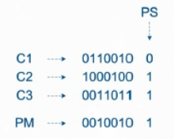<br>
*Source: MAIA, Luiz Paulo. Arquitetura de Redes de Computadores, 2nd ed., 2013, p. 159.*

- **Checksum:** One simple rule is to add the bytes and keep the remainder after division by 256. For the message `MODEM!`, the ASCII values are `77, 79, 68, 69, 77, 33`. The sum is `403`, and the check value is $403 \bmod 256 = 147$. The receiver repeats the operation. This rule misses, for example, a swap in the positions of two bytes because the sum stays the same.

- **CRC (Cyclic Redundancy Check):** The transmitter and receiver use the same **generator polynomial**, represented by a bit sequence. In the simplified model, a four-bit generator produces a three-bit remainder:

    1. To protect data `1101` using generator `1011`, the transmitter appends three zeros to obtain `1101000`.
    2. It divides `1101000` by `1011` using modulo-2 binary arithmetic. At each step, it combines the bits using `XOR`, without borrowing. The remainder is `001`.
    3. It replaces the three zeros with the remainder and transmits `1101001`. When the receiver divides this sequence by the same generator, it obtains a zero remainder. A nonzero remainder reveals an error.

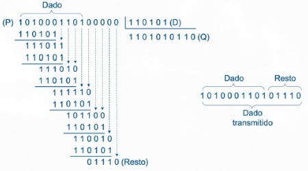<br>
*Source: MAIA, Luiz Paulo. Arquitetura de Redes de Computadores, 2nd ed., 2013, p. 161.*

- **Hamming code:** To protect $n$ data bits and correct a single error, choose the smallest number $r$ of parity bits that satisfies $2^r \geq n+r+1$. The combinations of parity check results must identify every position in the codeword as well as the case in which no check fails.

With **16 data bits**, **5 parity bits** are needed, for a total of 21 positions. The parity bits occupy the powers of two (`1`, `2`, `4`, `8`, and `16`), and the data occupy the remaining positions. Each position participates in the checks indicated by its binary representation. Position `5`, for example, corresponds to `00101` and participates in parity checks `1` and `4`.

| Parity bit | Positions checked | Example result |
| --- | --- | --- |
| `1` | 1, 3, 5, 7, 9, 11, 13, 15, 17, 19, 21 | Fail |
| `2` | 2, 3, 6, 7, 10, 11, 14, 15, 18, 19 | Pass |
| `4` | 4, 5, 6, 7, 12, 13, 14, 15, 20, 21 | Fail |
| `8` | 8 to 15 | Pass |
| `16` | 16 to 21 | Pass |

Adding the positions of the parity bits whose checks failed gives $1 + 4 = 5$. Assuming a single error, simply flip the bit at position 5. This code has a minimum distance of 3. If two bits change, a decoder attempting to correct a single error may flip the wrong bit.

### Retransmission:

- **ARQ:** The transmitter keeps one frame outstanding, starts a timer, and waits for the ACK. If the timer expires, it sends the frame again (stop-and-wait retransmission). A NAK can trigger an earlier retransmission when the receiver detects a failure.

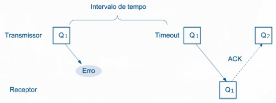<br>
*Source: **Adapted** from MAIA, Luiz Paulo. Arquitetura de Redes de Computadores, 2nd ed., 2013, p. 163.*

- **Alternating bit protocol:** Uses `0` and `1` to distinguish new frames from retransmissions. If the receiver has already accepted frame `0` and the ACK was lost, it is still waiting for `1`. When it receives another copy of `0`, it acknowledges it again and delivers the payload only once.

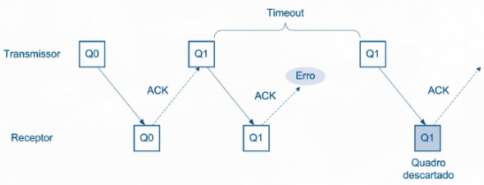<br>
*Source: MAIA, Luiz Paulo. Arquitetura de Redes de Computadores, 2nd ed., 2013, p. 167.*

- **Window-based retransmission.** Suppose the transmitter has sent frames `1`, `2`, `3`, and `4`. Frame `1` was lost and the other three arrived. The choice of protocol affects both the receiver's memory use and how much data is retransmitted.

| Protocol | What the receiver does with `2`, `3`, and `4` | How the loss is recovered |
| --- | --- | --- |
| **Go-Back-N** | In classic operation, discards out-of-order frames and continues waiting for `1`. | On timeout, the transmitter resends `1` and the following frames that are still outstanding. |
| **Selective Repeat** | Buffers valid frames within the window and acknowledges the ones received. | The transmitter resends `1`. Once it arrives, the receiver can deliver `1`, `2`, `3`, and `4` in order. |

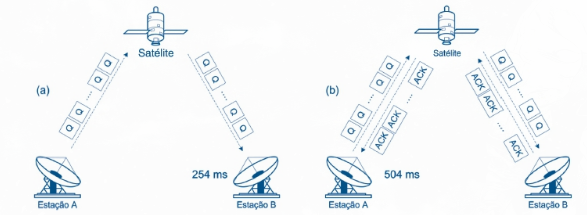<br>
*Source: MAIA, Luiz Paulo. Arquitetura de Redes de Computadores, 2nd ed., 2013, p. 170.*

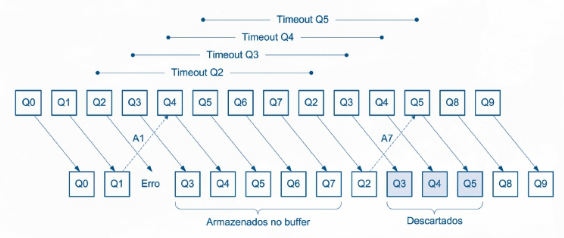<br>
*Source: MAIA, Luiz Paulo. Arquitetura de Redes de Computadores, 2nd ed., 2013, p. 175.*

### Medium Access Methods:

When several stations share a transmission medium, the access method defines the conditions under which each station can transmit. There are three ways to organize access:

- **Channel partitioning:** Transmissions are separated by frequency, time, or code. Each station uses its allocated resource.

| Method | How it works |
| --- | --- |
| **FDMA** | Each station transmits in its own frequency band. Transmissions can occur simultaneously, and guard bands help reduce interference between adjacent channels. |
| **TDMA** | Stations share the channel in time slots. Each station transmits in its reserved slot, which may remain idle if it has no data. |
| **CDMA** | Stations can transmit at the same time in the same frequency band. Each transmission uses a code that allows the receiver to recover the desired signal. |

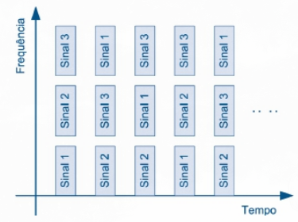<br>
*Source: MAIA, Luiz Paulo. Arquitetura de Redes de Computadores, 2nd ed., 2013, p. 188.*

- **Contention-based access:** A station with a frame ready can contend for the medium. Because two stations may try to transmit simultaneously, each method defines when to start the attempt and how to handle potential collisions.

| Method | How it works |
| --- | --- |
| **Pure ALOHA** | The station transmits as soon as it has a frame. If no acknowledgement arrives, it waits a random time before trying again. |
| **Slotted ALOHA** | The station can begin transmitting only at the start of a slot. Two stations that choose the same slot can still collide. |
| **CSMA (Carrier Sense Multiple Access)** | The station listens to the channel before transmitting. Because the signal takes time to propagate, two stations may still sense an idle channel and transmit at the same time. |

> In the classic ALOHA model, with equal-duration frames and independent random attempts, aligning the start of transmissions with slot boundaries reduces the period in which a collision can occur. The ideal maximum utilization rises from approximately $18\%$ to $37\%$.

In **CSMA**, the **persistence** rule determines what to do when the channel is busy. **CD** and **CA** indicate how the method handles potential collisions.

| Variant | Aspect | How it works |
| --- | --- | --- |
| **1-persistent CSMA** | Persistence | The station keeps listening and transmits as soon as it senses an idle channel. Several waiting stations may try at once. |
| **Nonpersistent CSMA** | Persistence | The station waits a random time before listening again. This reduces the chance of simultaneous attempts but may leave the channel idle. |
| **CSMA/CD (Collision Detection)** | Collisions | The station monitors the medium while transmitting. When it detects a collision, it signals the event, stops transmitting, and waits before trying again. In classic shared Ethernet, the range of possible waiting times increases after successive collisions, up to a limit. |
| **CSMA/CA (Collision Avoidance)** | Collisions | The station listens to the channel and uses waiting intervals and a random backoff to reduce the chance of simultaneous transmissions. It is the basis of contention-based access in Wi-Fi. |

On a wireless medium, the transmitter and receiver can perceive the channel differently. This explains two situations:

| Situation | What happens |
| --- | --- |
| **Hidden station** | X and Z can reach Y but cannot hear each other. Both can sense an idle channel and transmit at the same time, causing a collision at Y. |
| **Exposed station** | A station hears a nearby transmission and defers its own, even though both receivers are positioned where they could receive the transmissions simultaneously. |

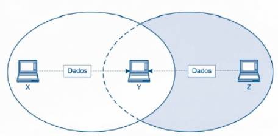<br>
*Source: MAIA, Luiz Paulo. Arquitetura de Redes de Computadores, 2nd ed., 2013, p. 196.*

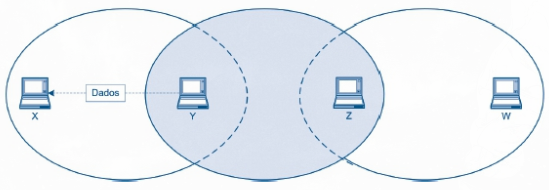<br>
*Source: MAIA, Luiz Paulo. Arquitetura de Redes de Computadores, 2nd ed., 2013, p. 197.*

- **Controlled access:** Each station waits for permission to transmit. A controller can grant a turn, or the turn can pass from one station to another.

| Method | How it works |
| --- | --- |
| **Centralized polling** | A controller polls the stations and grants a turn to those with data. Each poll takes time, even when a station has no data to send. |
| **Token passing** | Permission, in the form of a token, circulates among the stations. In Token Ring, a station that receives the free token can transmit. If the token is lost, the protocol must restore it. |

### IEEE 802 Family of Standards:

**IEEE 802** is a family of standards for local and metropolitan area networks. Within this family, **IEEE 802.3** specifies Ethernet and **IEEE 802.11** specifies the wireless local area networks on which Wi-Fi is based. Both cover Physical and Data Link layer characteristics.

| Reference | Main subject |
| --- | --- |
| **IEEE 802.1** | LAN integration, bridges, VLANs, and control functions. |
| **IEEE 802.2** | Logical Link Control (LLC). Historical reference for the services of this sublayer. |
| **IEEE 802.3** | Ethernet, including the frame format and different media and transmission rates. |
| **IEEE 802.4** | Token Bus: a token passes in a logical order over a shared medium. |
| **IEEE 802.5** | Token Ring: a token passes around a logical ring. |
| **IEEE 802.11** | Medium access and physical transmission in wireless local area networks. |
| **IEEE 802.15** | A family of wireless technologies, including short-range personal area networks. |
| **IEEE 802.16** | Broadband wireless access, associated with technologies such as WiMAX. |

In the IEEE 802 architecture, two link-layer functions appear frequently:

- **MAC (Medium Access Control):** Handles access to the medium and aspects of the frame, such as addressing and error checking. The term **MAC address** refers to an address used at this sublayer.
- **LLC (Logical Link Control):** Provides a logical interface for higher-layer protocols. The classic model includes connectionless services, with or without acknowledgements, and connection-oriented services. In the Ethernet II format, the **EtherType** field directly identifies the protocol being carried.

### Ethernet Frame:

Before the frame, the transmitter sends a **preamble** for synchronization and a **start delimiter**. In the basic format, without a VLAN tag, the frame fields are:

| Field | Size | Function |
| --- | --- | --- |
| **Destination MAC address** | 6 bytes | Identifies the interface or group for which the frame is intended. |
| **Source MAC address** | 6 bytes | Identifies the interface that sent the frame. |
| **Length/Type** | 2 bytes | Indicates the length of the data or identifies the protocol being carried, depending on the value. |
| **Data and optional padding** | 46 to 1,500 bytes | Carries the payload. If it is short, the transmitter adds padding. |
| **FCS** | 4 bytes | Contains the CRC used to detect changes in the frame. |

In the **Ethernet II** (DIX) format, a value such as `0x0800` identifies IPv4. In the **length** format, the higher-layer protocol is identified with the help of LLC and, when applicable, SNAP. The figure compares the two uses of the field following the source MAC address.

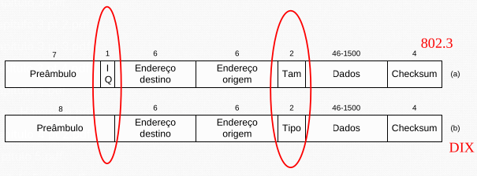<br>
*Source: FRAGA, Marcelo Caramuru Pimentel. Redes de Computadores - 11ª Aula, p. 15.*

The minimum size of a basic frame is **64 bytes**, from the destination MAC address to the FCS. In classic shared Ethernet, this minimum and the limit on segment length allowed a station to detect a distant collision while it was still transmitting.

**MAC address.** An Ethernet address is 48 bits long, usually written as six hexadecimal pairs. It can be administered globally, using identifiers assigned to the responsible organization, or locally, including by software.

**Evolution of the medium.** In **10BASE5** and **10BASE2**, several stations shared a coaxial bus. **10BASE-T** ran a twisted-pair cable from each station to a central point. The device installed there determines whether the stations still share the medium or each link operates independently. Later rates include **Fast Ethernet** ($100 \text{ Mbps}$) and **Gigabit Ethernet** ($1 \text{ Gbps}$).

### Interconnection Devices:

- **Repeater:** Operates at the Physical layer. It receives the digital signal on one section of a link, recovers its timing, and retransmits it with the signal levels restored. To do so, its **regenerator** circuit must identify the received symbols. If it interprets a symbol incorrectly, the repeater may retransmit a well-formed signal carrying the wrong data.

<br>
*Source: MAIA, Luiz Paulo. Arquitetura de Redes de Computadores, 2nd ed., 2013, p. 100.*

<br>
*Source: MAIA, Luiz Paulo. Arquitetura de Redes de Computadores, 2nd ed., 2013, p. 220.*

- **Hub:** Acts as a multiport repeater. A signal received on one port is repeated on the others. Although the cables form a star, the stations share the medium and belong to the same **collision domain**.

<br>
*Source: MAIA, Luiz Paulo. Arquitetura de Redes de Computadores, 2nd ed., 2013, p. 220.*

- **Bridge:** Operates at the Data Link layer. It interconnects segments and uses the destination MAC address to decide whether a frame needs to pass from one segment to another. When it knows the destination is on the same segment as the source, the bridge **filters** the frame, keeping it off the other segment.

<br>
*Source: MAIA, Luiz Paulo. Arquitetura de Redes de Computadores, 2nd ed., 2013, p. 223.*

- **Switch:** Acts as a multiport bridge. It uses each frame's **source** MAC address to learn which port leads to the sender and looks up the **destination** MAC address to decide where to forward the frame. Consider A on port 1 and B on port 4, both in the same VLAN, with the MAC table initially empty.

    1. **A sends to B.** The switch learns `A - port 1`. Because it does not yet know B's port, it sends a copy out through the other ports that can forward traffic in this VLAN.
    2. **B replies to A.** The switch learns `B - port 4`. Because it already knows A's port, it forwards the reply only through port 1.
    3. **A sends to B again.** The table already indicates `B - port 4`, and the frame goes only through that port. If the port listed for a destination is the same as the ingress port, the switch filters the frame.

<br>
*Source: MAIA, Luiz Paulo. Arquitetura de Redes de Computadores, 2nd ed., 2013, p. 224.*

> On a full-duplex Ethernet link between a station and a switch, both ends can transmit at the same time, so CSMA/CD is unnecessary. A broadcast frame is forwarded through all other ports eligible to transmit in that VLAN.

### Wi-Fi and IEEE 802.11:

- **BSS (Basic Service Set):** A set of stations that communicate in a Wi-Fi network. It can be organized in two ways:

    - **Infrastructure network:** Stations communicate through an access point (AP).
    - **Ad hoc:** Stations communicate directly and form an independent set.

<br>
*Source: MAIA, Luiz Paulo. Arquitetura de Redes de Computadores, 2nd ed., 2013, p. 229.*

- **ESS (Extended Service Set):** A distribution system (DS) interconnects infrastructure BSSs into a single logical network. This allows a laptop to change APs as it moves from one university corridor to another.

<br>
*Source: MAIA, Luiz Paulo. Arquitetura de Redes de Computadores, 2nd ed., 2013, p. 230.*

- **Frame delivery:** The receiver of a frame on the radio link can differ from the destination of its data. When a laptop sends data to a wired printer on the same network, the **AP** receives the frame over the radio and forwards it to the **printer**. An 802.11 frame can contain up to four address fields to identify who transmits and receives on each link as well as the source and destination of the data.

- **Medium access:** In the classic IEEE 802.11 model, use of the channel can be distributed among stations or coordinated by the AP.

| Method | How it works |
| --- | --- |
| **DCF (Distributed Coordination Function)** | Stations contend for the channel using CSMA/CA. During backoff, the counter decreases while the channel is idle and pauses when it is busy. The station transmits when the count reaches zero. |
| **PCF (Point Coordination Function)** | During coordinated periods, the AP polls the stations and grants them turns to transmit. This mechanism is optional. |

<br>
*Source: MAIA, Luiz Paulo. Arquitetura de Redes de Computadores, 2nd ed., 2013, p. 233.*

- **Acknowledgement and reservation:** In acknowledged unicast delivery, the sequence is `Data - ACK`. With reservation, it becomes `RTS - CTS - Data - ACK`: the transmitter requests permission to send, and the receiver grants it. A hidden station that hears the CTS can use the announced duration to set its **NAV** timer and wait for the exchange to finish.
- **Interframe spaces:** In the classic model, `SIFS < PIFS < DIFS`. Responses such as CTS and ACK use the shortest interval (SIFS), the PCF coordinator uses PIFS, and a new DCF contention waits for DIFS. An exchange already in progress therefore has priority.
- **Fragmentation:** Dividing data into smaller frames reduces the amount to retransmit in case of error but adds headers and acknowledgements.

**Wi-Fi Security**

| Technology | Main characteristic |
| --- | --- |
| **WEP** | The original Wi-Fi protection mechanism, now considered insecure. |
| **WPA** | A transitional solution that used TKIP on equipment of the time. |
| **WPA2** | Established the use of AES-CCMP to protect data. In personal mode, it uses a pre-shared key (PSK). |
| **WPA3** | In personal mode, uses SAE to authenticate participants using a password and establish keys. |

In **personal mode**, users normally share a password. In **enterprise mode**, each user or device can authenticate using its own credentials or a certificate, generally through 802.1X with the support of an authentication server.

### Local Area Network Organization:

Two switches can combine several physical connections into one logical link (**link aggregation**). Traffic from different flows is distributed across the participating links. This increases total capacity and allows the logical link to stay active at reduced capacity if one physical link fails.

- **STP (Spanning Tree Protocol):** Consider three switches connected in a triangle. If they all forward a broadcast in both directions, copies of the frame can circulate repeatedly. STP selects a **forwarding tree**: the switches remain physically connected, but some ports are excluded from data forwarding to eliminate loops. If the active path fails, the protocol can activate an alternative path.

<br>
*Source: MAIA, Luiz Paulo. Arquitetura de Redes de Computadores, 2nd ed., 2013, p. 241.*

**VLAN (Virtual Local Area Network):** On a switch whose ports belong to one VLAN, a broadcast sent by the lab can also reach the administration's computers. Assigning the two groups to separate VLANs gives each group its own broadcast domain, even though they share the equipment.

<br>
*Source: MAIA, Luiz Paulo. Arquitetura de Redes de Computadores, 2nd ed., 2013, p. 243.*

<br>
*Source: MAIA, Luiz Paulo. Arquitetura de Redes de Computadores, 2nd ed., 2013, p. 246.*

| Port or link type | Use |
| --- | --- |
| **Access port** | Normally associates an end device's traffic with one VLAN. The computer can send an untagged frame, and the switch identifies the VLAN by the ingress port. |
| **Trunk** | Carries multiple VLANs between devices. An IEEE 802.1Q tag identifies a frame's VLAN. Depending on the configuration, a native VLAN can travel untagged. |

If the lab and the administration occupy two buildings, a trunk between the switches can carry both VLANs while keeping the groups separate. A lab broadcast can cross this link and reach the lab ports in the other building. Sending a packet to the administration network requires **inter-VLAN routing**, performed by a router or a switch with Network layer capabilities.

## 2. Network Layer:

### Interfaces and IP Addresses:

The lab laptop has IPv4 address `192.168.10.34/27` on its Wi-Fi interface. The same interface can also have IPv6 addresses. The scope of each address determines where it can be used.

- **Loopback:** The addresses `127.0.0.1` (IPv4) and `::1` (IPv6) allow access to a service on the laptop itself. Traffic stays on the device.

- **Private IPv4:** The laptop's address belongs to one of the three blocks reserved for private networks. Different organizations can use the same addresses on their internal networks.

| Prefix | Range |
| --- | --- |
| `10.0.0.0/8` | `10.0.0.0` to `10.255.255.255` |
| `172.16.0.0/12` | `172.16.0.0` to `172.31.255.255` |
| `192.168.0.0/16` | `192.168.0.0` to `192.168.255.255` |

- **IPv6 link-local:** An address such as `fe80::70db:aa5b:82c0:622c/64` allows communication with neighbors on the same link. Routers keep this traffic on the originating link. This address is in abbreviated form (a sequence of all-zero groups can be replaced by `::` once in the address). The full address is `fe80:0000:0000:0000:70db:aa5b:82c0:622c/64`.

Appendix C shows how to look up the addresses, state, and MTU of each interface.

### IPv4 and IPv6 Headers:

IPv4 and IPv6 headers have different formats. The table compares fields with similar functions:

| Item | IPv4 | IPv6 |
| --- | --- | --- |
| Source and destination identifiers | 32-bit addresses. | 128-bit addresses. |
| Limit on how far a packet can travel (decremented at each router) | **TTL** (Time to Live). | Hop Limit. |
| Identifier for what follows | Protocol, such as TCP, UDP, or ICMP. | Next Header, which can identify an extension header or the protocol being carried. |
| Size | Total Length, including the IPv4 header. | Payload Length, which counts the bytes after the base header, including any extension headers. |

### Calculating an IPv4 Subnet:

In `192.168.10.34/27`, the prefix leaves $32 - 27 = 5$ bits for addresses within the subnet. Each block contains $2^5 = 32$ addresses. Since `.34` falls in the block from `.32` to `.63`, the laptop belongs to subnet **`192.168.10.32/27`**.

- **Subnet identifier:** `192.168.10.32`, the first address in the block.
- **Usable addresses:** `192.168.10.33` to `192.168.10.62`. By convention, the first (`.33`) is often assigned to the subnet's gateway, although the gateway can use another usable address.
- **Broadcast:** `192.168.10.63`, the last address in the block.

### Dividing a Block with VLSM:

How can `192.168.20.0/24` be divided among groups of **100, 50, and 20 interfaces**? With **VLSM** (Variable Length Subnet Mask), each subnet receives a prefix suited to its size. Starting with the largest group makes it easier to place each block on a valid boundary.

| Group | Assigned subnet | Interface address range | Broadcast |
| --- | --- | --- | --- |
| 100 interfaces | `192.168.20.0/25` | `.1` to `.126` | `.127` |
| 50 interfaces | `192.168.20.128/26` | `.129` to `.190` | `.191` |
| 20 interfaces | `192.168.20.192/27` | `.193` to `.222` | `.223` |
| Reserve | `192.168.20.224/27` | `.225` to `.254` | `.255` |

### Route Aggregation with CIDR:

A router can advertise several networks using a shorter prefix when they form an aligned block and it can forward traffic for the entire set.

- **Blocks that form a single prefix:** `192.168.10.0/27` and `192.168.10.32/27` cover the addresses from `.0` to `.63`. The advertisement `192.168.10.0/26` represents exactly those two networks.

<br>
*Source: Created by the author with the assistance of ChatGPT, 2026.*

- **Adjacent blocks without the required alignment:** `192.168.10.32/27` and `192.168.10.64/27` cover `.32` through `.95`. This range crosses the boundary between two `/26` blocks at `.64`. A single advertisement covering both would include additional addresses.

### Selecting the Route and Next Hop:

A router knows the networks directly connected to its interfaces. If the destination is on one of them, it delivers the packet over the corresponding link. For other networks, it consults the routing table.

If no more specific entry matches the destination, it uses the **default route** (`0.0.0.0/0`), when configured, to forward the packet to the next router.

<br>
*Source: MAIA, Luiz Paulo. Arquitetura de Redes de Computadores, 2nd ed., 2013, p. 292.*

### Neighbor Resolution:

Suppose the route to server `192.168.10.70` lists router `192.168.10.62` as the next hop. The laptop still needs to discover the **MAC address of `.62`** to build the frame. An IP-to-MAC mapping can be configured manually or learned when there is traffic for that neighbor.

- **ARP in IPv4:** The laptop checks its cache. If it does not yet know the mapping, it broadcasts a request on the link: “Who has `192.168.10.62`?” The router replies with its MAC address, and the laptop stores the mapping for subsequent transmissions.
- **Neighbor Discovery in IPv6:** The interface uses ICMPv6 Neighbor Solicitation and Neighbor Advertisement messages to discover the next hop's link-layer address. The mapping can also be reused.

### Address and Port Translation:

- **NAT:** The border router translates an internal (private) IP address into an external (public) address. For the response, it performs the reverse translation to deliver the packet to the internal source.

<br>
*Source: MAIA, Luiz Paulo. Arquitetura de Redes de Computadores, 2nd ed., 2013, p. 288.*

- **PAT (Port Address Translation):** A form of NAT that also translates ports. The router can distinguish connections by their external ports and allow several devices to share a public IPv4 address when accessing the Internet.

> A home router can perform three functions. As a gateway, it forwards packets to another network. With NAT, it translates addresses and, with PAT, ports as well. With its firewall, it applies rules that allow or block traffic.

### Path MTU:

The **path MTU** is the smallest MTU among the links along the path. If a packet exceeds the MTU of the next outgoing link, the behavior depends on the IP version and, in IPv4, on whether fragmentation is permitted.

- **IPv4 with DF:** With the Don't Fragment bit set, the router drops the oversized packet and informs the source via ICMP that fragmentation would be required.
- **IPv6:** The router drops the oversized packet and sends the source an ICMPv6 Packet Too Big message with the outgoing link's MTU. The source can adjust its packet sizes.

> In a VPN, the headers and tunnel protection take up some of the space available for the inner packet.

### IPv4 Fragmentation:

A router receives a **1,500-byte** datagram with a 20-byte header and needs to send it over a link with an **MTU of 1,280 bytes**. In this example, fragmentation is allowed.

1. **Subtract the header.** Each fragment will have its own 20-byte header. This leaves up to $1{,}280 - 20 = 1{,}260$ bytes for data.
2. **Align the payload.** The Fragment Offset indicates the position of the data in eight-byte units. The payload of each fragment before the last must be a multiple of eight. The first carries 1,256 bytes.
3. **Position the remaining data.** Of the original 1,480 data bytes, 224 remain. The second fragment starts at position $1{,}256 / 8 = 157$.

| Fragment | Original data bytes | Payload | Total with header | Offset | MF |
| --- | --- | --- | --- | --- | --- |
| **1** | 0 to 1,255 | 1,256 bytes | 1,276 bytes | `0` | `1` |
| **2** | 1,256 to 1,479 | 224 bytes | 244 bytes | `157` | `0` |

During reassembly, the shared identification associates the fragments with the datagram, and the offset positions each piece. The **MF** (More Fragments) flag is `1` in the first fragment and `0` in the last. With both pieces, the destination recovers the 1,480 bytes of data.

### Routing Protocols:

- **RIP:** Within an autonomous system, routers advertise distances in hops to their neighbors. After a failure, outdated advertisements can lead two neighbors to point to each other as the path to the destination. The advertised distance increases with each exchange until it reaches `16`, the value indicating an unreachable destination. This is the **count-to-infinity problem**.
- **OSPF:** Also operates within an autonomous system, which can be organized into areas. Routers advertise link states and costs. Each uses that information to calculate its own lowest-cost paths.
- **BGP:** Exchanges prefix advertisements between autonomous systems and distributes these routes within an autonomous system. Selection takes into account policies and attributes such as `AS_PATH`, which records the autonomous systems on the advertised path.

### Calculating Paths with Dijkstra's Algorithm:

In the **Link State** network in Chapter 4, router A starts with a cost of zero to itself. At each stage, it confirms the router with the lowest tentative cost and checks whether going through it improves the path to any neighbor.

| Confirmed router | Cost from A | What changes in the calculation |
| --- | --- | --- |
| **A** | 0 | B is assigned a tentative cost of 2 and G a cost of 6. |
| **B** | 2 | Reaching E through B costs 4. Reaching C through B costs 9. |
| **E** | 4 | The cost to G drops from 6 to 5. F is assigned a cost of 6. |
| **G** | 5 | H is assigned a tentative cost of 9. |
| **F** | 6 | The cost to H drops from 9 to 8. The path to C through F also costs 9. |
| **H** | 8 | D is assigned a cost of 10. |
| **C** | 9 | Going through C to reach D would cost 12. The cost remains 10. |
| **D** | 10 | All destinations are confirmed. |

> The resulting tree is one possible outcome. The paths `A-B-C` and `A-B-E-F-C` both cost 9. In both cases, the first hop from A is B.

### IPv4 Broadcast:

- **Limited:** The address `255.255.255.255` reaches the local link. The transmission ends at that link.
- **Directed:** The address identifies all devices on a specific subnet. For `192.168.10.32/27`, it is `192.168.10.63`. Forwarding this broadcast from another network is disabled by default on routers.

### Multicast Group Membership:

- **Group address:** The IPv4 range `224.0.0.0/4` identifies multicast groups. An interface keeps its individual address when it joins a group such as `239.1.1.1`.
- **Joining via IGMP:** When an application requests to receive traffic for a group, IGMP (Internet Group Management Protocol) allows the local router to be informed that there are interested receivers on that link.

### Multicast Routing:

On an IPTV network, multiple receivers can watch the same channel. A single copy of the stream travels over the shared section, and the routers replicate it where the paths to the receivers diverge.

- **Reverse path and pruning:** In the RPM example in **Figures 024 and 025**, the router checks whether the packet arrived on the interface it would use to return to the source. This check (Reverse Path Forwarding, RPF) guides the initial distribution. Pruning removes branches with no receivers from the tree.
- **Core-based tree (CBT):** The router serving a receiver requests to join in the direction of the core. When it encounters a router that already participates in the tree, the new branch can attach to it.
- **Rendezvous point (PIM-SM):** The receivers' routers form a tree toward the rendezvous point (RP). The source's router can encapsulate the initial packets and send them to the RP for distribution. Later, the branch serving a receiver can switch to a lower-cost path to the source.

## 3. Transport Layer:

### Service Ports and Simultaneous Connections:

| Service | Transport protocol | Default port |
| --- | --- | --- |
| SSH | TCP | `22` |
| DNS | UDP or TCP | `53` |
| HTTP/1.1 | TCP | `80` |
| HTTPS with HTTP/1.1 or HTTP/2 | TCP | `443` |
| HTTPS with HTTP/3 | QUIC over UDP | `443` |

A server can maintain a listening socket on port `443` and handle several connections on that same port. Consider two TCP connections opened by the lab's browser:

| Connection | Browser endpoint | Server endpoint |
| --- | --- | --- |
| **1** | `192.168.10.34:51000` | `192.168.10.70:443` |
| **2** | `192.168.10.34:51001` | `192.168.10.70:443` |

The IP addresses and server port are the same in both connections. The browser's port distinguishes the pairs of endpoints. When the server receives a segment from `192.168.10.34:51001`, it delivers it to the socket for **connection 2**.

### UDP and TCP Headers:

| Information | UDP | TCP |
| --- | --- | --- |
| **Ports** | Source and destination. | Source and destination. |
| **Length** | Length gives the size of the datagram, including the header. | Data Offset indicates where the data start and therefore the size of the TCP header. |
| **Error checking** | Checksum, optional in UDP over IPv4. | Mandatory checksum. |
| **Sequence and acknowledgement** | - | The sequence number positions the bytes in the stream. The acknowledgement number indicates the next expected byte. |
| **Receive window** | - | The Window field advertises how much the receiver accepts starting at the next expected byte. |
| **Flags** | - | SYN, ACK, and FIN participate in connection setup, acknowledgements, and connection termination. |

> The window advertised in the TCP header is the **receive window** (`rwnd`). Each sender calculates and maintains its own **congestion window** (`cwnd`) locally.

### Applying the Two Windows:

Consider transmission from the laptop to the server. The server advertises `rwnd`, and the laptop calculates `cwnd`. The values in the table apply to this direction of the connection.

| Situation | Server's `rwnd` | Laptop's `cwnd` | Limit on data in flight |
| --- | --- | --- | --- |
| The server application is slow to read the data | 4,000 bytes | 10,000 bytes | **4,000 bytes**, due to flow control. |
| The sender detects signs of congestion | 12,000 bytes | 3,000 bytes | **3,000 bytes**, due to congestion control. |

In the second situation, if the laptop has already sent **2,000 bytes** that are awaiting acknowledgement, it can send **1,000 more bytes** before reaching the limit. As ACKs arrive, they free up room for new transmissions. Round-trip time therefore also influences the rate achieved.

### A TCP Connection Step by Step:

1. **Opening - three-way handshake.** The browser sends **SYN** with its initial sequence number. The server replies with **SYN + ACK**, acknowledging the received SYN and providing its own initial number. The browser confirms with **ACK**. The sequence is `SYN - SYN + ACK - ACK`.

2. **Transfer and acknowledgement.** Suppose the server expects byte `1001`. If it receives bytes `1101` through `1200` first, it can buffer them and continue indicating `ACK = 1001`. Once bytes `1001` through `1100` arrive, the range is complete. The server can deliver all 200 bytes in order and send `ACK = 1201`. This **cumulative acknowledgement** covers all bytes through `1200`.

3. **Closing - four-way handshake.** The browser sends **FIN** to indicate that it has finished transmitting. The server acknowledges with **ACK** and can still send data in the opposite direction. When it too has finished, it sends its own **FIN**, and the browser acknowledges with **ACK**. With separate transmissions, the sequence is `FIN - ACK - FIN - ACK`. If the server is already ready to close, it can combine its ACK and FIN in the same segment.

## 4. Application Layer:

### From URL to Page:

A student enters `https://www.faculdade.br/horarios` in the browser. Assume this is the first visit, with no DNS answer in the cache, using HTTP/1.1.

1. **Resolve the name.** The computer sends the resolver a recursive query for `www.faculdade.br`. The resolver queries the root, receives a referral for `br`, and follows the delegations to the authoritative server for `faculdade.br`. That server supplies the address record. The resolver caches the result for its TTL and returns the IP address to the computer.
2. **Establish the connection.** The browser opens a TCP connection to the returned IP address on port `443` and negotiates TLS. During negotiation, it verifies that the certificate is valid for `www.faculdade.br`.
3. **Request the resource.** Over the protected connection, the browser sends `GET /horarios HTTP/1.1` with the `Host: www.faculdade.br` header. The server can generate the page by querying the timetable system and respond with `200 OK`. The `Content-Type: text/html` header indicates how to interpret the body.
4. **Maintain the session.** If the student authenticates, the server can include `Set-Cookie: sessao=abc123; Path=/; Secure; HttpOnly` in the response. In another HTTPS request to the same server, the browser sends `Cookie: sessao=abc123`. The server uses this identifier to locate the student's session.

> DNS receives the name `www.faculdade.br` for resolution. The path `/horarios` follows later, in the HTTP request sent to the web server.

### The Path of an Email:

Ana uses an email application to send a message to `bruno@faculdade.br`. Bruno reads the message on two devices.

| Stage | Who communicates | Protocol and result |
| --- | --- | --- |
| **1. Sending by Ana** | Ana's application - outgoing server | **SMTP:** the application authenticates and submits the message. |
| **2. Locating the server** | Outgoing server - DNS | **DNS:** a query for the `MX` record of `faculdade.br` returns the mail server's name. The IP address for that name allows the connection to be established. |
| **3. Delivery to the university** | Outgoing server - university mail server | **SMTP:** the message is transferred and delivered to Bruno's mailbox. |
| **4. Reading by Bruno** | Phone and computer - mailbox server | **IMAP:** the devices synchronize the message and its read status. With POP3, each client could retrieve a copy for local reading. |

> With webmail, Bruno's browser communicates over **HTTPS** with the provider's web application. The application accesses the mailbox on the server side. Delivery between providers still uses **SMTP**.

### SNMP Queries and Notifications:

A management station monitors a router interface with index `2`. In the interfaces MIB, `ifOperStatus` represents the **operational state**. The instance `ifOperStatus.2` corresponds to that interface.

| Situation | Exchange | What the manager learns |
| --- | --- | --- |
| **Periodic query** | The manager sends a `GET` for `ifOperStatus.2`. The agent replies with `up(1)`. | The interface was operational at the time of the query. The MIB defines the meaning of the value `1`. |
| **Link goes down** | If notifications are enabled, the agent sends a `linkDown` trap identifying the affected interface. | The manager receives the notice without waiting for the next periodic query. |

The manager can then query `ifOperStatus.2` again to check the current state. The trap reports that a change occurred; the query shows the state at the time of the response.

---

# Appendix B. OSI Model

ISO developed the **OSI model** (Open Systems Interconnection) to guide the creation of standards that would allow systems from different manufacturers to communicate. The model organizes communication into seven layers. As in the TCP/IP model, each layer offers a service to the layer above and uses the services of the layer below.

The first three layers - **Physical**, **Data Link**, **Network**, and **Transport** - handle signal transmission, frame delivery on each link, and packet forwarding between networks and processes (identical operation). After the fourth layer, the focus shifts to the processes at the endpoints: how the dialogue is coordinated, how content is represented, and which service the application uses.

5. **Session:** Establishes, coordinates, and ends the dialogue between applications. It can organize whose turn it is to transmit and insert **synchronization points** during an operation. In a long transfer, these points allow work to resume from a completed stage after an interruption.

6. **Presentation:** Defines how data are represented so that both systems assign the same meaning to the bytes they receive. For example, two computers can use different character encodings internally and agree on a common encoding to exchange text. The model also assigns functions such as compression and encryption to this layer.

7. **Application:** Provides the network services used by programs, such as file transfer, email, and remote access. This layer defines the meaning of a request or response. In a file service, for example, a message can request a directory listing or ask to read a file.

<br>
*Source: Delta Protect - Capas del Modelo OSI. Available at: [https://www.deltaprotect.com/blog/modelo-osi](https://www.deltaprotect.com/blog/modelo-osi). Accessed: Nov. 26, 2026.*

> In the five-layer model used in this guide, Transport remains responsible for end-to-end communication. The functions OSI distributes among **Session**, **Presentation**, and **Application** are grouped in the Application layer and may be performed by the programs themselves, by protocols, or by libraries.

---

# Appendix C. Important Commands

> In the syntax templates, **elements in braces indicate values to replace**. Enter the value without braces. `{options}` and `{function}` indicate optional modifiers; the main description explains the behavior without them, given the arguments shown. The remaining elements in braces are required in the form shown.

## Linux:

### View Interfaces and Addresses:

- `ip {options} link {function}` - Shows link-layer information for the interfaces, including the MAC address and local MTU (the link's limit).

    - `ip link show dev {interface}` - Shows only the specified interface, such as `wlo1`.
    - `ip -d link` - Displays link details. On a VLAN interface, it can confirm the VLAN type and ID.

- `ip {options} address {function}` - Lists interfaces, link state, MTU, and configured addresses. `ip a` is the abbreviated form of `ip address`.

    - `ip -br a` - Summarizes the name, state, and IP addresses of each interface on one line.
    - `ip a show dev {interface}` - Shows only the specified interface, such as `wlo1`.

### View Routes and Neighbors:

- `ip {options} route {function}` - Lists IPv4 routes by default.

    - `ip -6 route` - Shows only IPv6 routes.
    - `ip route get {destination}` - Shows how the system would forward a packet to the destination. If the route to the server goes through router `.62` on interface `wlo1`, `ip route get 192.168.10.70` indicates `via 192.168.10.62 dev wlo1`. The lookup is local and works whether or not the server is available.

- `ip {options} neigh {function}` - Shows IPv4 and IPv6 neighbors, their link-layer addresses, and the state of each entry.

    - `ip neigh show dev {interface}` - Shows only the neighbors on the specified interface.
    - `ip -6 neigh` - Shows only IPv6 neighbors. Use `-4` to look up IPv4 neighbors.

- `tracepath {destination}` - Shows the hops that respond to probes and estimates the path MTU based on the responses received.

- `traceroute {options} {destination}` - Traces the path to the destination by sending probes with increasing hop limits. For each responding hop, it shows the IP address and round-trip times.

    - `traceroute -n {destination}` - Displays the hops' IP addresses without looking up their names.

> `traceroute` uses UDP by default and allows other probe types, such as ICMP. `tracepath` uses UDP and estimates the path MTU. In the default UDP mode, both can trace the path without administrative privileges.

### Test Connectivity:

- `ping {options} {destination}` - Sends ICMP echo requests and measures the round-trip time for each reply. By default, it continues until interrupted with `Ctrl+C`.

    - `ping -c {count} {destination}` - Sets the number of requests to send.

## Windows:

### View Network Configuration:

- `ipconfig /all` - Displays the adapter configuration, including IP addresses, DHCP configuration, and gateways. The “Physical Address” field shows the adapter's MAC address.

### View Routes and Neighbors:

- `route print` - Lists IPv4 and IPv6 routes by default.

- `Get-NetNeighbor {options}` - Shows IPv4 and IPv6 neighbors, their link-layer addresses, and the state of each entry. Run in PowerShell.

    - `Get-NetNeighbor -AddressFamily IPv6` - Shows only IPv6 neighbors. Use `IPv4` to look up IPv4 neighbors.

- `tracert {options} {destination}` - Traces the path to the destination by sending probes with increasing hop limits. For each responding hop, it shows the IP address and round-trip times. The probes are ICMP echo requests.

    - `tracert /d {destination}` - Displays the hops' IP addresses without looking up their names.

- `pathping {destination}` - Identifies the hops along the path and then sends several probes to estimate packet loss along the way. A router may respond to few probes and still forward traffic normally to subsequent hops.

### Test Connectivity and Ports:

- `ping {options} {destination}` - Sends ICMP echo requests and measures the round-trip time for each reply. By default, it sends four requests.

    - `ping /n {count} {destination}` - Sets the number of requests to send.

- `Test-NetConnection -ComputerName {destination} -Port {port}` - Tests whether a TCP connection can be established to the specified port. Run in PowerShell. For example, `Test-NetConnection -ComputerName 192.168.10.70 -Port 443` tests the lab server's HTTPS port. The `TcpTestSucceeded` field indicates whether the connection was established.

## Cross-Platform:

### Query DNS:

- `nslookup {options} {name}` - Queries the DNS server configured on the computer for records associated with a name. Run `nslookup` without arguments to open interactive mode.

    - `nslookup -type={type} {name}` - Selects the record type. For example, `nslookup -type=A example.org` looks up IPv4 addresses and `nslookup -type=AAAA example.org` looks up IPv6 addresses.
    - `nslookup {name} {DNS_server}` - Sends the query to the specified server. For example, `nslookup example.org 1.1.1.1` lets you compare its answer with that of the DNS server configured on the computer.

---

# Sources

- MAIA, Luiz Paulo. *Arquitetura de Redes de Computadores*. 2nd ed. Rio de Janeiro: LTC, 2013.
- TANENBAUM, Andrew; FEAMSTER, Nick; WETHERALL, David. *Redes de Computadores*. 6th ed. São Paulo: Pearson, 2021.
- FOROUZAN, Behrouz A. *Comunicação de Dados e Redes de Computadores*. 4th ed. Porto Alegre: AMGH, 2010.
- FRAGA, Marcelo Caramuru Pimentel. *Disciplina: Redes de Computadores I*. Undergraduate program in Computer Engineering - Centro Federal de Educação Tecnológica de Minas Gerais (CEFET-MG), 2026.
- NEWMAN-WOLFE, Richard E. *Multiplexing*. CEN 4500C: Fundamentals of Computer Communication Networks. Gainesville: University of Florida, 1995. Available at: [https://www.cise.ufl.edu/~nemo/cen4500/mux.html](https://www.cise.ufl.edu/~nemo/cen4500/mux.html). Accessed: Sep. 24, 2026.
- BRADEN, R. (ed.). *Requirements for Internet Hosts - Communication Layers*. RFC 1122. Marina del Rey: RFC Editor, 1989. Available at: [https://www.rfc-editor.org/rfc/rfc1122.html](https://www.rfc-editor.org/rfc/rfc1122.html). Accessed: Oct. 8, 2026.
- SIMPSON, W. (ed.). *PPP in HDLC-like Framing*. RFC 1662. Madison Heights: RFC Editor, 1994. Available at: [https://www.rfc-editor.org/rfc/rfc1662.html](https://www.rfc-editor.org/rfc/rfc1662.html). Accessed: Oct. 8, 2026.
- FORNEY, G. David. *Principles of Digital Communication II: The Gap Between Uncoded Performance and the Shannon Limit*. Cambridge: MIT OpenCourseWare, 2005. Available at: [https://ocw.mit.edu/courses/6-451-principles-of-digital-communication-ii-spring-2005/b286123989945cef13e5a9aa20e56a18_chap4.pdf](https://ocw.mit.edu/courses/6-451-principles-of-digital-communication-ii-spring-2005/b286123989945cef13e5a9aa20e56a18_chap4.pdf). Accessed: Oct. 8, 2026.
- CISCO. *WPA3 Deployment Guide*. San Jose: Cisco Systems, 2025. Available at: [https://www.cisco.com/c/en/us/td/docs/wireless/controller/9800/technical-reference/wpa3-dg.html](https://www.cisco.com/c/en/us/td/docs/wireless/controller/9800/technical-reference/wpa3-dg.html). Accessed: Oct. 8, 2026.
- NIST. *Guide to IPsec VPNs*. Special Publication 800-77, revision 1, 2020. [NIST publication](https://csrc.nist.gov/pubs/sp/800/77/r1/final). Nov. 25, 2026
- KENT, S.; SEO, K. *Security Architecture for the Internet Protocol*. RFC 4301, 2005. [RFC Editor](https://www.rfc-editor.org/rfc/rfc4301). Nov. 25, 2026
- THE TOR PROJECT. *A Short Introduction to Tor*. In: *Tor Specifications*. [Tor Project documentation](https://spec.torproject.org/intro/index.html). Nov. 25, 2026
