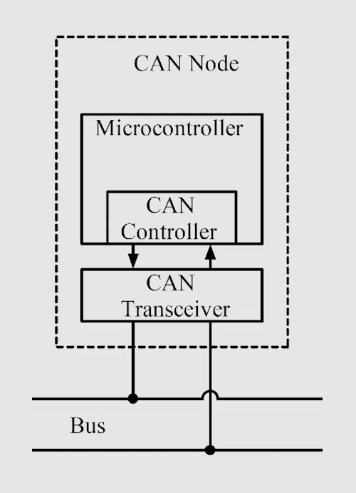
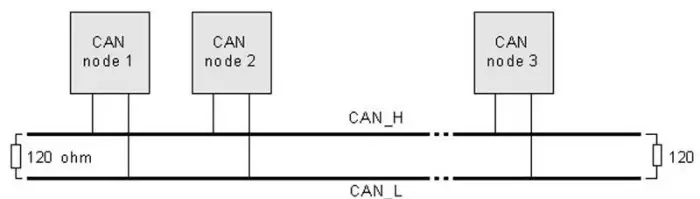
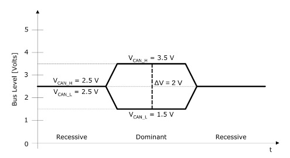

```
 _____   ___   _   _ 
/  __ \ / _ \ | \ | |
| /  \// /_\ \|  \| |
| |    |  _  || . ` |
| \__/\| | | || |\  |
 \____/\_| |_/\_| \_/
```

**Author: Kayky Moreira Praxedes**

# 0. Introduction

> This handout uses **classic CAN**, with the high-speed physical layer, as a reference.

CAN (Controller Area Network) is a communication protocol that allows messages to be exchanged between devices connected to the same **bus**, the shared path through which data circulates.

It is widely used in vehicles to connect **ECUs** (Electronic Control Units), electronic units responsible for functions such as controlling the engine, monitoring sensors, and updating the dashboard. Each device connected to the network is called a **node**.

## Shared Communication:

Communication is **broadcast**. A transmitted message becomes available to all nodes on the bus. Each node can select which messages are of interest to its application.

> An ECU can, for example, publish the engine temperature. The dashboard uses this information to update an indicator, while another ECU uses it to control ventilation. **The same transmission serves different interested parties**.

CAN is **multi-master**: several nodes can initiate a transmission. Each one monitors the bus and waits for an opportunity to send its data.

Communication is **half-duplex**: one frame transmitted at a time. Two nodes can start simultaneously, but the protocol resolves this dispute at the beginning of the transmission, through the **arbitration** mechanism.

A **frame** is the message organized in the protocol format, with identification, data, and control information.

## Main Applications:

- **Vehicles:** Communication between ECUs, sensors, actuators, and dashboard.
- **Industrial Automation:** Exchange of information between machines, control modules, and devices.
- **Agricultural Machines and Mobile Equipment:** Communication between distributed parts of the equipment.
- **Embedded Systems:** Devices that need to share small control information.

## Advantages:

- **Resistance to Interference:** Differential signaling and the twisted pair help preserve communication in environments with electrical noise.
- **Wiring Sharing:** Several devices use the same bus, reducing individual connections between them.
- **Message Priority:** More urgent information can receive preference when there is contention for the bus.
- **Error Handling:** The protocol detects various transmission failures and allows resending.
- **Distributed Control:** Nodes can contend for access without depending on a central unit to authorize each transmission.

## Limitations:

- **Few Data per Frame:** **Classic CAN** carries up to 8 bytes of data.
- **Shared Capacity:** All messages contend for the same bus. A very busy network increases waiting.
- **Relationship between Speed and Distance:** Higher rates require greater care with cable length, stubs, and component delays.
- **Priority Planning:** Low-priority messages may wait a long time when there is frequent traffic of priority messages.
- **Electrical Installation:** Improper termination, cabling, and connections can cause errors.

> **CAN FD** expands the payload to up to 64 bytes and allows a higher rate during part of the frame.

---

# 1. Electrical Schematic

Connecting a node to the bus involves application processing, the CAN controller, and the transceiver. Each part handles one stage of communication.

## Parts of a Node:

| Part | Function |
| --- | --- |
| Microcontroller | Executes the program that produces and uses the data. |
| CAN controller | Organizes the frames, controls transmission and reception, and executes the protocol rules. |
| Transceiver | Converts the controller's digital signals into electrical signals suitable for the bus and performs the conversion on reception. |

The CAN controller is often integrated into the microcontroller. When it is external, the microcontroller needs an interface to communicate with it, such as SPI.

<br>
*Source: **Adapted** from DEWESoft - O que é barramento CAN (Controller Area Network) e como ele se compara a outras redes de barramento de veículos, Available at: [https://dewesoft.com/pt/blog/que-e-barramento-can](https://dewesoft.com/pt/blog/que-e-barramento-can). Accessed on: Nov. 17, 2026.*

The transceiver connects the controller to the two bus lines, called **CANH** (CAN High) and **CANL** (CAN Low).

## Transceiver Connections:

| Connection | Direction |
| --- | --- |
| `CAN_TX` of the controller - `TXD` of the transceiver | Informs the bit the node wants to transmit. |
| `CAN_RX` of the controller - `RXD` of the transceiver | Informs the state observed on the bus. |
| `CANH` and `CANL` | Connect the transceiver to the communication pair. |

The transmission and reception signals belong to the **CAN controller**. When it is integrated into the microcontroller, its functions are made available by the pins configured for that peripheral.

The controller continues monitoring reception while transmitting. This allows comparing what it tried to send with what actually appeared on the bus.

## Twisted Pair and Termination:

The bus normally uses a **twisted pair**, formed by two conductors twisted around each other. The proximity and alternating position help reduce the pickup and emission of interference.

The nodes connect to the two lines along the main cable. The stubs between the cable and each node should be short to limit the effects on the signal.

At the two physical ends of the bus, a **120 Ω resistor between CANH and CANL** is normally used. Termination reduces reflections, which are returns of part of the signal upon encountering an impedance change.

It is similar to an echo that mixes with the original sound. On the cable, these reflections can deform the transitions and make bit reading difficult.

<br>
*Source: PetrolheadGarage - Diagnóstico de línea CAN Bus. Solución de problemas, ejemplos y técnica, Available at: [https://petrolheadgarage.com/cursos-automocion/diagnostico-linea-can-bus-solucion-problemas/](https://petrolheadgarage.com/cursos-automocion/diagnostico-linea-can-bus-solucion-problemas/). Accessed on: Nov. 17, 2026.*

> With the network de-energized and both terminations connected, the resistance measured between CANH and CANL is usually close to **60 Ω** (two 120 Ω resistors in parallel).

## Differential Voltage:

The receiver interprets the voltage difference between the lines, calculated by `Vdif = VCANH - VCANL`.

If CANH is at 3.5 V and CANL at 1.5 V, the difference will be 2 V. If an interference raises both voltages by 0.3 V, they will go to 3.8 V and 1.8 V, keeping the 2 V difference.

This example represents **common-mode noise**, which affects both lines similarly. Differential reading reduces its influence. Noise that affects the lines differently and signals outside the transceiver's electrical limits can still cause errors.

Attenuation along the cable can also reduce the voltage difference. Therefore, network length and installation quality remain important.

## Signal Conversion:

On the controller side, bits are represented by digital levels referenced to ground, such as the 3.3 V logic levels of certain microcontrollers. On the bus, information is represented by the difference between CANH and CANL.

The transceiver performs the conversion between these two representations. The expression **conversion between differential signal and logic-level digital signal** describes this function more precisely than "conversion to DC".

The compatibility of the digital pin voltages must be verified in the chosen component. Some transceivers also offer protection against electrostatic discharges, shorts, and other electrical conditions, within the limits specified by the manufacturer.

> Galvanic isolation requires its own components or circuits. The design must also keep the potential differences between nodes within the limits supported by the interfaces.

---

# 2. Logical Schematic

CAN represents bits by two bus states, called **dominant** and **recessive**. These names indicate the result when several nodes try to transmit at the same time.

## Bus States:

| State | Bit | Typical CANH | Typical CANL | Difference |
| --- | --- | --- | --- | --- |
| Dominant | `0` | 3.5 V | 1.5 V | 2 V |
| Recessive | `1` | 2.5 V | 2.5 V | Close to 0 V |

<br>
*Source: **Adapted** from Copperhill Technologies - CAN Bus And SAE J1939 Bus Voltage, Available at: [https://copperhilltech.com/blog/can-bus-and-sae-j1939-bus-voltage/](https://copperhilltech.com/blog/can-bus-and-sae-j1939-bus-voltage/). Accessed on: Nov. 17, 2026.*

> These values illustrate the operation of common 5 V-powered transceivers. The exact values and recognition limits depend on the component.

In the dominant state, the transceiver establishes a voltage difference between the lines. In the recessive state, it allows another node to impose the dominant state.

Thus, **it is enough for one node to transmit dominant for the bus to be dominant**, even if the others are transmitting recessive.

## Combination of Transmissions:

Considering `0` and `1`, the result is equivalent to an **AND** operation. The value `1` only appears when all participants leave the bus recessive.

| Node A | Node B | Observed state |
| --- | --- | --- |
| `1` - recessive | `1` - recessive | `1` - recessive |
| `0` - dominant | `1` - recessive | `0` - dominant |
| `1` - recessive | `0` - dominant | `0` - dominant |
| `0` - dominant | `0` - dominant | `0` - dominant |

This property allows nodes to transmit and compare bits during arbitration. A node that sends recessive and observes dominant notices the participation of another transmitter.

## Idle State:

When no node imposes the dominant state, the bus remains recessive.

During a message there are also recessive bits. To recognize that the bus is free, the controller monitors the protocol sequence, including the end of the frame and the interval between transmissions.

---

# 3. Frames

> The structure presented in this chapter corresponds to the **data frame**, used to carry application information. The other frame types and their differences are presented at the end.

A CAN frame gathers fields that allow identifying the message, carrying its data, and verifying the transmission. It is similar to a form with defined spaces, each with a function.

## Data Frame Structure:

| Field | Function |
| --- | --- |
| SOF | Marks the beginning of the frame. |
| Arbitration | Includes the identifier and information used in contention for the bus. |
| Control | Includes the code that informs the data length. |
| Payload | Carries the application content. |
| Verification and Acknowledgement | Allows verifying the integrity of the bits protected by the calculation and signaling correct reception up to that point. |
| EOF | Marks the end of the frame. |

The frame contains information beyond the payload (transmitting 8 bytes of data requires more than 64 bits on the bus).

## Arbitration:

### ID:

The **ID** identifies the message according to a convention defined for the network.

> The project can associate `0x100` with engine temperature and `0x120` with speed, for example.

The identifier also determines the priority during arbitration. Among data frames of the same format, **the lower numeric ID has higher priority**.

| Format | ID Size |
| --- | --- |
| Standard | 11 bits. |
| Extended | 29 bits. |

The ID can be compared to a label that informs the published subject. Its meaning must be known by the interested devices. The same ECU can transmit messages with different IDs and priorities.

> Protocols built on top of CAN can define additional conventions, including addressing. The interpretation depends on the rules adopted by the network.

## Control:

The **DLC** (Data Length Code) is a four-bit field used to indicate the data length. In classic CAN, values from zero to eight directly indicate the number of bytes.

Other bits help interpret the frame format. The **IDE** (Identifier Extension) participates in identifying the standard or extended format, while the **RTR** (Remote Transmission Request), belonging to the arbitration field, differentiates a data frame from a remote request.

## Payload:

The payload of a classic CAN data frame can contain from **0 to 8 bytes**. These bytes can represent temperatures, speeds, states, commands, or other information.

The application defines how to interpret them, including unit, scale, sign, and byte order.

For example, a network can define that temperature is transmitted in one byte, in integer degrees Celsius.

| Information | Example value |
| --- | --- |
| ID | `0x100` |
| DLC | `1` |
| Data | `0x50`, equivalent to 80 in decimal |
| Agreed interpretation | Temperature of 80 °C |

The byte `0x50` gains the meaning of temperature because that interpretation was defined by those responsible for the network.

## Verification and Acknowledgement:

The **CRC** (Cyclic Redundancy Check) is a verification method in which a value is calculated from bits of the frame. The receiver repeats the calculation and compares the results to detect alterations in the transmission.

The **ACK** (Acknowledgement) is a space in the frame in which the receivers can place a dominant bit. It allows the transmitter to notice that at least one other node received the content correctly up to that point.

The acknowledgement belongs to the CAN protocol. To confirm that a command was executed or that the program used the data, the application can define a response message.

## Frame Types:

### Data Frame:

Carries application information using the structure presented in this chapter. Its **RTR bit is dominant (`0`)**.

### Remote Frame:

Requests a data frame with the corresponding ID. Its structure is similar to that of the data frame, with two main differences - the **RTR is recessive (`1`)** and the **data field is omitted**. The DLC informs the expected length of the requested data.

For example, a remote frame with ID `0x100` can request the engine temperature. The response uses a data frame with that same ID and the temperature value.

### Error Frame:

Signals a failure detected in communication. It has its own structure, formed by an **error flag** and an **eight-recessive-bit delimiter**.

Each node signals the error with six dominant or recessive bits, according to its error state. The flags of several nodes can overlap. Error handling will be explained in the operation chapter.

### Overload Frame:

Extends the interval before the next data or remote frame under certain conditions provided for by the protocol.

Its structure brings together an **overload flag** of six dominant bits, per node, and an **eight-recessive-bit delimiter**. It is similar to the active error flag, being distinguished by the moment it appears in communication.

> Error and overload frames use their own signaling sequences, without ID, DLC, payload, CRC, or ACK.

---

# 4. Operation

The application provides the data to the CAN controller. From there, the controller organizes the frame, waits for bus access, and monitors its transmission through the transceiver.

## Start and End of Transmission:

With the bus available, a node can start the frame by sending a dominant **SOF** (Start of Frame) bit. This transition also helps the other nodes align their reading of the message.

The receivers follow the fields in the order defined by the protocol. The **EOF** (End of Frame), formed by seven recessive bits, marks the end. After it, the intermission includes three recessive bits before a new normal transmission.

Thus, recognizing activity combines electrical levels, bit duration, and position within the frame.

## Arbitration:

Two or more nodes can find the bus free and start together. During arbitration, each one transmits its bits and observes the resulting state.

When a node sends a recessive `1` and reads a dominant `0`, it loses the dispute. It interrupts its transmission and continues receiving the winning frame. The winner proceeds without needing to restart the frame.

Consider two data frames with 11-bit IDs, transmitted from the most significant bit to the least significant.

| Message | ID in Binary |
| --- | --- |
| A - `0x100` | `00100000000` |
| B - `0x120` | `00100100000` |

The first five bits are equal. In the sixth position, A sends `0` and B sends `1`. The bus becomes `0`, so B notices the difference and interrupts its transmission. A continues.

This is **non-destructive arbitration**, since the dispute preserves the winning frame. The message that lost can contend for a later opportunity.

Priority applies at the moment of arbitration. A priority message that becomes ready during another frame waits for its end before contending for access.

> Losing arbitration is part of the normal operation of the network. IDs and sending frequencies must be planned so that all necessary messages have an opportunity to be transmitted.

## Timing:

Nodes must agree on the **bit rate**, such as 500 kbit/s. At this rate, each bit lasts approximately two microseconds (`1 / 500,000 = 0.000002`).

Each controller uses its own clock. Signal transitions allow adjusting the alignment between them during communication.

Within the time of each bit there is a **sampling point**, the instant at which the controller considers the received level. The signal must have time to cross the cable and the components before this reading.

This explains the relationship between rate and distance. When bits last less, there is less time available for propagation and synchronization adjustments.

> In a detailed configuration, the bit time is divided into smaller segments. To understand the protocol, it is initially enough to relate bit duration, propagation, and reading instant.

## Bit Stuffing:

A very long sequence without a level change makes it difficult to keep the clocks aligned. To produce transitions, classic CAN uses automatic bit insertion.

In the part of the frame subject to this rule, the transmitter inserts a bit of opposite value after five consecutive equal bits (even if the sixth bit of the message would already be different). The receiver follows the same sequence. Upon reading five equal bits, it checks whether the next one has the opposite value and removes it when reconstructing the message.

> If the sixth bit (the added one) also has the same value, the receiver detects a stuffing error.

The rule covers from SOF to the end of the CRC sequence in data and remote frames. The following fields have their own rules.

Since the number of inserted bits depends on the content, frames with the same number of bytes can occupy different times on the bus.

## Reception and Filtering:

All connected nodes can observe the transmission. The **acceptance filters** allow selecting the IDs that will be forwarded to each device's program.

In the temperature example, the dashboard can accept `0x100` to update its indicator. A module interested only in other information can discard that frame during filtering.

The controller handles reception, while the program uses the data made available. This separation reduces the microcontroller's work with uninteresting messages.

## Acknowledgement with ACK:

In the space reserved for ACK, the transmitter sends recessive. The receivers enabled to participate in communication place dominant when they have received correctly up to that point.

Upon observing dominant, the transmitter knows that at least one receiver has acknowledged. Since several nodes can acknowledge together, this bit does not identify which one responded nor how many responded.

The acknowledgement occurs even when a receiver's filter does not forward that message to the application. If the transmitter does not observe acknowledgement, it detects an ACK error.

> A node in silent listening mode observes traffic without sending ACK. In a network with only one transmitter and silent observers, the acknowledgement is absent.

## Error Detection:

The controller verifies different aspects of the transmission.

| Verification | What it allows detecting |
| --- | --- |
| Bit monitoring | Unexpected differences between the transmitted and observed bit. |
| Bit Stuffing | Sequences that violate the insertion rule. |
| Format | Incorrect values in positions with fixed format. |
| CRC | Alterations identified by the verification calculation. |
| ACK | Absence of acknowledgement by another node. |

The differences provided for by arbitration and by ACK are interpreted according to the position in the frame.

When a node in the active error state detects a failure, it can emit a flag that invalidates the frame for the other participants. The transmitter normally tries to send it again when the bus allows.

Retransmission also depends on the controller configuration. Some devices offer modes that limit automatic attempts.

## Failure Control:

Each controller maintains counters related to transmission and reception errors. They allow reducing the participation of a node that presents repeated failures.

| State | Behavior |
| --- | --- |
| Error active | Participates normally and can emit an active error flag. |
| Error passive | Continues participating, but uses a less interfering error flag and follows additional restrictions. |
| Bus-off | Stops participating in bus transmissions and acknowledgements. |

This progression helps limit the impact of a problematic node on the others. Returning after bus-off requires a recovery procedure compatible with the controller and the design.

## Path of a Message:

1. The application provides the ID and data to the controller.
2. The controller prepares the frame and waits for the bus to be available.
3. The node starts transmission and participates in arbitration, if there is contention.
4. The receivers follow the bits and verify the frame.
5. The able receivers acknowledge in the ACK space.
6. The frames accepted by the filters are made available to the programs.
7. The bus becomes available again after the end and the provided interval.

If there is a failure, error handling can interrupt this path and cause a new transmission attempt.

---

# Appendix A. Development and Simulation

## Frameworks and Drivers

The drivers allow configuring the CAN controller, sending and receiving frames, and defining acceptance filters.

- **ESP-IDF (ESP32)** - The TWAI driver gives access to the ESP32's classic CAN controller. [ESP-IDF documentation (TWAI)](https://docs.espressif.com/projects/esp-idf/en/latest/esp32/api-reference/peripherals/twai.html)
- **Zephyr RTOS** - Offers a common API for CAN controllers from different platforms. [Zephyr RTOS documentation (CAN)](https://docs.zephyrproject.org/latest/hardware/peripherals/can/index.html)
- **STM32Cube HAL (STM32)** - Offers drivers for CAN or FDCAN, depending on the microcontroller. [STM32Cube HAL documentation (CAN)](https://www.st.com/resource/en/user_manual/dm00105879.pdf) · [STM32Cube HAL documentation (FDCAN)](https://dev.st.com/stm32cube-docs/stm32h7pxx-hal-drivers/2.0.0/en/docs/drivers/hal_drivers/fdcan/hal_fdcan_how_to_use.html)

## Embedded Firmware Simulation

Simulation allows verifying which frames the firmware sends and how it reacts to received frames.

- **Proteus VSM** - Executes the firmware in a simulated circuit with a CAN bus. [Proteus VSM documentation](https://www.labcenter.com/documentation/)
- **Renode** - Connects emulated microcontrollers to a virtual CAN network. [Renode documentation](https://renode.readthedocs.io/en/latest/host-integration/can.html)
- **Wokwi** - Simulates the ESP32 with partial TWAI support. [Wokwi documentation](https://docs.wokwi.com/guides/esp32#simulation-features)

## Automotive Testing

These tools allow analyzing CAN traffic, testing communication between electronic control units (ECUs), or simulating the vehicle in driving scenarios.

- **CANoe (Vector)** - Simulates ECUs and tests CAN and CAN FD networks. Uses the CAPL language to automate tests. [CANoe documentation](https://support.vector.com/sys_attachment.do?sys_id=8f48aa2493352d907bd5b7527cba10ed)
- **CANalyzer (Vector)** - Records and analyzes CAN traffic. [CANalyzer documentation](https://support.vector.com/sys_attachment.do?sys_id=8f48aa2493352d907bd5b7527cba10ed)
- **VEOS (dSPACE)** - Runs virtual ECUs on the computer to test communication between them. [VEOS documentation](https://www.dspace.com/en/inc/home/support/documentation.cfm?externalid=Container_31ea5042-6b44-4c1f-9162-466e8e5aab45_--_&helpsetid=VEOS)
- **CarMaker (IPG Automotive)** - Simulates the vehicle, the track, and traffic. The manual is in Help → Reference Manual in the program. [CarMaker documentation](https://www.ipg-automotive.com/support/support-request/faq/accessing-product-documentation-on-ubuntu-systems)

> **AUTOSAR Classic** is a software architecture standard for ECUs. It specifies modules such as CAN Driver and CAN Interface. [AUTOSAR Classic documentation](https://www.autosar.org/standards/classic-platform)

---

# Sources

- FASTBIT EMBEDDED BRAIN ACADEMY. Controller Area Network (CAN) Programming Tutorial Step by Step. \[YouTube\], 2019. Available at: [https://www.youtube.com/playlist?list=PLERTijJOmYrApVZqiI6gtA8hr1_6QS-cs](https://www.youtube.com/playlist?list=PLERTijJOmYrApVZqiI6gtA8hr1_6QS-cs). Accessed on: Nov. 17, 2026.
- CORRIGAN, Steve. Controller Area Network Physical Layer Requirements. SLLA270. Dallas: Texas Instruments, 2008. Available at: [https://www.ti.com/lit/an/slla270/slla270.pdf](https://www.ti.com/lit/an/slla270/slla270.pdf). Accessed on: Nov. 16, 2026.
- NXP SEMICONDUCTORS. TJA1057: High-speed CAN transceiver. Rev. 8.1. Eindhoven: NXP B.V., 2026. Available at: [https://cache.nxp.com/docs/en/data-sheet/TJA1057.pdf](https://cache.nxp.com/docs/en/data-sheet/TJA1057.pdf). Accessed on: Nov. 16, 2026.
- KVASER. The CAN Bus Protocol Tutorial. Mölndal: Kvaser AB, 2026. Available at: [https://kvaser.com/can-protocol-tutorial/](https://kvaser.com/can-protocol-tutorial/). Accessed on: Nov. 16, 2026.
- KVASER. CAN Error Handling. Mölndal: Kvaser AB, 2026. Available at: [https://kvaser.com/lesson/can-error-handling/](https://kvaser.com/lesson/can-error-handling/). Accessed on: Nov. 16, 2026.
- KVASER. CAN FD Protocol Tutorial. Mölndal: Kvaser AB, 2026. Available at: [https://kvaser.com/can-fd-protocol-tutorial/](https://kvaser.com/can-fd-protocol-tutorial/). Accessed on: Nov. 16, 2026.
