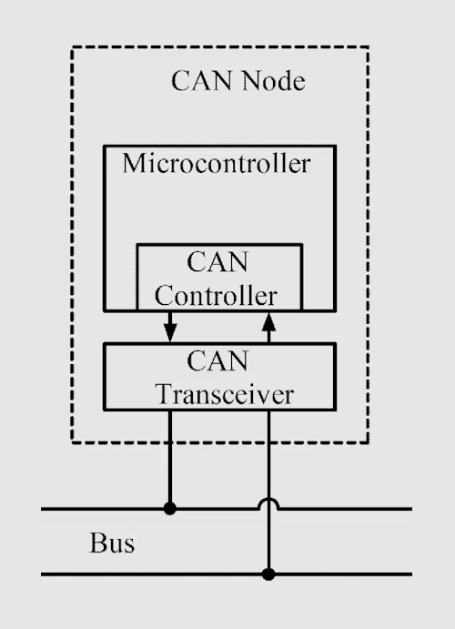
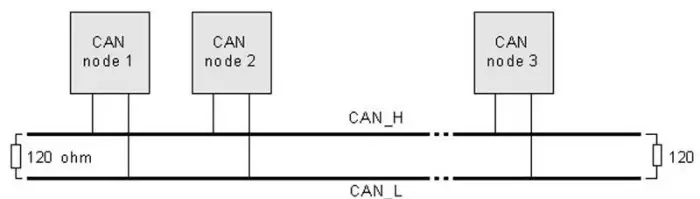
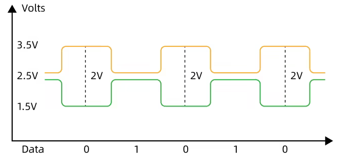

```
 _____   ___   _   _ 
/  __ \ / _ \ | \ | |
| /  \// /_\ \|  \| |
| |    |  _  || . ` |
| \__/\| | | || |\  |
 \____/\_| |_/\_| \_/
```

**Autor: Kayky Moreira Praxedes**

# 0. Introdução

> Esta apostila utiliza o **CAN clássico**, com a camada física de alta velocidade, como referência.

CAN (*Controller Area Network*) é um protocolo de comunicação que permite trocar mensagens entre dispositivos conectados ao mesmo **barramento**, o caminho compartilhado por onde os dados circulam.

É muito utilizado em veículos para conectar **ECUs** (*Electronic Control Units*), unidades eletrônicas responsáveis por funções como controlar o motor, acompanhar sensores e atualizar o painel. Cada dispositivo conectado à rede é chamado de **nó**.

## Comunicação Compartilhada:

A comunicação é ***broadcast***. Uma mensagem transmitida fica disponível para todos os nós do barramento. Cada nó pode selecionar quais mensagens interessam à sua aplicação.

> Uma ECU pode, por exemplo, publicar a temperatura do motor. O painel usa essa informação para atualizar um indicador, enquanto outra ECU a utiliza para controlar a ventilação. **A mesma transmissão atende a diferentes interessados**.

O CAN é **multi-mestre**: vários nós podem iniciar uma transmissão. Cada um acompanha o barramento e aguarda uma oportunidade para enviar seus dados.

A comunicação é ***half-duplex***: um quadro transmitido por vez. Dois nós podem começar simultaneamente, mas o protocolo resolve essa disputa durante o início da transmissão, pelo mecanismo de **arbitragem**.

Um **quadro** (*frame*) é a mensagem organizada no formato do protocolo, com identificação, dados e informações de controle.

## Principais Aplicações:

- **Veículos:** Comunicação entre ECUs, sensores, atuadores e painel.
- **Automação Industrial:** Troca de informações entre máquinas, módulos de controle e dispositivos.
- **Máquinas Agrícolas e Equipamentos Móveis:** Comunicação entre partes distribuídas do equipamento.
- **Sistemas Embarcados:** Dispositivos que precisam compartilhar pequenas informações de controle.

## Vantagens:

- **Resistência a Interferências:** A sinalização diferencial e o par trançado ajudam a preservar a comunicação em ambientes com ruído elétrico.
- **Compartilhamento da Fiação:** Vários dispositivos utilizam o mesmo barramento, reduzindo conexões individuais entre eles.
- **Prioridade de Mensagens:** Informações mais urgentes podem receber preferência quando há disputa pelo barramento.
- **Tratamento de Erros:** O protocolo detecta diversas falhas de transmissão e permite repetir o envio.
- **Controle Distribuído:** Os nós podem disputar o acesso sem depender de uma unidade central para autorizar cada transmissão.

## Limitações:

- **Poucos Dados por Quadro:** O **CAN clássico** transporta até 8 *bytes* de dados.
- **Capacidade Compartilhada:** Todas as mensagens disputam o mesmo barramento. Uma rede muito ocupada aumenta a espera.
- **Relação entre Velocidade e Distância:** Taxas maiores exigem maior cuidado com comprimento do cabo, derivações e atrasos dos componentes.
- **Planejamento das Prioridades:** Mensagens de baixa prioridade podem esperar muito quando há tráfego frequente de mensagens prioritárias.
- **Instalação Elétrica:** Terminação, cabeamento e conexões inadequados podem provocar erros.

> O **CAN FD** amplia a carga útil para até 64 *bytes* e permite uma taxa maior durante parte do quadro.

---

# 1. Esquema Elétrico

A conexão de um nó ao barramento envolve o processamento da aplicação, o controlador CAN e o *transceiver*. Cada parte cuida de uma etapa da comunicação.

## Partes de um Nó:

| Parte | Função |
| --- | --- |
| Microcontrolador | Executa o programa que produz e utiliza os dados. |
| Controlador CAN | Organiza os quadros, controla a transmissão e recepção e executa as regras do protocolo. |
| *Transceiver* | Converte os sinais digitais do controlador em sinais elétricos adequados ao barramento e realiza a conversão na recepção. |

O controlador CAN frequentemente está integrado ao microcontrolador. Quando é externo, o microcontrolador precisa de uma interface para se comunicar com ele, como SPI.

<br>
*Fonte: **Adaptado** de Smith (2024).*

O *transceiver* conecta o controlador às duas linhas do barramento, chamadas **CANH** (*CAN High*) e **CANL** (*CAN Low)*.

## Ligações do *Transceiver*:

| Ligação | Sentido |
| --- | --- |
| `CAN_TX` do controlador - `TXD` do *transceiver* | Informa o *bit* que o nó deseja transmitir. |
| `CAN_RX` do controlador - `RXD` do *transceiver* | Informa o estado observado no barramento. |
| `CANH` e `CANL` | Conectam o *transceiver* ao par de comunicação. |

Os sinais de transmissão e recepção pertencem ao **controlador CAN**. Quando ele está integrado ao microcontrolador, suas funções são disponibilizadas pelos pinos configurados para esse periférico.

O controlador continua observando a recepção enquanto transmite. Isso permite comparar o que tentou enviar com o que efetivamente apareceu no barramento.

## Par Trançado e Terminação:

O barramento normalmente utiliza um **par trançado**, formado por dois condutores enrolados entre si. A proximidade e a alternância de posição ajudam a reduzir a captação e a emissão de interferências.

Os nós se conectam às duas linhas ao longo do cabo principal. As derivações entre o cabo e cada nó devem ser curtas para limitar os efeitos sobre o sinal.

Nas duas extremidades físicas do barramento, utiliza-se normalmente um resistor de **120 Ω entre CANH e CANL**. A terminação reduz as reflexões, que são retornos de parte do sinal ao encontrar uma mudança de impedância.

É semelhante a um eco que se mistura ao som original. No cabo, essas reflexões podem deformar as transições e dificultar a leitura dos *bits*.

<br>
*Fonte: PetrolheadGarage (2020).*

> Com a rede desenergizada e as duas terminações conectadas, a resistência medida entre CANH e CANL costuma ficar próxima de **60 Ω** (dois resistores de 120 Ω em paralelo).

## Tensão Diferencial:

O receptor interpreta a diferença de tensão entre as linhas, calculada por `Vdif = VCANH - VCANL`.

Se CANH estiver em 3,5 V e CANL em 1,5 V, a diferença será de 2 V. Se uma interferência elevar as duas tensões em 0,3 V, elas passarão para 3,8 V e 1,8 V, mantendo a diferença de 2 V.

Esse exemplo representa um **ruído de modo comum**, que afeta as duas linhas de maneira semelhante. A leitura diferencial reduz sua influência. Ruídos que afetam as linhas de maneiras diferentes e sinais fora dos limites elétricos do *transceiver* ainda podem causar erros.

A atenuação ao longo do cabo também pode reduzir a diferença de tensão. Por isso, o comprimento da rede e a qualidade da instalação continuam importantes.

## Conversão dos Sinais:

No lado do controlador, os *bits* são representados por níveis digitais referenciados ao terra, como os níveis lógicos de 3,3 V de determinados microcontroladores. No barramento, a informação é representada pela diferença entre CANH e CANL.

O *transceiver* realiza a conversão entre essas duas representações. A expressão **conversão entre sinal diferencial e sinal digital de nível lógico** descreve essa função com mais precisão que “conversão para CC”.

A compatibilidade das tensões dos pinos digitais precisa ser verificada no componente escolhido. Alguns *transceivers* também oferecem proteção contra descargas eletrostáticas, curtos e outras condições elétricas, dentro dos limites especificados pelo fabricante.

> A isolação galvânica exige componentes ou circuitos próprios. O projeto também precisa manter as diferenças de potencial entre os nós dentro dos limites suportados pelas interfaces.

---

# 2. Esquema Lógico

O CAN representa os *bits* por dois estados do barramento, chamados **dominante** e **recessivo**. Esses nomes indicam o resultado quando vários nós tentam transmitir ao mesmo tempo.

## Estados do Barramento:

| Estado | *Bit* | CANH típica | CANL típica | Diferença |
| --- | --- | --- | --- | --- |
| Dominante | `0` | 3,5 V | 1,5 V | 2 V |
| Recessivo | `1` | 2,5 V | 2,5 V | Próxima de 0 V |

<br>
*Fonte: Zhou (2026).*

> Esses valores ilustram o funcionamento de *transceivers* comuns alimentados em 5 V. Os valores exatos e os limites de reconhecimento dependem do componente.

No estado dominante, o *transceiver* estabelece uma diferença de tensão entre as linhas. No recessivo, ele permite que outro nó imponha o estado dominante.

Assim, **basta um nó transmitir dominante para que o barramento seja dominante**, mesmo que os demais estejam transmitindo recessivo.

## Combinação de Transmissões:

Considerando `0` e `1`, o resultado equivale a uma operação **AND**. O valor `1` só aparece quando todos os participantes deixam o barramento recessivo.

| Nó A | Nó B | Estado observado |
| --- | --- | --- |
| `1` - recessivo | `1` - recessivo | `1` - recessivo |
| `0` - dominante | `1` - recessivo | `0` - dominante |
| `1` - recessivo | `0` - dominante | `0` - dominante |
| `0` - dominante | `0` - dominante | `0` - dominante |

Essa propriedade permite que os nós transmitam e comparem *bits* durante a arbitragem. Um nó que envia recessivo e observa dominante percebe a participação de outro transmissor.

## Estado de Repouso:

Quando nenhum nó impõe o estado dominante, o barramento permanece recessivo.

Durante uma mensagem também existem *bits* recessivos. Para reconhecer que o barramento está livre, o controlador acompanha a sequência do protocolo, incluindo o fim do quadro e o intervalo entre transmissões.

---

# 3. Componentes

Um quadro CAN reúne campos que permitem identificar a mensagem, transportar seus dados e verificar a transmissão. É semelhante a uma ficha com espaços definidos, cada um com uma função.

A estrutura apresentada neste capítulo corresponde ao **quadro de dados**, utilizado para transportar informações da aplicação. Os demais tipos de quadro e suas diferenças são apresentados ao final.

## Estrutura do Quadro de Dados:

| Campo | Função |
| --- | --- |
| SOF | Marca o início do quadro. |
| Arbitragem | Inclui o identificador e informações utilizadas na disputa pelo barramento. |
| Controle | Inclui o código que informa o tamanho dos dados. |
| *Payload* | Transporta o conteúdo da aplicação. |
| Verificação e Confirmação | Permite verificar a integridade dos *bits* protegidos pelo cálculo e sinalizar o recebimento correto até esse ponto. |
| EOF | Marca o encerramento do quadro. |

O quadro contém informações além da carga útil (transmitir 8 *bytes* de dados exige mais que 64 *bits* no barramento).

## Arbitragem:

### ID:

O **ID** identifica a mensagem segundo uma convenção definida para a rede.

> O projeto pode associar `0x100` à temperatura do motor e `0x120` à velocidade, por exemplo.

O identificador também determina a prioridade durante a arbitragem. Entre quadros de dados do mesmo formato, **o menor ID numérico tem maior prioridade**.

| Formato | Tamanho do ID |
| --- | --- |
| Padrão | 11 *bits*. |
| Estendido | 29 *bits*. |

O ID pode ser comparado a uma etiqueta que informa o assunto publicado. Seu significado precisa ser conhecido pelos dispositivos interessados. Uma mesma ECU pode transmitir mensagens com diferentes IDs e prioridades.

> Protocolos construídos sobre CAN podem definir convenções adicionais, incluindo endereçamento. A interpretação depende das regras adotadas pela rede.

## Controle:

O **DLC** (*Data Length Code*) é um campo de quatro *bits* utilizado para indicar o comprimento dos dados. No CAN clássico, os valores de zero a oito indicam diretamente a quantidade de *bytes*.

Outros *bits* ajudam a interpretar o formato do quadro. O **IDE** (*Identifier Extension*) participa da identificação do formato padrão ou estendido, enquanto o **RTR** (*Remote Transmission Request*), pertencente ao campo de arbitragem, diferencia um quadro de dados de uma solicitação remota.

## *Payload*:

A carga útil de um quadro de dados do CAN clássico pode conter de **0 a 8 *bytes***. Esses *bytes* podem representar temperaturas, velocidades, estados, comandos ou outras informações.

A aplicação define como interpretá-los, incluindo unidade, escala, sinal e ordem dos *bytes*.

Por exemplo, uma rede pode definir que a temperatura é transmitida em um *byte*, em graus Celsius inteiros.

| Informação | Valor do exemplo |
| --- | --- |
| ID | `0x100` |
| DLC | `1` |
| Dado | `0x50`, equivalente a 80 em decimal |
| Interpretação acordada | Temperatura de 80 °C |

O *byte* `0x50` ganha o significado de temperatura porque essa interpretação foi definida pelos responsáveis pela rede.

## Verificação e Confirmação:

O **CRC** (*Cyclic Redundancy Check*) é um método de verificação em que um valor é calculado a partir de *bits* do quadro. O receptor repete o cálculo e compara os resultados para detectar alterações na transmissão.

O **ACK** (*Acknowledgement*) é um espaço do quadro no qual os receptores podem colocar um *bit* dominante. Ele permite ao transmissor perceber que pelo menos outro nó recebeu corretamente o conteúdo até aquele ponto.

A confirmação pertence ao protocolo CAN. Para confirmar que um comando foi executado ou que o programa utilizou os dados, a aplicação pode definir uma mensagem de resposta.

## Tipos de Quadro:

### Quadro de Dados:

Transporta informações da aplicação utilizando a estrutura apresentada neste capítulo. Seu *bit* **RTR é dominante (`0`)**.

### Quadro Remoto:

Solicita um quadro de dados com o ID correspondente. Sua estrutura é semelhante à do quadro de dados, com duas diferenças principais - o **RTR é recessivo (`1`)** e o **campo de dados é omitido**. O DLC informa o tamanho esperado dos dados solicitados.

Por exemplo, um quadro remoto com ID `0x100` pode solicitar a temperatura do motor. A resposta utiliza um quadro de dados com esse mesmo ID e o valor da temperatura.

### Quadro de Erro:

Sinaliza uma falha detectada na comunicação. Possui uma estrutura própria, formada por uma **sinalização de erro** (*Error Flag*) e um **delimitador** de oito *bits* recessivos.

Cada nó sinaliza o erro com seis *bits* dominantes ou recessivos, conforme seu estado de erro. As sinalizações de vários nós podem se sobrepor. O tratamento dos erros será explicado no capítulo de funcionamento.

### Quadro de Sobrecarga:

Prolonga o intervalo antes do próximo quadro de dados ou remoto em determinadas condições previstas pelo protocolo.

Sua estrutura reúne uma **sinalização de sobrecarga** (*Overload Flag*) de seis *bits* dominantes, por nó, e um **delimitador** de oito *bits* recessivos. É semelhante à sinalização ativa de erro, sendo distinguida pelo momento em que aparece na comunicação.

> Os quadros de erro e de sobrecarga utilizam sequências próprias de sinalização, sem ID, DLC, *payload*, CRC ou ACK.

---

# 4. Funcionamento

A aplicação fornece os dados ao controlador CAN. A partir daí, o controlador organiza o quadro, aguarda o acesso ao barramento e acompanha sua transmissão pelo *transceiver*.

## Início e Fim da Transmissão:

Com o barramento disponível, um nó pode iniciar o quadro enviando um *bit* dominante de **SOF** (*Start of Frame*). Essa transição também ajuda os outros nós a alinharem a leitura da mensagem.

Os receptores acompanham os campos na ordem definida pelo protocolo. O **EOF** (*End of Frame*), formado por sete *bits* recessivos, marca o encerramento. Depois dele, a intermissão inclui três *bits* recessivos antes de uma nova transmissão normal.

Assim, o reconhecimento da atividade combina níveis elétricos, duração dos *bits* e posição dentro do quadro.

## Arbitragem:

Dois ou mais nós podem encontrar o barramento livre e começar juntos. Durante a arbitragem, cada um transmite seus *bits* e observa o estado resultante.

Quando um nó envia `1` recessivo e lê `0` dominante, ele perde a disputa. Interrompe sua transmissão e continua recebendo o quadro vencedor. O vencedor prossegue sem precisar reiniciar o quadro.

Considere dois quadros de dados com IDs de 11 *bits*, transmitidos do *bit* mais significativo para o menos significativo.

| Mensagem | ID em Binário |
| --- | --- |
| A - `0x100` | `00100000000` |
| B - `0x120` | `00100100000` |

Os cinco primeiros *bits* são iguais. Na sexta posição, A envia `0` e B envia `1`. O barramento fica em `0`, então B percebe a diferença e interrompe sua transmissão. A continua.

Essa é uma **arbitragem não destrutiva**, pois a disputa preserva o quadro vencedor. A mensagem que perdeu pode disputar uma oportunidade posterior.

A prioridade vale no momento da arbitragem. Uma mensagem prioritária que fica pronta durante outro quadro aguarda seu encerramento antes de disputar o acesso.

> Perder a arbitragem faz parte do funcionamento normal da rede. Os IDs e as frequências de envio devem ser planejados para que todas as mensagens necessárias tenham oportunidade de transmissão.

## Temporização:

Os nós precisam concordar sobre a **taxa de *bits***, como 500 kbit/s. Nessa taxa, cada *bit* dura aproximadamente dois microssegundos (`1 / 500.000 = 0,000002`).

Cada controlador utiliza seu próprio relógio. As transições do sinal permitem ajustar o alinhamento entre eles durante a comunicação.

Dentro do tempo de cada *bit* existe um **ponto de amostragem**, o instante em que o controlador considera o nível recebido. O sinal precisa ter tempo para atravessar o cabo e os componentes antes dessa leitura.

Isso explica a relação entre taxa e distância. Quando os *bits* duram menos, há menos tempo disponível para a propagação e os ajustes de sincronização.

> Em uma configuração detalhada, o tempo de *bit* é dividido em segmentos menores. Para compreender o protocolo, basta inicialmente relacionar duração do bit, propagação e instante de leitura.

## *Bit Stuffing*:

Uma sequência muito longa sem mudança de nível dificulta manter os relógios alinhados. Para produzir transições, o CAN clássico utiliza a inserção automática de *bits*.

Na parte do quadro sujeita a essa regra, o transmissor insere um *bit* de valor oposto após cinco *bits* consecutivos iguais (mesmo que o sexto *bit* da mensagem já fosse diferente). O receptor acompanha a mesma sequência. Ao ler cinco *bits* iguais, ele verifica se o próximo tem valor oposto e o remove ao reconstruir a mensagem. 

> Se o sexto *bit* (o adicionado) também tiver o mesmo valor, o receptor detecta um erro de *stuffing*.

A regra abrange do SOF até o fim da sequência de CRC nos quadros de dados e remotos. Os campos seguintes possuem regras próprias.

Como a quantidade de *bits* inseridos depende do conteúdo, quadros com o mesmo número de *bytes* podem ocupar tempos diferentes no barramento.

## Recepção e Filtragem:

Todos os nós conectados podem observar a transmissão. Os **filtros de aceitação** permitem selecionar os IDs que serão encaminhados ao programa de cada dispositivo.

No exemplo da temperatura, o painel pode aceitar `0x100` para atualizar seu indicador. Um módulo interessado apenas em outra informação pode descartar esse quadro na filtragem.

O controlador trata a recepção, enquanto o programa utiliza os dados disponibilizados. Essa separação reduz o trabalho do microcontrolador com mensagens sem interesse.

## Confirmação com ACK:

No espaço reservado ao ACK, o transmissor envia recessivo. Os receptores habilitados a participar da comunicação colocam dominante quando receberam corretamente até esse ponto.

Ao observar dominante, o transmissor sabe que pelo menos um receptor confirmou. Como vários nós podem confirmar juntos, esse bit não identifica qual deles respondeu nem quantos responderam.

A confirmação ocorre mesmo quando o filtro de um receptor não encaminha aquela mensagem à aplicação. Se o transmissor não observar confirmação, detecta um erro de ACK.

> Um nó em modo de escuta silenciosa observa o tráfego sem enviar ACK. Em uma rede com apenas um transmissor e observadores silenciosos, a confirmação fica ausente.

## Detecção de Erros:

O controlador verifica diferentes aspectos da transmissão.

| Verificação | O que permite detectar |
| --- | --- |
| Monitoramento dos *bits* | Diferenças inesperadas entre o bit transmitido e o observado. |
| *Bit Stuffing* | Sequências que violam a regra de inserção. |
| Formato | Valores incorretos em posições com formato fixo. |
| CRC | Alterações identificadas pelo cálculo de verificação. |
| ACK | Ausência de confirmação por outro nó. |

As diferenças previstas pela arbitragem e pelo ACK são interpretadas conforme a posição no quadro.

Quando um nó em estado de erro ativo detecta uma falha, pode emitir uma sinalização que invalida o quadro para os demais participantes. O transmissor normalmente tenta enviá-lo novamente quando o barramento permite.

A retransmissão depende também da configuração do controlador. Alguns dispositivos oferecem modos que limitam as tentativas automáticas.

## Controle de Falhas:

Cada controlador mantém contadores relacionados a erros de transmissão e recepção. Eles permitem reduzir a participação de um nó que apresenta falhas repetidas.

| Estado | Comportamento |
| --- | --- |
| *Error active* | Participa normalmente e pode emitir uma sinalização ativa de erro. |
| *Error passive* | Continua participando, mas utiliza uma sinalização de erro menos interferente e segue restrições adicionais. |
| *Bus-off* | Deixa de participar das transmissões e confirmações do barramento. |

Essa progressão ajuda a limitar o impacto de um nó com problemas sobre os demais. O retorno após *bus-off* exige um procedimento de recuperação compatível com o controlador e o projeto.

## Percurso de uma Mensagem:

1. A aplicação fornece o ID e os dados ao controlador.
2. O controlador prepara o quadro e aguarda o barramento disponível.
3. O nó inicia a transmissão e participa da arbitragem, se houver disputa.
4. Os receptores acompanham os *bits* e verificam o quadro.
5. Os receptores aptos confirmam no espaço de ACK.
6. Os quadros aceitos pelos filtros são disponibilizados aos programas.
7. O barramento fica disponível novamente após o encerramento e o intervalo previsto.

Se houver falha, o tratamento de erros pode interromper esse percurso e provocar uma nova tentativa de transmissão.

---

# Fontes

- FASTBIT EMBEDDED BRAIN ACADEMY. *Controller Area Network (CAN) Programming Tutorial Step by Step*. [YouTube], 2019. Disponível em: [https://www.youtube.com/playlist?list=PLERTijJOmYrApVZqiI6gtA8hr1_6QS-cs](https://www.youtube.com/playlist?list=PLERTijJOmYrApVZqiI6gtA8hr1_6QS-cs). Acesso em: 17 nov. 2026.
- SMITH, Grant Maloy. *O que é barramento CAN (Controller Area Network) e como ele se compara a outras redes de barramento de veículos*. Dewesoft, 17 abr. 2024. Disponível em: [https://dewesoft.com/pt/blog/que-e-barramento-can](https://dewesoft.com/pt/blog/que-e-barramento-can). Acesso em: 17 nov. 2026.
- PETROLHEADGARAGE. *Diagnóstico de línea CAN Bus. Solución de problemas, ejemplos y técnica*. [S. l.], 2020. Disponível em: [https://petrolheadgarage.com/cursos-automocion/diagnostico-linea-can-bus-solucion-problemas/](https://petrolheadgarage.com/cursos-automocion/diagnostico-linea-can-bus-solucion-problemas/). Acesso em: 17 nov. 2026.
- ZHOU, Estelle. *CAN Bus Guide: Protocol, Architecture, Types, and Applications*. COME-STAR, 24 abr. 2026. Disponível em: [https://www.come-star.com/blog/can-bus-wiki/](https://www.come-star.com/blog/can-bus-wiki/). Acesso em: 17 nov. 2026.
- TEXAS INSTRUMENTS. *Controller Area Network Physical Layer Requirements*. SLLA270, jan. 2008. Disponível em: [https://www.ti.com/lit/an/slla270/slla270.pdf](https://www.ti.com/lit/an/slla270/slla270.pdf). Acesso em: 16 nov. 2026.
- NXP SEMICONDUCTORS. *TJA1057 - High-Speed CAN Transceiver*. Rev. 8.1, 2 mar. 2026. Disponível em: [https://cache.nxp.com/docs/en/data-sheet/TJA1057.pdf](https://cache.nxp.com/docs/en/data-sheet/TJA1057.pdf). Acesso em: 16 nov. 2026.
- KVASER. *The CAN Bus Protocol Tutorial*. Disponível em: [https://kvaser.com/can-protocol-tutorial/](https://kvaser.com/can-protocol-tutorial/). Acesso em: 16 nov. 2026.
- KVASER. *CAN Error Handling*. Disponível em: [https://kvaser.com/lesson/can-error-handling/](https://kvaser.com/lesson/can-error-handling/). Acesso em: 16 nov. 2026.
- KVASER. *CAN FD Protocol Tutorial*. Disponível em: [https://kvaser.com/can-fd-protocol-tutorial/](https://kvaser.com/can-fd-protocol-tutorial/). Acesso em: 16 nov. 2026.
